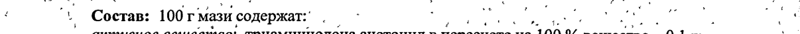
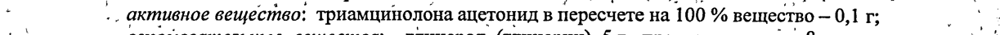
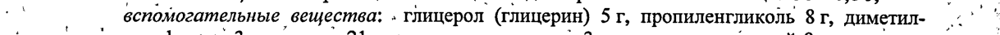
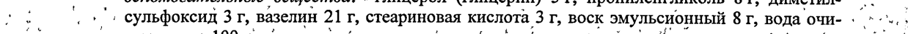
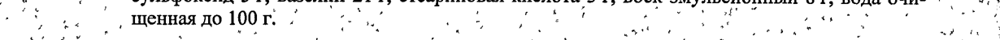
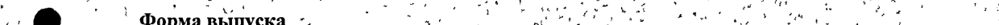
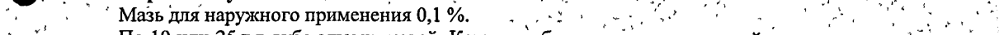
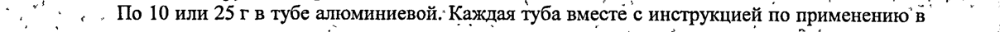

# Триамцинолона ацетонид — наружно

- Препарат: Триакорт (мазь для наружного применения;)
- АТХ: D07AB09
- Источник: ГРЛС, инструкция по медицинскому применению, РУ Р N002854/01, файл от 2023-09-28 (https://grls.rosminzdrav.ru/Grls_View_v2.aspx?routingGuid=767a924d-5b0d-4eb0-908f-7e039be4fe43)
- Распознано автоматически (OCR): 2 из 2 стр.
- Инструкция к другому РУ того же препарата: Р N002854/01 (национальное РУ, переоформленное по правилам ЕАЭС, решение от 19.09.2023). Текст может быть старше действующего
- Сомнительных строк после OCR: 8 (см. раздел «Проверка распознавания»)

## Общие сведения

_ no Poa т т a | iy P N002854/01-200312 ‘ ..
ИНСТРУКЦИЯ . ‘ и ; по медицинскому применению препарата
ТРИАКОРТ® , . , ` ‘ + . . . of . | | о » ’. Регистрационный номер: oo” om, so о
_— и Торговое название препарата: Триакорт® 7 ; 7 ot , .? И: |
| Международное непатентованное название: триамцинолон А - о
- Лекарственная форма: мазь для наружного применения И иг
‘ в Состав: 100 г мази содержат: (т еее" a a
. .. активное вещество: триамцинолона ацетонид в пересчете на 100 % вещество — 0,1 г; (о a вспомогательные вещества: » глицерол (глицерин) Sr, пропиленгликоль 8 г, диметил- ~ ° | oo. Tot, сульфоксид Зг, вазелин 21 г, стеариновая кислота 3 г, воск эмульсионный 8 г, вода очи- . ° yas
7. , Щенная до 100г. 2. ий И" on о Ommeanne ere et te и
.@. г Мазь от белого до желтовато-белого цвета. - Пн, ен
‘ ` , _ ; у .. в." my les ; +, . у О Фармакотерапевтическая группа: глюкокортикостероид для местного применения °°
‚``. KogATX:DO7ABIQ им ие > “ . 7 . , ' ' mo . . ‘ $ .
‚ ... * Фармакологическое действие‘. ’ ‚= me a pe |
- .’ . | Фторированный глюкокортикостероидный препарат, оказывает выраженное противовос- а т ‹ палительное, противоаллергическое и антиэкссудативное действие. ‹ rg ok
‘s+ + + +. Взаимодействуя co специфическим белковым рецептором в тканях-мишенях, регулирует . |
'’’ с“, Экспрессию кортикоидзависимых генов и влияет, таким образом, на синтез белка. Умень- ^^ о.’ шает образование, высвобождение и активность медиаторов воспаления (гистамина, ки- .^- et . нина, простагландинов, лизосомальных ферментов). Подавляет миграцию клеток к месту ..
-, 7 воспаления; уменьшает вазодилатацию и повышенную проницаемость сосудов в очаге: ^”. ..
``. + воспаления. Стабилизирует лизосомальные ферменты мембран лейкоцитов: подавляет `‘. a
. ‚синтез антител и нарушает распознавание антигена. Тормозит высвобождение интерлей-, ^^
"+ xwHa 1, интерлейкина 2, гамма-интерферона‘ из лимфоцитов и макрофагов. Индуцирует * |
® Г образование липокортина, угнетает высвобождение эозинофилами медиаторов воспаления `.
ww ‚. и стабилизирует мембраны тучных клеток. Все эти эффекты участвуют в подавлении вос- | я ’ ралительной реакции в тканях в ответ на механическое, химическое или иммунное повре- |...
. ^ ждение. ; a ‚. а, ae a, " r a ‚ о ` . oan a ho ` a of .

## 4.1. Показания к применению

=| ©‘. ут ОИ . + Простые и аллергические дерматиты, экзема, атопический дерматит, диффузный нейро-,. .
=| ©‘. ут ОИ . + Простые и аллергические дерматиты, экзема, атопический дерматит, диффузный нейро-,. .
. ’ дермит, псориаз, гранулема кольцевидная, красный плоский лишай, простой хронический * ~ | лишай (ограниченный нейродермит), токсидермия, келоидные ‘рубцы, гнездная алопеция,
`` полная алопеция, укусы насекомых. о и oa Coe
. Противопоказания - ° ` = mR ee re os ` Повышенная чувствительность к триамцинолону и другим компонентам препарата, бакте-
| риальные, вирусные и грибковые заболевания кожи, беременность, период лактации.

## 4.2. Способ применения и дозы

^ `” ™ i ; . .
^ `” ™ i ; . .
- Мазь наносят равномерно тонким. слоем на пораженные участки кожи 1-3 раза в день.
| Можно применять с окклюзионной повязкой при лихенифицированных проявлениях. .
| | т. о. 54184 > ‚” 1 t ` ‘. * ы + у ` ‘ ) .,
И: ть и: 4°? `Р №002854/01-200312 ›_ . , ‘ . ” 7 | - « . , 7 . , & ., 2 й “ = .,
| ’ | , Г у й . . > ‘ v 2° . ;
. Продолжительность лечения зависит от характера заболевания и эффективности терапии,
| составляя обычно 5-10 дней. При упорном течении болезни курс лечения может быть продлен до 25 дней. Не рекомендуется применение более 4 недель. |
Побочное действие me , wo, ; | Зуд, раздражение кожи, контактная экзема, стероидные угри, пурпура. ,
, ‚ * При длительном применении - развитие вторичных инфекционных поражений и трофиче- oe ских изменений кожи. * at ; А. м no |
` e e ., * й - ‚ Взаимодействие — у . , rr
`,; ‘© +. Глюкокортикостероидные препараты для перорального применения усиливают эффект. ‚.
s ‹ ‘ * i . > ; . a ‘ “4 би И” дн .

## 4.4. Особые указания

, а т ро О :
, а т ро О :
oO - ‚ '* Не рекомендуется наносить на большие поверхности; избегать длительного примененияу °’’, ‚„ a ‚ Детей независимо от возраста. .’, ` ., a
- ‘7 * * Для профилактики местных инфекционных осложнений возможно применение в сочета- ` z а 4 . „ ы В = № > t . ‹ :
и ‚ нии с противомикробными лекарственными средствами. = 6, te . ._
‘ , к Ss , . ‚’ ., a aren) ”. 2 de м 7 Stee 7, . `` , о
О + \ ы о,“ . и . , } * *s vf ра м \ 2%, ” у у ats м ’, * И oo @. | Форма выпуска *. . о. whe oe ea ee .
- ; ° Мазь для наружного применения 0,1 %. wth te . НЮ wt в fat oe ‘ gua! у
`` с. Шо 10 или 25 г в тубе алюминиевой. Каждая туба вместе с инструкцией по применению B |
‚ + Пачке из картона. ot rete pe Ин ‘ .°
| . + ‚. | . « 4 ^` | “ | у г р ` " - a | io у ` бл’ a | |
, « + ' , ® . ` , - bogs 4 a ’ Условия хранения. *, о et , a. - . И, _
| ‚ При температуре не выше 15 °С. обо Lem, о -,
' © ` > в =“ й * хе `, 5 a й > « | ‚ +, Хранить в недоступном для детей месте. toe ‘ eo о a ”. Срок годности о мо И. _ oof.
.. ‚ 4 года. Не применять по истечении срока годности. , О и
. В р ы ; . а vo? . . ‘ a= t и | А “. . “ie . у , ' . , aw whos wf _ “
‹ wy 5 vy `` $ an ‘ eon ” .
. 0... Условия отпуска из’ аптек оо par pee Без рецепта: . to res oO - 7 ae
. . 7 > са м ` . . , a ” ; t , эх . a Е , $ , й 4 ’ k р a , 4
- Производитель. Претензии принимаются по адресу, - т“ : о , ‚ :
® ‚Открытое акционерное общество «Химико-фармацевтический комбинат «АКРИХИН» °
; 142450, Московская область, Ногинский район, г. Старая Купавна, ул. Кирова, 29.” **. ‘''..
aod + щ “ oy „+ `, ;
; Телефон/факс: (495) 702-95-03. , И А т my
= ” te - , . м 4 ab . : . ob , .
у > aoe . . .‘ * . . р. Не рно в at “> , : “а , , * 5 . :
` ' ` ' ‘ 7 чи MS 7 ‘ . ‹ ‘ :
4 | . „' Os, oe MH, sete < —= р . yy, . `
; - Представитель фирмы ‘. fs р cs Tue \> . - Н.И. Юрченко '.,
В 3 = 5 , * ‘ + * + (. QAO «AKPHXHH» . Ae * AY A _ . :
п . ‘PEM а гижин-] © 27 a . | : ^ 4 + a .” . &% a 5 1 8 af . . + № , |
ЗА И и te Mn EE > pe | | , о. . ` te . Зена text’ eS oan . a р р -. > . |
. oa s . Cr ee eee , * ‘ ae M3CP PO foe . О > _ ЭКСПЕРТНЫЙ ОТЧЕТ |2 oo be INEVICTB Ae о | ЧАВЙСТВИТЕЛЕН ДЛЯ ДАННОЙ 8] ВЕРСИИ ДОКУМЕНТА |=
. о | -2.9.0000 0006~- ; . ‘ В о 5.4184 | | |
Г ` - aa a , 8 у ы у ‘ .
“ ¢ 4 . 3 7 . й . ‘ - ,
## Проверка распознавания

Страницы-сканы распознаны автоматически. В 8 строках с дозировками цифры могли распознаться с ошибкой — сверьте с вырезкой из оригинала:

- стр. 1: «‘ в Состав: 100 г мази содержат: (т еее" a a» — повторное чтение: «. | . Состав: 100 гмази содержа: | С 7 coe _ ve о a . 7 Е? — ° | | .»  
  
- стр. 1: «. .. активное вещество: триамцинолона ацетонид в пересчете на 100 % вещество — 0,1 г; (о» — повторное чтение: «И .. активное вещество: триамцинолона ацетонид в пересчете на 100 % вещество -01; ``.»  
  
- стр. 1: «a вспомогательные вещества: » глицерол (глицерин) Sr, пропиленгликоль 8 г, диметил- ~ ° |» — низкая уверенность: «8» (73)  
  
- стр. 1: «oo. Tot, сульфоксид Зг, вазелин 21 г, стеариновая кислота 3 г, воск эмульсионный 8 г, вода очи- . ° yas» — повторное чтение: «:; |, +": сульфокоид 3 г, вазелин 21 г, стеариновая кислота 3 т, воск эмульсионный 8 г, вода очи- ‹ 2...»  
  
- стр. 1: «7.  , Щенная до 100г. 2. ий И" on» — низкая уверенность: «7.» (0), «100г.» (68), «2.» (3); повторное чтение: «я | 7 : . . щенная до 1 00г. Е 7 a # о. ит Ш oar J a Г. И... ‚ . , a a | . 7 Ы»  
  
- стр. 2: «О + \ ы о,“ . и . , } * *s vf ра м \ 2%, ” у у ats м ’, * И» — низкая уверенность: «2%,» (14); повторное чтение: «° @ a) Darna atinvera ._ о _ о a oe, vi er _ ‚ _ № 7 ;. + | ue»  
  
- стр. 2: «- ; ° Мазь для наружного применения 0,1 %. wth te . НЮ» — повторное чтение: «4. 'Мазь для наружного применения 0 %. (о: о. ПИ,»  
  
- стр. 2: «`` с. Шо 10 или 25 г в тубе алюминиевой. Каждая туба вместе с инструкцией по применению B |» — повторное чтение: «oO > « . To 10 um 25 гв тубе алюминиевой. Каждая туба вместе с инструкцией по применению‘ в. _ |»  
  
