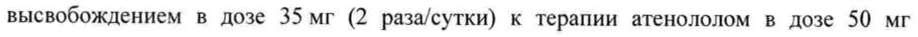

# Триметазидин — внутрь

- Препарат: Предуктал® МВ (таблетки с модифицированным высвобождением)
- АТХ: C01EB15
- Источник: ОХЛП, Единый реестр ЛС ЕАЭС, запись 5ed4df18fb66f1505043ed9d, документ от 2025-03-13
- Распознано автоматически (OCR): 13 из 13 стр.
- Сомнительных строк после OCR: 1 (см. раздел «Проверка распознавания»)

## Общие сведения

ОБЩАЯ ХАРАКТЕРИСТИКА ЛЕКАРСТВЕННОГО ПРЕНАРАТ Ay CCHR =]

## 1. Наименование лекарственного препарата

С He ( 2022 |

Предуктал MB, 35 мг, таблетки с модифицированным ВЕДЕНИЕ Оше. — пленочной оболочкой

## 2. Качественный и количественный состав

Триметазидина дигидрохлорид

Каждая таблетка с модифицированным высвобождением, покрытая пленочной оболочкой, содержит 35 мг триметазидина дигидрохлорида.

Полный перечень вспомогательных веществ представлен в разделе 6.1.

-

## 3. Лекарственная форма

Таблетки с модифицированным высвобождением, покрытые пленочной оболочкой.
Круглые, двояковыпуклые таблетки, покрытые пленочной оболочкой розового цвета.

## 4. Клинические данные

## 4.1. Показания к применению

Триметазидин показан к применению у взрослых пациентов в качестве дополнительной терапии для симптоматического лечения стабильной стенокардии при неадекватном контроле или непереносимости антиангинальной терапии первой линии.

## 4.2. Режим дозирования и способ применения

© Режим дозирования Внутрь.
Дозировка составляет | таблетку 2 раз в сутки, утром и вечером, во время еды.
Оценка пользы от лечения должна быть проведена после трех месяцев приема препарата.
Прием триметазидина следует прекратить, если за это время улучшение не наступило.
Особые группы пациентов Пациенты с нарушением функции почек
У пациентов с умеренным нарушением функции почек (клиренс креатинина 30-60 мл/мин) (см. разделы 4.4 и 5.2) рекомендуется снижение дозы наполовину, т.е. по | таблетке, содержащей 35 мг триметазидина, утром во время завтрака.
Пациенты пожилого возраста | 147644 У пациентов пожилого возраста может наблюдаться повышение экспозиции триметазидина из-за возрастного снижения функции почек (см. раздел 5.2). У пациентов с умеренным нарушением функции почек (клиренс креатинина 30-60 мл/мин)
рекомендуемая доза составляет | таблетку, содержащую 35 мг триметазидина, утром во время завтрака. Подбор дозы у пациентов пожилого возраста должен проводиться с осторожностью (см. раздел 4.4).
Дети Безопасность и эффективность применения триметазидина у пациентов младше 18 лет не установлены. Данные отсутствуют.
Способ применения Лекарственный препарат Предуктал МВ следует принимать внутрь по 1 таблетке 2 раз в с сутки, утром и вечером, во время еды.

## 4.3. Противопоказания

® Гиперчувствительность к действующему веществу или к любому из вспомогательных веществ, перечисленных в подразделе 6.1.
¢ Болезнь Паркинсона, симптомы паркинсонизма, тремор, синдром «беспокойных ног» и другие связанные с ними двигательные нарушения.
® _ Тяжелая почечная недостаточность (клиренс креатинина < 30 мл/мин).
® Период беременности и кормления грудью.

## 4.4. Особые указания и меры предосторожности при применении

| Лекарственный препарат Предуктал МВ не предназначен для купирования приступов
- стенокардии и не показан для начального курса терапии нестабильной стенокардии или инфаркта миокарда на догоспитальном этапе или в первые дни госпитализации.
В случае развития приступа стенокардии следует вновь оценить степень поражения коронарных артерий и, при необходимости, адаптировать лечение (лекарственную терапию или возможное проведение процедуры реваскуляризации).
Триметазидин может вызывать или ухудшать симптомы паркинсонизма (тремор, акинезию, повышение тонуса), поэтому следует проводить регулярное наблюдение пациентов, особенно пожилого возраста. В сомнительных случаях пациенты должны быть направлены к неврологу для соответствующего обследования.
При появлении двигательных нарушений, таких как симптомы паркинсонизма, синдром

«беспокойных ног», тремор, неустойчивость походки, триметазидин следует

окончательно отменить.

Такие случаи редки и симптомы обычно проходят после прекращения терапии.

У большинства пациентов симптомы проходят в течение 4 месяцев после отмены

триметазидина. Если симптомы паркинсонизма сохраняются более 4 месяцев после

отмены препарата, следует проконсультироваться у невролога.

Могут отмечаться случаи падения, связанные с неустойчивостью походки или

артериальной гипотензией, особенно у пациентов, принимающих антигипертензивные

препараты (см. раздел 4.8).

Следует с осторожностью назначать триметазидин пациентам, у которых возможно
©. повышение его экспозиции:

© принарушении функции почек умеренной степени тяжести (см. разделы 4.2 и 5.2),

© упожилых пациентов старше 75 лет (см. раздел 4.2).

## 4.5. Взаимодействие с другими лекарственными препаратами и другие виды взаимодействия

взаимодействия,

Не было выявлено взаимодействий с другими лекарственными препаратами.

## 4.6. Фертильность, беременность и лактация

Беременность

Данные о применении триметазидина у беременных отсутствуют. Исследования с

участием животных не выявили наличие прямого или непрямого негативного влияния в
& отношении репродуктивной функции (см. раздел 5.3). В качестве меры

предосторожности предпочтительно избегать применения триметазидина во время

беременности.

Кормление грудью

Данные о выделении триметазидина в грудное молоко отсутствуют. Риск для

новорожденного/ребенка не может быть исключен. Лекарственный препарат Предуктал

МВ не следует использовать в период грудного вскармливания.

Фертильность

Изучения репродуктивной токсичности показали отсутствие влияния на фертильность у

крыс обоего пола (см. раздел 5.3).

4.7. Влияние на способность управлять транспортными средствами и работать с механизмами.
В ходе клинических исследований не было выявлено влияния триметазидина на показатели гемодинамики, однако в период пострегистрационного применения наблюдались случаи головокружения и сонливости (см. раздел 4.8), что может повлиять на способность управлять транспортными средствами и работать с механизмами.

## 4.8. Нежелательные реакции

В таблице | представлен перечень нежелательных реакций, которые были выявлены в ходе клинических исследований.
Количественные критерии частоты нежелательных реакций и классификация
G нежелательных реакций в соответствии с системно-органной классификацией и с частотой их возникновения (Определение частоты побочных явлений проводится в соответствии со следующими критериями: очень часто (> 1/10), часто (> от 1/100 до
< 1/10), нечасто (> от 1/1000 до < 1/100), редко (> 1/10000 до < 1/1000), очень редко (< 1/10000), неизвестно (невозможно оценить на основании имеющихся данных).
Таблица 1: Перечень нежелательных реакций
Системно-органный класс Нежелательные Частота
ИИ = ae Часто боль | Симптомы паркинсонизма
© (тремор, акинезия, повышение тонуса), неустойчивость походки,
Нарушения со стороны нервной синдром «беспокойных
Частота неизвестна системы ног», другие связанные с ними двигательные нарушения, обычно обратимые после прекращения терапии тени
Частота неизвестна (бессонница, сонливость)
Нарушения со стороны органа Частота неизвестна Вертиго слуха и лабиринтные нарушения
Ощущение сердцебиения, Нарушения со стороны сердца Редко экстрасистолия, тахикардия
Артериальная гипотензия, ортостатическая гипотензия, которая может сопровождаться общим недомоганием,
Нарушения со стороны сосудов Редко головокружением или
© \ падением, особенно при одновременном приеме антигипертензивных препаратов, «приливы»
крови к коже лица Боль в животе, диарея,
Нарушения со стороны желудочно- Часто диспепсия, тошнота и кишечного тракта рвота
Кожная сыпь, кожный зуд, Часто крапивница
Нарушения со стороны кожи и Острый генерализованный ew подкожных тканей экзантематозный пустулез
Частота неизвестна (ОГЭП), ангионевротический отек
Общие расстройства и нарушения в Часто Астения месте введения
Агранулоцитоз, Нарушения со стороны крови и тромбоцитопения,
Частота неизвестна лимфатической системы тромбоцитопеническая пурпура
Нарушения со стороны печени и Частота неизвестна Гепатит желчевыводящих путей
Сообщение 0 подозреваемых нежелательных реакциях
Важно сообщать о подозреваемых нежелательных реакциях после регистрации лекарственного препарата с целью обеспечения непрерывного мониторинга соотношения «польза - риск» лекарственного препарата. Медицинским работникам рекомендуется сообщать о подозреваемых нежелательных реакциях лекарственного препарата через национальные системы сообщения о нежелательных реакциях государств — членов Евразийского экономического союза.
Республика Казахстан 010000, г. Нур-Султан, район Алматы, пр. Бауыржана Момышулы, 2/3

©. РГП на ПХВ «Национальный центр экспертизы лекарственных средств и медицинских изделий» Комитета медицинского и фармацевтического контроля Министерства здравоохранения Республики Казахстан
Тел.: +7 (7172) 78 99 11 Эл. почта: farm@dari.kz http://www.ndda.kz
Кыргызская Республика 720044, г. Бишкек, ул. 3-я Линия, 25
Департамент лекарственного обеспечения и медицинской техники при Министерстве
Здравоохранения Кыргызской Республики Тел.: +996 (312) 21 92 78

~ Эл. почта: dlomt@pharm.kg http://pharm.kg
Республика Армения 0051, г. Ереван, пр. Комитаса, 49/4
АОЗТ «Научный центр экспертизы лекарств и медицинских технологий им. академика
Э. Габриеляна»
Тел.: (+374 10) 231682, 230896, 234732, 232091
Факс: (+374 10) 232118, 232942 Телефон горячей линии отдела мониторинга безопасности лекарственных средств:
(+374 10) 200505, (+374 96) 220505

Эл. почта: admin@pharm.am, vigilance@pharm.am http://pharm.am
Республика Беларусь 220037, г. Минск, Товарищеский пер., 2a
УП «Центр экспертиз и испытаний в здравоохранении»
Тел.: +375 (17) 299 55 14 Факс: +375 (17) 299 53 58
Телефон отдела фармаконадзора: + 375 (17) 242 00 29
Эл. почта: rceth@rceth.by. repl@rceth.by http://www.rceth.by
® Российская Федерация 109074, г. Москва, Славянская площадь, д. 4, стр. 1
Федеральная служба по надзору в сфере здравоохранения
Тел.: +7 (495) 698 45 38, +7 (499) 578 02 30
Эл. почта: npr@roszdravnadzor.ru https://roszdravnadzor.gov.ru/

## 4.9. Передозировка

Имеется лишь очень ограниченная информация о передозировке триметазидина. В случае передозировки следует проводить симптоматическую терапию.
© 5. MAPMAKOJIOPHYECKHE СВОЙСТВА

## 5.1. Фармакодинамические свойства

Фармакотерапевтическая группа: Кардиологические препараты. Кардиологические препараты другие. Триметазидин
Код АТХ С01ЕВ15 5.1.1. Механизм действия
Сохраняя энергетический метаболизм клеток, подверженных гипоксии или ишемии, триметазидин предотвращает снижение внутриклеточной концентрации аденозинтрифосфата (АТФ), тем самым обеспечивая нормальное функционирование мембранных ионных каналов и трансмембранный перенос ионов калия и натрия при сохранении клеточного гомеостаза.
Триметазидин ингибирует р-окисление жирных кислот за счет блокировки длинноцепочечной 3-кетоацил-КоА-тиолазы, которая усиливает окисление глюкозы. В ишемически поврежденной клетке энергия, полученная во время окисления глюкозы, требует меньшего потребления кислорода, чем в процессе В-окисления. Потенцирование окисления глюкозы оптимизирует клеточные энергетические процессы, тем самым поддерживая надлежащий энергетический обмен при ишемии.
5.1.2. Фармакодинамические эффекты У пациентов с ишемической болезнью сердца триметазидин действует как метаболический агент, сохраняя уровни высокоэнергетического фосфата в клетках миокарда. — Антиишемический эффект достигается без сопутствующих гемодинамических эффектов.

© 5.1.3. Клиническая эффективность и безопасность
Результаты проведенных клинических исследований подтвердили эффективность и безопасность применения триметазидина у пациентов со стабильной стенокардией как в монотерапии, так и в тех случаях, когда эффект других антиангинальных лекарственных препаратов был недостаточным.
В двойном слепом, плацебо-контролируемом исследовании с участием 426 пациентов
(TRIMPOL-II) добавление триметазидина (60 мг/сутки) к терапии метопрололом 100 мг/сут (50 мг 2 раза в сутки) в течение 12 недель статистически достоверно улучшило результаты нагрузочных тестов и клинические симптомы по сравнению с плацебо:
общую длительность нагрузочных тестов (+20,1с, р=0,023), общее время выполнения нагрузки (+0,54 METs, р=0,001), время до развития депрессии сегмента ST на 1 мм (+33.4

_ с, р-0,003), время до развития приступа стенокардии (+33.9 с, p<0,001), количество

w приступов стенокардии в неделю (-0,73, р=0,014) и потребление нитратов короткого действия в неделю (-0,63, р=0,032), без гемодинамических изменений.
В двойном слепом, плацебо-контролируемом исследовании с участием 223 пациентов
(Sellier) добавление триметазидина в форме таблетки с модифицированным высвобождением в дозе 35 мг (2 раза/сутки) к терапии атенололом в дозе 50 мг
(1 раз/сутки) в течение 8 недель приводило к увеличению времени до развития ишемической депрессии сегмента ST на 1мм (+34,4 с, р=0,03) при проведении нагрузочных тестов в подгруппе пациентов (n=173), по сравнению с плацебо, через 12 часов после приема препарата. Эта разница была также показана и для времени развития приступов стенокардии (р=0,049). Не выявлено достоверных различий между группами

для других вторичных конечных точек (общая длительность нагрузочных тестов, общее

время нагрузки и клинические конечные точки).

В трехмесячном рандомизированном, двойном слепом исследовании (Vasco) с участием

1962 пациентов триметазидин в двух дозировках (70 мг/сутки и 140 мг/сутки) в

сравнении с плацебо был добавлен к терапии атенололом 50 мг/сутки. В общей

популяции, включая пациентов как без симптомов, так и с симптомами стенокардии,

триметазидин не продемонстрировал преимуществ по эргометрическим (общая

длительность нагрузочных тестов, время до наступления ишемической депрессии

сегмента ST на | мм и время до развития приступа стенокардии) и клиническим

конечным точкам. Однако при ретроспективном анализе в подгруппе пациентов с

симптомами стенокардии (п=1574) было показано, что триметазидин (140 мг)
©. значительно улучшил общее время нагрузочного теста (+23,8 с по сравнению с +13,1 с

для плацебо; p=0,001) и время до развития приступа стенокардии (+46,3 с по сравнению

с +32,5 для плацебо; р=0,005).

5.1.4. Дети

Предуктал МВ не проходил изучения у одной или нескольких подгрупп детей. См.

раздел 4.2. по применению у детей.

## 5.2. Фармакокинетические свойства

5.2.1. Абсорбция

После приема внутрь триметазидин достигает максимальной концентрации в плазме

крови приблизительно через 5 часов. Свыше 24 часов концентрация в плазме крови

остается на уровне, превышающем или равном 75 % концентрации, определяемой через
~ 1] часов.

Равновесное состояние достигается не позднее чем через 60 часов.

Прием пищи не влияет на фармакокинетику триметазидина при приеме лекарственного

препарата Предуктал МВ.

5.2.2. Распределение

Объем распределения составляет 4,8 л/кг; степень связывания с белками плазмы крови

низкая (около 16 % in vitro).

5.2.3. Выведение

Триметазидин выводится в основном почками, главным образом, в неизмененном виде.

Период полувыведения составляет около 7 ч у молодых здоровых добровольцев и около

12 ч-у пациентов пожилого возраста (старше 65 лет).

Общий клиренс триметазидина главным образом состоит из почечного клиренса, который прямо коррелирует с клиренсом креатинина, и в менышей степени из печеночного клиренса, который снижается с возрастом пациента.

5.2.4. Особые группы пациентов

Пациенты пожилого возраста

У пациентов пожилого возраста может наблюдаться повышенная экспозиция триметазидина из-за возрастного снижения функции почек. Специальное фармакокинетическое исследование с участием пожилых пациентов (75-84 лет) или очень пожилых (> 85 лет) пациентов, показало, что умеренное нарушение функции почек
(клиренс креатинина от 30 до 60 мл/мин) повышало экспозицию триметазидина в 1,0 и 1,3 раза, соответственно, по сравнению с более молодыми пациентами (30-65 лет) с

© умеренным нарушением функции почек.

Специальное клиническое исследование, проведенное в популяции пациентов пожилого возраста (старше 75 лет) с применением триметазидина (в форме таблетки с модифицированным высвобождением, содержащей 35 мг триметазидина) в дозе по 2 таблетки в сутки (в 2 приема), показало в среднем двукратное повышение экспозиции в плазме крови у пациентов с тяжелой почечной недостаточностью (клиренс креатинина ниже 30 мл/мин) по сравнению с пациентами с клиренсом креатинина выше 60 мл/мин.
Не было выявлено каких-либо проблем в отношении безопасности у пациентов старше 75 лет по сравнению с общей популяцией.

Пациенты с нарушением функции почек

Экспозиция триметазидина в среднем была увеличена в 1,7 раз у пациентов с умеренным нарушением функции почек (клиренс креатинина от 30 до 60 мл/мин), и в среднем в 3,1

w раза — у пациентов с тяжелой почечной недостаточностью (клиренс креатинина ниже 30

мл/мин) по сравнению со здоровыми добровольцами с нормальной функцией почек.

Не было выявлено каких-либо проблем в отношении безопасности у этой популяции пациентов по сравнению с общей популяцией.
Дети

Фармакокинетика триметазидина у детей и подростков в возрасте до 18 лет не изучалась.
5.3. Данные доклинической безопасности.

Исследования хронической токсичности при пероральном пути введения у собак (от 5 до 40 мг*кг"*д") и крыс (от 5 до 200 мг*кг\*д“) показали хороший профиль безопасности.

Ни эмбриофетотоксический эффект, ни тератогенность не были обнаружены у мышей и кроликов. Общее исследование репродуктивной функции и эмбриогенеза у 3 поколений крыс не выявило аномалий.
Генотоксический потенциал был тщательно изучен в исследованиях in vitro, включая оценку мутагенного и кластогенного потенциала, и в одном исследовании in vivo. Все тесты были отрицательными.

## 6. Фармацевтические свойства

6.1. Перечень вспомогательных веществ.
Ядро таблетки Кальция гидрофосфата дигидрат я Гипромеллоза 4000
Магния стеарат Повидон Кремния диоксид коллоидный безводный
Сухой премикс для розовой оболочки:
Глицерол Макрогол 6000 Магния стеарат Гипромеллоза
Краситель железа оксид красный (Е 172)
Титана диоксид (Е 171)
Полировка Макрогол 6000

## 6.2. Несовместимость

Не применимо.

## 6.3. Срок годности (срок хранения)

3 года.
6.4. Особые меры предосторожности при хранении.
1] Хранить при температуре не выше 30 °С.
6.5. Характер и содержание первичной упаковки
По 30 таблеток в блистер (ПВХ/Ал). По 2 блистера с листком-вкладышем в пачку картонную, с контролем первого вскрытия (при необходимости).
6.6. Особые меры предосторожности при уничтожении использованного лекарственного препарата или отходов, полученных после применения лекарственного препарата или работы с ним.
Нет особых требований к утилизации.
Весь оставшийся лекарственный препарат и отходы следует уничтожить в
© установленном порядке.

## 7. Держатель регистрационного удостоверения

Франция “Лаборатории Сервье” / Les Laboratoires Servier 92284 Франция, Сюрен Седекс, ул. Карно 50 / 50 rue Carnot, 92284 Suresnes Cedex,
France
7.1. ПРЕДСТАВИТЕЛЬ ДЕРЖАТЕЛЯ РЕГИСТРАЦИОННОГО
УДОСТОВЕРЕНИЯ Претензии потребителей направлять по адресу:
Российская Федерация Республика Казахстан и Кыргызская
© AO “Сервье” Республика Адрес: 125196, г. Москва, ул. Лесная, ТОО “Сервье Казахстан” дом 7, этаж 7/8/9 Адрес: 050020, г. Алматы, пр. Достык
Тел.: +7 (495) 937 07 00 3100 Факс: +7 (495) 937 07 01 Тел.: +7 (727) 386 76 62
Республика Беларусь Республика Армения Представительство YAO “Les Представительство “Лаборатории
Laboratoires Servier” (Французская Сервье”
Республика) в Республике Беларусь Адрес: 0001, г. Ереван, Северный проспект 1, бизнес центр “Норд”
Адрес: 220030, г. Минск. ул. Мясникова, Тел.: (+374 10) 505074 70, оф. 303
Тел.: +375 (17) 306 54 55 8 — НОМЕР РЕГИСТРАЦИОННОГО УДОСТОВЕРЕНИЯ

## 9. Дата первичной регистрации

(ПОДТВЕРЖДЕНИЯ

РЕГИСТРАЦИИ, ПЕРЕРЕГИСТРАЦИИ)
Дата первичной регистрации:
10. ДАТА ПЕРЕСМОТРА ТЕКСТА
©. #<{MM/TTTT}> <{ДДИММЛТГГГ}> <{ДД месяц ГГГГ}>#
Общая характеристика лекарственного препарата Предуктал МВ доступна на информационном портале Евразийского экономического союза в информационнокоммуникационной сети «Интернет» http://www.eurasiancommission.org.
13 = 147644
## Проверка распознавания

Страницы-сканы распознаны автоматически. В 1 строках с дозировками цифры могли распознаться с ошибкой — сверьте с вырезкой из оригинала:

- стр. 8: «высвобождением в дозе 35 мг (2 раза/сутки) к терапии атенололом в дозе 50 мг» — низкая уверенность: «35» (42)  
  
