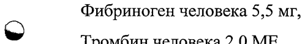
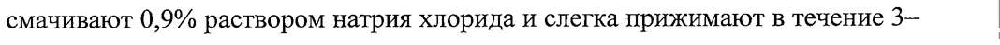

# Тромбин человека + Фибриноген человека — прочее

- Препарат: Тахокомб® (губка;)
- АТХ: B02BC30
- Источник: ГРЛС, инструкция по медицинскому применению, РУ П N012888/01, файл от 2025-05-07 (https://grls.rosminzdrav.ru/Grls_View_v2.aspx?routingGuid=3d3fe6bb-7441-45f7-8abb-a6aeac7eeb7c)
- Распознано автоматически (OCR): 13 из 13 стр.
- Инструкция к другому РУ того же препарата: П N012888/01 (национальное РУ, переоформленное по правилам ЕАЭС, решение от 21.04.2025). Текст может быть старше действующего
- Сомнительных строк после OCR: 2 (см. раздел «Проверка распознавания»)

## Общие сведения

МИНИСТЕРСТВО ЗДРАВООХРАНЕНИЯ РОССИЙСКОЙ ФЕДЕРАЦИИ
ИНСТРУКЦИЯ | | по медицинскому применению лекарственного препарата
| Тахокомб® Регистрационный номер: IT №012888/01
© Торговое наименование.
Тахокомб® Группировочное наименование фибриноген + тромбин

## 3. Лекарственная форма

Губка | Состав | 1 см? губки содержит:
Губка | Состав | 1 см? губки содержит:
Действующие вещества:
о Фибриноген человека 5,5 мг, Тромбин человека 2,0 МЕ. |
Вспомогательные вещества: _ | Альбумин человека около 2,9 мг |
Г.-аргинина гидрохлорид около 2,8 мг Коллаген лошадиный 2,1 мг
Натрия хлорид около 1,5 мг | ‚ Натрия цитрат | | около 0,4 мг | | |
Рибофлавин 18,2 мкг | С.2 Описание Губка почти белого цвета с желтым покрытием на одной стороне или
| скрученная губка почти белого цвета с желтым покрытием на внешней стороне.
| Фармакотерапевтическая группа: гемостатическое средство для местного применения. |
Код ATX: BO2BC30 Фармакологические свойства | |

## 5.1. Фармакодинамика

| Препарат Taxoxom6® содержит фибриноген и тромбин в виде сухого покрытия
| Препарат Taxoxom6® содержит фибриноген и тромбин в виде сухого покрытия
“> поверхности коллагеновой губки.
При контакте с физиологическими жидкостями (кровью, лимфой или растворами электролитов) компоненты покрытия губки растворяются и частично диффундируют на раневую поверхность. Это сопровождается реакцией фибриногена и тромбина, инициирующей последнюю фазу физиологического свертывания крови.
Фибриноген превращается в фибрин-мономер, который затем спонтанно полимеризуется с образованием фибринового сгустка (тромба), плотно удерживающего коллаген губки на поверхности раны. С помощью фактора
© свёртывания крови ХШ происходит сшивание фибрин-полимеров с формированием твердой, механически прочной сетчатой структуры с хорошими адгезивными свойствами, что обеспечивает надежное закрытие
| раны. | Клинические исследования (КИ), продемонстрировавшие гемостаз, были
| проведены с участием в общей сложности 240 пациентов (119 пациентов в
. группе применения препарата Тахокомб®, 121 — в группе применения .
аргонолучевой терапии), перенесших операцию по частичной резекции печени, и 185 пациентов (92 пациента в группе применения препарата
Тахокомб®, 93 пациента в группе стандартного хирургического лечения), подвергшихся хирургической резекции поверхностной опухоли почки. Также
| | | | | C.3 было проведено контролируемое КИ с участием П9нациентов (62 нациентав
| группе применения препарата Тахокомб®, 57 пациентов в группе применения
| гемостатического флиса), которое продемонстрировало герметичность, гемостаз и поддержку швов у пациентов, перенесших операции на сердечно-
| сосудистой системе.
Эффективность препарата Тахокомб® была изучена в рандомизированном контролируемом КИ у 726 пациентов (362 пациента в группе применения препарата Тахокомб® и 364 пациента в контрольной группе), перенесших операцию на основании черепа в качестве дополнения ко шву для герметизации твердой мозговой оболочки. Эффективность определяли после
> операции по верифицированным утечкам спинномозговой жидкости, или псевдоменингоцеле, или неэффективности лечения во время операции.
Результаты КИ показали, что эффективность применения препарата
Тахокомб® была схожа с эффективностью применения стандартной терапии,
| включающей наложение швов, пластические операции на твердой мозговой оболочке, фибриновые и полимерные герметики или их комбинации. В данном исследовании применяли две’ техники нанесения препарата Тахокомб®:
нанесение препарата Тахокомб® на наружную сторону твердой мозговой | оболочки и нанесение препарата Тахокомб® с обеих сторон твердой мозговой
© оболочки. Одобрение получила только первая техника применения препарата.
Препарат Тахокомб® хоропю переносится и безопасен для применения в качестве дополнения к герметизации твердой. мозговой оболочки в нейрохирургии.
Дети Данные, подтверждающие эффективность и безопасность применения препарата Тахокомб® у.детей, ограничены. В КИ в общей сложности у 36 педиатрических пациентов в возрасте от 0 до 13 лет применяли препарат
| Тахокомб® при операциях на печени. Одно исследование было досрочно
| прекращено после включения в него 16 из 40 запланированных пациентов.
| | | C4 | _ В следующем КИ 8 педиатрических пациентов были включены в грунну | сравнительного анализа, дополнительные 12 пациентов - в открытую фазу.
Данные об иммуногенности отсутствуют.

## 5.2. Фармакокинетика

| Препарат Тахокомб® предназначен только для местного применения.
| Препарат Тахокомб® предназначен только для местного применения.
Внутрисосудистое введение противопоказано. Поэтому внутрисосудистые фармакокинетические исследования у человека не проводили.
Фибриновые губки/гемостатические продукты метаболизируются путем.
фибринолиза и фагоцитоза так же, как эндогенный фибрин. |
В исследованиях на животных биодеградация препарата Тахокомб® до
~ следового содержания после нанесения На раневую поверхность происходит за 13 недель. Полную деградацию препарата Тахокомб® отмечали у некоторых животных через 12 месяцев после его нанесения на рану печени, в то время
_ _ каку других животных все еще наблюдались небольшие следовые количества.
Деградация препарата была связана с инфильтрацией гранулоцитами и образованием резорбтивной грануляционной ткани, инкапсулирующей следы губки с препаратом Taxoxom6®. В исследованиях на животных не было | выявлено признаков местной непереносимости.
Из опыта применения препарата у людей получены данные о единичных о случаях обнаружения следов губки в качестве случайной находки без признаков нарушения функции.

## 4.1. Показания к применению

Препарат Тахокомб® показан:
Препарат Тахокомб® показан:
- для вспомогательного применения у взрослых и детей с 1 месяца при
’ хирургических вмешательствах с целью улучшения гемостаза, обеспечения соединения тканей, а также для укрепления швов в сосудистой хирургии тогда, когда результаты стандартных методов недостаточны.
- для улучшения герметизации твердой мозговой оболочки с целью профилактики ликвореи после нейрохирургических вмешательств.
| (om Противопоказания _ | Препарат Тахокомб® нельзя применять внутрисосудисто.
Гиперчувствительность к действующим веществам или к любому из вспомогательных веществ. |

## 4.6. Применение при беременности и в период грудного вскармливания

_ Безопасность препарата Тахокомб® при применении во время беременности и грудного вскармливания не изучали в контролируемых клинических исследованиях. Результаты экспериментальных исследований на животных не достаточны для оценки безопасности в отношении репродуктивной функции, развития эмбриона или плода, течения беременности и пери- и постнатального
& развития. | | Поэтому в период беременности и грудного вскармливания препарат следует применять только в случаях, когда ожидаемая польза терапии для матери
| превыптает потенциальный риск для плода или ребенка.

## 4.2. Способ применения и дозы

| Препарат Тахокомб® может применяться только квалифицированными хирургами. -
| Препарат Тахокомб® может применяться только квалифицированными хирургами. -
Только для местного применения. Не применять внутрисосудисто.
Способ применения © Препарат Тахокомб® находится в стерильной упаковке и готов к применению.
_ Может применяться препарат только из неповрежденной упаковки.
После вскрытия упаковки повторная стерилизация препарата Тахокомб® невозможна. Наружный упаковочный алюминиевый пакет может быть вскрыт в нестерильной зоне операционной. Внутренний стерильный блистер следует вскрывать в стерильной зоне. | |
Препарат.Тахокомб® должен быть применен сразу после вскрытия внутренней стерильной упаковки.
Препарат Тахокомб® следует применять в стерильных условиях. Перед .
наложением губки раневая поверхность должна быть очищена от крови, дезинфицирующих и других жидкостей.
| С.6 После извлечения плоской губки с препаратом Тахокомб® `из внутренней стерильной упаковки губку следует смочить 0,9% раствором натрия хлорида и применить немедленно.
Сторону, покрытую активными веществами и помеченную желтым цветом, накладывают на раневую поверхность, при необходимости дополнительно смачивают 0,9% раствором натрия хлорида и слегка прижимают в течение 3— | 5 минут. Процедура обеспечивает легкое приклеивание губки с препаратом
Тахокомб® к раневой поверхности.
После извлечения скрученной губки с препаратом Тахокомб® из внутренней стерильной упаковки ее следует наложить немедленно через троакар без
> предварительного увлажнения. При раскручивании губку накладывают стороной желтого цвета, покрытой активными веществами, на раневую поверхность с помощью пинцета и слегка прижимают влажной салфеткой в течение 3—5 минут. Это создает условия для улучшения склеивания препарата
Тахокомб® с раневой поверхностью.
Прижимание осуществляют увлаженными перчатками или влажной салфеткой. В связи с сильным сродством коллагена к крови губка с препаратом
Тахокомб® может также прилипать к инструментам, перчаткам или прилегающим тканям, покрытым кровью. Этого можно избежать путем
© очищения хирургических инструментов, перчаток и прилегающих тканей перед наложением губки. Следует отметить, что невозможность в достаточной мере очистить прилегающие ткани может привести к спайкам. По окончании прижимания губки с препаратом Тахокомб® к ране следует аккуратно убрать перчатку или салфетку. Во избежание отставания губки от поверхности она может быть удержана на месте за один конец, например, с помощью пинцета.
В другом случае, например, при более сильном. кровотечении, можно наложить губку с препаратом Тахокомб® без предварительного увлажнения, при этом также с легким прижиманием губки к раневой поверхности в течение 3—5 минут. |
C.7 Активная сторона губки с mpemapatoM-Taxoxomo® должна накладываться с
| выступанием на 1—2 см за края раны. В случае применения более одной губки, при наложении на рану края губок должны перекрывать друг друга. Губку с препаратом Тахокомб® можно резать для получения желаемого размера и формы, если она слишком большая.
| При нейрохирургических операциях препарат Тахокомб® следует наносить поверх первичного закрытия твердой мозговой оболочки.
a Скрученная губка с препаратом Тахокомб® может применяться и при открытых, и при минимально инвазивных вмешательствах, ее можно провести
| через порт или троакар диаметром 10 мм или больше.
& Любой неиспользованный продукт или отходы должны быть утилизированы в соответствии с местными требованиями.
Режим дозирования | Количество применяемого препарата Тахокомб® всегда должно соответствовать основной клинической потребности пациента. Количество
| применяемого препарата Тахокомб® зависит от размера области раны и должно быть индивидуально подобрано лечащим хирургом.
В КИ индивидуальные дозы обычно составляли от 1 до 3 губок (9,5 cm x 4,8 см); сообщалось о применении до 10 губок. Для ран небольшого размера,
© например при минимально инвазивных вмешательствах, рекомендуется использовать губки меньшего размера (4,8 см х 4,8 см или 3,0 смх 2,5 см) или скрученные губки (на основе губки 4,8 см x 4,8 см).
| Побочное действие | В редких случаях у пациентов, у которых ранее применялись фибриновые губки/гемостатические продукты, могут возникнуть реакции — гиперчувствительности или аллергические реакции, которые могут включать
_ ангионевротический отек, ощущения жжения и покалывания в месте применения, бронхоспазм, озноб, покраснение кожи, крапивницу (в том числе генерализованные формы), головную боль, гипотензию, заторможенность, тошноту, беспокойство, тахикардию, чувство сдавленности в грудной клетке,
| С. 8:
ощущение покалывания, рвоту, свистящее дыхание. В-единичных случаях эти реакции могут прогрессировать до тяжелого анафилактического шока.
Подобные реакции могут в первую очередь наблюдаться при повторном применении препарата или при применении у пациентов с известной гиперчувствительностью к компонентам препарата. .

Иммуногенность: | Появление антител к компонентам фибриновых губок/гемостатических продуктов происходит редко.
‚ В To же время в клиническом исследовании препарата Тахокомб® при
° хирургических вмешательствах на печени, в котором изучалось образование |
© антител у пациентов, у 26% из 96 пациентов, получавших препарат Тахокомб®, было отмечено появление антител к коллагену из лошадиных сухожилий. |
Антитела к коллагену из лошадиных сухожилий, которые образуются у | некоторых пациентов после применения препарата Тахокомб®, не реагировали с человеческим коллагеном. У одного пациента появились антитела к человеческому фибриногену.
| Не было выявлено нежелательных явлений, обусловленных образованием антител к человеческому фибриногену или коллагену из лошадиных сухожилий.
© Клинические данные в отношении повторного воздействия препарата
Тахокомб® крайне ограничены. При повторном применении препарата у двух пациентов во время КИ не сообщалось о каких-либо иммуноопосредованных нежелательных явлениях; в то же время их статус по антителам к коллагену или фибриногену неизвестен.
В случае внутрисосудистого применения препарата могут возникать a тромбоэмболические осложнения.
Сообщалось о нескольких случаях, когда остатки препарата могли вызвать реакцию на инородное тело в виде гранулемы. |
С.9 Данные по безопасности препарата Тахокомб®, как правило, отражают вид | послеоперационных осложнений, связанных с хирургической ситуацией, в которой были проведены исследования, и первичной патологией пациентов.
Данные восьми контролируемых КИ были объединены в единую базу данных безопасности. В объединенных КИ 997 пациентов получали терапию препаратом Taxoxom6®, а 984 пациента — препаратом сравнения. Проведение исследований препарата Тахокомб® слепым методом не представлялось
| возможным в силу практических причин (сравнения со стандартной
| хирургической и гемостатической терапией). В связи с этим КИ были выполнены как открытые исследования.
“> | Классификация нежелательных реакций (НР) по частоте развития:
`очень часто (>1/10); часто (>1/100, <1/10); не часто (>1/1000, <1/100); редко
(>1/10 000, <1/1 000); очень редко (1/10 000, включая отдельные сообщения);
частота неизвестна (невозможно оценить на основе имеющихся данных).
Нарушения со стороны иммунной системы | Частота неизвестна: анафилактический шок, гиперчувствительность.
Нарушения со стороны сосудов Частота неизвестна: тромбоз.
© Нарушения со стороны желудочно-кишечного. тракта:
Частота неизвестна: обтурационная кишечная непроходимость (при.
операциях на органах брюшной полости).
Общие расстройства и нарушения в месте применения: |
: Частота неизвестна: спайки, образование гранулемы инородного тела.
| Передозировка Данные о случаях передозировки отсутствуют.

## 4.5. Взаимодействие с другими лекарственными средствами

Исследования взаимодействия не проводили.
Компоненты препарата могут изменять свои свойства при одновременном | применении с растворами этанола, йода или тяжелых металлов (например,
| ET С. 10 ’ антисептические растворы). Подобные вещества должны быть тщательно
| удалены перед применением препарата.

## 4.4. Особые указания

Отслеживаемость | При каждом применении препарата Тахокомб® настоятельно рекомендуется записывать название и номер серии препарата для того, чтобы сохранить связь между пациентом и серией препарата.
Отслеживаемость | При каждом применении препарата Тахокомб® настоятельно рекомендуется записывать название и номер серии препарата для того, чтобы сохранить связь между пациентом и серией препарата.
| Только для местного применения. | Не применять внутрисосудисто. При внутрисосудистом применении препарата могут возникать угрожающие жизни тромбоэмболические
% осложнения.
Не было получено специальных данных по применению данного препарата при операциях с формированием желудочно-кишечных анастомозов. |
Неизвестно, влияет ли современная’ лучевая терапия на эффективность препарата Тахокомб® при) применении для герметизации твердой мозговой
| оболочки.
| Возможно возникновение реакций гиперчувствительности, как и в случае с
— любым белковым препаратом. Симптомы реакций гиперчувствительности включают крапивницу, в том числе генерализованные формы, ощущение
© сдавленности в грудной клетке, свистящие хрипы, гипотензию и
| анафилаксию. В случае развития подобных симптомов применение препарата должно быть прекращено немедленно.
Для профилактики образования спаек в нежелательных местах перед нанесением препарата Тахокомб® необходимо убедиться, что ткани за
| пределами места нанесения достаточно очищены. Были зафиксированы
| _ случаи формирования. спаек в тканях .желудочно-кишечного тракта, приводившие к кишечной непроходимости, при вмешательствах на органах брюшной полости в непосредственной близости к кишечнику.
| В случае развития шока должна проводиться неотложная терапия по стандартным алгоритмам.
C.11

Характеристика вирусной безопасности | Стандартные меры профилактики инфекций, передающихся с лекарственными средствами, изготовленными из человеческой крови или плазмы, включают отбор доноров, скрининг индивидуального материала, получаемого от доноров, и пула плазмы на специфические маркеры инфекций, а также специальные технологические процедуры по
_ инактивации/элиминации вирусов. Тем не менее при назначении препаратов, приготовленных из крови или плазмы. человека, существует вероятность передачи инфекционных агентов. Это также относится к неизвестным ранее

или вновь выявляемым вирусам и другим патогенам.

“> Принимаемые профилактические меры считаются эффективными в отношении оболочечных вирусов, таких как ВИЧ, вирус гепатита В и вирус гепатита С, а также в отношении безоболочечных вирусов, например вирус гепатита А. |
Эффективность принимаемых мер ограничена в отношении таких безоболочечных вирусов, как парвовирус В19. Инфицирование парвовирусом
В19 может быть опасным для беременных женщин (инфекция плода) и для людей с иммунодефицитом или состояниями, характеризующимися повышением эритропоэза (например, гемолитические анемии).

© Влияние на способность к вождению автотранспорта и управлению механизмами
Не влияет.

## 6.5. Форма выпуска

| губку или 1 скрученную губку помещают в контейнер из фольги
| губку или 1 скрученную губку помещают в контейнер из фольги
° полиэтилентерефталат-ГАГ/полиэтилен высокой плотности (ПЭТФГАГЛТЭВП).
1 контейнер, 1 высушивающий агент упаковывают в контурную упаковку из ламинированной алюминиевой фольги.
С. 12 Губка размером 2,5 x 3,0 x 0,5 cm |
| 1 контурную упаковку вместе с инструкцией по применению помещают в картонную пачку.
Губка размером 4,8 x 4,8 x 0,5 см | 2 контурные упаковки вместе с инструкцией по применению помещают в картонную пачку.
Губка размером 9,5 x 4,8 x 0,5 см 1 контурную упаковку вместе с инструкцией по применению помещают в картонную пачку.
Скрученная губка размером 4,8 см x 4,8 см
Cw) 1 контурную упаковку вместе с инструкцией по применению помещают в картонную пачку.

## 6.4. Условия хранения

При температуре не выше 25 °С.
При температуре не выше 25 °С.
| | Хранить в недоступном для детей месте. |
| Срок годности 3 года.
Не применять после истечения срока годности.
После извлечения губки с препаратом Тахокомб® из внутренней стерильной
© упаковки препарат применяют немедленно.
Условия отпуска Отпускают по рецепту.
| Держатель регистрационного удостоверения
Корза Медикал ГмбХ, Германия | Шпедиционштрассе 21, 40221 Дюссельдорф, Германия /
Corza Medical GmbH, Germany Speditionstrasse 21, 40221 Dtisseldorf, Germany
СООТВЕТСТВУЕТ ЭКСПЕРТНОМУ OF4pBTY от 22.11.2023 № 24531

Производитель (Входящий МЗ №4269092) | Такеда Австрия ГмбХ, Австрия
Ст. Петер Штрассе 25, 4020 Линц, Австрия
Takeda Austria GmbH, Austria St. Peter Strasse 25, 4020 Linz, Austria

| Организация, уполномоченная держателем регистрационного удостоверения лекарственного препарата для медицинского применения, на принятие претензий от потребителя |
ООО «Райфарм»

~ Российская Федерация, 127006 Москва, ул. М. Дмитровка, д.4, офис 8.
Тел.: + 7 (495) 937 56 08, | факс.: +7 (495) 937 56 14
Эл.почта: safety@raifarm.com |

Представитель компании Я Дмитриев Д.В.

| te й

р = NY

| © Sane:

* a a | Л 9 EE ig

Boars Le

| хи
## Проверка распознавания

Страницы-сканы распознаны автоматически. В 2 строках с дозировками цифры могли распознаться с ошибкой — сверьте с вырезкой из оригинала:

- стр. 1: «о Фибриноген человека 5,5 мг,» — повторное чтение: «© ee PE челов meee NE»  
  
- стр. 6: «смачивают 0,9% раствором натрия хлорида и слегка прижимают в течение 3— |» — низкая уверенность: «3—» (78)  
  
