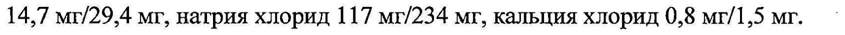
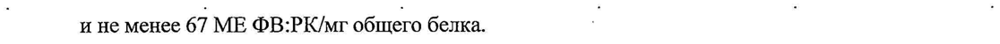
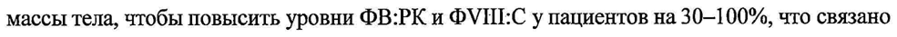
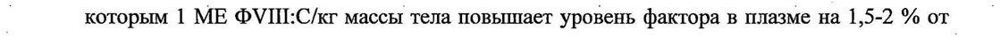
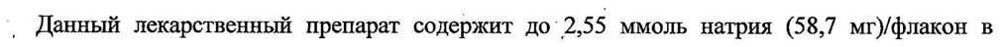
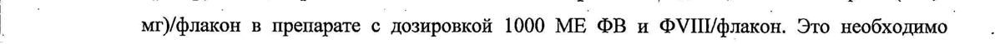

# Фактор Виллебранда и Фактор свертывания крови VIII — парентерально

- Препарат: Вилате® Нео (лиофилизат для приготовления раствора для внутривенного введения;)
- АТХ: B02BD06
- Источник: ГРЛС, инструкция по медицинскому применению, РУ ЛП-007434, файл от 2023-11-07 (https://grls.rosminzdrav.ru/Grls_View_v2.aspx?routingGuid=72cc4720-730a-4601-a4e5-2eb2751ae05e)
- Распознано автоматически (OCR): 16 из 16 стр.
- Инструкция к другому РУ того же препарата: ЛП-007434 (национальное РУ, переоформленное по правилам ЕАЭС, решение от 27.10.2023). Текст может быть старше действующего
- Сомнительных строк после OCR: 6 (см. раздел «Проверка распознавания»)

## Общие сведения

и . - от 24.10.2023 № 21278 МИНИСТЕРСТВО ЗДРАВООХРАНЕНИЯ РОССИЙСКОЙ ФЕДЕРАЦИИ _
— | ИНСТРУКЦИЯ | | | | по медицинскому применению лекарственного препарата |
| : ‚ Вилате Нео .
Регистрационный номер: ЛП-007434 - Торговое наименование: Вилате® Нео
Международное непатентованное или группировочное наименование:
| Фактор свертывания крови УП + фактор Виллебранда о Лекарственная форма
Лиофилизат для приготовления раствора для внутривенного введения.
® Состав - , , В 1 флаконе содержится:
Действующие вещества: фактор свертывания крови УШ 500 ME/1000 МЕ, фактор
Виллебранда 500 МЕ/1000 МЕ, эквивалентно содержанию белка не более 7,5 мг/15 мг;
| | Вспомогательные вещества: глицин 50 мг/100 мг, сахароза 50 мг/100 мг, натрия цитрат 14,7 мг/29,4 мг, натрия хлорид 117 Mr/234 мг, кальция хлорид 0,8 мг/1,5 мг. ‘
Растворитель: полисорбат 80 5 мг/10 мг, вода для инъекций до 5 мл/10 мл.
Описание Лиофилизат: Белый или бледно-желтый порошок или рыхлое твердое вещество.
Фильтрованный раствор — прозрачный или слегка опалесцирующий, бесцветный или слегка желтоватого цвета.
® Растворитель: Прозрачная, бесцветная жидкость. | |
`Фармакотерапевтическая группа | Гемостатические средства; витамин К и другие гемостатические средства; факторы свертывания крови.
Код ATX: BO2BD06 Фармакологическое действие |
| ‘;Фармакодинамика | | | Вилате® Нео — комплеке фактора свертывания крови УШ (ФУШ) и фактора Виллебранда | |
(ФВ), состоящий из двух молекул с разными физиологическими функциями. ри
| растворении В прилагаемом растворителе препарат содержит около 100 МЕ/мл ФУШ и 100
МЕ/мл ФВ.
Активность ФВ определяется на основании активности ристоцетинового кофактора
- (@B:PK) в сравнении с Международным стандартом для концентрата ФВ (ВОЗ).
| | | р ` | | от 24.10.2023 № 21278 & (Byeanouiuit’ №2 Ned 232N0or
Специфическая активность препарата Вилате!? Нео составляе Не менее” 67 МВОФЖЯИ:С/мг |
| и не менее 67 МЕ ФВ:РК/мг общего белка. 7 | |
Болезнь Виллебранла (БВ) , ; Препарат Вилате® Нео содержит человеческий ФВ, который является нормальным
| компонентом человеческой плазмы крови и действует так же, как эндогенный ФВ. | .
Применение ФВ корректирует нарушения гемостаза у пациентов с дефицитом ФВ следующим образом:
-— ФВ восстанавливает адгезию тромбоцитов к сосудистому субэндотелию в месте повреждения сосуда (посредством прикрепления к сосудистому субэндотелию и к мембране тромбоцитов), обеспечивая этим первичный гемостаз, что проявляется уменьшением времени кровотечения. Этот эффект проявляется немедленно и в большой мере зависит от уровня полимеризации белка;
® — ФВ задерживает коррекцию сопутствующего дефицита фактора VIII. При - внутривенном введении ФВ связывает эндогенный ФУШ (содержащийся в плазме пациента) и стабилизирует его, замедляя его быструю деградацию. |
Поэтому введение чистого ФВ (препарат ФВ с низким содержанием ФУШ)
восстанавливает уровень ФУШ:С до нормального в качестве вторичного эффекта после первой инфузии. Применение препаратов ФВ, содержащих ФУШ, восстанавливает уровень ФУШ:С до нормального непосредственно сразу же после первой инфузии.
В дополнение к своей роли белка, защищающего ФУШ, ФВ опосредует адгезию.
тромбоцитов в месте повреждения сосуда и играет роль в агрегации тромбоцитов.
Гемофилия А ® Препарат `Вилате® Нео содержит человеческий VII, который является нормальным компонентом человеческой плазмы крови и действует так же, как эндогенный ФУ Ш.
При введении препарата пациентам с гемофилией ФУШ связывается в кровеносном русле с ФВ. Активированный ФУШ (ФУШа) выступает в качестве кофактора активированного фактора IX (ФГХа), ускоряя переход фактора свертывания Х в активную форму (ФХа). ФХа активирует переход протромбина в тромбин. Тромбин, в свою очередь, активирует переход во фибриногена в фибрин с последующим формированием тромба. | -
| _ Гемофилия А - сцепленное с полом наследственное нарушение свертывания крови, |
|” обусловленное снижением уровня ФУШ:С, которое проявляется в виде профузных кровоизлияний в суставы, мышцы или внутренние органы, как спонтанных, так ив результате травмы или хирургического вмешательства. Заместительная терапия позволяет
| от 24.10.2023 № 21278 | (Входяший МЗ \№=4230905)
| ' повысить уровень ФУШ в плазме, обеспечивая временную коррекцию дефицита фактораи понижая тенденцию к кровотечениям.

## 5.2. Фармакокинетика

| Болезнь Виллебранда .
| Болезнь Виллебранда .
| Фармакокинетические свойства Вилате® Нео оценивали у 24 пациентов со всеми типами | болезни Виллебранда (тип 1 — 2 человека, тип 2 — 5 человек и тип 3 — 17 человек). |
: Увеличение ристоцетин-кофакторной активности в среднем составило 1,56 %/МЕ/кг (от 1,19 до 1,83 %/МЕ/кг). Средняя площадь под кривой «концентрация — время» составила
| _ 15981 (час*%). = | о | Период полувыведения составил в среднем 23,3 часа (от 18 до 39,7часа); средний клиренс
— 3,29 мл/ч/кг (от 1,95 до 3,76 мл/ч/кг). |
, ® | Гемофилия А , | . о После введения препарата примерно от 2/3 до 3/4 ФУШ остается в кровотоке. Уровень
ФУШ:С, достигаемый в плазме крови, должен составлять 80-120 % от прогнозируемого
| _ уровня ФУШ:С. | | _ Выведение ФУТИ:С носит двухфазный характер. На первом этапе период полувыведения составляет от 3 до 6 часов; на втором этапе он варьирует от 8 до 18 часов, в среднем
| составляя 15 часов. Это соответствует фактическому биологическому периоду
‚ полувыведения. Клиренс составляет 3,37 мл/ч/кг.

## 4.1. Показания к применению

| - Лечение и профилактика кровотечений или кровопотери у пациентов с болезнью ©
| - Лечение и профилактика кровотечений или кровопотери у пациентов с болезнью ©
Виллебранда, если монотерапия десмопрессином неэффективна или противопоказана; |
® - Лечение и профилактика кровотечений у пациентов с гемофилией А (врожденный —
| дефицит фактора свертывания крови VIII).

## 4.3. Противопоказания

- Повышенная чувствительность к фактору свертывания крови VIII, фактору Виллебранда и/или другим компонентам препарата. . |
- Повышенная чувствительность к фактору свертывания крови VIII, фактору Виллебранда и/или другим компонентам препарата. . |

## 4.6. Применение при беременности и в период грудного вскармливания

Болезнь Виллебранда .
| ‚ Опыт лечения препаратом беременных или кормящих женщин отсутствует. | |
Применение препарата при беременности и в период кормления грудью возможно только
_ по строгим. показаниям, учитывая, что роды связаны с повышенным риском кровотечения | у таких пациенток. ‘
Гемофилия A .
| Tak как гемофилия А крайне редко развивается у женщин, опыт применения препарата при ь.
° ‚ oT 24.10.2023 № 21278 беременности и в период грудного вскармливания OTC сёВуодящий МЗ 4230905). |
Таким образом, Вилате® Нео может применяться во время беременности ив период грудного вскармливания только по строгим показаниям.
| Способ применения и дозы _ , | | | | Г, Лечение должно проводиться врачами с опытом ведения пациентов с нарушениями .
свертывания крови.
Препарат Вилате® Нео вводят внутривенно после растворения прилагаемым растворителем
(0,1 % раствор полисорбата 80 в воде для инъекций). Полученный раствор содержит 100
МЕ фактора свертывания крови УШ и 100 МЕ фактора Виллебранда в 1 мл. Доза препарата и продолжительность лечения зависят от степени дефицита фактора свертывания крови, локализации и выраженности кровотечения и клинического состояния пациента.
Ф Болезнь Виллебранда | Соотношение между ФВ:РК и ФУШ:С составляет 1:1. Как правило, 1 МЕ/кг массы тела
ФВ:РК и ФУШ:С повышает концентрацию в плазме крови на 1,5 - 2 % от нормальной .
активности соответствующего белка. Обычно . для достижения адекватного гемостаза
| требуется доза препарата Вилате® Нео от 20 до 50 МЕ/кг массы тела, что повышает уровень
. ФВ:РК и ФУШ:С у пациентов на 30 - 100 %. | | | | |
| Начальная доза препарата может достигать 50 - 80 МЕ/кг массы тела, особенно у пациентов с болезнью Виллебранда третьего типа, при которой для поддержания необходимого уровня концентрации в плазме крови требуются более высокие дозы, чем при остальных типах.
_ ‚ Профилактика кровотечений при. хирургических вмешательствах или при тяжелой | травме: для предупреждения кровотечения ‘необходимо начинать введение препарата
® `° Вилате® Нео за 1 — 2 часа до начала хирургического вмешательства. Должны быть достигнуты уровни ФВ:РК > 60 МЕ/лдл (> 60 %) и ФУШ:С > 40 МЕ/дл (> 40 %).
Соответствующую дозу необходимо вводить повторно каждые 12-24 ч во время лечения.
Доза и продолжительность лечения зависят от клинического состояния пациента, типа и
° тяжести кровотечения, а также от уровней ФВ:РК и ФУШ:С.
| При применении препаратов ФВ, содержащих ФУШ, необходимо контролировать уровни
ФУШ:С в плазме крови для обнаружения устойчивого избыточного повышения уровня о ФУШ:С, поскольку это может ПОВЫСИТЬ риск развития тромботических осложнений, |
‚ особенно у пациентов с известными клиническими либо лабораторными факторами риска.

° При обнаружении избыточного уровня ФУШ:С необходимо уменыпить дозу препарата и/или увеличить интервал между введениями или использовать препарат ФВ с более низкой концентрацией ФУШ.

| Профилактика: | | | | 4 | от 24.10.2023 № 21278
‚ Для долгосрочной профилактики кровотечений у пациеновяв бе лезнаю 2Виляебранда |
| необходимо применять препарат в дозах 20 - 40 МЕ/кг массы тела 2 или 3 раза в неделю. В |
| некоторых случаях, например, у пациентов с желудочно-кишечными кровотечениями,
_ могут потребоваться более высокие дозы. : ;
| о Педиатрическая популяция | о | | | | |
При лечении кровотечений у детей в возрасте от 6 до <12 лет и у подростков может
| потребоваться применение препарата Вилате® Нео в дозе, превышающей 20-50 МЕ/г массы тела, чтобы повысить уровни ФВ:РК и ФУН:С у пациентов на 30-100%, что связано с более низким восстановлением in Vivo и более низкой максимальной концентрацией В плазме крови у пациентов более младшего возраста. |
При профилактике кровотечений во время операции или в случаях тяжелых травм о начальный режим лечения сопоставим с таковым для взрослых пациентов. Частоту
® повторного применения препарата следует определять с учетом ускоренного клиренса у пациентов более младшего возраста. |
_ Аналогичным образом, при долгосрочной профилактике кровотечений у детей в возрасте от 6 до <12 лет и у подростков с болезнью Виллебранда данный лекарственный препарат -
‚ _ можно применять в дозах, превышающих 20-40 МЕ/кг массы тела, и чаше 2 раз в неделюв связи с более низким восстановлением iN VIVO и ускоренным клиренсом у пациентов данных
| возрастных групп. ‘о | | Гемофилия А | , .
Доза и продолжительность лечения зависят от степени дефицита ФУШ, локализации и длительности кровотечения и клинического состояния пациента. |
Количество единиц применяемого ФУШ выражается в Международных Единицах (МЕ),
® соответствующих стандартам ВОЗ для препаратов ФУ. Активность ФУШ выражается или в процентном соотношении (относительно нормальной человеческой плазмы), или в |
Международных Единицах (относительно Международного Стандарта для ФУШ в плазме).
Одна Международная Единица активности ФУШ эквивалентна количеству ФУШ в одном
1 мл нормальной человеческой плазмы.
Лечение по требованию: о .
; Расчет требуемой дозы ФУШ основан на эмпирически полученных результатах, согласно `
| которым 1 МЕ ФУШ:С/кг массы тела повышает уровень фактора в плазме на 1,5-2 % от = нормального уровня. Необходимую дозу определяют по следующей ‘формуле:
И Необходимая доза (МЕ) = масса тела (кг) х желаемое повышение уровня ФУШ (%) (МЕ/дл) x 0,5 (МЕ/кг)
Количество и частота применения ФУШ должны определяться клинической
| от 24.10.2023 № 21278 эффективностью в каждом индивидуальном случае. (Входящий МЗ 4230905] |
‚ При описываемых ниже случаях кровотечений уровень активности фактора УШ не должен |
| опускаться ниже исходного уровня активности в плазме крови (% от нормального уровня
; или МЕ/лл) в соответствующий период времени. . -
| _ Следующая таблица может быть использована для подбора доз при эпизодах кровотечений | | о и хирургических вмешательствах. |
Схема лечения при кровотечениях и хирургических вмешательствах
Частота введения (часы)/ хирургического уровень ФУШ (%)
| | Длительность лечения (дни)
вмешательства (МЕ/дл)
Ранние ° Темартрозы, Повторять каждые 12-24 часа, по внутримышечные ° | крайней мере 1 сутки, до | кровотечения ИЛИ 20 - 40 устранения боли или заживления
| кровотечения. ротовой источника кровотечения.
| полости т | - | Более Повторные введения каждые 12-
| | обширные кровотечения, т. 30-60 24 часа в течение 3-4 дней или , внутримышечные | более, до устранения боли и | кровотечения или гематомы восстановления трудоспособности.
| Угрожающие Жизни _` Повторные введения каждые 8кровотечения | 60 - 100 24 часа, до полного исчезновения
@ a угрозы.
| Малые, — | Каждые 24 часа, по крайней мере,
| включая удаление зубов 30 - 60 1 сутки, до достижения
- | заживления.
—6 СООТВЕТСТВУЕТ ЭКСПЕРТНОМУ ОТЧЕТУ oe ’ - Частота введения (часы хирургического уровень ФУШ (%)
| Длительность лечения (дни)
вмешательства (МЕ/да) | доить em)
Большие , Повторные введения каждые 8-24
| | | 7 | | 80-100 1 часа, до адекватного заживления |
, (до и после раны, затем как минимум 7 дней операции) для поддержания активности ФУШ на уровне 30-60 % (МЕ/дл).
Профилактика: | Для продолжительной профилактики кровотечений у пациентов с тяжелой формой гемофилии А, необходимо вводить препарат в дозе от 20 до 40 МЕ/кг массы тела каждые 2-
№ 3 дня. В некоторых случаях, особенно у молодых пациентов, может возникнуть необходимость уменьшения интервала между введениями или увеличения дозы.
Непрерывная инфузия:
Перед хирургическим вмешательством необходимо провести фармакокинетический анализ
| для оценки клиренса. Исходную скорость инфузии можно рассчитать следующим образом:
| | Скорость инфузии (МЕ/кг/ч) = | клиренс (мл/кг/ч) х желаемый уровень равновесной концентрации (МЕ/мл)
После первых 24 часов непрерывной инфузии необходимо снова ежедневно рассчитывать клиренс на основании уравнения стационарного состояния с измерением концентрации и
‚ известной скоростью инфузии. | | Мониторинг лечения:
®@ В ходе лечения рекомендовано определять уровни ФУШ:С с целью регулирования дозы и частоты повторных инфузий. В случае обширных хирургических вмешательств особенно необходим точный мониторинг заместительной терапии с помощью тестов коагуляции
(ФУШ:С).
Пациенты реагируют на введение фактора УШ индивидуально, демонстрируя различные значения показателя восстановления и различные значения периода его полувыведения.
- Педиатрическая популяция .
_ При лечении кровотечений по мере необходимости или при хирургических вмешательствах” у детей схему применения следует корректировать с учетом показателя восстановления in
Vivo в конкретной возрастной группе. | |
Требуемая доза для детей в возрасте < 6 лет, от 6 до < 12 лет и подростков рассчитывается по следующей формуле:
| в | СООТВЕТСТВУЕТ ЭКСПЕРТНОМУ ОТЧЕТУ от 24.10.2023 № 21278 `
Е | | масса тела (кг) х требуемое повышение уровня ФУШ (%) (МЕ/дл) х 0,6 (МЕ/кг)
Количество и частоту введения ФУШ определяют в зависимости от клинической
: эффективности в каждом отдельном случае.
`Частоту повторного применения препарата следует определять с учетом ускоренного клиренса у пациентов младшего возраста.
При долгосрочной профилактике кровотечений у детей в возрасте < 6 лет и от 6 до < 12 лет с тяжелой формой гемофилии А данный препарат следует применять в дозе 30-50 МЕ/кг
’ массы тела через день или три раза в неделю.
Схема применения для профилактики у подростков сопоставима с таковой у взрослых.
Схема применения препарата в каждой возрастной группе определяется в зависимости от
| ©® клинической эффективности в каждом отдельном случае. |
Инструкция по приготовлению раствора | При приготовлении раствора необходимо соблюдать асептические условия.
1. Довести до комнатной температуры лиофилизат и растворитель в закрытых флаконах. Следует поддерживать эту температуру во время восстановления
| лиофилизата. |
2. Удалить защитные крышки с флаконов с лиофилизатом и растворителем, ъ‘продезинфицировать резиновые пробки флаконов одной из дезинфицирующих салфеток. ,
3. Короткий конец двухконцевой иглы освободить от защитного покрытия, не
_ дотрагиваясь до кончика иглы. Затем, держа иглу вертикально, проткнуть в центре
@ пробку флакона с растворителем. Для полного извлечения жидкости из флакона игла должна только проткнуть пробку и должна быть видна во флаконе.
4. Длинный конец двухконцевой иглы освободить от защитного покрытия, не дотрагиваясь до кончика иглы. Удерживая флакон с растворителем вместе с иглой в перевернутом положении над флаконом с лиофилизатом, расположенным вертикально, быстро проткнуть иглой центр резиновой пробки флакона с
| лиофилизатом. Вакуум во флаконе с лиофилизатом втянет растворитель. |
- - 3, Извлечь двухконцевую иглу с пустым флаконом от растворителя из флакона с лиофилизатом, затем медленно вращать флакон до тех пор, пока лиофилизат .
полностью не растворится. Препарат Вилате® Нео быстро растворяется при комнатной температуре.
Полученный раствор — бесцветный или желтоватый, прозрачный или слегка
| СООТВЕТСТВУЕТ ЭКСПЕРТНОМУ ОТЧЕТУ опалесцирующий. Если лиофилизат растворился не полнобВаИНИЙ пр porecve растворения образовались агрегаты, раствор использовать нельзя. |

| | Растворять лиофилизат следует непосредственно перед введением препарата.

й Стабильность раствора сохраняется в течение 8 часов при комнатной температуре. Тем не ;
менее, во избежание микробиологического загрязнения, раствор должен быть использован сразу после приготовления. |
Не следует выбрасывать неиспользованный лекарственный препарат вместе с бытовыми отходами.

Неиспользованный препарат следует утилизировать в соответствии с местными
° требованиями.
Введение В качестве меры предосторожности до введения и во время введения препарата необходимо
® | определить частоту пульса пациента. При выраженном учащении пульса необходимо
| уменьшить скорость введения препарата или сделать перерыв.
Для введения следует использовать только предоставляемый в комплекте набор для
| растворения и внутривенного введения. Другие устройства способны абсорбировать факторы -свертывания крови.на внутренних поверхностях, что приводит к снижению .
эффективности лечения.
1. Снять защитное покрытие с фильтровальной иглы и проколоть резиновую пробку
1 флакона с приготовленным раствором.
| 2. Присоединить фильтровальную иглу другим концом к шприцу. |
| 3. Перевернуть флакон со шприцем вверх дном и набрать раствор в шприц.
4. Продезинфицировать место введения дезинфицирующей салфеткой.
® 5. Отсоединить фильтровальную иглу от шприца и присоединить вместо нее иглу-
| бабочку. |
6. Вводить раствор внутривенно медленно со скоростью 2 - 3 мл/минуту.
Препарат предназначен для однократного применения и должен быть использован полностью. Любой неиспользованный раствор препарата должен быть утилизирован согласно существующим правилам. | 7

## 4.8. Побочное действие

| | . a | - Общий профиль безопасности | | |
| | . a | - Общий профиль безопасности | | |
‘Редко наблюдались реакции гиперчувствительности или аллергические реакции - ангионевротический отек, ощущение жжения и покалывания в области введения, озноб,
«приливы» крови к лицу, крапивница, в том числе генерализованная, эритема, зуд, кожная
В | | СООТВЕТСТВУЕТ ЭКСПЕРТНОМУ ОТЧЕТУ |
(Входящий МЗ №4230905)., сыпь, головная боль, артериальная гипотензин, затормож енность ошнота, обспокойство тахикардия, ощущение сдавливания в грудной клетке, парестезия, одышка, покалывание, рвота, свистящее дыхание. В некоторых случаях эти проявления могут прогрессировать до
1 развития тяжелой анафилаксии, включая шок.
] Болезнь Виллебранда | | | , У пациентов с болезнью Виллебранда, особенно 3 типа, возможно развитие ингибиторных о антител к ФВ. В этом случае отмечается неадекватный клинический эффект на введение препарата. Появление ингибиторов часто связано с развитием анафилактических реакций.
| Поэтому, при развитии анафилактических реакций пациентов следует обследовать на наличие ингибиторных антител. В таких случаях рекомендуется обращаться в специализированные гематологические/гемофильные центры.
* _В клинических исследованиях и при применении препарата в постмаркетинговый период
| не было зарегистрировано случаев образования ингибиторов к фактору Виллебранда.
Существует риск развития тромботических осложнений, особенно у пациентов с известными клиническими либо лабораторными факторами риска. В связи с этим, необходимо проводить профилактику тромботических осложнений в соответствии с действующими рекомендациями. ` |
При применении препаратов OB, содержащих ФУШ, возможно избыточное повышение уровня ФУШ:С, что также повышает риск развития тромботических осложнений.
Гемофилия А У пациентов с гемофилией А также возможно развитие ингибиторных антител к ФУШ, при этом отмечается недостаточный клинический эффект на введение препарата. В таких a случаях рекомендуется обращаться в специализированные гематологические/гемофильные центры. |
Таблица нежелательных реакций Ниже представлен обзор нежелательных реакций из клинических исследований и постмаркетинговых исследований безопасности, классифицированных по системам и органам (MedDRA) и по частоте.
Частота встречаемости нежелательных реакций классифицируется следующим образом:

a т очень часто (> 1/10); часто (or> 1/100 qo < 1/10); нечасто (от> 1/1000 до < 1/100); редко (or | о
> 1/10000 до < 1/1000); очень редко (от < 1/10000), частота неизвестна (He может быть оценена на основании доступных данных). | | |
Для нежелательных реакций, выявленных в период постмаркетингового наблюдения,

частота неизвестна. | ; 10 СООТВЕТСТВУЕТ ЭКСПЕРТНОМУ ОТЧЕТУ
Классификация. по [i he |__| | системам | и органам Нежелательная реакция Частота
(Мед ВА)
Со стороны крови и| Ингибирование фактора | Нечасто (РЛП)*
| | лимфатической системы Vill | _ | Очень часто (PHIT)* |
Ингибирование — фактора | Очень редко Виллебранда
Со стороны иммунной | Гиперчувствительность Нечасто
Анафилактический шок Очень редко.
Со стороны нервной | Головокружение Частота неизвестна
®& Co’ стороны дыхательной | Кашель `| Частота неизвестна системы, органов грудной клетки и средостения
Со стороны желудочно- Боль в животе Частота неизвестна |
Со стороны скелетно- Боль в поясничной области | Частота неизвестна мышечной и соединительной ткани
Общие расстройства и | Лихорадка Незчасто нарушения в ‘ месте Боль в грудной клетке Частота неизвестна | введения препарата
} *Частота рассчитана на основе клинических исследований препаратов, содержащих фактор VIII, в том числе, для лечения тяжелой гемофилии А.
РЛИ — ранее леченные пациенты РНП - ранее не леченные пациенты
Описание отдельных нежелательных реакций |
Описание отдельных нежелательных реакций представлено в разделе «Особые указания».
Педиатрическая популяция 7 . , | | Нежелательные реакции в клинических исследованиях у детей в возрасте < 6 лет, от 6 до < 12 лет и подростков включали повышение температуры тела, сонливость, рвоту и положительный результат серологического анализа на парвовирус В19, у взрослых наблюдались аналогичные явления.
Кроме того, у 8 из 28 ранее не получавших лечение пациентов с гемофилией А (28,6 %) В возрасте от менее чем 1 месяц до 7,5 лет были выявлены ингибиторы ФУ.
И СООТВЕТСТВУЕТ ЭКСПЕРТНОМУ ОТЧЕТУ В проспективном клиническом исследовании у 15 nanentos я ббленью Bushieopanna В возрасте до 6 лет после 419 инфузий препарата (389 дней экспозиции) ингибиторных антител обнаружено не было.
| Передозировка ; . . ;
° He выявлено случаев передозировки при применении. препаратов ФВ или ФУШ -
| производных плазмы крови. В случае ‘существенной передозировки могут развиваться тромбоэмболические осложнения.
| Взаимодействие с другими лекарственными средствами
Данные о взаимодействии препарата Вилате® Нео с другими лекарственными препаратами отсутствуют.
Не смешивать препарат с другими лекарственными препаратами и растворителями.
Для растворения и введения препарата применять только набор, входящий в комплект C
® ‚ Лекарственным препаратом.

## 4.4. Особые указания

Отслеживаемость При введении пациенту препарата настоятельно рекомендуется записывать наименование препарата и номер серии, чтобы сохранить связь между пациентом и серией препарата. -
Отслеживаемость При введении пациенту препарата настоятельно рекомендуется записывать наименование препарата и номер серии, чтобы сохранить связь между пациентом и серией препарата. -
Гиперчувствительность | При применении препарата возможно развитие реакций гиперчувствительности .
аллергического типа. Препарат содержит следы других белков человека, а не только белки
| фактора УШ. Необходимо тщательно контролировать состояние пациентов в период
| введения препарата. В случае возникновения аллергических симптомов следует немедленно прекратить введение препарата и обратиться к врачу.
| ® Пациентов следует проинформировать о ранних признаках реакций гиперчувствительности, таких как сыпь, генерализованная крапивница, ощущение -
| сдавливания в грудной клетке, свистящее дыхание, снижение артериального давления и анафилаксия. В случае развития шока должны быть применены современные методы противошоковой терапии.
Трансмиссивные инфекции , - . Стандартные меры для профилактики инфекций, вызванных применением лекарственных .
препаратов, изготовленных из крови или плазмы крови человека, включают отбор доноров, скрининг индивидуальных порций и пулов плазмы на наличие специфических маркеров | инфекций, а также включение в процесс производства эффективных процедур | инактивации/элиминации вирусов. Несмотря на это, при применении лекарственных препаратов, полученных из крови или плазмы крови человека, возможность передачи
| 12 от 24.10.2023 № 21278 возбудителей инфекционных заболеваний не MoxeT быть пос исключена ITO также относится к неизвестным или недавно выявленным вирусам и другим патогенным микроорганизмам.

р Данные меры считаются эффективными в отношении оболочечных вирусов, таких как.
| вирус иммунодефицита человека (ВИЧ), вирус гепатита В (НВУ) и вирус гепатита С (HCV), a также в отношении безоболочечного вируса гепатита А. Данные меры могут иметь
| ограниченную эффективность в отношении безоболочечных вирусов, таких как парвовирус
B19.
Парвовирус B19 может вызвать серьезные реакции у беременных женщин (внутриутробная инфекция), а также у лиц с иммунодефицитом или при усилении эритропоэза (например, при гемолитической анемии).
Пациентам, регулярно/многократно получающим препараты ФВ/фактора VII, полученные
® | ‚ из плазмы крови человека. рекомендуется вакцинация для профилактики вирусных
’ гепатитов А и В.
Болезнь Виллебранда (БВ)
Тромбоэмболические осложнения При применении препаратов ФВ, содержащих ФУШ, лечащий врач должен быть готов к тому, что продолжительное лечение может вызвать избыточное повышение уровня
| ФУШ:С. У пациентов, получающих препараты ФВ, содержащие ФУШ, необходимо контролировать уровни ФУШ:С, чтобы избежать чрезмерного их повышения в плазме
| крови, поскольку это может повысить риск развития тромботических осложнений.
При применении препаратов ФВ, содержащих ФУШ, существует риск развития тромботических осложнений, особенно у нациентов с известными клиническими или
* лабораторными факторами риска. Поэтому для выявления ранних симитомов тромбоза необходим контроль пациентов из группы риска. Профилактику венозной тромбоэмболии необходимо проводить в соответствии с современными рекомендациями.
Ингибиторы У пациентов с болезнью Виллебранда, особенно 3 типа, возможно развитие | нейтрализующих антител (ингибиторов) к ФВ. Если не достигаются ожидаемые уровни активности ФВ:РК в.плазме крови, либо не удается контролировать кровотечение при введении соответствующей дозы, необходимо провести соответствующее исследование для
_ определения ингибиторов ФВ. У пациентов с высокими уровнями ингибиторов терапия ФВ может быть неэффективна и следует рассмотреть другие варианты лечения. Лечение таких пациентов необходимо проводить под руководством врачей с опытом ведения пациентов с гемостатическими нарушениями.
| - 13 — . СООТВЕТСТВУЕТ ЭКСПЕРТНОМУ ОТЧЕТУ
| от 24.10.2023 № 21278 Гемофилия А | Ингибиторы | о | | |
Образование нейтрализующих антител (ингибиторов) к ФУШ является известным
. осложнением при лечении пациентов с гемофилией А. Как правило, эти ингибиторы й
| являются иммуноглобулинами IgG, направленными против прокоагулянтной активности |
} ФУШ, и их количественно определяют в Единицах Бетезда (ЕБ) на мл плазмы крови, используя модифицированный анализ. Риск развития ингибиторов коррелирует со
, степенью тяжести заболевания и с количеством введенного ФУШ, и достигает максимума в течение первых 50 дней после начала применения, но при дальнейшем применении препарата в течение жизни риск развития ингибиторов становится нечастым.
Клиническое значение образования ингибиторов зависит от титра ингибиторов. При низких титрах ингибиторов риск недостаточного ответа на лечение меныше, чем при высоких
| Необходимо тщательно наблюдать всех пациентов, получающих лечение препаратами
ФУШ, на предмет развития ингибиторов с проведением соответствующих лабораторных
| ‚ анализов. В случае, если ожидаемые уровни активности ФУШ в плазме крови не поддерживаются, или если не удается контролировать кровотечение при применении подходящей дозы, необходимо провести исследование на наличие ингибитора ФУШ. У
| _ пациентов с высокими уровнями ингибиторов терапия ФУШ может быть неэффективна, и следует рассмотреть другие варианты лечения.
| — Ведение таких пациентов должен осуществлять врач, имеющий опыт лечения пациентов с гемофилией и ингибиторами ФУШ. | |
Осложнения со стороны сердечно-сосудистой системы
® У пациентов с имеющимися факторами риска сердечно-сосудистых заболеваний
| применение препарата может увеличивать этот риск. .
Осложнения, связанные с установкой катетера | |
Если требуется применение катетера, возможны осложнения, связанные с его применением
_ — местные инфекции, бактериемия и тромбоз в месте введения катетера.
’ Данный лекарственный препарат содержит до’ 2,55 ммоль натрия (58,7 мг)/флакон в
К .. препарате с дозировкой 500 МЕ ФВ и .ФУШ/флакон и до 5,1 ммоль натрия (117,3 -
| 1 мг)/флакон в препарате с дозировкой 1000 МЕ ФВ и ФУПИфлакон. Это необходимо. .
принимать во внимание пациентам, придерживающимся диеты с контролируемым | потреблением натрия.
Применение у детей Перечисленные выше меры предосторожности относятся как к взрослым, так и к детям.
, | 14 СООТВЕТСТВУЕТ ЭКСПЕРТНОМУ ОТЧЕТУ Влияние на способность управлять транспортными open ORAM Mexdansmane”.
| Применение препарата Вилате® Нео не оказывает влияния на способность управлять ‘ | транспортными средствами и работать с механизмами.

## 6.5. Форма выпуска

; | . .
; | . .
| | Лиофилизат для приготовления раствора для внутривенного введения, 500 МЕ фактора | | свертывания крови УШ + 500 МЕ фактора Виллебранда, 1000 МЕ фактора свертывания крови УШ + 1000 МЕ фактора Виллебранда.
Лиофилизат | По 500/1000 МЕ фактора свертывания крови УШ и 500/1000 МЕ фактора Виллебранда во флакон из прозрачного бесцветного стекла (тип I, Евр. Ф.), укупоренный пробкой из резины, покрытой алюминиевым колпачком под обкатку с идентификационным номером
| на боковой стороне колпачка, соответствующим определенному номеру серии препарата,
| | | ® и пластиковой крышкой типа flip-off (допускается прокручивание крышки). По 1флакону вместе с инструкцией по применению в картонную пачку.
: Растворитель По 5 мл (для дозировки 500 ME+500 ME) или по 10 мл (для дозировки 1000 МЕ+1000МЕ)

- растворителя (полисорбат 80 5 мг/10 мг, вода для инъекций до 5 мл/10 мл) во флакон из прозрачного бесцветного стекла (тип IJ, Евр. Ф.), укупоренный пробкой из резины, покрытой алюминиевым колпачком под обкатку с идентификационным номером на боковой стороне колпачка, соответствующему определенному номеру серии растворителя, и пластиковой крышкой типа flip-off (допускается прокручивание крышки).
Комплект для растворения и внутривенного введения (1 одноразовый шприц, 1 двухконцевая игла, | фильтровальная игла, 1 игла-бабочка, 2 дезинфицирующие салфетки

® в индивидуальных герметичных упаковках) в полиэтиленовый пакет или блистер.
По 1 флакону с растворителем и 1 пакету или блистеру с комплектом для растворения и внутривенного введения в отдельную картонную пачку.
| картонная пачка с препаратом и 1 картонная пачка с растворителем и пакетом или блистером с комплектом для растворения и внутривенного введения скреплены пластиковой лентой. |
| Условия хранения - - | | im | | Хранить при температуре от2 до 8 °С в защищенном от света месте. | |
| Не замораживать. | | | В пределах указанного срока годности препарат можно хранить при температуре не выше 25 °С не более 6 месяцев, после чего срок годности препарата считается истекшим.
Хранить в недоступном для детей месте. | от 24.10.2023 № 21278

## 6.3. Срок годности

(Входящий МЗ №4230905)
(Входящий МЗ №4230905)
| Лиофилизат - 3 года | | | | Растворитель - 5 лет
Срок годности комплекта ‘определяется по наименьшему сроку годности одного. из
| компонентов. | | | | | | . | Не применять по истечении срока годности.
Условия отпуска Отпускают по рецепту.
Юридическое лицо, на имя которого выдано регистрационное удостоверение:
| Октафарма Фармацевтика Продуктионсгес M.6.X., Австрия. |
'Уберлаерштрассе 235, А-1100, Вена, Австрия.
Производитель лиофилизата:
® Октафарма Фармацевтика Продуктионсгес м.б.Х., Австрия. | |
`Уберлаерштрассе 235, А-1100, Вена, Австрия. |
Производитель растворителя:

’ Октафарма AB, Швеция.
Ларс Форсселлс гата 23, 112 75, Стокгольм. .
Организация, принимающая претензии потребителей:

Представительство АООО «Октафарма Нордик АБ» (Швеция). .
119002, г. Москва, Денежный пер., 11, стр.1.
Tem: +7 (495) 785-45-55, факс: +7 (495) 785-45-58. |

ий cay

@ Генеральный директор ЕЙ at \3\

OOO «МДА» Е eg р Е | Гильдеева Г.Н.

\.. Ao ой

вх Ул
## Проверка распознавания

Страницы-сканы распознаны автоматически. В 6 строках с дозировками цифры могли распознаться с ошибкой — сверьте с вырезкой из оригинала:

- стр. 1: «14,7 мг/29,4 мг, натрия хлорид 117 Mr/234 мг, кальция хлорид 0,8 мг/1,5 мг. ‘» — низкая уверенность: «Mr/234» (47)  
  
- стр. 2: «| и не менее 67 МЕ ФВ:РК/мг общего белка. 7 | |» — низкая уверенность: «7» (40); повторное чтение: «| и не менее 67 МЕФВ:РК/мг общего белка. . | |»  
  
- стр. 5: «массы тела, чтобы повысить уровни ФВ:РК и ФУН:С у пациентов на 30-100%, что связано» — низкая уверенность: «30-100%,» (71)  
  
- стр. 5: «| которым 1 МЕ ФУШ:С/кг массы тела повышает уровень фактора в плазме на 1,5-2 % от =» — повторное чтение: «| которым 1 ME ФУШ:С/кг массы тела повышает уровень фактора в плазме на 1,5-2 % от |»  
  
- стр. 14: «’ Данный лекарственный препарат содержит до’ 2,55 ммоль натрия (58,7 мг)/флакон в» — низкая уверенность: «2,55» (72)  
  
- стр. 14: «| 1 мг)/флакон в препарате с дозировкой 1000 МЕ ФВ и ФУПИфлакон. Это необходимо. .» — повторное чтение: «| мР/флакон B препарате с дозировкой 1000 ME ФВ и ФУПИ флакон. Это необходимо .»  
  
