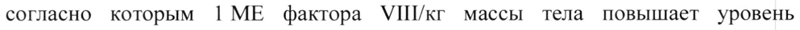

# Фактор свертывания VIII крови — парентерально

- Препарат: Нувик (лиофилизат для приготовления раствора для внутривенного введения;)
- АТХ: B02BD02
- Источник: ГРЛС, инструкция по медицинскому применению, РУ ЛП-003522, файл от 2023-03-21 (https://grls.rosminzdrav.ru/Grls_View_v2.aspx?routingGuid=7c6d9670-4c4a-449b-973d-fd3dd974a329)
- Распознано автоматически (OCR): 25 из 25 стр.
- Сомнительных строк после OCR: 1 (см. раздел «Проверка распознавания»)

## Общие сведения

| СОГЛАСОВАНО МИНИСТЕРСТВО ЗДРАВООХРАНЕНИЯ РОССИЙСКОЙ ФЕДЕРАЦИИ
ИНСТРУКЦИЯ по медицинскому применению лекарственного препарата
Нувик

Регистрационный номер: ЛП-003522 Торговое наименование: Нувик

~ Международное непатентованное наименование: симоктоког альфа (фактор свертывания крови УШ человеческий рекомбинантный)

## 3. Лекарственная форма

лиофилизат для приготовления раствора для внутривенного введения.
лиофилизат для приготовления раствора для внутривенного введения.
Фармакотерапевтическая группа: гемостатическое средство.
Код ATX: BO2BD02 Состав

| В 1 флаконе содержится действующее вещество симоктоког альфа (фактор свертывания крови У Ш человеческий рекомбинантный) 250 МЕ или 500 МЕ, или 1000 МЕ, или 2000 МЕ.
Вспомогательные вещества. натрия хлорид 45 мг, сахароза 13,5 мг, аргинина гидрохлорид 13,5 мг, кальция хлорида дигидрат 0,75 мг, полоксамер 188 3,0 мг, натрия цитрата дигидрат 3,0 мг.
В | шприце содержится вода для инъекций 2,5 мл.

| Описание Масса белого цвета, возможно наличие небольшого количества порошка белого цвета.
Восстановленный раствор — прозрачный или слегка опалесцирующий бесцветный раствор.
Фармакологические свойства Фармакодинамика

— Симоктоког альфа, фактор свертывания крови VIII человеческий (рДНК), представляет собой высокоочищенный протеин, состоящий из 1440 аминокислот. Последовательность аминокислот сравнима с таковой фактора свертывания крови VIII (фактор VIII) из плазмы человека, состоящего их двух цепей с молекулярной массой 90 кДа и 80 кДа и не содержащего В-домен.
Препарат получают при помощи технологии рекомбинантной ДНК из клеточных линий эмбриональной почки человека (НЕК 293Е клетки). Никакие вещества человеческого или животного происхождения в процессе производства и в готовый препарат не добавляются.

© Посттрансляционные модификации препарата Нувик аналогичны таковым в эндогенном факторе УШ у здоровых людей, и в отличие от препаратов из клеточных линий хомячка препарат рекомбинантного фактора УШ из клеточных линий человека не имеет карбогидратных эпитопов, обладающих антигенными свойствами.
Комплекс фактор УШИфактор Виллебранда состоит из двух молекул (фактор VIII и фактор Виллебранда) с различными физиологическими функциями. При введении пациентам с гемофилией фактор УШ связывается с фактором

Виллебранда в кровеносном русле. Активированный фактор УШ действует как кофактор для активированного фактора IX, ускоряя превращение фактора Х в активированный фактор Х. Активированный фактор Х превращает протромбин в тромбин. Затем тромбин превращает фибриноген в фибрин, при этом может сформироваться сгусток. Гемофилия A — это связанное с полом наследственное нарушение свертывания крови, связанное со снижением уровня фактора УШ и приводящее к профузным кровотечениям в суставы, мышцы или внутренние органы, как спонтанным, так и в результате случайных травм или хирургических вмешательств. При проведении заместительной терапии достигается временная
- коррекция дефицита фактора УШ в плазме и коррекция риска возникновения кровотечений.
Иммуногенность препарата Нувик изучалась в клинических исследованиях, в которых приняли участие 190 пациентов с тяжелой гемофилией А, ранее получавших лечение (129 взрослых и 61 ребенок). Ни у одного из пациентов появление ингибиторов не наблюдалось.
Пациенты взрослого и подросткового возраста (12-65 лет)
Профилактика w В клиническом исследовании Ha 32 взрослых пациентах с тяжелой гемофилией
А среднее потребление препарата Нувик в целях профилактики составило 468,7
МЕ/кг в месяц.
Лечение кровотечений Средняя доза для лечения острых кровотечений была 33,0 МЕ/кг для пациентов, получавших Нувик в профилактических целях. В другом клиническом исследовании 22 взрослых пациента получали лечение при необходимости. Всего 986 случаев кровотечений потребовали лечения со средней дозой 30,9 МЕ/кг. В целом малые кровотечения требуют применения несколько меньших доз препарата, а более тяжелые кровотечения требуют введения препарата в дозах, вплоть до трех раз превышающих средние дозы препарата.
Индивидуализированная профилактика:

Индивидуализированная профилактика, основанная на данных фармакокинетики, была оценена у 66 ранее лечившихся взрослых пациентов с тяжелой гемофилией А. По окончании стандартной профилактической фазы

& (продолжительностью 1-3 месяца; введение с регулярным интервалом один раз в 2 дня либо 3 раза в неделю) 44 пациента (67 %) были переведены на режим дозирования, основанный на данных анализа их фармакокинетики, а 40 пациентов завершили 6-месячный период профилактики в соответствии с назначенными дозами и схемами лечения. Из этих пациентов 34 (85 %) получали препарат два раза в неделю или реже, у 33 (82,5 %) не возникало никаких кровотечений, ау 36 (90,0 %) не возникало спонтанных кровотечений. Среднее значение (+ СО) частоты встречаемости кровотечений за год составило 1,2 + 3,9, а средняя (+ СО) доза составила 52,2 + 12,2 МЕ/кг на инъекцию и 99,7 + 25,6
МЕ/кг в неделю.

ы Важно отметить, что сравнение годовой частоты кровотечений для различных концентраций фактора и в различных клинических исследованиях не представляется возможным.

Фармакодинамика у детей

Данные были получены от 29 ранее получавших лечение детей в возрасте от 2 до

5 лет, 31 ребенка в возрасте от 6 до 12 лет и одного подростка 14 лет. Средняя

доза профилактических инфузий составила 37,8 МЕ/кг. Двадцать пациентов получали среднюю дозу более 45 МЕ/кг. Среднее потребление препарата Нувик в целях профилактики составило 521,9 МЕ/кг в месяц. Исследования показали, что для лечения кровотечений у детей средняя дозировка Нувик (43,9 МЕ/кг)
выше, чем у взрослых (33,0 МЕ/кг), а также что средняя дозировка, необходимая для остановки от средних до сильных кровотечений, выше чем для слабых кровотечений (78,2 МЕ/кг против 41,7 МЕ/кг). Для детей младшего возраста в основном требуется большая средняя доза (6-12 лет: 43,9 МЕ/г, 2-5 лет: 52,6
МЕ/г). Эти данные были подтверждены при последующем долгосрочном наблюдении 49 из этих детей, получавших лечение в течение дополнительного
~ периода, продолжительностью в среднем около 30 месяцев (от 9,5 до 52 месяцев);
за этот период у 45% детей спонтанных кровотечений не наблюдалось.

## 5.2. Фармакокинетика

Таблица 1. Фармакокинетика препарата Нувик (50 МЕ/кг) у взрослых в возрасте от 18 до 65 лет с тяжелой формой гемофилии А, ранее получавших лечение (п = 20)
Таблица 1. Фармакокинетика препарата Нувик (50 МЕ/кг) у взрослых в возрасте от 18 до 65 лет с тяжелой формой гемофилии А, ранее получавших лечение (п = 20)
параметр Среднее + CO Медиана (интервал)
& AUC (ч*МЕ/мл) 22,0 4 8,0 22,3 (8,4 — 38,1)
IVR (%/МЕ/кг) 2,5 = 0,4 2,5 (1,7 — 3,2)
CL (мл/ч/кг) 3,0 + 1,2 2,7 (1,5 — 6,4)
Таблица 2. Фармакокинетика препарата Нувик (50 ME/kr) у детей в возрасте OT 6 до 12 лет с тяжелой формой гемофилии А, ранее получавших лечение (п = 12)
Фармакокинетический - Таблица 3. Фармакокинетика препарата Нувик (50 ME/kr) у детей в возрасте от 2 до 5 лет с тяжелой формой гемофилии А, ранее получавших лечение (п = 13)
Фармакокинетический - AUC = площадь под кривой (ЕУШ:С), Т1/› = период полувыведения, [VR = восстановление фактора in vivo, CL = клиренс, CO = стандартное отклонение
Фармакокинетика у детей В соответствии с литературными данными время восстановления и период полувыведения несколько меньше у детей, чем у взрослых, в то же время клиренс препарата у детей выше, что может быть связано с известным фактом, что у детей объем плазмы на килограмм массы тела выше, чем у взрослых.
Разделение на подгруппы по весу Таблица 4. Фармакокинетика препарата Нувик (50 МЕ/кг) в зависимости от веса у взрослых в возрасте от 18 до 65 лет с тяжелой формой гемофилии А, ранее получавших лечение (п = 20)
о Bee “ore pesos Ожирение ический B =20 = параметр (1-20) (n=14) (n=4) (n=)
| Хромогенный анализ (среднее + CO)
AUC 22,0 $,0 20,4 + 6,9 24,9 + 8,9 33,0 2°6,5
© (ч*МЕ/мл)
14,7 + 10,4 14,7 + 12,1 | 13,4 + 5,9 17,2 + 4,8
ГУК 2,5 = 0,4 2,4 = 0,4 2,7 + 0,4 2,0 0,3
(%/МЕ/кг)
CL (мл/ч/кг) | 3,0 + 1,2 3,2 = 1,3 2d: 10 1,8 + 0,4 po Хромогенный анализ Медиана (интервал)
AUC 22,3 (8,4 — 21,2 (8,4 — 23,3 (17,4 — 33,5 (28,9 —
(ч*МЕ/мл) 38,1) 32,6) Эа) 38,1)
Тур (ч) 12,5 (5,4 — 12,3 (5,4 — 11,2 (9,3 — 17,2 (13,8 —
! 55,6) 55,6) 22,0) 20,6)
-
ГУК 2,5 (1,7-3,2) |2,4 (1,7 - 2,8 (2,3 — 3,2) | 2,8 (2,6 — 3,0)
(%/МЕ/кг) 3,1)
CL (мл/ч/кг) |2,7 (1,5 -— 6,4) |2,8 (1,7 - 2,5 (1,6-3,7) | 1,8 (1,5 - 2,0)
6,4)
Нормальный вес: индекс массы тела (ИМТ) 18,5-25 кг/м?; Предожирение: ИМТ 25-30 кг/м?; Ожирение: ИМТ > 30 кг/м"; СО — стандартное отклонение
:

## 4.1. Показания к применению

Лечение и профилактика кровотечений у пациентов с гемофилией А
(врожденный дефицит фактора свертывания крови УШ).

Нувик может применяться у всех возрастных групп пациентов.

## 4.3. Противопоказания

Повышенная чувствительность к действующему веществу или любому из компонентов препарата.

- Применение при беременности и в период грудного вскармливания
Поскольку гемофилия А редко наблюдается у женщин, опыт лечения фактором
УШ во время беременности и кормления грудью отсутствует. Поэтому Нувик следует применять при беременности и в период грудного вскармливания только при наличии абсолютных показаний.

## 4.2. Способ применения и дозы

Лечение должно проводиться врачом, имеющим опыт лечения пациентов с

гемофилией. Препарат вводят внутривенно после растворения в прилагаемом
© растворителе (вода для инъекций). Следует использовать только прилагаемые

приспособления для растворения и введения, так как вследствие адсорбции

фактора VIII на внутренней поверхности любых других контейнеров и устройств

для проведения инъекции лечение может быть неэффективным.

Скорость введения раствора не должна превышать 4 мл/мин.

Доза и длительность проведения заместительной терапии зависят от степени

дефицита фактора VIII, локализации и тяжести кровотечения, а также OT

объективного состояния пациента.
Количество единиц фактора УШ в препарате выражается в Международных
Единицах (МЕ), установленных действующим стандартом ВОЗ для препаратов фактора УШ. Активность фактора УШ в плазме выражается в процентах
(относительно содержания фактора УШ в нормальной человеческой плазме) или в МЕ (относительно Международного Стандарта фактора VIII).
1 МЕ активности фактора VIII эквивалентна содержанию фактора VIII в 1 мл нормальной человеческой плазмы.

- Режим терапии «по требованию»
Расчет требуемой дозы основан на эмпирически полученных результатах, согласно которым 1 МЕ фактора УПИкг массы тела повышает уровень активности фактора УШ в плазме примерно на 2 % от нормальной активности
(или 2 МЕ/дл). Расчет требуемой дозы проводят по формуле:
e Необходимая доза = масса тела (кг) х желаемое повышение уровня фактора

УШ (%) (МЕ/лл) x 0,5 (МЕ/кг на МЕ/дл)

e Ожидаемое повышение уровня фактора VIII (% от нормы):

® 2 x количество введенного фактора VIII (МЕ)

масса тела (кг)
Дозы и частота применения препарата всегда должны быть ориентированы на достижение клинического эффекта в каждом индивидуальном случае.
В случае последующих кровотечений уровень активности фактора УШ не должен уменьшаться ниже заданного уровня активности в плазме (% OT нормального содержания ) в соответствующий период времени. Таблица ниже может быть использована в качестве ориентира для выбора доз при различных кровотечениях и хирургических вмешательствах.
Таблица 5. Рекомендуемые дозы препарата Нувик при различных видах кровотечений и хирургических вмешательствах
Необходимый Тяжесть кровотечения/тип Частота введения (часы)/ уровень хирургического фактора УШ | Длительность лечения (дни)
вмешательства (%)
© Кровотечение Ранние гемартрозы, Каждые 12-24 4 не менее 1 суток, внутримышечные пока эпизод кровотечения кровотечения, 20-40 (определяется по наличию боли)
кровотечения ротовой не разрешится или до заживления полости источника кровотечения.
Более обширные Каждые 12-24 ч в течение не гемартрозы, менее 3-4 дней до исчезновения внутримышечные 30 - 60
- боли и острых функциональных кровотечения ИЛИ нарушений.
гематомы Каждые 8-24 ч до полного Угрожающие erent исчезновения угрозы 60 - 100 кровотечения кровотечения. р ,
Хирургические вмешательства Малые вмешательства, Каждые 24 4 не менее 1 суток до 30 - 60 включая удаление зубов достижения заживления.
Каждые 8-24 ч до адекватного | заживления источника 80-100 кровотечения, затем не менее 7
Крупные вмешательства (до- и пост- , дней ДлЯ поддержания операционный part ) активности фактора VIII на w уровне 30-60 %
Режим терапии «профилактика»
Для длительной профилактики кровотечений у пациентов с тяжелой формой гемофилии А средняя доза фактора УШ составляет 20-40 МЕ/кг массы тела с интервалами в 2-3 дня. Допускается изменение режима терапии в зависимости от ответа пациента. В некоторых случаях, особенно у более молодых пациентов, может возникнуть необходимость сокращения промежутка между введениями
© или же повышения дозы.
Во время курса лечения рекомендуется определять уровень фактора УШ с целью коррекции дозы и частоты повторных введений. В случае больших хирургических вмешательств необходим тщательный мониторинг заместительной терапии путем контроля свертываемости крови (активность фактора УШ в плазме). Ответ на лечение может быть разным у отдельных пациентов, что свидетельствует о различиях в периоде полувыведения и восстановления.
И Пациенты, ранее не получавшие лечения Информация о безопасности и эффективности препарата Нувик у пациентов, ранее не получавших лечение, на данный момент отсутствует.
Применение у детей Применение препарата у детей соответствует таковому у взрослых, однако для детей могут потребоваться более короткие интервалы введения или более высокие дозы.
© Подготовка препарата к введению Лиофилизат разводят с помощью прилагаемого растворителя (2,5 мл воды для инъекций) и приспособлений для растворения и введения. Раствор после восстановления должен быть бесцветным, прозрачным или слегка опалесцирующим, рН от 6,5 до 7,5.
Восстановленный препарат используют немедленно.
Инструкция по приготовлению и введению
1. Доведите шприц с растворителем (вода для инъекций) и закрытый флакон с
© лиофилизатом до комнатной температуры. Вы можете согреть их в руке. Не используйте никаких других способов нагревания. Следует поддерживать комнатную температуру препарата в процессе восстановления.
2. Удалите пластиковую flip-off крышку с флакона с лиофилизатом. Не снимайте алюминиевый колпачок и не извлекайте резиновую пробку.
He Q CS у
3. Протрите верх флакона дезинфицирующей спиртовой салфеткой. Дайте ow спирту высохнуть.
4. Удалите бумажное покрытие с упаковки адаптера для флакона. Не вынимайте адаптер из упаковки.
i Ц aD) ODP, eA =
5. Поставьте флакон с лиофилизатом на ровную поверхность и удерживайте его.
Поместите упаковку с адаптером острием вниз по центру резиновой пробки.
Надавите на адаптер с усилием, чтобы игла проткнула пробку. Когда адаптер займет нужное положение, раздастся щелчок.
—®й СТ Я
6. Снимите бумажное покрытие с упаковки шприца. Держите шток поршня за
- конец и не трогайте штифт. Вставьте шток поршня концом с резьбой в поршень шприца с растворителем. Поворачивайте шток поршня по часовой стрелке, пока не почувствуете легкое сопротивление.
ve © ro at [22
7. Отломите пластиковый колпачок с индикацией вскрытия от шприца с растворителем по перфорации колпачка. Не дотрагивайтесь до внутренней части колпачка или открывшегося конца шприца. Если раствор не будет сразу же использован, закройте шприц пластиковым колпачком на время хранения.
9S и NQ IN BR ИХ = ь OD о
8. Снимите упаковку с адаптера для флакона и поместите в контейнер для
- отходов.
9. Надежно соедините шприц с растворителем с адаптером для флакона, поворачивая по часовой стрелке, пока не почувствуете сопротивление.
(С —_} [бы & cb ae Я
10. Нажимая на шток поршня, осторожно введите растворитель во флакон с

лиофилизатом.
ee A ar aby

11. Не извлекая шприц, осторожно вращайте флакон или двигайте по кругу до полного растворения лиофилизата. Не встряхивайте флакон.

12. Перед введением обязательно осмотрите раствор на предмет наличия частиц и изменения цвета. Раствор должен быть прозрачным и бесцветным. Не используйте мутный раствор или раствор, в котором есть частицы.

13. Переверните флакон с присоединенным шприцом вверх дном и медленно введите раствор обратно в шприц. Убедитесь, что всё содержимое флакона

© перенесено в шприц.
‘4 ty ake WG 7 ( ъ № (Ас iQ)
ZO.
© 14. Отсоедините заполненный шприц OT адаптера флакона, поворачивая его против часовой стренки, пустой флакон поместите в контейнер для отходов.
15. Раствор в шприце готов для введения. Не хранить в холодильнике после разведения. Приготовленный раствор после разведения следует использовать немедленно.
16. Очистите место введения одной из прилагающихся дезинфицирующих салфеток.
17. Подсоедините к шприцу прилагающуюся систему для введения («иглубабочку»). Введите «иглу-бабочку» в выбраную вену. При использовании
- жгута для облегчения введения в вену иглы перед введением раствора необходимо снять жгут. Следует следить за тем, чтобы кровь не попала внутрь шприца, чтобы исключить риск образования фибриновых сгустков.
18. Медленно введите раствор в вену (со скоростью не более 4 мл/мин).
Если планируется использовать несколько флаконов с препаратом для одной процедуры введения, можно использовать ту же иглу для введения восстановленного препарата из других флаконов.
Адаптер флакона и шприц предназначены только для одноразового

использования.

Неиспользованный препарат или отходы следует утилизировать в соответствии с

существующими правилами.

## 4.8. Побочное действие

Общая характеристика профиля безопасности

Гиперчувствительность или аллергические реакции (которые могут включать
© ангионевротический отек, сыпь, жжение и зуд в месте введения препарата, озноб,

покраснение лица, генерализованную крапивницу, головную боль, местную

крапивницу, гипотензию, заторможенность, тошноту, беспокойство,

тахикардию, чувство стеснения в груди, звон в ушах, рвоту, свистящее дыхание)

при применении препаратов фактора УШ наблюдались редко, но в некоторых

случаях прогрессировали с развитием тяжелой анафилаксии (включая шок).

В ходе клинических исследований применения препарата Нувик у получавших

предшествующее лечение детей (от 2 до 11 лет, п = 58), подростков (от 12 до 17

лет, п = 3) и взрослых пациентов (п = 129) с тяжелой формой гемофилии А в
© общей сложности было зарегистрировано 12 нежелательных реакций (НЛР) (8 у

взрослых и 4 у детей) у 8 пациентов (4 взрослых и 4 ребенка).

Частота встречаемости нежелательных реакций классифицируется следующим

образом: очень часто (>1/10); часто (> 1/100, но < 1/10); нечасто (> 1/1000, но

<1/100); редко (> 1/10000, но < 1/1000); очень редко (< 1/10000), частота

неизвестна (частоту невозможно оценить на основе имеющихся данных).

Таблица 6. Сведения о частоте нежелательных реакций в клинических исследованиях
Поражение органов и | Нежелательные реакции | Частота систем (MedDRA)
Со стороны крови и | Геморрагическая анемия | Нечасто* лимфатической системы | Ингибирование фактора | Очень часто (РНП) **
УШ Нечасто (РЛП) ** Со стороны иммунной | Гиперчувствительность | Часто*
© системы Со стороны нервной | Парестезия Нечасто* системы Головная боль
Головокружение Со стороны — органа | Вертиго Нечасто* слуха и лабиринтные нарушения
Со стороны желудочно- | Сухость во рту Нечасто* кишечного тракта
Со стороны скелетно - | Боль в спине Нечасто*
| мышечной и соединительной ткани Общие расстройства и | Повышение Часто* нарушения в месте | температуры введения Воспаление в месте | Нечасто* введения препарата
Боль в месте введения | Нечасто* препарата
Влияние на результаты | Положительный Нечасто* лабораторных и | результат определения инструментальных не-нейтрализующих исследований антител (у РЛИ)
Со стороны дыхательной | Одышка Нечасто* системы, органов грудной клетки И средостения
* расчет производился на основании нежелательных реакций у 280 пациентов в клинических исследованиях препарата Нувик, из которых 190 пациентов ранее получали лечение препаратом (РЛП) и 90 пациентов ранее не получали лечение препаратом (РНП).
** частота в клинических исследованиях всех препаратов фактора свертывания крови VIII, включая пациентов с тяжелой гемофилией А у пациентов, которые ранее получали лечение препаратами фактора свертывания VIII (РЛП) и у пациентов, которые ранее не получали лечение препаратами фактора свертывания УШ (РНП).
Описание отдельных нежелательных реакций
- Не-нейтрализующие антитела к фактору УШ определялись у одного взрослого пациента. Тест выполнялся в центральной лаборатории при восьми разведениях.
Результат был положительным только при коэффициенте разбавления 1, при этом титр антител был очень низким. Ингибирующая активность по данным модифицированного Бетезда-теста не определялась. Клиническая эффективность и восстановление активности препарата Нувик in-vivo у данного пациента не изменялись.
Применение у детей

Предполагается, что частота, тип и степень тяжести нежелательных реакций у

детей сходны с данными показателями у взрослых.

## 4.9. Передозировка

О случаях передозировки не сообщалось.

## 4.5. Взаимодействие с другими лекарственными средствами

Исследования взаимодействий препарата Нувик с другими лекарственными
- средствами не проводились. Ввиду отсутствия исследований совместимости

данный препарат не следует смешивать с другими препаратами.

## 4.4. Особые указания

Гиперчувствительность

Как и при применении любого белкового препарата для внутривенного введения,

возможно развитие аллергических реакций гиперчувствительности. Нувик

содержит следы человеческих белков хозяина, отличных от фактора УШ. При

появлении симптомов реакции гиперчувствительности пациенту следует
© немедленно прекратить применение препарата и обратиться к врачу. Пациенты

должны быть проинформированы о ранних признаках реакций

гиперчувствительности, включая аллергическую сыпь, генерализованную

крапивницу, чувство стеснения в груди, свистящее дыхание, гипотензию и

анафилаксию.

В случае развития шока следует проводить стандартное лечение.

Ингибиторы

Образование нейтрализующих антител (ингибиторов) к фактору УШ является известным осложнением при лечении пациентов с гемофилией А. Обычно этими ингибиторами являются направленные против прокоагулянтной активности фактора VIII иммуноглобулины IgG, содержание которых определяется в модифицированных единицах Бетезда (BU) на мл плазмы с использованием модифицированного метода.

Риск появления ингибиторов коррелирует с количеством раз (дней) введения

& фактора VIII и наиболее высок в течение первых 20 дней введения. В редких

случаях ингибиторы могут появиться после первых 100 дней введения.
Случаи рецидивирующего появления ингибиторов (с низким титром)
наблюдались после перехода с лечения одним препаратом фактора VIII на лечение другим препаратом фактора УШ у пациентов, ранее получавших препарат (введение более 100 дней), у которых отмечалось появление ингибиторов в анамнезе. Поэтому рекомендуется проводить тщательное наблюдение за пациентами на предмет появления ингибиторов после перехода с одного препарата фактора VIII на другой.

- Клиническое значение появления ингибиторов зависит от титра ингибиторов.
При преходящем низком титре или постоянно низком титре ингибиторов, риск недостаточного клинического эффекта меньше, чем при высоком титре ингибиторов.

В целом состояние пациентов, получающих лечение препаратами фактора УШ, следует тщательно мониторировать на предмет появления ингибиторов путем соответствующего клинического наблюдения и проведения лабораторных тестов
(необходимо периодически определять уровень активности фактора VIII). Если

ожидаемый уровень активности фактора УШ в плазме не достигнут, или если при применении адекватной дозы не удается контролировать кровотечение, необходимо выполнить соответствующий анализ для выявления ингибиторов фактора УШ. У пациентов с высоким уровнем ингибиторов лечение фактором
УШ может быть неэффективным, при этом необходимо рассмотреть вопрос о применении альтернативных методов лечения (например, индукция иммунной толерантности). Лечение таких пациентов должен проводить врач, имеющий опыт лечения гемофилии при наличии ингибиторов к фактору УШ.

© Сердечно- сосудистые заболевания У пациентов с существующими факторами риска сердечно-сосудистых заболеваний при заместительной терапии препаратами фактора свертывания крови УШ риск сердечно-сосудистых заболеваний может увеличиться.
Осложнения, связанные с применением катетера
При необходимости применения устройства для центрального венозного доступа следует учитывать риск осложнений, связанных с его применением, в том числе местные инфекции, бактериемию и тромбоз в месте введения катетера.

© При каждом введении препарата Нувик пациенту настоятельно рекомендуется регистрировать название препарата и номер серии для того, чтобы можно было проследить связь состояния пациента с введением препарата конкретной серии.
Применение у детей Выше приведенные указания в одинаковой степени относятся как к взрослым, так и к детям.

Ограничения, связанные с вспомогательными веществами
В одном флаконе препарата содержится < 1 ммоль (23 мг) натрия.
Однако в зависимости от массы тела и показаний пациент может применять более одного флакона препарата. Это следует учитывать пациентам, придерживающимся диеты с ограничением содержания натрия.

## 4.7. Влияние на способность управлять транспортными средствами, механизмами

© Нувик не оказывает влияния на способность к управлению автотранспортом и выполнению потенциально опасных видов деятельности, требующих повышенной концентрации внимания и быстроты психомоторных реакций.

## 6.5. Форма выпуска

Лиофилизат для приготовления раствора для внутривенного введения 250 МЕ, 500 МЕ, 1000 МЕ и 2000 МЕ.
Лиофилизат для приготовления раствора для внутривенного введения 250 МЕ, 500 МЕ, 1000 МЕ и 2000 МЕ.
По 250 МЕ или 500 МЕ или 1000 МЕ или 2000 МЕ во флакон из прозрачного бесцветного стекла (тип I, Евр. Ф.), укупоренный пробкой из резины (Евр. Ф.), покрытой алюминиевым колпачком под обкатку и пластиковой крышечкой типа

- flip-off (допускается прокручивание крышечки).
По 2,5 мл растворителя (вода для инъекций) в одноразовый шприц из прозрачного бесцветного стекла (тип I, Евр. Ф.).
По 1 флакону с лиофилизатом, 1 шприцу с растворителем в блистерной упаковке,
| адаптеру для флакона в блистерной упаковке, | системе для введения («иглабабочка») в блистерной упаковке, 2 дезинфицирующие салфетки в индивидуальных герметичных упаковках вместе с инструкцией по применению

в картонной пачке с картонной вставкой.

## 6.3. Срок годности

2 года. Не использовать после истечения срока годности.
2 года. Не использовать после истечения срока годности.

## 6.4. Условия хранения

Хранить при температуре от 2 до 8°С в защищенном от света месте. Не замораживать.
Хранить при температуре от 2 до 8°С в защищенном от света месте. Не замораживать.
Хранить в недоступном для детей месте.
Условия отпуска: отпускают по рецепту.

Юридическое лицо, на имя которого выдано регистрационное удостоверение: Октафарма Ab, Ларс Форсселс rata 23, Стокгольм, 112 75,
Швеция.
Производитель: Октафарма Ab, Ларс Форсселс rata 23, Стокгольм, 112 75,
Швеция.
Производитель/Выпускающий контроль качества:

1. Октафарма АБ, Ларс Форсселс гата 23, Стокгольм, 112 75, Швеция

2. ООО «Скопинский фармацевтический завод», 391800, Рязанская область,

& Скопинский район, Промышленная зона №1 тер., здание 1.
Организация, принимающая претензии потребителей: Представительство
АООО «Октафарма Нордик АБ», Швеция.
119002, г. Москва, Денежный пер., д. 11, стр. 1.
чо Тел.: (495) 785-45-55, факс: (495) 785-4588,
Менеджер по регуляторным вопросам. {<r Ue — /Семерджиева Т.В.
Я < 25
## Проверка распознавания

Страницы-сканы распознаны автоматически. В 1 строках с дозировками цифры могли распознаться с ошибкой — сверьте с вырезкой из оригинала:

- стр. 9: «согласно которым 1 МЕ фактора УПИкг массы тела повышает уровень» — низкая уверенность: «1» (5)  
  
