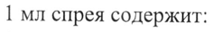
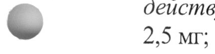
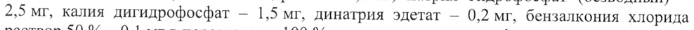

# Фенилэфрин + Цетиризин — нос

- Препарат: Фринозол® (спрей назальный;)
- АТХ: R01AB01
- Источник: ГРЛС, инструкция по медицинскому применению, РУ ЛП-004440, файл от 2022-08-09 (https://grls.rosminzdrav.ru/Grls_View_v2.aspx?routingGuid=93535e6d-e5ef-4d4b-b955-0bee6cf2140d)
- Распознано автоматически (OCR): 5 из 5 стр.
- Инструкция найдена по торговому наименованию: Фринозол®, РУ ЛП-004440
- Сомнительных строк после OCR: 3 (см. раздел «Проверка распознавания»)

## Общие сведения

| МИНЗДРА OCCHH РИА 499.
МИНИСТЕРСТВО ЗДРАВООХРАНЕНИЯ РОССИЙСКОЙ ФЕДЕРАЦИИ!
| COT JACOBAHO ИНСТРУКЦИЯ ————^——— ПО МЕДИЦИНСКОМУ ПРИМЕНЕНИЮ ЛЕКАРСТВЕННОГО ПРЕПАРАТА
Фринозол® Регистрационный номер:
Торговое наименование: Фринозол® Международное непатентованное или группировочное наименование: Фенилэфрин +
Цетиризин Лекарственная форма: спрей назальный

## 2. Состав

1 мл спрея содержит:
1 мл спрея содержит:
: действующие вещества: фенилэфрина гидрохлорид — 2,5 мг, цетиризина дигидрохлорид — w 2,5 мг;
вспомогательные вещества: глицерол — 40,0 мг, натрия гидрофосфат (безводный) — 2,5 мг, калия дигидрофосфат — 1,5 мг, динатрия эдетат — 0,2 мг, бензалкония хлорида раствор 50 % — 0,1 мг в пересчете на 100 %, вода очищенная — до 1 мл.
Описание Прозрачный бесцветный или светло-желтого цвета раствор.
& Фармакотерапевтическая группа Противоаллергическое средство комбинированное (Н!-гистаминовых рецепторов блокатор + альфа-адреномиметик).
Код АТХ ВО1АВО1 Фармакологическое действие
© Фармакодинамика Комбинированный препарат для местного интраназального применения для патогенетического и симптоматического лечения, обладающий сосудосуживающим и противоаллергическим действием.
Фенилэфрин представляет собой агонист альфа-1-адренергических рецепторов
(симпатомиметик), вызывает сужение кровеносных сосудов слизистой оболочки полости носа, уменьшает отек слизистых оболочек и гиперемию тканей, застойные явления в слизистой оболочке полости носа. Восстановление воздушной проходимости носоглотки улучшает самочувствие пациента и снижает опасность возможных осложнений, вызванных застоем слизистого секрета.
Цетиризин — блокатор Н!-гистаминовых рецепторов, обладает противоаллергическим действием, уменьшает проницаемость капилляров, предупреждает развитие отека слизистой оболочки полости носа и его придаточных пазух.
В состав препарата входит вспомогательное увлажняющее вещество глицерол, способствующее удержанию влаги, что помогает обеспечить увлажнение при сухости и раздражении слизистой оболочки носа.

## 5.2. Фармакокинетика

Препарат предназначен для местного интраназального применения, и его активность не зависит от концентрации активных веществ в плазме крови.
Препарат предназначен для местного интраназального применения, и его активность не зависит от концентрации активных веществ в плазме крови.

## 4.1. Показания к применению

— острый ринит (в том числе при «простудных» заболеваниях);

— аллергический ринит (в том числе при сенной лихорадке);

— вазомоторный ринит;

— хронический ринит;

— острый и хронический синусит; .

— острый средний отит (в качестве вспомогательного метода лечения);

— подготовка к хирургическим вмешательствам в области носа и устранение отека слизистой оболочки полости носа и придаточных пазух после хирургических вмешательств в этой области.

## 4.3. Противопоказания

— гиперчувствительность к фенилэфрину, цетиризину, гидроксизину и другим производным пиперазина, а также другим компонентам препарата;

— атрофический ринит;

& — прием ингибиторов моноаминооксидазы (одновременный или в предшествующие 14 дней);

— закрытоугольная глаукома;

— детский возраст до 18 лет (данные по эффективности и безопасности у детей отсутствуют);

— беременность, период грудного вскармливания.

## 4.3. С осторожностью

& — сердечно-сосудистые заболевания, в ТОМ числе артериальная гипертензия, аритмии, генерализованный атеросклероз; .

— гипертиреоз;

— аденома предстательной железы;

— хроническая почечная недостаточность;

— пожилой возраст;

— пациенты с повышенной судорожной активностью;

р — стенокардия;
= — сахарный диабет;

— обструкция шейки мочевого пузыря (например, вследствие гипертрофии предстательной железы);

— эпилепсия;

— пациентам с выраженными реакциями на симпатомиметики, проявляющимися в виде бессонницы, головокружения, тремора, сердечной аритмии или повышения артериального давления (как и в случае применения любых местных сосудосуживающих средств).

## 4.6. Применение при беременности и в период грудного вскармливания

В связи с отсутствием данных применение препарата противопоказано при беременности

и в период грудного вскармливания.

## 4.2. Способ применения и дозы

Интраназально.

Взрослым рекомендуемая суточная доза — 1-2 впрыскивания в каждый носовой ход 2-3

раза в сутки.

Флакон следует держать вертикально, распылителем кверху. Наклоните голову, вставьте

наконечник флакона в носовой ход, 1 раз коротким резким движением нажмите на распылитель. Во время впрыскивания рекомендуется сделать легкий вдох через нос.
Перед введением препарата следует тщательно очистить носовые ходы.
Препарат не следует применять непрерывно более 7 дней. Если симптомы не проходят, следует проконсультироваться с врачом.

## 4.8. Побочное действие

Цетиризин в комбинации с фенилэфрином в виде спрея в терапевтических дозах переносится хорошо, однако могут наблюдаться следующие побочные действия.
Цетиризин в комбинации с фенилэфрином в виде спрея в терапевтических дозах переносится хорошо, однако могут наблюдаться следующие побочные действия.
Классификация частоты развития побочных эффектов согласно рекомендациям
Всемирной организации здравоохранения (ВОЗ):
очень часто > 1/10;
часто от > 1/100 до < 1/10;
нечасто от > 1/1000 до < 1/100;
редко ot > 1/10000 до < 1/1000;
очень редко < 1/10000, включая отдельные сообщения;
частота неизвестна — по имеющимся данным установить частоту возникновения
‹ не представляется возможным.

w Нарушения co стороны крови и лимфатической системы:
очень редко — тромбоцитопения.
Нарушения со стороны иммунной системы:
редко — реакции гиперчувствительности;
очень редко — анафилактический шок.
Нарушения метаболизма и питания:
частота неизвестна — повышение аппетита.

р Психические расстройства:

w нечасто — возбуждение;
редко — агрессия, спутанность сознания, депрессия, галлюцинации;
очень редко — THK;
частота неизвестна— суицидальные идеи, нарушения сна (включая кошмарные сновидения).
Нарушения со стороны нервной системы:
нечасто — парестезии;

редко — судороги;

w очень редко — извращение вкуса, дискинезия, дистония, обморок, тремор;
частота неизвестна — головная боль, головокружение, нарушение памяти, в т.ч. амнезия, глухота.
Нарушения со стороны органа зрения:
очень редко — нарушение аккомодации, нечеткость зрения, нистагм;
частота неизвестна — васкулит.
Нарушения со стороны органа слуха и лабиринта:
частота неизвестна — вертиго.
Нарушения со стороны сердца:
редко — тахикардия;
частота неизвестна — аритмия.
Нарушения со стороны сосудов:
частота неизвестна — повышение артериального давления.
Желудочно-кишечные нарушения:
нечасто — диарея.
Нарушения со стороны печени и желчевыводящих путей:
редко — печеночная недостаточность с изменением функциональных печеночных проб
(повышение активности трансаминаз, щелочной фосфатазы, гамма-глутамилтрансферазы

и билирубина).
Нарушения со стороны кожи и подкожной клетчатки:
нечасто — сыпь, зуд;
редко — крапивница;
очень редко — ангионевротический отек, стойкая лекарственная эритема.
Нарушения со стороны мышечной, скелетной и соединительной ткани:
частота неизвестна — артралгия.
Нарушения со стороны почек и мочевыводящих путей:
очень редко — дизурия;
частота неизвестна — задержка мочи.
Общие нарушения и реакции в месте введения:
нечасто — астения, недомогание;
редко — дискомфорт в области носа, сухость или жжение в носу, покалывание, чихание, носовое кровотечение. Бензалкония хлорид, входящий в состав препарата, может вызвать раздражение слизистой оболочки носа;
частота неизвестна — отек и гиперемия слизистой оболочки полости носа, слизистые и водянистые выделения из носа, затруднение носового дыхания.
Если любые из указанных в инструкции побочных эффектов усугубляются, или Вы
- заметили любые другие побочные эффекты, не указанные в инструкции, сообщите об этом врачу.

## 4.9. Передозировка

Крайне низкая системная абсорбция препарата при местном применении делает передозировку практически невозможной.
Крайне низкая системная абсорбция препарата при местном применении делает передозировку практически невозможной.
Симптомы | При случайном однократном приеме внутрь цетиризина в дозе 50 мг могут наблюдаться:
w& спутанность сознания, диарея, утомляемость, головная боль, недомогание, мидриаз, зуд, беспокойство, седативный эффект, сонливость, ступор, тахикардия, тремор, задержка мочи.
Передозировка фенилэфрина может проявляться нарушениями сердечного ритма, повышением артериального давления, возбуждением, тошнотой, рвотой.
Лечение Промывание желудка или стимуляция рвоты, назначение активированного угля, прием
; большого количества жидкости; поддерживающая и симптоматическая терапия.
“ Специфического антидота нет. Гемодиализ неэффективен. При передозировке необходимо обратиться к врачу.

## 4.5. Взаимодействие с другими лекарственными средствами

Не следует применять препарат одновременно с три- и тетрациклическими антидепрессантами, бета-адреноблокаторами, ингибиторами моноаминооксидазы
(прокарбазин, селегилин), мапротилином, гуанедрелом, гуанетидином.
Тиреоидные гормоны при системной абсорбции фенилэфрина увеличивают (взаимно)
связанный с ними риск возникновения коронарной недостаточности (особенно при коронарном атеросклерозе).
Не рекомендуется применять препарат одновременно с другими сосудосуживающими средствами (независимо от способа применения этих средств).

## 4.4. Особые указания

Препарат не следует применять непрерывно на протяжении более 7 дней. Длительное или чрезмерное применение препарата может вызвать тахифилаксию и эффект «рикошета», связанный с повторным развитием заложенности носа (медикаментозный ринит), привести к развитию системного сосудосуживающего действия.
Препарат не следует применять непрерывно на протяжении более 7 дней. Длительное или чрезмерное применение препарата может вызвать тахифилаксию и эффект «рикошета», связанный с повторным развитием заложенности носа (медикаментозный ринит), привести к развитию системного сосудосуживающего действия.
Как и при применении других сосудосуживающих средств, не следует превышать рекомендуемые дозы препарата. В противном случае возможно развитие проявлений системного действия препарата, особенно у пациентов пожилого возраста.
Не следует применять препарат пациентам в течение 2 недель после отмены ингибиторов моноаминоксидазы, поскольку они могут усиливать выраженность адренергических эффектов симпатомиметических средств и увеличить риск возникновения побочных эффектов со стороны сердечно-сосудистой системы из-за лекарственного взаимодействия с фенилэфрином.
Препарат предназначен только для местного интраназального применения.

## 4.7. Влияние на способность управлять транспортными средствами, механизмами

Следует соблюдать осторожность при управлении транспортными средствами и механизмами, а также выполнении других видов деятельности, требующих концентрации внимания и быстроты психомоторных реакций, так как при применении препарата существует вероятность возникновения головокружения.

## 6.5. Форма выпуска

Спрей назальный 2,5 мг/мл + 2,5 мг/мл.
Спрей назальный 2,5 мг/мл + 2,5 мг/мл.

w 15 мл во флаконе из пластмассы (полиэтилена низкого давления) с дозатором для назального применения в комплекте с колпачком.
Каждый флакон вместе с инструкцией по применению в пачке из картона.

## 6.4. Условия хранения

Хранить в защищенном от света месте при температуре не выше 25 °С.
Хранить в защищенном от света месте при температуре не выше 25 °С.
Хранить в недоступном для детей месте.

‘

‘w Срок годности 2 года.
Не применять по истечении срока годности.
Условия отпуска Отпускают без рецепта.
Юридическое лицо, на имя которого выдано регистрационное удостоверение

& AO «ВЕРТЕКС», Россия Юридический адрес: 197350, г. Санкт-Петербург, Дорога в Каменку, д. 62, лит. А.
Производитель АО «ВЕРТЕКС», Россия Адрес производства: г. Санкт-Петербург, Дорога в Каменку, д. 62, лит. А.
Организация, принимающая претензии потребителей:
АО «ВЕРТЕКС», Россия 199106, г. Санкт-Петербург, Васильевский остров, 24-линия, д. 27, лит. А.
Тел./факс:

/ Представитель АО «ВЕРТЕКС» 4 С. А. Копатько
| }
## Проверка распознавания

Страницы-сканы распознаны автоматически. В 3 строках с дозировками цифры могли распознаться с ошибкой — сверьте с вырезкой из оригинала:

- стр. 1: «1 мл спрея содержит:» — низкая уверенность: «1» (73)  
  
- стр. 1: «w 2,5 мг;» — повторное чтение: «Osun»  
  
- стр. 1: «2,5 мг, калия дигидрофосфат — 1,5 мг, динатрия эдетат — 0,2 мг, бензалкония хлорида» — повторное чтение: «Ре мг, калия дигидрофосфат — 1,5 мг, динатрия эдетат — 0,2 мг, бензалкония хлорида»  
  