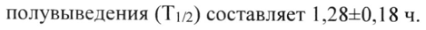
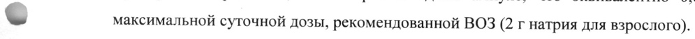

# Флороглюцинол — парентерально

- Препарат: СПАЗМОВАКС® (раствор для внутривенного и внутримышечного введения;)
- АТХ: A03AX12
- Источник: ГРЛС, инструкция по медицинскому применению, РУ ЛП-008494, файл от 2024-10-30 (https://grls.rosminzdrav.ru/Grls_View_v2.aspx?routingGuid=032e8d60-7be7-4d19-8d13-60ecee8499f0)
- Распознано автоматически (OCR): 5 из 5 стр.
- Инструкция к другому РУ того же препарата: ЛП-008494 (национальное РУ, переоформленное по правилам ЕАЭС, решение от 21.10.2024). Текст может быть старше действующего
- Сомнительных строк после OCR: 2 (см. раздел «Проверка распознавания»)

## Общие сведения

МИНИСТЕРСТВО ЗДРАВООХРАНЕНИЯ РОССИЙСКОЙ ФЕДЕРАЦИИ
ИНСТРУКЦИЯ ПО МЕДИЦИНСКОМУ ПРИМЕНЕНИЮ ЛЕКАРСТВЕННОГО ПРЕПАРАТА ]
МИНЗ 3 РОССИИ | СПАЗМОВАКС? | — 21-008494-2308;
Регистрационный номер: ГЛАСОВАЕ Торговое наименование: СПАЗМОВАКС® | |
Международное непатентованное или — группировочное — наименование:
флороглюцинол Лекарственная форма: раствор для внутривенного и внутримышечного введения
Состав ow Состав На одну ампулу:
Действующее вещество: флороглюцинола дигидрат 51,43 мг (в пересчете на флороглюцинол безводный 40,00 мг);
Вспомогательные вещества: натрия хлорид 28,00 мг, натрия метабисульфит 3,00 мг, натрия сульфит 1,00 мг, вода для инъекций до 4,00 мл.
Описание: Прозрачный бесцветный или практически бесцветный раствор.
Фармакотерапевтическая группа: препараты для лечения функциональных расстройств желудочно-кишечного тракта (ЖКТ)
Код ATX: A03AX12 Фармакологические свойства

## 5.1. Фармакодинамика

СПАЗМОВАКС® представляет собой спазмолитический препарат,
СПАЗМОВАКС® представляет собой спазмолитический препарат,
© применяемый для контроля болевого синдрома, вызванного острыми и хроническими расстройствами мочевыводящей и желчевыводящей систем. Препарат оказывает спазмолитическое действие, посредством ингибирования активности KaTexHH-Oметилтрансферазы в тканях, таким образом вмешиваясь в катаболизм катехоламинов, что приводит к последующему увеличению симпатического тонуса.
Установлено, что флороглюцинол и его метилированное производное, триметоксибензол, не приводят к изменению физиологического тонуса гладких мышц, так как они действуют избирательно на ткани гладких мышц в состоянии спазма. Интенсивная противоспазматическая активность была отмечена и для сфинктера Одди, что подтверждено исследованиями на собаках с удаленным желчным пузырем, лечение которых производилось при помощи ВаСЬ.

## 5.2. Фармакокинетика

У животных период полувыведения (T1/2) флороглюцинола, меченного тритием (3H-T.H.B)
из плазмы был равен 15 минутам. Концентрация препарата быстро снижается до 4-ого часа.
Концентрация препарата максимальна в почках, печени и кишечнике. Через 24 часа после введения радиоактивность не обнаруживается.
При введении флороглюцинола (40 мг/ 4 мл) здоровым добровольцам период полувыведения (T1/2) составляет 1,28+0,18 ч.

## 4.1. Показания к применению

Боль и спазмы в мочевыводящих путях, острая почечная колика в качестве вспомогательной терапии.
Боль и спазмы в мочевыводящих путях, острая почечная колика в качестве вспомогательной терапии.
Острая желчная колика при желчекаменной болезни или спастические состояния при заболеваниях желчевыводящих путей или спазм, вызванный дискинезией желчевыводящих путей.

w Симптоматическое лечение болей, связанных с функциональными нарушениями желудочно-кишечного тракта.

## 4.3. Противопоказания

- гиперчувствительность к флороглюцинолу или к любому из вспомогательных веществ:
- гиперчувствительность к флороглюцинолу или к любому из вспомогательных веществ:
- детский возраст;
- период грудного вскармливания.

## 4.3. С осторожностью

Беременность.
Беременность.
Нет данных о применении препарата СПАЗМОВАКС® у пациентов с почечной/печеночной недостаточностью.
Применение во время беременности и в период грудного вскармливания

© Беременность В исследованиях с животными использование флороглюцинола не выявило тератогенных эффектов. Поскольку у животных тератогенные эффекты не были обнаружены, считается, что пороки развития у людей маловероятны.
В настоящее время в ходе специальных исследований, проведенных с целью изучения тератогенности, было показано, что вещества, ответственные за пороки развития у людей, являются тератогенными для животных.
До настоящего времени относительно широкое клиническое применение флороглюцинола не выявило риска пороков развития.
Флороглюцинол используется только в случае крайней необходимости под наблюдением лечащего врача в случае, если потенциальная польза для матери превышает риск для плода.
Период грудного вскармливания

Применение лекарственного препарата в период грудного вскармливания не рекомендовано, так как клинические исследования не проводились.

## 4.2. Способ применения и дозы

Для внутривенного и внутримышечного введения.
Для внутривенного и внутримышечного введения.
Режим дозирования Для купирования острого приступа желчекаменной болезни или почечной колики: вводят внутривенно в дозе 40 мг (1 ампула). При отсутствии эффекта через 30 мин, возможно введение повторной дозы 40 мг (1 ампула). Если еще через 30 мин эффект отсутствует, то лечение прекращают.
При наличии эффекта, продолжают поддерживающую терапию: по 40 мг (1 ампула)
внутривенно или внутримышечно 1-2 раза в сутки.
Максимальная длительность терапии 5-7 дней.
& Побочное действие Частота побочных реакций приведена в виде следующей градации: очень часто (>1/10);
часто (21/100, <1/10); нечасто (1/1000, <1/100); редко (>1/10000, <1/1000); очень редко
(<1/10000); неуточненной частоты (частота не может быть подсчитана по доступным данным).
Нарушения со стороны иммунной системы:
Неуточненной частоты (частота не может быть подсчитана по доступным данным):
анафилактический шок.
Нарушения со стороны сосудов:
Неуточненной частоты (частота не может быть подсчитана по доступным данным):
снижение артериального давления.
© Нарушения со стороны кожи и подкожных тканей:

Редко (>1/10000, <1/1000): крапивница.
Очень редко (<1/10000): ангионевротический отек.
Неуточненной частоты (частота не может быть подсчитана по доступным данным): сыпь, острый генерализованный экзантематозный пустулез. |

## 4.9. Передозировка

Случаи передозировки не известны.
Случаи передозировки не известны.

## 4.5. Взаимодействие с другими лекарственными средствами

Не рекомендуется применять СПАЗМОВАКС® одновременно с сильнодействующими обезболивающими препаратами, такими как морфин или его производными, в связи с их спазмогенным действием.

Не рекомендуется смешивать СПАЗМОВАКС® с норамидопирином — из-за физической/химической несовместимости (риск развития флеботромбоза).

## 4.4. Особые указания

Рекомендуемый температурный режим хранения препарата от 15 до 25 °С. При охлаждении препарата ниже 15 °С возможно образование кристаллов. Препарат годен к применению после их полного растворения, для этого ампулу следует выдержать под теплой проточной водой и осторожно встряхнуть.

Препарат содержит натрия метабисульфит и натрия сульфит. В редких случаях они могут вызывать тяжелые реакции гиперчувствительности и бронхоспазм. Эти вещества могут вызывать аллергические реакции и тяжелые астматические приступы у чувствительных к данным компонентам пациентов и, в частности, у астматических пациентов.

Препарат содержит 12,1 мг натрия в одной ампуле, что эквивалентно 0,61 % от

& максимальной суточной дозы, рекомендованной ВОЗ (2 г натрия для взрослого).

## 4.7. Влияние на способность управлять транспортными средствами, механизмами

Применение препарата не влияет на способность управлять автотранспортом и другими механизмами.

## 6.5. Форма выпуска

Раствор для внутривенного и внутримышечного введения, 40 мг/4 мл.

По 4 мл препарата в ампулах бесцветного нейтрального стекла типа I с линией надлома.
10 ампул в ПВХ-поддоне с инструкцией по применению в пачке картонной.

## 6.4. Условия хранения

Хранить при температуре от 15 до 25 °С в оригинальной пачке.

Хранить в недоступном для детей месте.

& Срок годности

3 года.

Не применять по истечении срока годности, указанного на упаковке.

Условия отпуска

Отпускают по рецепту.

Производитель Все стадии, включая выпускающий контроль качества:

«Доппель Фармачеутичи С.Р.Л.», Италия / «Doppel Farmaceutici 5.В.[..», Italy.
Bua Волтурно, 48 - Квинто Де’ Стампи 20089 - Роццано (Милан), Италия
/ Via Volturno, 48 - Quinto De’ Stampi 20089 - Rozzano (MI), Italy.
Вторичная упаковка:
«Доппель Фармачеутичи С.Р.Л.», Италия / «Doppel Farmaceutici $.В.Г..», Italy.
Виа Мартири делле Фоибе, 1, 29016 — Кортемаджоре (Пьяченца), Италия / Via Martiri delle гос, 1, 29016 - Cortemaggiore (PC), Italy.
Владелец регистрационного удостоверения «Шарпер С.П.А.», Италия / «Scharper S.p.A.», Italy.
Виале Ортлес 12, 20139 Милан, Италия / Viale Ortles 12, 20139, Milan, Italy.
Организация, принимающая претензии потребителя
OOO «Си Эс Cu ЛТД», Россия 115230, г. Москва, Варшавское шоссе, д.47, кор.4, 14 этаж тел./факс: +7 (499) 311 67 71 http://escpharma.ru
& Специалист по регуляторным вопросам Ahi tbr Миронова М.М.
-
## Проверка распознавания

Страницы-сканы распознаны автоматически. В 2 строках с дозировками цифры могли распознаться с ошибкой — сверьте с вырезкой из оригинала:

- стр. 2: «полувыведения (T1/2) составляет 1,28+0,18 ч.» — низкая уверенность: «(T1/2)» (61)  
  
- стр. 4: «& максимальной суточной дозы, рекомендованной ВОЗ (2 г натрия для взрослого).» — повторное чтение: «| максимальной суточной дозы, ee BO3 Or натрия ameepnarcrell,»  
  
