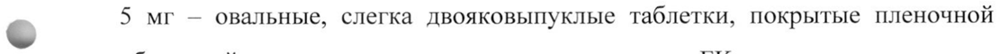

# Флупентиксол + Флупентиксола дигидрохлорид — внутрь

- Препарат: Флюанксол (таблетки, покрытые пленочной оболочкой;)
- АТХ: N05AF01
- Источник: ГРЛС, инструкция по медицинскому применению, РУ ЛП-005430, файл от 2024-09-18 (https://grls.rosminzdrav.ru/Grls_View_v2.aspx?routingGuid=ccdaabe3-2d4f-483b-980f-cd7306fb135a)
- Распознано автоматически (OCR): 17 из 17 стр.
- Инструкция к другому РУ того же препарата: ЛП-005430 (прежняя редакция, решение от 27.10.2023). Текст может быть старше действующего
- Сомнительных строк после OCR: 1 (см. раздел «Проверка распознавания»)

## Общие сведения

МИНИСТЕРСТВО ЗДРАВООХРАНЕНИЯ РОССИЙСКОЙ ФЕДЕРАЦИИ
ИНСТРУКЦИЯ ПО МЕДИЦИНСКОМУ ПРИМЕНЕНИЮ ЛЕКАРСТВЕННОГО ПРЕПАРАТА
ФЛЮАНКСОЛ

Регистрационный номер:

~ Торговое наименование: ФЛЮАНКСОЛ Международное непатентованное наименование: флупентиксол.

## 3. Лекарственная форма

таблетки, покрытые пленочной оболочкой.
таблетки, покрытые пленочной оболочкой.

## 2. Состав

Действующее вещество: флупентиксола дигидрохлорид 0,584 мг/ 1,168 мг/ 5,84 мг, что соответствует 0,5 мг/ 1 мг/ 5 мг флупентиксола.
Действующее вещество: флупентиксола дигидрохлорид 0,584 мг/ 1,168 мг/ 5,84 мг, что соответствует 0,5 мг/ 1 мг/ 5 мг флупентиксола.
Вспомогательные вещества: бетадекс 14,4 мг/ 14,4 мг/ 36,0 мг, лактозы моногидрат 20,0 мг/ 19,85 мг/ 51,04 мг, крахмал кукурузный 62,02 мг/

©, 61,58 мг/ 149,62 мг, гипролоза 5,4 мг/ 5,4 мг/ 10,5 мг, целлюлоза микрокристаллическая 12,68 мг/ 12,68 мг/ 23,90 мг, кроскармеллоза натрия 2,4 мг /2,4 мг /12,0 мг, тальк 0,6 мг/ 0,6 мг/ 1,5 мг, масло растительное гидрогенизированное 1,2 мг/ 1,2 мг / 9,0 мг, магния стеарат 0,72 мг/ 0,72 мг/ 0,6 мг.
Пленочная оболочка:
для таблеток 0,5 мги 1 мг: поливиниловый спирт частично гидролизованный, макрогол (ПЭГ) 3350, тальк, краситель железа оксид желтый (Е 172), титана диоксид (Е 171), макрогол (ПЭГ) 6000;
для таблеток 5 мг: поливиниловый спирт частично гидролизованный, макрогол (ПЭГ) 3350, тальк, краситель железа оксид желтый (Е 172),

краситель железа оксид красный (Е 172), титана диоксид (Е 171), краситель солнечный закат желтый лак алюминиевый (E110) (FD&C, FCF), макрогол
(ПЭГ) 6000.
Описание 0,5 мг — круглые, слегка двояковыпуклые таблетки, покрытые пленочной оболочкой желтого цвета, с тиснением «FD».
1 мг — овальные, слегка двояковыпуклые таблетки, покрытые пленочной оболочкой желтого цвета, с тиснением «ЕЁ».

© 5 мг — овальные, слегка двояковыпуклые таблетки, покрытые пленочной оболочкой желто-коричневого цвета, с тиснением «ЕК».
Фармакотерапевтическая группа:
антипсихотическое средство (нейролептик).
Код ATX: NOSAFO1.
Фармакологические свойства Флюанксол является антипсихотическим препаратом группы тиоксантенов.

## 5.1. Фармакодинамика

- Флупентиксол представляет собой смесь двух изомеров, активного флупентиксола и транс (Е)-флупентиксола, в соотношении примерно 1:1.
Антипсихотическое действие нейролептиков связано с их блокирующим действием на дофаминовые рецепторы, а также возможно блокадой 5-НТ рецепторов.
In vitro и т vivo флупентиксол обладает высоким сродством к обоим дофаминовым рецепторам ПО: и D2, в то время как флуфеназин in vivo селективно связывается с D2 рецепторами. Клозапин демонстрирует, как и флупентиксол, сродство к О! и D2 рецепторам in vitro и т vivo. Флупентиксол имеет высокое сродство к а!-адренорецепторам и 5-HT> рецепторам, хотя и в меньшей степени, чем хлорпротиксен, высокие дозы фенотиазина и

клозапина, но не обладает сродством к холинергическим мускариновым рецепторам. Он обладает незначительными антигистаминными свойствами и не блокирует действие 92-адренорецепторов.
Флупентиксол является мощным нейролептиком во всех поведенческих моделях нейролептического действия (блокирование рецепторов дофамина).
Существует корреляция между моделями тестирования in Vivo, сродством к
D2 местам связывания т vitro и средней пероральной суточной дозой антипсихотика.
Движения околоротовой мускулатуры у крыс зависят от стимуляции О!
© рецепторов или блокады D2 рецепторов. Флупентиксол может предотвратить развитие этих движений. Исследования у обезьян также показывают, что оральные гиперкинезии больше связаны со стимуляцией О! рецепторов и, в меньшей степени, с повышением чувствительности О› рецепторов. Это позволяет предположить, что активация О! рецепторов является основой для развития нежелательных реакций в организме человека, а именно дискинезии. Таким образом, блокада D; рецепторов может считаться благоприятным действием.
Флупентиксол только в очень высоких дозах усиливает продолжительность вызванного алкоголем и барбитуратами сна у мышей, что свидетельствует об
- очень слабом седативном действии в клинической практике.
Как и большинство других нейролептиков флупентиксол дозозависимо увеличивает уровень пролактина в сыворотке.
Клиническое применение небольших доз флупентиксола имеет довольно широкие показания. В зависимости от применяемого диапазона доз препарат оказывает селективное клиническое действие, которое может быть адаптировано к потребностям конкретного пациента.
Флупентиксол в низких дозах (1-2 мг/сутки) оказывает антидепрессивное, анксиолитическое и активирующее действие.
a В умеренных дозах (3-25 мг/сутки) флупентиксол показан для лечения острых и хронических психозов. В этом диапазоне доз флупентиксол практически не оказывает неспецифического седативного действия и не подходит для лечения пациентов с тяжелым психомоторным возбуждением.
Помимо значительного сокращения или полного устранения галлюцинаций, бреда и расстройства мышления, флупентиксол оказывает растормаживающее действие и улучшает настроение, что, в частности, делает его полезным при лечении пациентов с апатией, аутизмом, депрессией и низкой мотивацией.

© Антипсихотическое действие возрастает с увеличением дозы; в то же время можно ожидать некоторый седативный эффект. Флупентиксол во всем диапазоне доз оказывает выраженное анксиолитическое действие и даже в высоких дозах улучшает настроение и оказывает растормаживающее действие.

## 5.2. Фармакокинетика

Биодоступность флупентиксола при пероральном приеме составляет около 40%. Максимальная концентрация в сыворотке крови достигается примерно через 4-5 часов. Кажущийся объем распределения (Уа)в составляет около
Биодоступность флупентиксола при пероральном приеме составляет около 40%. Максимальная концентрация в сыворотке крови достигается примерно через 4-5 часов. Кажущийся объем распределения (Уа)в составляет около

~ 14,1 л/кг. Связывание с белками плазмы крови около 99%,
Флупентиксол незначительно проникает через плацентарный барьер и в небольших количествах выделяется с грудным молоком. Период полувыведения составляет примерно 35 часов. Метаболиты не обладают нейролептической активностью, выделяются, в основном, с калом и, частично, с мочой.
При поддерживающей терапии у больных шизофренией с легкой или умеренной — тяжестью — заболевания рекомендуется поддерживать минимальную (то есть измеренную непосредственно перед введением)
концентрацию флупентиксола в сыворотке в диапазоне 1-3 нг/мл
(2-8 нмоль/л).

## 4.1. Показания к применению

В дозе до 3 мг/сутки

Депрессии легкой и средней степени тяжести, сочетающиеся с тревогой,

астенией и отсутствием инициативы.

Хронические невротические расстройства с тревогой, депрессией и апатией.

Психосоматические нарушения с астеническими проявлениями.

В дозе 3 мг/сутки и более

Шизофрения и шизофреноподобные психозы с — преобладанием

галлюцинаторной симптоматики, бреда и нарушений мышления,
© сопровождающиеся также апатией, анергией, снижением настроения и

аутизмом.

## 4.3. Противопоказания

Повышенная чувствительность к Ффлупентиксолу или любому из

вспомогательных веществ (в том числе известная повышенная

чувствительность к Ффенотиазинам), наследственная непереносимость

галактозы, недостаточность лактазы, нарушение абсорбции глюкозы и

галактозы.

Сосудистый коллапс, угнетение сознания любого происхождения (в том
- числе вызванное приемом алкоголя, барбитуратов или опиоидов), кома.

Детский возраст (до 18 лет).

## 4.3. С осторожностью

Органические заболевания головного мозга; умственная отсталость;

судорожные — расстройства; тяжелая печеночная — недостаточность;

гипокалиемия, гипомагниемия и генетическая предрасположенность к таким

состояниям; сердечно-сосудистые заболевания в анамнезе (риск

транзиторного снижения артериального давления), в том числе удлинение

интервала ОТ, брадикардия <50 ударов в минуту, недавно перенесенный

острый инфаркт миокарда, декомпенсированная сердечная недостаточность,

аритмия; наличие факторов риска развития инсульта; опиоидная и алкогольная зависимость (может усиливаться угнетение ЦНС);
беременность, период грудного вскармливания.

## 4.6. Применение при беременности и в период грудного вскармливания

Беременность Во время беременности Флюанксол следует применять, только если предполагаемая польза для матери превышает потенциальный риск для плода.

© Новорожденные, подвергающиеся воздействию антипсихотических средств
(включая флупентиксол) во время третьего триместра беременности, подвержены риску развития нежелательных реакций, включая экстрапирамидные симптомы и/или проявления синдрома отмены, которые могут варьировать по степени тяжести и продолжительности после родов.
Были зафиксированы случаи возбуждения, повышенного и пониженного мышечного тонуса, тремора, сонливости, респираторного дистресса, а также нарушений питания. Поэтому за новорожденными следует тщательно наблюдать.
Исследования на животных показали наличие репродуктивной токсичности.

-
Грудное вскармливание С учетом того, что флупентиксол в незначительных концентрациях присутствует в грудном молоке, он вряд ли способен оказывать негативное воздействие на ребенка в случае назначения препарата матери в терапевтических дозах. Доза, поступающая перорально в организм ребенка, составляет менее 0,5% от суточной материнской дозы, скорректированной по массе тела. Во время лечения Флюанксолом допускается продолжить кормление грудью, если это признано клинически необходимым. Тем не менее, рекомендуется наблюдать за состоянием новорожденного, особенно в первые 4 недели после рождения.

Фертильность

У человека были зафиксированы такие нежелательные явления, как

гиперпролактинемия, галакторея, аменорея, снижение либидо, эректильная

дисфункция и нарушения эякуляции (см. раздел «Побочное действие»). Эти

побочные действия могут оказывать отрицательное влияние на сексуальную

функцию и Фертильность женщин и/или мужчин. В случае появления

клинически значимых гиперпролактинемии, галактореи, аменореи или

проявлений сексуальной дисфункции необходимо рассмотреть вопрос о

снижении дозы (если это возможно) или отмене препарата. Указанные
© эффекты являются обратимыми после отмены препарата.

В доклинических исследованиях фертильности у крыс флупентиксол

оказывал незначительное влияние на частоту наступления беременности у

самок крыс. Эффекты наблюдались в дозах, значительно превышающих

используемые в клинической практике.

## 4.2. Способ применения и дозы

Таблетки принимают внутрь: проглатывают, запивая водой.

Депрессии. Невротические расстройства. Психосоматические нарушения

Исходно 1 мг ежедневно как однократная утренняя доза или 0,5 мг дважды в
- день. Через неделю при недостаточном терапевтическом эффекте доза может

быть увеличена до 2 мг в день. Ежедневную дозу более 2 мги до 3 мг следует

разделить на несколько приемов.

Пожилые пациенты: рекомендуемая суточная доза составляет 0,5-1,5 мг.

Реакция пациентов на Флюанксол обычно наступает в течение 2-3 дней. Если

эффекта от максимальной дозы (3 мг в день) не наблюдается в течение

недели, то препарат следует отменить.

Шизофрения и шизофреноподобные психозы

Дозы препарата должны подбираться индивидуально в зависимости от

состояния пациента. Как правило, первоначально следует применять

небольшие дозы, которые затем быстро наращиваются до оптимальных в зависимости от клинического эффекта.
Начальная суточная доза — 3-15 мг - делится на 2-3 приема. При необходимости дозу можно увеличить до 20-30 мг в день. Максимальная суточная доза составляет 40 мг. Обычная поддерживающая терапия — 5-20 мг в день. Поддерживающая доза может быть назначена один раз в сутки утром.
Пожилые пациенты: рекомендуются более низкие дозы.
Длительность терапии зависит от природы заболевания. Терапия хронических психозов может длиться несколько лет.

© Сниженная функция почек Флюанксол может назначаться в обычных дозах пациентам со сниженной функцией почек.
Сниженная функция печени Пациентам со сниженной функцией печени следует назначать меньшую дозу, а также по возможности проводить мониторинг концентрации флупентиксола в сыворотке крови.

## 4.8. Побочное действие

Большинство нежелательных реакций являются дозозависимыми. Частота
Большинство нежелательных реакций являются дозозависимыми. Частота

- возникновения нежелательных реакций и их интенсивность наиболее выражены на ранних этапах лечения и снижаются по мере продолжения терапии.
Во время лечения флупентиксолом и сразу после отмены терапии были отмечены случаи появления суицидальных мыслей и суицидального поведения (см. раздел «Особые указания»).
Могут возникать экстрапирамидные расстройства, особенно на ранних стадиях лечения. В большинстве случаев эти нежелательные реакции успешно контролируются путем снижения дозы и/или применением антипаркинсонических препаратов. Однако рутинное использование антипаркинсонических средств для профилактики нежелательных реакций не

рекомендуется. Они не облегчают проявлений поздней дискинезии и могут ухудшить их. Рекомендуется снижение дозы или, если возможно, прекращение терапии флупентиксолом. При персистирующей акатизии могут быть полезны бензодиазепины или пропранолол.
Информация о частоте возникновения нежелательных реакций представлена на основании данных литературы и спонтанных сообщений. Частота указана как: очень часто (>1/10), часто (от 21/100 до <1/10), нечасто (от 21/1000 до
<1/100), редко (от 21/10000 до <1/1000), очень редко (<1/10000), либо неизвестно (нельзя оценить на основании существующих данных).

© Нарушения со стороны крови и лимфатической системы: редко — тромбоцитопения, нейтропения, — гранулоцитопения, — агранулоцитоз, лейкопения, гемолитическая анемия.
Нарушения со стороны иммунной системы: редко — гиперчувствительность, анафилактические реакции.
Нарушения со стороны эндокринной системы: редко — гиперпролактинемия, дисменорея, сахарный диабет, снижение потенции, изменение углеводного обмена.
Нарушения со стороны обмена веществ и питания: часто — повышение аппетита, повышение массы тела; нечасто — снижение аппетита; редко —

- гипергликемия, нарушение толерантности к глюкозе.
Нарушения психики: часто — бессонница, депрессия, нервозность, ажитация, снижение либидо; нечасто — спутанность сознания; неизвестно — суицидальные мысли, суицидальное поведение.
Нарушения со стороны нервной системы: очень часто — сонливость, акатизия, гиперкинез, гипокинезия; часто — головокружение, головная боль, тремор, дистония, нарушение внимания; от нечасто до редко — поздняя дискинезия, дискинезия, паркинсонизм, расстройства речи, судорожные расстройства; очень редко — злокачественный нейролептический синдром.
Со стороны органов зрения: часто — нарушение аккомодации, нарушение зрения; нечасто — непроизвольное движение глазных яблок.

Нарушения со стороны сердца: часто — тахикардия, ощущение сердцебиения; редко — удлинение интервала ОТ на электрокардиограмме.
Нарушения со стороны сосудов: нечасто — гипотензия, «приливы»; очень редко — венозная тромбоэмболия.
Нарушения со стороны дыхательной системы, органов грудной клетки и средостения: часто — одышка.
Нарушения со стороны желудочно-кишечного тракта: очень часто — сухость во рту; часто — запор, диарея, диспепсия, повышенное слюноотделение, рвота; нечасто — боль в животе, тошнота, метеоризм.

© Нарушения со стороны печени и желчевыводящих путей: нечасто — изменение лабораторных показателей функции печени; очень редко — желтуха.
Нарушения со стороны кожи и подкожных тканей: часто — зуд, повышенное потоотделение; нечасто — дерматит, кожная сыпь, фотосенсибилизация.
Нарушения со стороны скелетно-мышечной и соединительной ткани: часто
— миалгия; нечасто — мышечная ригидность.
Нарушения со стороны почек и мочевыводящих путей: часто — задержка мочи, расстройства мочеиспускания.
Беременность, послеродовые и перинатальные состояния: неизвестно —

- неонатальный синдром отмены.
Нарушения со стороны половых органов и молочной железы: нечасто — эректильная дисфункция, нарушения эякуляции; редко — гинекомастия, галакторея, аменорея.
Общие расстройства и нарушения в месте введения: часто — астения, слабость.
Как и при применении других антипсихотических препаратов при приеме флупентиксола также были зарегистрированы следующие нежелательные реакции: в редких случаях удлинение интервала ОТ, желудочковые аритмии
— фибрилляция и тахикардия, внезапная смерть и полиморфная желудочковая тахикардия по типу «пируэт» (Torsade des Pointes). Резкое прекращение

приема флупентиксола может сопровождаться возникновением реакций
«отмены». Наиболее частые симптомы: тошнота, рвота, анорексия, диарея, ринорея, потоотделение, миалгии, парестезии, бессонница, нервозность, тревога и ажитация. Пациенты могут также испытывать головокружение, ощущения тепла и холода и тремор. Симптомы, как правило, начинаются в течение | — 4 дней после отмены и уменьшаются в течение 7 — 14 дней.

## 4.9. Передозировка

Симптомы.
Симптомы.
© Сонливость, кома, двигательные расстройства, судороги, шок, гипертермия/гипотермия.
При передозировке одновременно с приемом препаратов, оказывающих влияние на сердечную деятельность, были зарегистрированы изменения на
ЭКГ, удлинение интервала QT, полиморфная желудочковая тахикардия по типу «пируэт» (Torsade des Pointes), остановка сердца, вентрикулярная аритмия.
Лечение.
Симптоматическое и поддерживающее. Как можно быстрее должно быть произведено промывание желудка, рекомендуется применение
- активированного угля. Должны быть приняты меры, направленные на поддержание деятельности дыхательной и сердечно-сосудистой систем. Не следует применять эпинефрин (адреналин), т.к. это может привести к последующему понижению артериального давления. Судороги можно купировать диазепамом, а двигательные расстройства бипериденом.

## 4.5. Взаимодействие с другими лекарственными средствами

Флюанксол может усилить седативное действие алкоголя, действие барбитуратов и других угнетающих ЦНС веществ.
Флюанксол не следует назначать вместе с гуанетидином или аналогично действующими препаратами из-за возможного ослабления гипотензивного действия этих средств.

Одновременное применение нейролептиков и лития повышает риск

нейротоксичности.

Трициклические антидепрессанты и нейролептики взаимно ингибируют

метаболизм друг друга.

Флюанксол может снижать эффект леводопы и действие адренергических

препаратов. Одновременное применение с метоклопрамидом и пиперазином

повышает риск развития экстрапирамидных нарушений.

Увеличение интервала ОТ, характерное для терапии антипсихотическими
© средствами, может быть усилено при одновременном приеме препаратов,

удлиняющих интервал ОТ: антиаритмических лекарственных средств IA и

Ш классов (хинидин, амиодарон, соталол, дофетилид), некоторых

антипсихотических средств (тиоридазин), некоторых антибиотиков-

макролидов (эритромицин) и антибиотиков хинолонового ряда

(гатифлоксацин, моксифлоксацин), некоторых антигистаминных средств

(терфенадин, астемизол), а также цизаприда, лития и других лекарственных

средств, увеличивающих интервал ОТ. Следует избегать одновременного

приема Флюанксола и указанных выше препаратов.

Флюанксол следует с осторожностью назначать одновременно с
- препаратами, вызывающими электролитные нарушения (тиазидные и

тиазидоподобные диуретики), и препаратами, способными повысить

концентрацию флупентиксола в плазме крови, из-за возможного увеличения

риска удлинения интервала ОТ и возникновения опасных для жизни

аритмий.

## 4.4. Особые указания

При приеме любых нейролептиков существует возможность развития

злокачественного нейролептического синдрома (гипертермия, мышечная

ригидность, эпизоды потери сознания, нестабильность автономной нервной

системы).

Риск повышается при использовании более сильных препаратов.
У пациентов с имеющимися органическими заболеваниями головного мозга, умственной отсталостью и опиоидной и алкогольной зависимостью частота случаев с летальным исходом выше.
Лечение: Прекратить прием нейролептиков. Назначить симптоматическую и общеукрепляющую терапию. Рекомендуется применение дантролена и бромокриптина. Симптоматика может сохраняться более недели после прекращения приема пероральных нейролептиков и дольше — при использовании депо форм.

© Как и другие нейролептики флупентиксол следует с осторожностью назначать пациентам с органическими заболеваниями головного мозга, судорожными расстройствами и тяжелыми нарушениями функции печени.
Не рекомендуется назначать легковозбудимым или гиперактивным пациентам дозы до 25 мг/сутки, так как активирующее действие препарата может привести к ухудшению состояния больного. Если пациент получал транквилизаторы или нейролептики, обладающие седативным эффектом, то их следует отменять постепенно.

-
Как и другие психотропные препараты флупентиксол может изменить концентрацию инсулина и глюкозы в крови, что может потребовать коррекции доз гипогликемических препаратов у пациентов с диабетом.
При длительной терапии, особенно высокими дозами, необходимо проводить тщательный контроль, периодически оценивая состояние пациентов, чтобы принять решение о возможности уменьшения поддерживающей дозы.
Как и другие препараты, принадлежащие к терапевтическому классу нейролептиков, флупентиксол может вызвать удлинение интервала ОТ.

La Постоянно удлиненные интервалы ОТ могут повысить риск возникновения злокачественных аритмий. Поэтому флупентиксол следует с осторожностью применять у пациентов с гипокалиемией, гипомагниемией и генетической предрасположенностью к таким состояниям и у пациентов с сердечнососудистыми заболеваниями в анамнезе, например, удлинением интервала
ОТ, значительной брадикардией (<50 ударов в минуту), недавно перенесенным острым инфарктом миокарда, декомпенсированной сердечной недостаточностью или аритмией. Следует избегать одновременного применения с другими антипсихотиками (см. раздел «Взаимодействие с
© другими лекарственными препаратами»).
Депрессия связана с повышенным риском возникновения суицидальных мыслей, нанесения себе телесных повреждений и суицида (суицидальные явления). Этот риск сохраняется до наступления выраженной ремиссии.
Поскольку улучшения может не наблюдаться в течение первых нескольких недель терапии или даже большего промежутка времени, пациенты должны находиться под постоянным наблюдением до наступления улучшения их состояния.
Общая клиническая практика показывает, что на ранних стадиях
- выздоровления возможно увеличение риска самоубийства.
Другие психические состояния, для лечения которых назначают флупентиксол, могут также быть связаны с повышенным риском возникновения суицидальных явлений. Кроме того, эти состояния могут являться сопутствующей патологией по отношению к депрессивному эпизоду. При лечении пациентов с другими психическими расстройствами следует соблюдать те же самые предосторожности, что при лечении пациентов с депрессивным эпизодом.
Пациенты, имеющие в анамнезе суицидальное поведение, или пациенты со значимым уровнем размышления на суицидальные темы до начала лечения в большей степени подвержены риску суицидальных мыслей или попыток суицида, поэтому во время лечения за ними должно вестись тщательное наблюдение. Мета-анализ плацебо-контролируемых клинических исследований антидепрессантов с участием взрослых пациентов с психическими нарушениями показал, что при приеме антидепрессантов у пациентов моложе 25 лет существует повышенный риск суицидального поведения по сравнению с приемом плацебо. Медикаментозное лечение этих пациентов и, в частности, пациентов с высокой степенью риска суицида, должно сопровождаться тщательным наблюдением, особенно на ранней стадии лечения и при изменениях дозы. Пациенты (и лица, ухаживающие за
© пациентами) должны быть предупреждены о необходимости контролировать любые проявления клинического ухудшения, суицидального поведения или мыслей, а также необычных изменений в поведении, и немедленно обращаться за медицинской консультацией при появлении этих симптомов.
Сообщалось о случаях развития венозной тромбоэмболии на фоне приема нейролептиков. В связи с тем, что пациенты, находящиеся на лечении нейролептиками, часто входят в группу риска развития венозной тромбоэмболии, до начала и во время лечения флупентиксолом необходимо определить факторы риска развития венозной тромбоэмболии и предпринять
- меры предосторожности.
Пожилые пациенты Церебро-васкулярные нежелательные реакции
В ходе рандомизированных плацебо-контролируемых клинических исследований применения некоторых атипичных антипсихотических препаратов у пациентов с деменцией наблюдалось З-кратное увеличение риска возникновения церебро-васкулярных нежелательных реакций.
Механизм такого повышения риска неизвестен. Нельзя исключать повышения риска и при применении других антипсихотических средств у других групп пациентов. У пациентов с риском развития инсульта следует применять флупентиксол с осторожностью.
Повышенная смертность у пожилых пациентов с деменцией
Данные двух больших наблюдательных исследований показали, что у пожилых пациентов с деменцией, принимавших антипсихотические препараты, отмечалось незначительное повышение риска смерти, по сравнению с пациентами, не принимавшими антипсихотики. Достаточных данных для точной оценки величины риска и причин его повышения нет.
Флюанксол не зарегистрирован для лечения поведенческих расстройств у

© больных с деменцией.
Вспомогательные вещества Таблетки содержат моногидрат лактозы. Пациенты с редкой наследственной непереносимостью галактозы, недостаточностью лактазы или нарушением абсорбции глюкозы и галактозы не должны принимать этот препарат.
Таблетки 5 мг содержат краситель солнечный закат желтый лак алюминиевый (E110) (FD&C, FCF), который может вызывать аллергические реакции.

w Влияние на способность управлять транспортными средствами и работать с механизмами
В период лечения необходимо воздержаться от вождения автотранспорта и занятий потенциально опасными видами деятельности, требующими повышенной концентрации внимания и быстроты психомоторных реакций.

## 6.5. Форма выпуска

Таблетки, покрытые пленочной оболочкой 0,5 мг, 1 мг, 5 мг.
Таблетки, покрытые пленочной оболочкой 0,5 мг, 1 мг, 5 мг.
Упаковка:
По 50 или 100 таблеток в пластиковый контейнер из полиэтилена высокой плотности с завинчивающейся крышкой, защитной мембраной из

ламинированной фольги, контролем первого вскрытия и защитой от вскрытия детьми. На крышку методом тиснения нанесена схема вскрытия контейнера. Контейнер с инструкцией по применению в картонную пачку.

## 6.4. Условия хранения

При температуре не выше 25°С.
При температуре не выше 25°С.
Хранить в недоступных для детей местах.

## 6.3. Срок годности

3 года.
3 года.
© He использовать по истечении срока годности, указанного На упаковке.
Условия отпуска из аптек По рецепту врача.
Производитель Х. Лундбек А/О Оттилиавай 9,
Вальбю, 2500, wo Дания Организация, уполномоченная на принятие претензий от потребителей
Представительство компании «Лундбек Экспорт А/С»
2-й Крутицкий nep., д. 18, стр. 1, Москва, 109044
Тел. (495) 380-31-97 Ps CITT ho Ne, Руководитель отдела регистрации т, ры wre по России и странам СНГ oe A Ag nt = А) рентьева 4 хх JE
## Проверка распознавания

Страницы-сканы распознаны автоматически. В 1 строках с дозировками цифры могли распознаться с ошибкой — сверьте с вырезкой из оригинала:

- стр. 2: «© 5 мг — овальные, слегка двояковыпуклые таблетки, покрытые пленочной» — повторное чтение: «© м —= — слегка двояковыпуклые таблетки, покрытые пленочной»  
  