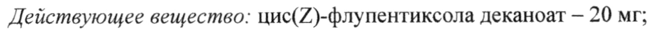

# Флупентиксол + Цис — парентерально

- Препарат: Флюанксол (раствор для внутримышечного введения;)
- АТХ: N05AF01
- Источник: ГРЛС, инструкция по медицинскому применению, РУ П N012625/02, файл от 2025-03-10 (https://grls.rosminzdrav.ru/Grls_View_v2.aspx?routingGuid=3f1883d1-1248-4ac4-9911-6e8d6dc545a7)
- Распознано автоматически (OCR): 15 из 15 стр.
- Инструкция к другому РУ того же препарата: П N012625/02 (национальное РУ, переоформленное по правилам ЕАЭС, решение от 27.02.2025). Текст может быть старше действующего
- Сомнительных строк после OCR: 1 (см. раздел «Проверка распознавания»)

## Общие сведения

NO 262507 et 27.02 2025 от 24.02.2025 № 5071
(Входящий МЗ №242 75639)
МИНИСТЕРСТВО ЗДРАВООХРАНЕНИЯ-РОССИИСКОЙ-ФЕДЕРАЦИИ
ИНСТРУКЦИЯ ПО МЕДИЦИНСКОМУ ПРИМЕНЕНИЮ ПРЕПАРАТА
ФЛЮАНКСОЛ

Регистрационный номер: IT №012625/02

Торговое название: Флюанксол

Международное непатентованное название: флупентиксол

## 3. Лекарственная форма

раствор для внутримышечного введения (масляный)
раствор для внутримышечного введения (масляный)

## 2. Состав

| мл раствора содержит:

Действующее вещество: цис(7)-флупентиксола деканоат — 20 мг;

вспомогательные вещества: триглицериды среднецепочечные — до | мл.

Описание

Прозрачная, от бесцветного до слегка желтоватого цвета маслянистая жидкость.

Фармакотерапевтическая группа: антипсихотическое средство (нейролептик)

Код ATX: NOSAFO1

Фармакологические свойства

## 5.1. Фармакодинамика

Механизм действия

Флупентиксол является антипсихотическим средством (нейролептиком) группы

тиоксантенов.

Антипсихотическое действие нейролептиков связывают с блокадой дофаминовых

рецепторов, а также, возможно, блокадой 5-НТ (5-гидрокситриптаминовых) рецепторов.

In vitro и т vivo флупентиксол обладает высокой аффинностью к связыванию с D; и D2

рецепторами, в то время как флуфеназин обладает селективной аффинностью по

отношению к D2 рецептору in vivo. Другой атипичный антипсихотик клозапин, как и

флупентиксол, проявляет эквивалентную аффинность к О: и D2 рецепторам in vitro и

in vivo.

Флупентиксол имеет высокую аффинность к связыванию с о !-адренорецепторами и 5-HT2

рецепторами, которая ниже, чем у хлорпротиксена, фенотиазинов в высокой дозе и
С. 1 из 15 СООТВЕТСТВУЕТ ЭКСПЕРТНОМУ ОТЧЕТУ от 24.02.2025 № 5071

клозапина. Аффинность к холинергическиммускариновым- рецепторам отеутетвует:
Флупентиксол обладает слабыми антигистаминергическими свойствами и не оказывает блокирующего действия на @2-адренорецепторы.
Во всех исследованиях по оценке расстройств поведения для изучения нейролептической
(блокирующей дофаминовые рецепторы) активности доказано, что флупентиксол является сильным нейролептиком. Обнаружена корреляция в исследуемых моделях in vivo между сродством к связывающим участкам на дофаминовых D2 рецепторах in vitro и средними суточными дозами антипсихотических препаратов для приема внутрь.
Периоральные движения у крыс зависят от стимуляции группы Di рецепторов или блокады D2 рецепторов. Появление движений можно предотвратить применением флупентиксола. Кроме того, результаты исследования у обезьян показывают, что оральная гиперкинезия в большей степени связана со стимуляцией О: рецептора, и в меньшей степени с повышенной чувствительностью D2 рецептора. Эти результаты приводят к предположению о том, что активация О! рецепторов способствует появлению сходных эффектов (то есть, дискинезии) у человека. Поэтому предпочтительной является блокада
О: рецепторов.
Как и большинство других нейролептиков, флупентиксол повышает концентрацию пролактина в сыворотке крови.
На основании фармакологических исследований было однозначно установлено, что масляный раствор флупентиксола деканоата обладает длительным нейролептическим действием, и количество лекарственного препарата, необходимого для поддержания определенного действия в течение длительного периода времени, значительно меньше при применении препарата в форме депо по сравнению с ежедневным применением флупентиксола внутрь. Невыраженное и кратковременное удлинение сна у мышей, обусловленное барбитуратом, может проявиться только при применении высоких доз флупентиксола. В связи с этим маловероятно, что у пациентов, получающих препарат в форме депо, возникнет какое-либо значимое взаимодействие флупентиксола с анестетиками.
Клиническая эффективность и безопасность
Флупентиксола деканоат показан для поддерживающего лечения пациентов с хроническими психозами. Антипсихотическое действие усиливается с увеличением дозы.
В малых и средних дозах (до 100 мг | раз в 2 недели) флупентиксола деканоат не проявляет седативного действия, которое может развиваться при использовании препарата

С. 2 из 15 от 24.02.2025 № 5071 (Входящий МЗ №242 75639)

в более высоких дозах. Флупентиксола деканеат-ееебенне-эффективен-нри-яечении пациентов с апатией, отчужденностью, депрессией и низкой мотивацией.
Флупентиксола деканоат в данной лекарственной форме позволяет проводить непрерывную антипсихотическую терапию, особенно тех пациентов, которые не соблюдают рекомендованный режим приема пероральных лекарственных препаратов.
Таким образом, флупентиксола деканоат предотвращает частые рецидивы, связанные с прерыванием пациентами приема пероральных лекарственных препаратов.

## 5.2. Фармакокинетика

Всасывание В процессе этерификации при взаимодействии флупентиксола с декановой кислотой, флупентиксол преобразуется в высоколипофильное вещество флупентиксола деканоат.
Всасывание В процессе этерификации при взаимодействии флупентиксола с декановой кислотой, флупентиксол преобразуется в высоколипофильное вещество флупентиксола деканоат.
При растворении в масляной среде и внутримышечном введении эфир довольно медленно диффундирует из масляной среды в водную среду организма, в которой он быстро гидролизуется с высвобождением активного флупентиксола.
После внутримышечной инъекции максимальная концентрация в сыворотке крови, как правило, достигалась в течение 3-7 дней. С учетом расчетного периода полувыведения в 3 недели (период, необходимый для высвобождения из депо) равновесная концентрация будет достигнута примерно через 3 месяца при повторном применении.
Распределение | Кажущийся объем распределения (Va)p составляет около 14,1 л/кг. Связывание с белками плазмы крови составляет около 99 %.
Метаболизм Метаболизм флупентиксола протекает по трем основным направлениям: одновременное окисление и сульфирование, М-деалкилирование боковой цепи и конъюгирование с глюкуроновой кислотой Метаболиты не обладают психофармакологической активностью. В головном мозге и других тканях обнаруживается в основном флупентиксол, а не метаболиты.
Выведение Период полувыведения (Туз) флупентиксола составляет около 35 часов, а средний системный клиренс (Cl) около 0,29 л/мин.
Флупентиксол выводится главным образом через кишечник и в незначительной степени — через почки. При введении в организм человека флупентиксола, меченого тритием,

С. 3 из 15 СООТВЕТСТВУЕТ ЭКСПЕРТНОМУ ОТЧЕТУ от 24.02.2025 № 5071

особенности экскреции позволяют установить ‘что-вытведение препарата-через-киттечнт!
примерно в 4 раза превышает выведение через почки.
У женщин в период лактации флупентиксол в небольших количествах проникает в грудное молоко. Соотношение концентрации препарата в грудном молоке и сыворотке крови составляет в среднем 1,3.
Линейность Кинетика носит линейный характер. Среднее значение концентрации флупентиксола в сыворотке крови в равновесном состоянии перед инъекцией, соответствующее применению флупентиксола деканоата в дозе 40 мг | раз в 2 недели, составляет около 6 нмоль/Л.
Пациенты пожилого возраста Фармакокинетические исследования у пациентов пожилого возраста не проводились.
Однако фармакокинетические параметры такого препарата группы тиоксантенов, как зуклопентиксол, в значительной степени не зависят от возраста пациентов.
Пациенты с нарушением функции почек На основании представленных выше характеристик процесса выведения можно предположить, что снижение функции почек не оказывает значительного влияния на концентрацию исходного препарата в сыворотке крови.
Пациенты с нарушением функции печени Данные отсутствуют.
Взаимосвязь фармакокинетики/фармакодинамики
Концентрация в сыворотке (плазме) крови перед инъекцией составляет 1-3 нг/мл
(2-8 нмоль/л), и соотношение максимальная/минимальная концентрация < 2,5 предлагается в качестве справочной величины при поддерживающем лечении больных шизофренией с малопрогредиентным и среднепрогредиентным течением заболевания.
С точки зрения фармакокинетики флупентиксола деканоат в дозе 40 мг 1 раз в 2 недели эквивалентен ежедневному приему внутрь флупентиксола в суточной дозе 10 мг.

## 4.1. Показания к применению

Поддерживающее лечение шизофрении и других психотических состояний, протекающих с галлюцинациями, бредом и нарушениями мышления, сопровождающихся апатией, анергией, депрессией и аутизмом.
Поддерживающее лечение шизофрении и других психотических состояний, протекающих с галлюцинациями, бредом и нарушениями мышления, сопровождающихся апатией, анергией, депрессией и аутизмом.

## 4.3. Противопоказания

С. 4 из 15 от 24.02.2025 № 5071 (Входящий МЗ №242 75639)

Повышенная чувствительность к флупентиксолу-—или--любому—из—вепомегательньые веществ (в том числе известная повышенная чувствительность к фенотиазинам).
Сосудистый коллапс, угнетение сознания любого происхождения (в том числе вызванное приемом алкоголя, барбитуратов или опиатов), кома.
Детский возраст до 18 лет (эффективность и безопасность не установлены).

## 4.3. С осторожностью

органические заболевания головного мозга, умственная отсталость, судорожные расстройства, тяжелая печеночная недостаточность, гипокалиемия, гипомагниемия и генетическая предрасположенность к таким состояниям, сердечнососудистые заболевания в анамнезе (риск транзиторного снижения артериального давления), в том числе удлинение интервала ОТ, значительная брадикардия (< 50 ударов в минуту), недавно перенесенный острый инфаркт миокарда, декомпенсированная сердечная недостаточность, аритмия, наличие факторов риска развития инсульта, опиоидная и алкогольная зависимость (может усиливаться угнетение ЦНС), беременность, период грудного вскармливания, одновременное применение с препаратами, угнетающими костномозговое кроветворение.
органические заболевания головного мозга, умственная отсталость, судорожные расстройства, тяжелая печеночная недостаточность, гипокалиемия, гипомагниемия и генетическая предрасположенность к таким состояниям, сердечнососудистые заболевания в анамнезе (риск транзиторного снижения артериального давления), в том числе удлинение интервала ОТ, значительная брадикардия (< 50 ударов в минуту), недавно перенесенный острый инфаркт миокарда, декомпенсированная сердечная недостаточность, аритмия, наличие факторов риска развития инсульта, опиоидная и алкогольная зависимость (может усиливаться угнетение ЦНС), беременность, период грудного вскармливания, одновременное применение с препаратами, угнетающими костномозговое кроветворение.
Не рекомендуется назначать пациентам в состоянии психомоторного возбуждения, т.к.
активирующее действие препарата Флюанксол в небольших дозах (10-20 мг 1 раз в 2 недели) может привести к обострению этой симптоматики.

## 4.6. Применение при беременности и в период грудного вскармливания

Беременность Флюанксол следует применять при беременности только в случае, если предполагаемая польза для матери превышает потенциальный риск для плода.
У новорожденных, которые подвергались воздействию антипсихотиков (включая флупентиксола деканоат) во время третьего триместра беременности, существует риск развития нежелательных реакций, включая экстрапирамидные симптомы и/или проявления синдрома отмены, которые могут варьировать по степени тяжести и продолжительности после родов. Были зафиксированы случаи возбуждения, повышенного и пониженного мышечного тонуса, тремора, сонливости, респираторного дистресссиндрома и расстройства питания. Следовательно, новорожденные должны находиться под тщательным наблюдением.
Исследования на животных выявили репродуктивную токсичность препарата.
При применении флупентиксола сообщалось о таких нежелательных явлениях как гиперпролактинемия, галакторея, аменорея, снижение либидо, эректильная дисфункция и

С. 5 из 15 от 24.02.2025 № 5071 (Входящий МЗ №42 75639)

нарушение эякуляции (см. раздел «Побочное-дейетвие»)-Эти-нежелателньные-явления могут иметь негативное влияние на сексуальную функцию и фертильность женщин и/или мужчин. В случае возникновения клинически значимых симптомов гиперпролактинемии, галактореи, аменореи или сексуальной дисфункции рекомендуется снижение дозы препарата (по возможности) или его отмена. Нежелательные явления обратимы при прекращении лечения.
Доклинические изучения фертильности показали, что флупентиксол в дозах, значительно превышающих рекомендованные для клинического применения, незначительно влияет на частоту беременности у крыс.
Грудное вскармливание Флупентиксол выделяется в грудное молоко в низкой концентрации, поэтому при применении в терапевтических дозах маловероятно, что он может воздействовать на новорожденного. Доза, поступающая в организм новорожденного, составляет менее 0,5 % от дозы, получаемой матерью, скорректированной по массе тела (в мг/кг). При наличии клинической необходимости грудное вскармливание может быть продолжено при применении препарата Флюанксол, но в этом случае рекомендуется наблюдение за новорожденным, особенно в первые 4 недели после родов.

## 4.2. Способ применения и дозы

Взрослые пациенты
Взрослые пациенты
Дозы и интервалы между введениями препарата Флюанксол подбираются индивидуально для каждого пациента так, чтобы добиться максимального контроля над психотическими симптомами с минимальными побочными эффектами.
Флюанксол вводится глубоко внутримышечно в верхний наружный квадрант ягодичной области. В другие мышцы вводить не рекомендуется. Если необходимый объем раствора превышает 2 мл, рекомендуется разделить его на две части и сделать две инъекции в разные места. Местная переносимость хорошая.
При поддерживающем лечении диапазон дозировок обычно составляет 20-40 мг (1-2 мл)
каждые 2-4 недели в зависимости от ответа на проводимую терапию. Некоторым пациентам могут быть необходимы более высокие дозы или более короткие интервалы между инъекциями. Не рекомендуется применять Флюанксол в объемах, превышающих 23 мл.

С. 6 из 15 СООТВЕТСТВУЕТ ЭКСПЕРТНОМУ ОТЧЕТУ от 24.02.2025 № 5071
(Входящий МЗ №4275639) _ Препарат Флюанксол 20 мг/мл не показан ‘чаниентам; котерь еебхел седативнь эффект.
При переходе от лечения Флюанксолом в лекарственной форме для приема внутрь на поддерживающее лечение Флюанксолом в форме раствора следует руководствоваться следующей схемой:
— суточная доза (мг) препарата для приема внутрь, умноженная на 4, соответствует дозе раствора Флюанксола с интервалом в 2 недели;
— суточная доза (мг) препарата для приема внутрь, умноженная на 8, соответствует дозе раствора Флюанксола с интервалом в 4 недели.
При этом, в течение первой недели после первой инъекции следует продолжать прием флупентиксола внутрь, но в уменьшенной дозе.
Пациенты, которые переводятся с терапии другими препаратами в лекарственной форме депо, должны получать дозы в следующем соотношении: 40 мг флупентиксола деканоата эквивалентны 25 мг флуфеназина деканоата, 200 мг зуклопентиксола деканоата или 50 мг галоперидола деканоата.
Последующие дозы и интервалы между инъекциями должны быть установлены в соответствии с ответом на лечение.
Пациенты пожилого возраста Пациенты пожилого возраста должны получать дозы на нижней границе диапазона доз.
Нарушение функции почек Флюанксол можно назначать в обычных дозах у пациентов с нарушением функции почек.
Нарушение функции печени Необходимо осторожное дозирование препарата. Рекомендуется, по возможности, определение концентрации препарата в сыворотке крови.
Дети Флюанксол не рекомендуется для применения у детей в связи с недостаточностью опыта клинического применения.

## 4.8. Побочное действие

Большинство нежелательных реакций являются дозозависимыми. Частота возникновения и тяжесть нежелательных реакций наиболее выражены в начале лечения, снижаются по мере продолжения терапии.
Большинство нежелательных реакций являются дозозависимыми. Частота возникновения и тяжесть нежелательных реакций наиболее выражены в начале лечения, снижаются по мере продолжения терапии.
C. 7 из 15 СООТВЕТСТВУЕТ ЭКСПЕРТНОМУ ОТЧЕТУ

(Входящий M3 №4275639)
Экстрапирамидные расстройства могут появиться`особенно-в-первые-дни-поеле-инъекн или в начале терапии. В большинстве случаев эти симптомы контролируются при снижении дозы и/или назначении антипаркинсонических препаратов. Профилактическое применение антипаркинсонических препаратов не рекомендуется. Они не уменьшают симптомы поздней дискинезии и могут даже усилить их. Рекомендуется снижение дозы флупентиксола или, по возможности, прекращение терапии. При стойкой акатизии может быть полезным применение бензодиазепина или пропранолола.
Частота нежелательных реакций представлена на основании сообщений из литературных источников и из спонтанных сообщений. Частота нежелательных реакций классифицируется следующим образом: очень часто (> 1/10), часто (> 1/100 до < 1/10), нечасто (> 1/1000 до < 1/100), редко (> 1/10000 до < 1/1000), очень редко (< 1/10000) или неизвестно (частота не может быть установлена на основании имеющихся данных).

С. 8 из 15 СООТВЕТСТВУЕТ ЭКСПЕРТНОМУ ОТЧЕТУ от 24.02.2025 № 5071 ee БИ сли ИИ
Частота Нежелательная реакция класс | Со стороны крови и Редко Тромбоцитопения, нейтропения, лейкопения,
| лимфатической системы ee агранулоцитоз
Со стороны иммунной Редко Гиперчувствительность, анафилактические системы ve реакции
Со стороны эндокринной | Редко Гиперпролактинемия
НЙ ВОИ титаны Редко Гипергликемия, нарушение толерантности к
ИИ Психические Часто Бессонница, депрессия, повышенная нервная расстройства В возбудимость, возбуждение, снижение либидо системы Часто Тремор, дистония, головокружение, головная a
В диапазоне от Поздняя дискинезия, дискинезия, паркинсонизм,
ИИ нп Редко Удлинение интервала ОТ на ПЕЙ
Со стороны дыхательной | Часто Одышка системы, органов грудной клетки и средостения кишечного тракта Часто Повышенное слюноотделение, запор, рвота,
ПЕНИИ Со стороны печени и Нечасто Нарушение показателей функциональных
С. 9 из 15 СООТВЕТСТВУЕТ ЭКСПЕРТНОМУ ОТЧЕТУ
Вхоля М3 №42 75639)

скелетной и Нечасто Мышечная ригидность

Со стороны почек и Часто Нарушение мочеиспускания, задержка мочи
Рон Pe Беременность, Неизвестно Синдром отмены препарата у новорожденных послеродовой период и (см. раздел «Применение при беременности и в перинатальные состояния период грудного вскармливания»)
репродуктивной системы | Редко Гинекомастия, галакторея, аменорея

При применении флупентиксола, как и других препаратов из класса антипсихотиков, имеются сообщения о редких случаях удлинения интервала ОТ, желудочковой аритмии в виде фибрилляции желудочков, желудочковой тахикардии, полиморфной желудочковой тахикардии по типу «пируэт» (Torsade de Pointes) и внезапной смерти (см. раздел «Особые указания»).

Резкое прекращение терапии флупентиксолом может сопровождаться развитием реакций отмены. Наиболее частые симптомы: тошнота, рвота, анорексия, диарея, ринорея, повышенная потливость, миалгия, парестезия, бессонница, беспокойство, чувство тревоги и возбуждение. Пациенты могут испытывать головокружение, перемежающиеся ощущения тепла и холода, тремор. Обычно эти симптомы начинаются в течение 1-4 дней после отмены препарата и ослабевают в течение 7-14 дней.

## 4.9. Передозировка

В связи с особенностью лекарственной формы развитие передозировки маловероятно.
Симптомы

Сонливость, кома, двигательные нарушения, судороги, шок, гипертермия/гипотермия.

При передозировке в сочетании с приемом препаратов, оказывающих влияние на сердечную деятельность, были зарегистрированы изменения на ЭКГ, удлинение интервала
ОТ, развитие полиморфной желудочковой тахикардии по типу «пируэт» (Torsade de
Pointes), остановка сердца, желудочковые аритмии.

Лечение

Симптоматическое и поддерживающее. Должны быть приняты меры, направленные на поддержание деятельности дыхательной и сердечно-сосудистой систем. Не следует

С. 10 из 15 СООТВЕТСТВУЕТ ЭКСПЕРТНОМУ ОТЧЕТУ от 24.02.2025 № 5071

использовать эпинефрин (адреналин), т.к; O MORE ривести—к—последующему понижению артериального давления. Судороги можно купировать диазепамом, а экстрапирамидные симптомы бипериденом.

## 4.5. Взаимодействие с другими лекарственными средствами

Комбинации лекарственных препаратов, требующие осторожности при применении
Флупентиксол может усилить седативное действие алкоголя, действие барбитуратов и других угнетающих ЦНС веществ.
Нейролептики могут усилить или снизить эффект антигипертензивных лекарственных препаратов. Антигипертензивное действие гуанетидина и аналогичных препаратов уменьшается.
Одновременное применение нейролептиков и лития повышает риск нейротоксического действия.
Трициклические антидепрессанты и нейролептики взаимно ингибируют метаболизм друг друга.
Флупентиксола деканоат может снижать эффект леводопы и действие адренергических препаратов, а комбинация с метоклопрамидом и пиперазином увеличивает риск развития экстрапирамидных нарушений.
Увеличение интервала ОТ, характерное для терапии антипсихотическими средствами, может быть усилено при одновременном приеме препаратов, удлиняющих интервал ОТ.
Следует избегать одновременного применения препарата Флюанксол с препаратами, удлиняющими интервал ОТ. К ним относятся:

— антиаритмические лекарственные средства IA и Ш классов (хинидин, амиодарон,

соталол, дофетилид), — некоторые антипсихотические средства (тиоридазин),
— некоторые антибиотики-макролиды (эритромицин) и антибиотики хинолонового ряда (гатифлоксацин, моксифлоксацин),

— некоторые антигистаминные средства (терфенадин, астемизол).
Перечень не ограничивается только перечисленными выше лекарственными средствами.
Следует также избегать одновременного применения препарата Флюанксол и с другими препаратами, значительно удлиняющими интервал ОТ (например, цизапридом, литием).
Флюанксол следует с осторожностью назначать одновременно с препаратами, вызывающими электролитные нарушения (гипокалиемия), такими как тиазидные и

С. 11 из 15 СООТВЕТСТВУЕТ ЭКСПЕРТНОМУ ОТЧЕТУ от 24.02.2025 № 5071

тиазидоподобные диуретики, и препаратами; способньыми-повьннать—коннцентераниюе флупентиксола деканоата в плазме крови, из-за возможного увеличения риска удлинения интервала ОТ и возникновения опасных для жизни аритмий (см. раздел «Особые указания»).
Флюанксол не должен смешиваться с депонированными формами на основе кунжутного масла, так как это может оказать значительное влияние на фармакокинетику вводимых препаратов.

## 4.4. Особые указания

При применении любого нейролептика возможно развитие злокачественного нейролептического синдрома (гипертермия, ригидность мышц, нарушение сознания, лабильность вегетативной нервной системы). Риск, возможно, увеличивается при применении более сильных препаратов. У пациентов с имеющимися органическими заболеваниями головного мозга, умственной отсталостью и опиоидной и алкогольной зависимостью частота случаев с летальным исходом выше.
При применении любого нейролептика возможно развитие злокачественного нейролептического синдрома (гипертермия, ригидность мышц, нарушение сознания, лабильность вегетативной нервной системы). Риск, возможно, увеличивается при применении более сильных препаратов. У пациентов с имеющимися органическими заболеваниями головного мозга, умственной отсталостью и опиоидной и алкогольной зависимостью частота случаев с летальным исходом выше.
Лечение: Отмена нейролептика. Симптоматическая и поддерживающая терапия. Могут быть применены дантролен и бромокриптин. Симптомы могут сохраняться более недели после прекращения приема пероральных нейролептиков и несколько дольше при применении лекарственных препаратов в форме депо.
Как и другие нейролептики, Флюанксол следует с осторожностью применять у пациентов с органическими заболеваниями головного мозга, судорогами и прогрессирующими заболеваниями печени.
У возбудимых и гиперактивных пациентов применение препарата Флюанксол в более низких дозах не рекомендуется, так как активирующее действие препарата может привести к усилению указанной симптоматики.
Флюанксол, как и другие психотропные препараты, может изменять концентрации инсулина и глюкозы в крови, что требует коррекции антидиабетической терапии у пациентов с сахарным диабетом. Пациенты, получающие длительную терапию, особенно в высоких дозах, должны находиться под тщательным медицинским наблюдением, предусматривающим периодическую оценку состояния пациента для принятия решения о возможности снижения поддерживающей дозы.
Как и другие лекарственные препараты, относящиеся к терапевтическому классу антипсихотических средств, Флюанксол может вызывать удлинение интервала ОТ.
Постоянно удлиненный интервал ОТ может повышать риск развития злокачественных

С. 12 из 15 СООТВЕТСТВУЕТ ЭКСПЕРТНОМУ ОТЧЕТУ от 24.02.2025 № 5071

аритмий. Поэтому Флюанксол следует применять осторожностью—у—нанциентев—е гипокалиемией, гипомагниемией или генетической предрасположенностью к таким состояниям, а также у пациентов с сердечно-сосудистыми заболеваниями в анамнезе, например, удлинением интервала ОТ, значительной брадикардией (< 50 ударов в минуту), недавно перенесенным острым инфарктом миокарда, декомпенсированной сердечной недостаточностью или аритмией. Следует избегать одновременного применения с другими антипсихотическими препаратами (см. раздел «Взаимодействие с другими лекарственными препаратами и другие формы взаимодействия»).
При применении антипсихотических препаратов были зарегистрированы случаи венозной тромбоэмболии (ВТЭ). В связи с тем, что у пациентов, получающих лечение антипсихотическими препаратами, часто имеются факторы риска развития ВТЭ, все возможные факторы риска развития ВТЭ следует определить до и во время лечения препаратом Флюанксол и проводить профилактические меры.
Лейкопения, нейтропения и агранулоцитоз были зарегистрированы при применении антипсихотических препаратов, включая флупентиксола деканоат. Антипсихотические препараты длительного действия следует применять с осторожностью в комбинации с другими лекарственными препаратами с доказанным свойством миелосупрессии, так как их невозможно быстро вывести из организма, когда это может быть необходимо.
Пациенты пожилого возраста Цереброваскулярные нежелательные явления
При проведении рандомизированных плацебо контролируемых клинических исследований в популяции пациентов с деменцией, получавших некоторые атипичные антипсихотические препараты, было зарегистрировано повышение примерно в 3 раза риска развития цереброваскулярных нежелательных явлений. Механизм такого повышения риска неизвестен. Повышенный риск невозможно исключить при применении других антипсихотиков или при изучении других популяций пациентов. Флупентиксола деканоат следует применять с осторожностью у пациентов с факторами риска развития инсульта.
Повышение показателей смертности у пациентов пожилого возраста с деменцией
Данные двух больших наблюдательных исследований показали, что у пациентов пожилого возраста с деменцией, получающих антипсихотические препараты, существует небольшое повышение риска смертельного исхода по сравнению с пациентами, не

С. 13 из 15 СООТВЕТСТВУЕТ ЭКСПЕРТНОМУ ОТЧЕТУ от 24.02.2025 № 5071

получающими эти препараты. Однако для Точной оценки величины риска имеющихся данных недостаточно. Причина повышенного риска также не установлена.
Флупентиксола деканоат не показан для лечения расстройств поведения, связанных с деменцией.

## 4.7. Влияние на способность управлять транспортными средствами, механизмами

Препарат Флюанксол не оказывает седативного действия при применении в низких и средних дозах (до 100 мг 1 разв 2 недели).
Однако у пациентов, получающих психотропные препараты, могут наблюдаться нарушения концентрации и внимания, поэтому они должны соблюдать осторожность при управлении транспортными средствами и работе с механизмами.

## 6.5. Форма выпуска

Раствор для внутримышечного введения (масляный) 20 мг/мл.
Раствор для внутримышечного введения (масляный) 20 мг/мл.
По 1 мл в ампулу из бесцветного стекла типа | (Евр. Фарм.). На ампулу нанесена красная точка, указывающая место разлома.
10 ампул с инструкцией по применению в картонной пачке с перфорированным контролем первого вскрытия (язычком для вскрытия) на подложке из картона, приклеенной ко дну пачки.

## 6.4. Условия хранения

В защищенном от света месте при температуре не выше 25 °С.
В защищенном от света месте при температуре не выше 25 °С.
Хранить в местах, недоступных для детей.
Срок хранения 4 года.
Не использовать после истечения срока годности, указанного на упаковке.
Условия отпуска из аптек Отпускают по рецепту.
Производитель Х. Лундбек А/О Оттилиавай 9,
ОК-2500 Вальбю. Дания

С. 14 из 15 СООТВЕТСТВУЕТ ЭКСПЕРТНОМУ ОТЧЕТУ от 24.02.2025 № 5071
(Входящий МЗ №4275639)
Организация, уполномоченная на принятие претензий-от-нотребихелей
Представительство компании «Лундбек Экспорт А/С»
107045, г. Москва, Последний пер., д. 17
Тел. +7 (495) 380-31-97 E-mail: russia@lundbeck.com
С. 15 из 15
## Проверка распознавания

Страницы-сканы распознаны автоматически. В 1 строках с дозировками цифры могли распознаться с ошибкой — сверьте с вырезкой из оригинала:

- стр. 1: «Действующее вещество: цис(7)-флупентиксола деканоат — 20 мг;» — низкая уверенность: «цис(7)-флупентиксола» (73)  
  
