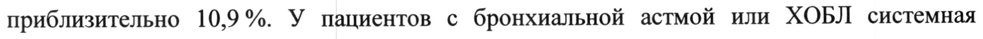
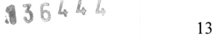

# Флутиказон — ингаляц

- Препарат: Флутиказон Эйр (аэрозоль для ингаляций дозированный;)
- АТХ: R03BA05
- Источник: ГРЛС, инструкция по медицинскому применению, РУ ЛП-008141, файл от 2022-06-15 (https://grls.rosminzdrav.ru/Grls_View_v2.aspx?routingGuid=8cb27e9d-017b-4a6a-9ee6-f8cb5f0bcc1a)
- Распознано автоматически (OCR): 13 из 13 стр.
- Инструкция к другому РУ того же препарата: ЛП-008141 (национальное РУ, переоформленное по правилам ЕАЭС, решение от 11.05.2022). Текст может быть старше действующего
- Сомнительных строк после OCR: 2 (см. раздел «Проверка распознавания»)

## Общие сведения

МИНИСТЕРСТВО ЗДРАВООХРАНЕНИЯ РОССИЙСКОЙ. ФЕДЕРАЦИИ
ИНСТРУКЦИЯ ПО МЕДИЦИНСКОМУ ПРИМЕНЕНИЮ ЛЕКАРСТВЕННОГО ПРЕПАРАТА
ФЛУТИКАЗОН ЭЙР РЕГИСТРАЦИОННЫЙ НОМЕР:
ТОРГОВОЕ НАИМЕНОВАНИЕ: Флутиказон Эйр.
МЕЖДУНАРОДНОЕ НЕПАТЕНТОВАННОЕ НАИМЕНОВАНИЕ (МНН): Флутиказон.

## 3. Лекарственная форма

аэрозоль для ингаляций дозированный.
аэрозоль для ингаляций дозированный.
~ COCTAB:
Ингредиенты Содержание в одной дозе 50 мкг/доза | 125 мкг/доза 250 мкг/доза
Действующее вещество:
Пропеллент 1,1,1,2 - 59950 мкг 59875 мкг 59750 мкг тетрафторэтан
ОПИСАНИЕ:
Суспензия белого цвета или почти белого цвета, находящаяся в алюминиевом баллоне с дозирующим клапаном.
w ФАРМАКОТЕРАПЕВТИЧЕСКАЯ ГРУППА: глюкокортикостероид для местного применения.
Код ATX: RO3BA05.
ФАРМАКОЛОГИЧЕСКИЕ СВОЙСТВА Фармакодинамика
Флутиказона пропионат относится к группе глюкокортикостероидов (ГКС) местного действия и при ингаляционном введении в рекомендуемых дозах оказывает выраженное противовоспалительное и противоаллергическое действие, что приводит к уменьшению выраженности симптомов и снижению частоты обострений — заболеваний, сопровождающихся обструкцией дыхательных путей (бронхиальная астма, хронический бронхит, эмфизема).
МИНЗДРАВ РОССИИ Флутиказона пропионат ингибирует пролиферацию тучных. ‚клеток, ‚Зозинофилов, лимфоцитов, макрофагов, нейтрофилов, снижает продукцию и высвобождение медиаторов воспаления и других биологически активных веществ — гистамина, простагландинов, лейкотриенов, цитокинов.
При хронической обструктивной болезни легких (ХОБЛ) подтверждена эффективность действия ингаляционного флутиказона пропионата (при применении в комбинации с бронходилататорами длительного действия) на функцию легких, что характеризуется уменьшением выраженности симптомов заболевания, частоты и тяжести обострений и повышением качества жизни пациентов по сравнению с плацебо.
В терапевтических дозах влияние на гипоталамо-гипофизарно-надпочечниковую систему незначительно, и данный эффект не считается клинически значимым.
Терапевтический эффект после ингаляционного применения флутиказона начинается в
< течение 24 4, достигает максимума в течение 1-2 недель и более после начала лечения.

## 5.2. Фармакокинетика

Всасывание Абсолютная биодоступность флутиказона пропионата при применении в виде дозированного аэрозоля для ингаляций у здоровых добровольцев составляет приблизительно 10,9%. У пациентов с бронхиальной астмой или ХОБЛ системная экспозиция меньше, чем у здоровых добровольцев.
Всасывание Абсолютная биодоступность флутиказона пропионата при применении в виде дозированного аэрозоля для ингаляций у здоровых добровольцев составляет приблизительно 10,9%. У пациентов с бронхиальной астмой или ХОБЛ системная экспозиция меньше, чем у здоровых добровольцев.
Системная абсорбция происходит преимущественно в легких, при этом всасывание первоначально быстрое с последующим замедлением. Часть ингалированной дозы может проглатываться, но ее системное действие минимально вследствие плохой растворимости
, препарата в воде и интенсивного пресистемного метаболизма.
> Биодоступность флутиказона пропионата при приеме внутрь составляет менее 1 %.
Существует линейная зависимость между величиной ингалированной дозы и системным действием флутиказона пропионата.
Распределение Флутиказона пропионат имеет большой объем распределения в равновесном состоянии
(около 300 л). Связь с белками плазмы крови умеренно высокая (91 %).
Метаболизм Флутиказона пропионат очень быстро выводится из системного кровотока, главным образом в результате метаболизма до неактивного метаболита карбоновой кислоты под действием изофермента СУРЗА4 системы цитохрома Р450. Поскольку существует возможность повышения системной экспозиции флутиказона пропионата, следует соблюдать осторожность при совместном применении с ‘известными | ингибиторами
CYP3A4. a a a Выведение Фармакокинетика флутиказона пропионата характеризуется высоким плазменным клиренсом (1150 мл/мин) и конечным периодом полувыведения около 8 ч. Почечный клиренс флутиказона пропионата незначителен (менее 0,2 %), и менее 5 % выводится с мочой в виде метаболита.
ПокдзднИя К ПРИМЕНЕНИЮ e Базисная противовоспалительная терапия бронхиальной астмы взрослых и детей 1 года и старше (включая пациентов с тяжелым течением заболевания, у которых имеется зависимость от системных ГКС);

w e Лечение хронической обструктивной болезни легких у взрослых в качестве дополнительного средства к терапии бронходилататорами длительного действия
(например, к бета-агонистам длительного действия (ДДБА)).

ПРОТИВОПОКАЗАНИЯ e Гиперчувствительность к любому компоненту препарата;
® Острый бронхоспазм;
e Астматический статус (в качестве первоочередного средства);
e Детский возраст (до 1 года).

## 4.3. С осторожностью

| Препарат следует применять препарат при циррозе печени, глаукоме, гипотиреозе,

© системных инфекциях (бактериальных, грибковых, паразитарных, вирусных), остеопорозе,

туберкулезе легких, беременности и в период лактации.

## 4.6. Применение при беременности и в период грудного вскармливания

Фертильность Отсутствуют данные по влиянию на фертильность у человека. В исследованиях на животных не было выявлено влияния флутиказона пропионата на фертильность самцов и самок.
Беременность Данные о применении препарата у беременных женщин ограничены. Применение флутиказона пропионата во время беременности допустимо только в случае, если потенциальная польза для матери превышает возможный риск для плода.

Результаты ретроспективного эпидемиологического исследования. не. обнаружили

повышенного риска возникновения серьезных врожденных пороков развития (CBIIP) после

применения флутиказона пропионата по сравнению с другими ингаляционными кортикостероидами в течение первого триместра беременности.

Репродуктивные исследования на животных показали, что при значениях системной

экспозиции, превышающих наблюдаемые при применении рекомендуемых

терапевтических ингаляционных доз, наблюдаются только эффекты, характерные для глюкокортикостероидов (ГКС).

Период грудного вскармливания

Выделение флутиказона пропионата в грудное молоко у человека не изучалось.

Когда после подкожного введения препарата лабораторным крысам в период лактации
, были получены поддающиеся измерению концентрации вещества в плазме крови,
> флутиказона пропионат был также обнаружен в грудном молоке. Однако после

ингаляционного применения флутиказона пропионата в рекомендуемых дозах его

концентрации в плазме крови у пациентов, скорее всего, будут низкими.

Применение препарата в период грудного вскармливания допустимо только в случае, если

потенциальная польза для матери превышает возможный риск для ребенка.

## 4.2. Способ применения и дозы

Дозированный аэрозоль Флутиказон Эйр предназначен только для ингаляций через рот.

Лечение аэрозолем Флутиказон Эйр относится к методам профилактической терапии,

препарат необходимо применять регулярно, даже при отсутствии симптомов заболевания.

Пациентам, у которых использование дозированного аэрозоля для ингаляций
- затруднительно, рекомендуется применять спейсер.

Особые группы пациентов

Лицам пожилого возраста и пациентам с заболеваниями печени или почек специального

подбора дозы не требуется.

Бронхиальная астма

Терапевтический эффект после применения препарата Флутиказон Эйр наступает через 4-

7 дней после начала лечения. У пациентов, которые ранее не принимали ингаляционные

глюкокортикостероиды, улучшение может отмечаться уже через 24 4 после начала

применения препарата.

Если пациент считает, что лечение бронходилататорами быстрого действия становится

менее эффективным, или ему требуется большее число ингаляций, чем обычно, врачу

следует обратить на это особое внимание.
на РН Взрослые и подростки старше 16 лет. | | | —
Рекомендуемая доза составляет 100-1000 мкг 2 раза в сутки. — —...
Начальная доза препарата зависит от степени тяжести заболевания:
- при бронхиальной астме легкой степени тяжести: 100-250 мкг 2 раза в сутки;
- при бронхиальной астме средней степени тяжести: 250-500 мкг 2 раза в сутки;
- при бронхиальной астме тяжелой степени: 500-1000 мкг 2 раза в сутки.
В зависимости от индивидуального ответа пациента, начальную дозу препарата можно увеличивать до достижения контроля над заболеванием или снизить до минимальной эффективной дозы.
Дети в возрасте 4 лет и старше.
Детям рекомендуется применять препарат Флутиказон Эйр, содержащий 50 мкг флутиказона пропионата в одной дозе.
w Рекомендуемая доза составляет 50-200 мкг 2 раза в сутки.
У большинства детей контроля астмы можно достичь, применяя дозы 50-100 мкг 2 раза в сутки. У детей с недостаточно контролируемой бронхиальной астмой возможно увеличение дозы до 200 мкг 2 раза в сутки.
Начальная доза препарата зависит от степени тяжести заболевания.
Затем, в зависимости от индивидуального ответа пациента, начальную дозу препарата можно увеличивать до достижения контроля над заболеванием или снизить до минимальной эффективной дозы.
Дети в возрасте от I года до 4 лет.
Рекомендуемая доза составляет 100 мкг 2 раза в сутки. Препарат вводится с помощью ингалятора через спейсер с лицевой маской, например, "Бэбихалер".
Дозированный аэрозоль Флутиказон Эйр особенно показан детям младшего возраста с
~ частыми и продолжительными приступами бронхиальной астмы.
Диагностика и лечение бронхиальной астмы должны выполняться при регулярном осмотре пациента врачом.
Хроническая обструктивная болезнь легких
Взрослые Рекомендуемая доза составляет 500 мкг 2 раза в сутки в качестве дополнительного средства к терапии бронходилататорами длительного действия (например, ДДБА).
Рекомендовано применять дозированный аэрозоль Флутиказон Эйр, содержащий 250 мкг в дозе.
Для достижения оптимального эффекта препарат рекомендовано применять ежедневно в течение 3-6 месяцев. При отсутствии клинического улучшения по прошествии 3-6 месяцев необходимо проведение медицинского осмотра.
Инструкция по проведению ингаляций 141-1105
Проверка ингалятора NACOBAI Перед первым использованием ингалятора или в случае, если ингалятор не использовался ^ неделю или более, проверьте его работу. Для этого снимите защитный колпачок с мундштука ингалятора, хорошо встряхните ингалятор и нажмите на баллон, выпуская одну дозу препарата в воздух.
Проведение ингаляций Шаг 1. Снимите защитный колпачок с мундштука ингалятора, слегка сдавив колпачок с боков (рис.1).
CA \2 № | 4 Lf ow № A рис.1 Шаг 2. Осмотрите ингалятор снаружи и изнутри, включая мундштук, на предмет наличия посторонних предметов.
Шаг 3. Энергично встряхните ингалятор для равномерного перемешивания содержимого ингалятора.
Шаг 4. Возьмите ингалятор так, чтобы он был между большим пальцем и остальными пальцами одной руки в вертикальном положении дном вверх, при этом большой палец должен располагаться на основании под мундштуком (рис.2).
| a \ e puc.2 Шаг 5. Выдохните настолько глубоко, насколько возможно (рис.3), затем поместите мундштук в рот между зубами, сомкнув губы вокруг него, но не прикусывая мундштук
(рис.4). Не выдыхайте в ингалятор!
- | | | p> & о Mie Sa f)
puc.3 puc.4 Шаг 6. Сразу же после начала вдоха через POT, нажмите Ha верхушку ингалятора, чтобы осуществить распыление препарата, при этом продолжайте глубоко и медленно вдыхать.
Шаг 7. Задерживая дыхание, выньте ингалятор изо рта и уберите палец с верхушки ингалятора. Продолжайте задерживать дыхание настолько долго, насколько это возможно
(рис.5).
© у ° = wie,* 1 < N Ц рис.5 Шаг 8. Для осуществления второго распыления следует удерживать ингалятор вертикально и примерно через 30 сек повторить пункты 3-7.
Шаг 9. После применения ингалятора необходимо прополоскать рот водой и затем выплюнуть ее.
Шаг 10. Немедленно закройте колпачок мундштука (рис.6) путем нажатия и защелкивания в нужном положении. Если защелкивания не происходит, поверните колпачок мундштука
> и попробуйте закрыть мундштук еще раз. Не нажимайте на колпачок с усилием.
{> dh = < 5 4 wy (\ puc.6 После ингаляции препарата Флутиказон Эйр рекомендуется прополоскать рот и горло водой. Воду нельзя глотать!
Препарат также может применяться через спейсер.
Внимание! Выполняя Шаги 5, 6 и 7, нельзя торопиться.
МИНЗДРАВ РОССИИ

Следует начинать вдох как можно медленнее, непосредственно Teper нажатием на клапан

ингалятора. | СОГЛАС ВАН

Первые несколько раз рекомендуется попрактиковаться перед зеркалом.

Если Вы видите "туман", выходящий из верхней части ингалятора или из уголков рта, то

Вам следует начать все заново, начиная с пункта 2.

Если врач дал Вам другие инструкции по пользованию ингалятора, то строго соблюдайте

их. Свяжитесь с врачом, если у Вас возникнут трудности с использованием ингалятора.

Баллон рассчитан на 60 или 120 ингаляций. После этого баллон стоит заменить.

Пациент должен соблюдать рекомендации врача по использованию ингалятора. При

возникновении трудностей следует проконсультироваться с врачом.

ПРЕДУПРЕЖДЕНИЕ: пластиковый мундштук для рта разработан специально для препарата Флутиказон Эйр и служит для точного дозирования препарата.

v Мундштук не должен быть использован с другими дозированными аэрозолями. Также нельзя использовать препарат Флутиказон Эйр с какими-либо другими адаптерами, кроме мундштука, поставляемого вместе с препаратом.

Чистка ингалятора

Ингалятор необходимо чистить не реже одного раза в неделю.

1. Удалите защитный колпачок с мундштука.

2. Не вынимайте металлический баллончик из пластикового кожуха.

3. Сухой тканью или ватным тампоном протрите мундштук и пластиковый кожух изнутри и снаружи.

4. Закройте мундштук защитным колпачком.

р Не погружайте металлический баллончик в воду.

> Дети Маленькие дети не могут сами пользоваться ингалятором и им должны помогать взрослые.
Дождитесь, когда ребенок сделает вдох, и приведите ингалятор в действие в момент начала вдоха. Более старшие дети и взрослые со слабыми руками должны держать ингалятор двумя руками.

ПодОЧНОЕ ДЕЙСТВИЕ

## 4.8. Побочное действие

, представленные ниже, перечислены в соответствии с поражением
, представленные ниже, перечислены в соответствии с поражением

органов и систем органов и частотой встречаемости. Частота встречаемости определена

следующим образом: очень часто (>1/10), часто (>1/100 и <1/10), нечасто (21/1 000 и

<1/100), редко (>1/10 000 и <1/1 000) и очень редко (<1/10 000, включая отдельные случаи).
МИНЗЛРАВ РОССИИ Категории частоты были сформированы на основании клинических исследований флутиказона и его пострегистрационного наблюдения. . _ № | ь —_ 7 т
Частота встречаемости нежелательных реакций
Инфекционные и паразитарные заболевания Очень часто: кандидоз рта и глотки (кандидозный стоматит).
У некоторых пациентов может развиваться кандидоз рта и глотки. В подобных случаях рекомендуется после ингаляции полоскать рот и горло водой. Можно применять противогрибковые препараты местного действия одновременно продолжая терапию препаратом Флутиказон Эйр.
Часто: пневмония у (пациентов с ХОБЛ).
Нарушения со стороны иммунной системы Были описаны реакции повышенной чувствительности со следующими проявлениями:
< Нечасто: кожные реакции повышенной чувствительности.
Очень редко: ангионевротический отек (преимущественно отек лица и ротоглотки), дыхательные нарушения (одышка и/или бронхоспазм) и анафилактические реакции.
Нарушения со стороны эндокринной системы
Возможные системные эффекты:
Очень редко: синдром Кушинга, кушингоидные симптомы, угнетение функции коры надпочечников, замедление роста, снижение минерализации костной ткани, катаракта, глаукома.
Нарушения со стороны обмена веществ и питания
Очень редко: гипергликемия.
, Нарушения психики > Очень редко: тревога, нарушения сна и поведения, включая гиперактивность и раздражительность (преимущественно у детей).
Нарушения со стороны дыхательной системы, органов грудной клетки и средостения
Часто: охриплость голоса.
У некоторых пациентов может отмечаться охриплость голоса; рекомендуется сразу после ингаляции полоскать рот и горло водой.
Очень редко: парадоксальный бронхоспазм.
Нарушения со стороны кожи и подкожных тканей
Часто: кровоподтеки.
Еслилюбые из указанных в инструкции побочных эффектов усугубляются или Вы заметили любые другие побочные эффекты, не указанные в инструкции, сообщите об этом врачу.
Я ПЕРЕДОЗИРОВКА ЛИ - 41-11052 Симптомы ‚ОГЛАСОВАН
Острая передозировка препарата может привести к временному угнетению функции гипоталамо-гипофизарно-надпочечниковой системы, что обычно не требует экстренной терапии, так как функция коры надпочечников восстанавливается в течение нескольких дней.
При длительном приеме доз препарата, превышающих рекомендованные, возможно значимое подавление функции коры надпочечников. Были получены очень редкие сообщения о развитии острого адреналового криза у детей, получивших дозу флутиказона пропионата 1000 мкг в сутки и выше на протяжении нескольких месяцев или лет. У таких пациентов отмечалась гипогликемия, угнетение сознания и судороги.
, Острый адреналовый криз может развиваться на фоне следующих состояний: тяжелая
< травма, хирургическое вмешательство, инфекции, резкое снижение дозы флутиказона пропионата.
Лечение Необходимо наблюдение пациентов, получающих высокие дозы, и постепенное снижение дозы флутиказона пропионата.

## 4.5. Взаимодействие с другими лекарственными средствами

При ингаляционном пути введения флутиказона пропионата концентрации его в плазме крови очень низки вследствие активного метаболизма при первом прохождении и высокого системного клиренса в кишечнике и печени, с участием ферментов системы цитохрома
P450 3А4. Таким образом, клинически значимые лекарственные взаимодействия
| флутиказона пропионата маловероятны.
Исследование лекарственного взаимодействия у здоровых добровольцев показало, что ритонавир (высокоактивный ингибитор цитохрома Р450 3A4) может значительно увеличивать концентрацию флутиказона пропионата в плазме, что соответственно приводит к снижению концентрации кортизола в сыворотке. В рамках пострегистрационного применения наблюдались клинически значимые лекарственные взаимодействия у пациентов, получающих флутиказона пропионат интраназально или ингаляционно совместно с ритонавиром, что приводило к системным эффектам кортикостероидов, включая синдром Кушинга и угнетение функции надпочечников.
Таким образом, необходимо избегать сопутствующего применения препарата ритонавир и флутиказона пропионата, за исключением тех случаев, когда потенциальная польза для пациента перевешивает возможный риск системных | побочных | эффектов глюкокортикостероидов. О и
Исследования других ингибиторов цитохрома P450 ЗА4 продемонстрировали незначительное (эритромицин) и малое (кетоконазол) увеличение системной экспозиции флутиказона пропионата без какого-либо заметного снижения концентрации кортизола в сыворотке. Тем не менее, необходимо соблюдать осторожность при сопутствующем назначении мощных ингибиторов цитохрома P450 3A4 (например, кетоконазол), поскольку существует возможность увеличения концентрации флутиказона пропионата в плазме.

## 4.4. Особые указания

Повышение частоты применения ингаляционных бета2-агонистов короткого действия для контроля симптомов бронхиальной астмы свидетельствует об ухудшении контроля над ww течением заболевания. В таком случае план лечения пациента требует пересмотра.
Повышение частоты применения ингаляционных бета2-агонистов короткого действия для контроля симптомов бронхиальной астмы свидетельствует об ухудшении контроля над ww течением заболевания. В таком случае план лечения пациента требует пересмотра.
Внезапное и прогрессирующее ухудшение контроля над течением бронхиальной астмы представляет собой потенциальную опасность для жизни пациента и требует повышения дозы ГКС. Пациентам, относящимся к группе риска, может быть назначено ежедневное проведение пикфлоуметрии.
При длительном применении любых ингаляционных ГКС, особенно в высоких дозах, могут отмечаться системные эффекты, однако вероятность их развития значительно ниже, чем при приеме ГКС внутрь. Возможные системные эффекты включают синдром Кушинга, кушингоидные симптомы, угнетение функции надпочечников, снижение минеральной плотности костей, задержку роста у детей и подростков, катаракту, глаукому и центральную серозную хориоретинопатию. Поэтому особенно важно, чтобы при
& достижении терапевтического эффекта доза ингаляционных ГКС была снижена до минимальной эффективной дозы, позволяющей контролировать течение заболевания.
Рекомендуется регулярно следить за динамикой роста детей, получающих ингаляционные
ГКС в течение длительного времени.
В связи с возможной надпочечниковой недостаточностью следует соблюдать особую осторожность и регулярно контролировать показатели функции коры надпочечников при переводе пациентов, принимавших ГКС внутрь, на лечение флутиказона пропионатом в форме аэрозоля для ингаляций. Отмену системных ГКС на фоне приема флутиказона пропионата в форме аэрозоля для ингаляций следует проводить постепенно, и пациенты должны носить с собой карточку, указывающую, что им может потребоваться дополнительный прием ГКС в период стресса.
МИНЗДРАВ РОССИИ Всегда необходимо учитывать вероятность надпочечниковой ‘недостаточности В экстренных ситуациях (включая хирургическое вмешательство), о аже-н плановом вмешательстве, которое может послужить причиной стресса, особенно у пациентов, принимающих высокие дозы ГКС в течение длительного времени. При этом следует решить вопрос о необходимости дополнительного назначения ГКС в зависимости от клинической ситуации (см. раздел "Передозировка").
При переводе пациентов с приема системных ГКС на ингаляционную терапию также могут обостряться сопутствующие аллергические заболевания (например, аллергический ринит, экзема), которые раньше подавлялись системными препаратами.
Резко прекращать лечение препаратом Флутиказон Эйр не рекомендуется.
Имеются очень редкие сообщения о повышении концентрации глюкозы в крови, и об этом
, следует помнить, назначая флутиказона пропионат пациентам с сахарным диабетом.
< Следует соблюдать особую осторожность при лечении ингаляционными ГКС пациентов с активной или неактивной формами туберкулеза легких.
Как и при проведении другой ингаляционной терапии, существует вероятность развития парадоксального бронхоспазма с немедленным усилением одышки после ингаляции. Для купирования этого приступа необходимо немедленное применение ингаляционного бронходилататора быстрого и короткого действия. Ингаляцию флутиказона пропионатом следует немедленно прекратить, далее следует оценить состояние пациента и, при необходимости, назначить альтернативную терапию (см. раздел "Побочное действие").
Было зарегистрировано увеличение случаев пневмонии у пациентов с ХОБЛ, получавших флутиказона пропионат в дозе 500 мкг. Следует помнить о возможности возникновения
, пневмонии у таких пациентов, поскольку клинические признаки пневмонии и обострения
> основного заболевания могут часто совпадать.
Рекомендуется проверить, умеет ли пациент правильно пользоваться ингалятором, чтобы убедиться в том, что приведение ингалятора в действие проводится синхронно с вдохом для обеспечения оптимальной доставки действующего вещества в легкие.
Как и у большинства средств для ингаляций в аэрозольных упаковках, эффект снижается при охлаждении баллончика.

## 4.7. Влияние на способность управлять транспортными средствами, механизмами

Влияние флутиказона пропионата на способность управлять автомобилем и работать с механизмами, требующими повышенной концентрации внимания, маловероятно.

## 6.5. Форма выпуска

Аэрозоль для ингаляций дозированный, 50 мкг/доза, 125 мкг/доза, 250 мкг/доза.
Аэрозоль для ингаляций дозированный, 50 мкг/доза, 125 мкг/доза, 250 мкг/доза.
11 -008141-110522 | По 60 или 120 доз в алюминиевый баллон с дозирующим клапаном; ‚снабженный\ ингаляционным устройством с защитным колпачком из_полипропилена. На баллон наклеивают этикетку из бумаги этикеточной или писчей, или самоклеящуюся этикетку.
По 1 баллону вместе с инструкцией по медицинскому применению помещают в картонную пачку или пачку из картона гофрированного.
На пачку из картона может быть нанесена этикетка контрольного вскрытия.

## 6.4. Условия хранения

В защищенном от прямых солнечных лучей месте при температуре не выше 30 °С, вдали от источников тепла.
В защищенном от прямых солнечных лучей месте при температуре не выше 30 °С, вдали от источников тепла.
Хранить в недоступном для детей месте.

© СРОК ГОДНОСТИ 2 года.
Не применять по истечении срока годности, указанного на упаковке.
УСЛОВИЯ ОТПУСКА Отпускают по рецепту.
ВЛАДЕЛЕЦ РЕГИСТРАЦИОННОГО УДОСТОВЕРЕНИЯ, ПРОИЗВОДИТЕЛЬ И ОРГАНИЗАЦИЯ,
ПРИНИМАЮЩАЯ ПРЕТЕНЗИИ ПОТРЕБИТЕЛЕЙ ООО «ПСК Фарма».
Юридический адрес:
141983, Московская область, г.о. Дубна, г. Дубна, ул. Программистов, д. 5, стр. 1.
©, Адрес места производства:
Московская обл., г.о. Дубна, г. Дубна, ул. Программистов, д. 5, стр. 1.
Тел.: 8 (800) 234-16-99.
E-mail: py@rusbiopharm.ru.
Ведущий менеджер по регистрации fe eal Nee лекарственных средств OOO «ПСК Фарма» а ФА fs) = Вейер А.Е.
> ЭКСПЕРТНЫЙ ОТЧЕТ Е = 8 | ДЕЙСТВИТЕЛЕН ДЛЯ ДАННОЙ| ©
Г 0000000004 ера | 456% |3
## Проверка распознавания

Страницы-сканы распознаны автоматически. В 2 строках с дозировками цифры могли распознаться с ошибкой — сверьте с вырезкой из оригинала:

- стр. 2: «приблизительно 10,9%. У пациентов с бронхиальной астмой или ХОБЛ системная» — низкая уверенность: «10,9%.» (56)  
  
- стр. 13: «456% |3» — низкая уверенность: «456%» (58), «|3» (59); повторное чтение: «$364“ ° |3»  
  
