# Фосампренавир — внутрь

- Препарат: Телзир (таблетки, покрытые пленочной оболочкой;)
- АТХ: J05AE07
- Источник: ГРЛС, инструкция по медицинскому применению, РУ ЛС-002473, файл от 2024-05-13 (https://grls.rosminzdrav.ru/Grls_View_v2.aspx?routingGuid=a6001c70-442d-4d2f-9269-7769cf1a1aa4)
- Распознано автоматически (OCR): 38 из 38 стр.
- Инструкция к другому РУ того же препарата: ЛС-002473 (исключено из реестра, решение от 07.05.2024). Текст может быть старше действующего
- Сомнительных строк после OCR: 29 (см. раздел «Проверка распознавания»)

## Общие сведения

—_—_ МИНЗДРАВ POCCHH , | еда" МИНИСТЕРСТВО ЗДРАВООХРАНЕНИЯ РОССИЙСКОЙ ФЕДЕРАЦИИ
СОГЛАСОВАНО | ИНСТРУКЦИЯ ПО МЕДИЦИНСКОМУ ПРИМЕНЕНИЮ ЛЕКАРСТВЕННОГО ПРЕПАРАТА
ТЕЛЗИР / TELZIR Регистрационный номер:
Торговое наименование: Телзир / Telzir.
Международное непатентованное наименование: фосампренавир.

## 3. Лекарственная форма

таблетки, покрытые пленочной оболочкой.
таблетки, покрытые пленочной оболочкой.
- СОСТАВ 1 таблетка содержит:
Фосампренавир кальция 853,2 эквивалентно фосампренавир 700,0 182,9
Повидон K30 | 1140 - Опадрай розовый 03К14881 1174,2
Состав пленочной оболочки:
Опадрай 03К14881 Розовый ОПИСАНИЕ Таблетки, покрытые пленочной оболочкой, розового цвета, двояковыпуклые, капсуловидной формы, с гравировкой «СХ LL7» на одной стороне таблетки.
ФАРМАКОТЕРАПЕВТИЧЕСКАЯ ГРУППА Противовирусное (ВИЧ) средство.
С. 1 из 38 Код ATX: JOSAEO7.
ФАРМАКОЛОГИЧЕСКИЕ CBOHCTBA Фармакодинамика
Механизм действия Противовирусная активность in vitro, наблюдаемая при применении фосампренавира, обусловлена наличием следовых количеств ампренавира. Ампренавир является конкурентным ингибитором протеазы ВИЧ-1. Ампренавир связывается с активным центром протеазы ВИЧ-! и тем самым предотвращает процессирование вирусных полипротеинов-предшественников Gag и Gag-Pol, приводя к образованию незрелых неинфекционных вирусных частиц.
Применение фосампренавира в дозе 700 мг два раза в сутки с ритонавиром в дозе 100 мг два раза в сутки приводит к повышению концентрации ампренавира в плазме крови
© (результаты исследования APV30003 у пациентов, ранее получавших антиретровирусную терапию) и значениям скорректированного среднего соотношения Cmin/MKso и Cmin/MKos белка (ИК — ингибирующая концентрация), составляющим 21,7 (диапазон 1,19—240) и 3,21
(диапазон 0,26—30,0) соответственно.
Резистентность т vitro В исследованиях методом серийных пассажей было показано, что мутация протеазы 150V является ключевой в развитии резистентности к ампренавиру т vitro; в случае вариантов вируса с тройной мутацией 150У+М46ИТЯ47У значения 50% ингибирующей концентрации (ИК5о) для ампренавира возрастают более чем в 10 раз. Подобный профиль резистентности при наличии тройной мутации не наблюдался при применении других ингибиторов протеазы как в исследованиях in уйго, так и в клинических условиях. In vitro варианты вируса, резистентные к ампренавиру, сохраняли чувствительность к саквинавиру, индинавиру и нелфинавиру, но проявляли снижение чувствительности к ритонавиру в 3—
© 5 раз. Тройной мутантный штамм I50V+M46I/L+147V был нестабилен при пассаже т vitro в присутствии саквинавира, при этом наблюдалась потеря мутации 147У и развитие резистентности к саквинавиру, что приводило к повторному появлению чувствительности к ампренавиру. Пассаж тройного мутантного штамма в присутствии индинавира, нелфинавира или ритонавира приводил к селекции дополнительных мутаций протеазы, ведущих к развитию двойной резистентности. Мутация 184V, временно наблюдаемая т уйго, редко появлялась во время терапии ампренавиром. Дополнительные данные, полученные в недавно проведенных исследованиях методом пассажей in vitro, также позволили выявить селекцию мутаций протеазы 154М и У32147У в присутствии ампренавира.
Резистентность т vivo: пациенты, ранее не получавшие антиретровирусную терапию
(АРТ) или терапию ингибиторами протеазы (ИП)
В программах исследований применения ампренавира/фосампренавира, как с совместным применением ритонавира, так и без него, изучали различные режимы терапии. Анализ проб в случаях вирусологической неэффективности лечения при этих режимах терапии позволил
С. 2 из 38 установить четыре основных пути развития резистентности: У321+147У, 150У, I54L/M и 184У. Дополнительными наблюдаемыми мутациями, которые могут вносить вклад в развитие резистентности, являлись: L10V/F/R, ПЗУ, K20R/T, L33F/V, M361, М46 ИТ, 147V/L
О58Е, 162У, L63P, V77I, 185У и 193L.
При применении терапии фосампренавиром + ритонавиром в рекомендуемых дозах у взрослых пациентов, ранее не получавших АРТ, как и при других режимах терапии с применением ИП, усиленных ритонавиром, описанные мутации наблюдались нечасто. В исследовании ESS100732 у 16 из 434 пациентов, ранее не получавших АРТ, которые принимали фосампренавир 700 мг + ритонавир 100 мг два раза в сутки, к 48 неделе наблюдалась вирусологическая неэффективность лечения с 14 генотипированными изолятами. У 3 из 14 изолятов имелись мутации резистентности к ингибиторам протеазы.
Одна из мутаций резистентности наблюдалась в каждом из 3 изолятов: K20K/R, 1541. и 1931/L соответственно.
При применении терапии фосампренавиром + ритонавиром у пациентов детского возраста,
- ранее не получавших терапию ИП, у 15 из 81 пациента наблюдалась вирусологическая неэффективность, определенная протоколом лечения, на протяжении 48 недель в исследовании APV29005 и до 108 недели в исследовании APV20003. В изолятах вируса, выделенных у двух пациентов, наблюдались главные мутации резистентности к ингибиторам протеазы, связанные с применением ампренавира. Профили резистентности были сходны с таковыми у взрослых пациентов.
Резистентность т vivo: пациенты, получавшие терапию ингибиторами протеазы (ИП)
Ампренавир. В исследовании PRO30017 с участием взрослых пациентов, ранее получавших терапию ИП (ампренавир 600 мг + ритонавир 100 мг два раза в сутки в субисследованиях
А и Вс участием 80 и 37 пациентов соответственно), у пациентов с вирусологической неэффективностью возникали следующие мутации: LIOF/I/V, V11I, ПЗУ, K20R, V32I,
L33F, E34Q, МЗ61, M46I/L, 147V, G48V, 150У, 1541/М/ТИУ, Q58E, D60E, 162V, A71V, V77I,
© \У82АЛ, 184У, I85V, L9OM и 193L/M.
Фосампренавир. В исследовании APV30003 с участием взрослых пациентов, ранее получавших терапию ИП, и его продолжении APV30005 (фосампренавир 700 мг + ритонавир 100 мг два раза в сутки: п=107) у пациентов с вирусологической неэффективностью на протяжении 96 недель возникали следующие мутации: [.10ЕЛ, 1.241,
У321, L33F, M361, M46I/L, 147V, 150У, IS4L/M/S, A71I/T/V, 073$, V82A, 184У и 190М.
В педиатрических исследованиях APV20003 и APV29005 с участием 77 пациентов, ранее получавших терапию ИП, применялись схемы — лечения на — основе фосампренавира + ритонавира; у 43 пациентов наблюдалась вирусологическая неэффективность, определенная протоколом лечения, на протяжении 48 недель в исследовании APV29005 и до 108 недели в исследовании APV20003. В изолятах вируса, выделенных у одного пациента в исследовании APV29005 и у шести пациентов в исследовании APV20003, наблюдались главные мутации резистентности к ингибиторам протеазы, связанные с применением ампренавира. Профили мутаций были сходны с
С. 3 из 38 таковыми у взрослых пациентов, ранее получавших терапию ИП, которые принимали фосампренавир + ритонавир.
Противовирусная активность по генотипической/фенотипической резистентности
Тестирование _ на _ генотипическую _ резистентность. Для оценки активности ампренавира + ритонавира или фосампренавира + ритонавира у пациентов с изолятами вируса, резистентными к ИП, могут быть использованы системы генотипической интерпретации. Действующий (июль 2006г.) алгоритм ANRS АС-П для оценки фосампренавира + ритонавира определяет резистентность как наличие мутаций
У321+147А/У, или IS50V, или по крайней мере четырех мутаций из списка: L10F/I/V, L33F,
M36I, IS4A/L/M/S/T/V, 162У, V82A/C/F/G, 184У и L9OM: и связан с повышенной фенотипической резистентностью к фосампренавиру с ритонавиром, а также со снижением вероятности вирусологического ответа (резистентностью). Выводы относительно релевантности конкретных мутаций или профилей мутаций могут изменяться при
© появлении дополнительных данных, поэтому рекомендуется всегда обращаться к актуальным системам интерпретации для анализа результатов тестирования на резистентность.
Тестирование _на _ фенотипическую _ резистентность. Системы фенотипической интерпретации, валидированные в условиях клинической практики, могут использоваться совместно с результатами тестирования на генотипическую резистентность для оценки активности ампренавира + ритонавира или фосампренавира + ритонавира у пациентов с изолятами вируса, резистентными к ИП. Диагностическими компаниями, осуществляющими тестирование на резистентность, разработаны клинические пороговые значения фенотипической резистентности для фосампренавира + ритонавира, которые могут быть использованы для интерпретации результатов тестирования на резистентность.
Клинический опыт. Клинический опыт применения фосампренавира, усиленного ритонавиром, главным образом основан на двух открытых клинических исследованиях:
© одно с участием пациентов, ранее не получавших антиретровирусную терапию
(исследование ESS100732), и одно с участием пациентов, ранее получавших антиретровирусную терапию (исследование APV30003). В обоих исследованиях сравнивали терапию фосампренавиром + ритонавиром И терапию лопинавиром + ритонавиром.
Взрослые _ пациенты, ранее не получавшие антиретровирусную _ терапию. В рандомизированном открытом исследовании (Е$ 5100732 — KLEAN) взрослые пациенты, ранее не получавшие антиретровирусную терапию, принимали фосампренавир (700 мг)
совместно с низкой дозой ритонавира (100 мг) два раза в сутки в составе терапии, включавшей также прием комбинации фиксированных доз абакавир + ламивудин
(600 мг + 300 мг) в форме таблетки один раз в сутки; при данном режиме терапии на протяжении 48 недель была продемонстрирована сопоставимая эффективность с терапией лопинавиром + ритонавиром (400 мг + 100 мг) два раза в сутки в комбинации с абакавиром + ламивудином (600 мг + 300 мг) один раз в сутки.
С. 4 из 38 Не меньшая эффективность была продемонстрирована между терапией фосампренавиром при совместном применении с ритонавиром и терапией лопинавиром + ритонавиром на основании доли пациентов, у которых содержание РНК ВИЧ-1 в плазме крови достигало
< 400 копий/мл через 48 недель (первичная конечная точка). В анализе времени до потери вирусологического ответа (TLOVR) для популяции пациентов с назначенным лечением
ITT(E) доля пациентов, у которых содержание РНК ВИЧ-1 в плазме крови достигало
< 400 копий/мл, составила 73 % (315/434) в группе фосампренавира с ритонавиром по сравнению с 71% (317/444) пациентов, получавших лопинавир + ритонавир, с 95% доверительным интервалом разности [-4,84 %; 7,05 %].
Взрослые _ пациенты, _ ранее получавшие _ антиретровирусную _ терапию. B рандомизированном открытом исследовании (APV30003) взрослые пациенты, ранее получавшие терапию ингибиторами протеазы с вирусологической неэффективностью (два
ИП или менее) принимали фосампренавир в комбинации с ритонавиром (700 мг + 100 мг два раза в сутки или 1400 мг + 200 мг один раз в сутки); в данном исследовании не была
© продемонстрирована не меньшая эффективность по сравнению с терапией лопинавиром + ритонавиром два раза в сутки в отношении вирусной супрессии, выраженной как средняя площадь под кривой за вычетом базовой линии (AAUCMB) для содержания РНК ВИЧ-1 в плазме крови на протяжении 48 недель (первичная конечная точка). Результаты указывают на более высокую эффективность терапии лопинавиром + ритонавиром.
У всех пациентов в данном исследовании ранее проведенная терапия с участием ингибитора протеазы была неэффективна (содержание РНК ВИЧ-1 в плазме крови не опускалось ниже 1000 копий/мл после не менее 12 недель непрерывной терапии, либо изначальная супрессия
РНК ВИЧ-1| впоследствии восстановилась до > 1000 копий/мл). Однако, только 65 % пациентов получали терапию на основе ИП на момент включения в исследование.
Популяция исследования включала главным образом пациентов, ранее получавших антиретровирусную терапию в течение ограниченного периода времени. Средняя
© продолжительность предшествующего лечения НИОТ составляла 257 недель для пациентов, получавших фосампренавир с ритонавиром два раза в сутки (79 % ранее принимали > 3 НИОТ) и 210 недель для пациентов, получавших лопинавир + ритонавир
(64% ранее принимали >3 НИОТ). Средняя продолжительность предшествующего лечения ингибиторами протеазы составляла 149 недель для пациентов, получавших фосампренавир с ритонавиром два раза в сутки (49 % ранее принимали > 2 ИП) и 130 недель для пациентов, получавших лопинавир + ритонавир (40 % ранее принимали > 2 ИП).
Только 16 пациентов в начале терапии обладали вирусом с резистентностью к фосампренавиру + ритонавиру согласно оценке ANRS (Национальное агентство Франции по изучению СПИДа и вирусного гепатита), проведенной на основании руководств ANRS 2007 г. по оценке резистентности. Данные, полученные с участием этого небольшого количества пациентов и в дальнейшем подвергшиеся анализу по подгруппам ГИЧ
(Генотипический Индекс Чувствительности к оптимизированной базовой терапии), следует интерпретировать с осторожностью.
С. 5 из 38 Отсутствуют достаточные данные для рекомендации применения фосампренавира с

ритонавиром у пациентов, ранее получавших интенсивное лечение.

Дети старше 6 лет

Применение фосампренавира в форме таблеток и суспензии для приема внутрь с

ритонавиром и в комбинации с НИОТ было изучено у детей, ранее не получавших и

получавших терапию ингибиторами протеазы. Данные о благоприятном эффекте терапии в

этой возрастной группе главным образом были получены в исследовании АРУ29005 —

открытом исследовании продолжительностью 48 недель по оценке фармакокинетического

профиля, безопасности и противовирусной активности фосампренавира с ритонавиром при

применении два раза в сутки у пациентов, инфицированных ВИЧ-1, ранее получавших и не

получавших терапию ингибиторами протеазы, в возрасте от 2 до 18 лет.

Исследование APV29005 включало 30 пациентов в возрасте от 6 до 11 лет (большинство из

которых получали фосампренавир + ритонавир в дозе 18 мг/кг + 3 мг/кг два раза в сутки
© или таблетки в режиме дозирования для взрослых пациентов) и 40 пациентов в возрасте от

12 до 18 лет (большинство из которых получали таблетки в режиме дозирования для

взрослых пациентов).

При применении фосампренавира с ритонавиром у детей в возрасте от 2 до 18 лет в

исследовании APV29005 содержание РНК ВИЧ-1 на 24 неделе достигало < 400 копий/мл у

71 % детей, ранее не получавших терапию ингибиторами протеазы, и у 55 % детей, ранее

получавших терапию ингибиторами протеазы (в общем 64 %). На 48 неделе эти значения

составляли 73 % и 48 % соответственно (в общем 62 %).

## 5.2. Фармакокинетика

Фосампренавир после приема внутрь быстро и почти полностью гидролизуется до

ампренавира и неорганического фосфата перед попаданием в системный кровоток.

Преобразование фосампренавира в ампренавир происходит преимущественно в эпителии

кишечника.

Ритонавир ингибирует метаболизм ампренавира посредством ингибирования изофермента

цитохрома СУРЗА4, что приводит к увеличению концентрации ампренавира в плазме

крови.

Фармакокинетические свойства ампренавира после одновременного приема

фосампренавира и ритонавира были изучены у взрослых здоровых добровольцев и ВИЧ-

инфицированных пациентов; существенные различия между этими двумя группами не

выявлены.

Всасывание

При повторном многократном пероральном приеме фосампренавира, с ритонавиром или

без него, происходит быстрое всасывание ампренавира.

Абсолютная биодоступность фосампренавира у человека не установлена.

Применение фосампренавира в форме таблеток для приема внутрь (1400 мг) вместе с пищей

с высоким содержанием жиров не влияет на фармакокинетику ампренавира в плазме крови,

С. 6 из 38 по сравнению с таковой при приеме натощак. Фосампренавир в форме таблеток можно принимать независимо от приема пищи.
Распределение Кажущийся объем распределения ампренавира после применения фосампренавира составляет приблизительно 430 л (6 л/кг, исходя из массы тела 70 кг), что позволяет сделать вывод о значительном объеме распределения и свободном проникновении ампренавира в ткани из системного кровотока.
Ампренавир связывается с белками приблизительно на 90 %. Ампренавир связывается с альфа-1-кислым гликопротеином (ААС) и альбумином, но обладает более высокой аффинностью к ААС.
Метаболизм Фосампренавир после приема внутрь быстро и почти полностью гидролизуется до

te ампренавира и неорганического фосфата при всасывании через эпителий кишечника.
Ампренавир метаболизируется преимущественно в печени, менее | % ампренавира выводится в неизмененном виде почками. Основной путь метаболизма опосредован изоферментом СУРЗА4 цитохрома Р450. Поэтому рекомендуется соблюдать осторожность при одновременном применении фосампренавира с лекарственными средствами, которые являются индукторами, ингибиторами или субстратами изофермента СУРЗА4.
Выведение После применения фосампренавира период полувыведения ампренавира составляет 7,7 ч.
Основным путем выведения ампренавира является метаболизм в печени, менее 1% ампренавира выводится в неизмененном виде почками. В виде метаболитов около 14 % от принятой дозы ампренавира выводится почками и около 75 % через кишечник.
Особые группы пациентов

< Пациенты пожилого возраста Фармакокинетика фосампренавира у пациентов старше 65 лет не изучалась. При лечении пациентов пожилого возраста необходимо учитывать возможность нарушения функции печени, почек или сердца, сопутствующие заболевания, а также прием других лекарственных препаратов.
Пациенты с нарушением функции почек Специальные исследования с участием пациентов с нарушением функции почек не проводились. Менее | % от терапевтической дозы ампренавира выводится в неизмененном виде почками. Влияние нарушения функции почек на выведение ампренавира должно быть минимальным, поэтому коррекция дозы фосампренавира не требуется.
Пациенты с нарушением функции печени Фосампренавир в организме человека преобразуется в ампренавир. Выведение ампренавира и ритонавира осуществляется преимущественно посредством метаболизма в печени.

С. 7 из 38 Фармакокинетические параметры ампренавира в плазме крови были изучены в 14-дневном исследовании с повторным применением у инфицированных ВИЧ-1 взрослых пациентов с нарушением функции печени легкой, средней и тяжелой степени тяжести, получавших фосампренавир с ритонавиром, в сравнении с контрольной группой пациентов с нормальной функцией печени.

У пациентов с нарушением функции печени легкой степени тяжести (5—6 баллов по шкале
Чайлд-Пью) применение фосампренавира в дозе 700 мг два раза в сутки и снижение частоты применения ритонавира до 100 мг один раз в сутки приводило к незначительному увеличению Cmax ампренавира в плазме крови (Ha 17 %), незначительному увеличению
АЧСо-12) ампренавира в плазме крови (на 22 %), сходной общей С; (концентрация через 12 ч после приема дозы) ампренавира в плазме крови и увеличению С: несвязанного ампренавира в плазме крови примерно на 117 % по сравнению с таковыми у пациентов с нормальной функцией печени, получавших фосампренавир + ритонавир в стандартном режиме 700 мг + 100 мг два раза в сутки.

- У пациентов с нарушением функции печени средней степени тяжести (7-9 баллов по шкале
Чайлд-Пью) при снижении дозы фосампренавира до 450 мг два раза в сутки и снижении частоты применения ритонавира до 100 мг один раз в сутки прогнозируются сходные значения Cmax и АЧС(-12) ампренавира в плазме крови, уменьшение общей С: ампренавира в плазме крови примерно на 35 % и увеличение С; несвязанного ампренавира в плазме крови примерно на 88 % по сравнению с таковыми у пациентов с нормальной функцией печени, получавших фосампренавир с ритонавиром в стандартном режиме 700 мг + 100 мг два раза в сутки. Прогнозируемые значения экспозиции основаны на экстраполяции данных, наблюдаемых после применения фосампренавира 300 мг два раза в сутки с ритонавиром 100 мг один раз в сутки у пациентов с нарушением функции печени средней степени тяжести.

У пациентов с нарушением функции печени средней степени тяжести для получения более низких доз следует применять фосампренавир в форме суспензии для приема внутрь.

- У пациентов с нарушением функции печени тяжелой степени тяжести (10-15 баллов по шкале Чайлд-Пью) снижение дозы фосампренавира до 300 мг два раза в сутки и снижение частоты применения ритонавира до 100 мг один раз в сутки приводило к уменьшению Cmax ампренавира в плазме крови на 19 %, уменьшению АОСц(о-12) на 23 %, уменьшению С: на 38 % и сходной С. несвязанного ампренавира в плазме крови по сравнению с таковыми у пациентов с нормальной функцией печени, получавших фосампренавир с ритонавиром в стандартном режиме 700 мг + 100 мг два раза в сутки. Несмотря на снижение частоты применения ритонавира, у пациентов с нарушением функции печени тяжелой степени тяжести наблюдалось увеличение Cmax ритонавира на 64%, увеличение AUC 0-24)
ритонавира на 40 % и увеличение C; ритонавира на 38 % по сравнению с таковыми у пациентов с нормальной функцией печени, получавших фосампренавир с ритонавиром в стандартном режиме 700 мг + 100 мг два раза в сутки.

У пациентов с нарушением функции печени тяжелой степени тяжести для получения более низких доз следует применять фосампренавир в форме суспензии для приема внутрь.
С. 8 из 38 Фосампренавир с ритонавиром, как правило, хорошо переносились у пациентов с

нарушением функции печени легкой, средней и тяжелой степени тяжести, для описанных

режимов терапии профили побочных явлений и клинико-лабораторных данных были

сходны с таковыми, полученными в предшествующих исследованиях ВИЧ-1

инфицированных пациентов с нормальной функцией печени.

## 4.1. Показания к применению

Лечение ВИЧ-! инфекции в комбинации с низкими дозами ритонавира в составе

комбинированной антиретровирусной терапии.

## 4.3. Противопоказания

° Повышенная чувствительность к фосампренавиру, ампренавиру или любому

другому компоненту препарата.

e Одновременное применение с препаратами, имеющими узкий терапевтический
~ диапазон и являющимися субстратами изофермента P450 цитохрома CYP3A4, например,

алфузозин, амиодарон, астемизол, бепридил, цизаприд, дигидроэрготамин, эрготамин,

пимозид, кветиапин, хинидин, терфенадин, мидазолам в форме для приема внутрь,

триазолам в форме для приема внутрь, силденафил (при лечении легочной артериальной

гипертензии).

® Одновременное применение с симвастатином и ловастатином, поскольку

повышение концентрации симвастатина и ловастатина в плазме крови может привести к

развитию миопатии, включая рабдомиолиз.

® Одновременное применение с растительными препаратами, содержащими зверобой

продырявленный, в связи с риском снижения концентрации ампренавира в плазме крови.

° Применение в комбинации с ритонавиром одновременно с препаратами,

обладающими узким терапевтическим диапазоном, концентрация которых в значительной
& степени зависит от метаболизма системой изофермента цитохрома CYP2D6, такими как

флекаинид и пропафенон.

° Одновременное применение с луразидоном.

= Одновременное применение с рифампицином.

e Одновременное применение с паритапревиром (в связи с ожидаемым увеличением

экспозиции паритапревира и отсутствием клинических данных для оценки значения этого

увеличения).

« Пациенты с нарушением функции печени тяжелой степени тяжести (10—15 баллов

по шкале Чайлд-Пью) и средней степени тяжести (7-9 баллов по шкале Чайлд-Пью) (таким

пациентам необходимо назначать препарат Телзир в лекарственной форме суспензии для

приема внутрь, ввиду невозможности коррекции дозы при приеме таблеток).

° Дети с массой тела менее 39 kr (рекомендуется применять препарат Телзир в

лекарственной форме суспензии для приема внутрь).

С. 9 из 38 С ОСТОРОЖНОСТЬЮ Препарат Телзир следует принимать с осторожностью:
® пациентам с известной гиперчувствительностью к сульфонамидным лекарственным препаратам;
e пациентам с нарушением функции печени легкой степени тяжести;
® при совместном применении с лекарственными препаратами, которые являются индукторами или ингибиторами изофермента цитохрома СУРЗА4;
® при совместном применении с аторвастатином;
° при совместном применении с противосудорожными препаратами (карбамазепин, фенобарбитал);
° при совместном применении с мидазоламом для парентерального введения;
© e при совместном применении с кларитромицином, эритромицином;
° при совместном применении с долутегравиром.
Не рекомендуется совместное применение препарата Телзир со следующими препаратами:
e лопинавир + ритонавир;
® ралтегравир;
e маравирок;
® противовирусные препараты, применяемые для терапии вируса гепатита С, которые метаболизируются изоферментом цитохрома СУРЗА4 или являются ингибиторами/индукторами изофермента цитохрома CYP3A4 (телапревир, боцепревир);
e кетоконазол или итраконазол при применении в высоких дозах (более 200 мг/сутки);
t ° галофантрин, лидокаин (для системного введения);

° ингибиторы 5-фосфодиэстеразы, используемые для лечения эректильной дисфункции (силденафил, варденафил, тадалафил).
Двойная терапия с применением ингибиторов протеазы, как правило, не рекомендуется.
Препарат Телзир в комбинации с ритонавиром не рекомендуется применять одновременно с флутиказона пропионатом или другими глюкокортикостероидами, которые метаболизируются изоферментом цитохрома CYP3A4, за исключением случаев, когда ожидаемая польза от применения превышает возможный риск развития системных эффектов глюкокортикостероидов.
Одновременное применение препарата Телзир с ритонавиром и пероральными контрацептивами не рекомендуется. В таких случаях для женщин, способных к деторождению, рекомендовано применение альтернативных негормональных методов контрацепции.

С. 10 из 38 Одновременное применение препарата Телзир с ритонавиром и симепревиром или даклатасвиром не рекомендуется, поскольку это может привести к увеличению экспозиции симепревира или даклатасвира в плазме крови в связи с ингибированием изофермента
CYP3A4.

ПРИМЕНЕНИЕ TPH БЕРЕМЕННОСТИ И В ПЕРИОД ГРУДНОГО
ВСКАРМЛИВАНИЯ

Беременность

У беременных самок крыс и кроликов не было обнаружено значительное влияние препарата на развитие эмбриона или плода. Системная экспозиция в плазме крови (AUC) ампренавира в этих исследованиях была сходной (у крыс) или ниже (у кроликов) по сравнению с экспозицией у пациентов в клинических исследованиях с применением фосампренавира. В связи с низкой экспозицией у кроликов потенциальное токсическое воздействие фосампренавира на внутриутробное развитие не было полностью определено.

- После применения фосампренавира с ритонавиром в дозе 700 мг + 100 мг два раза в сутки у беременных женщин наблюдалась низкая или умеренная степень проникновения ампренавира через плаценту. Доступны ограниченные клинические данные по применению фосампренавира в комбинации с другими антиретровирусными препаратами во время беременности у человека. Ограниченные данные по применению фосампренавира во время беременности из Реестра по применению антиретровирусных препаратов во время беременности и сообщения о клинических случаях недостаточны для информирования о риске возникновения врожденных пороков развития и преждевременных родов в связи с применением препарата.

Применение препарата Телзир при беременности возможно только в том случае, если ожидаемая польза от применения превышает возможный риск для плода.
Период грудного вскармливания

& Поскольку ВИЧ проникает в грудное молоко, для предотвращения передачи ВИЧ ребенку
ВИЧ-инфицированным женщинам грудное вскармливание противопоказано.

На основании данных, полученных в исследованиях на животных, ожидается, что ампренавир может проникать в грудное молоко у человека. Отсутствует информация о передаче или влиянии ампренавира на ребенка, находящегося на грудном вскармливании, или о влиянии препарата на лактацию.
Фертильность Влияние применения фосампренавира на фертильность и общую репродуктивную функцию исследовали на самцах крыс (препарат применяли в течение 4 недель до спаривания в дозах, обеспечивающих до 3-KpaTHOH ожидаемой клинической экспозиции ампренавира на основании сравнительных данных AUC) и самках крыс (препарат применяли в течение 2 недель до спаривания и до 21 дня после родов в дозах, обеспечивающих до 4-кратной ожидаемой клинической экспозиции). Применение фосампренавира не нарушало спаривание или фертильность самцов или самок крыс и не влияло на развитие и созревание сперматозоидов у крыс, получивших препарат.

С. 11 из 38 СПОСОБ ПРИМЕНЕНИЯ И ДОЗЫ Для приема внутрь.
Препарат Телзир, таблетки, покрытые пленочной оболочкой, можно принимать независимо от приема пищи.
Для пациентов, которые испытывают трудности с проглатыванием таблеток, а также для детей с массой тела менее 39 кг препарат Телзир также выпускается в форме суспензии для приема внутрь.
Препарат Телзир следует назначать только в сочетании с ритонавиром в низких дозах (в качестве фармакокинетического усилителя ампренавира) и в комбинации с другими антиретровирусными лекарственными препаратами. В связи с этим перед началом терапии препаратом Телзир необходимо ознакомиться с инструкцией по применению ритонавира.
Терапию должен назначать врач, имеющий опыт лечения ВИЧ-инфекции.
© Фосампренавир является пролекарственным средством по отношению к ампренавиру, поэтому фосампренавир не следует применять одновременно с другими лекарственными препаратами, содержащими ампренавир.
Взрослые (18 лет и старше)
Рекомендуемая доза составляет 700 мг фосампренавира (1 таблетка препарата Телзир) два раза в сутки с ритонавиром 100 мг два раза в сутки.
Дети om 6 лет Для детей с массой тела не менее 39 кг, способных проглотить таблетку целиком, может быть назначен режим дозирования для взрослых пациентов: 700 мг фосампренавира
(1 таблетка препарата Телзир) два раза в сутки с ритонавиром 100 мг два раза в сутки.
У детей с массой тела менее 39 кг для более точного подбора дозы в зависимости от массы тела рекомендуется применение препарата Телзир», суспензия для приема внутрь.
- Дети до блет
Применение препарата Телзир с ритонавиром противопоказано у детей младше 6 лет в связи с недостаточностью данных о фармакокинетике, безопасности и противовирусном ответе.
Особые группы пациентов Пациенты пожилого возраста
Фармакокинетика фосампренавира у пациентов старше 65 лет не изучалась.
Пациенты с нарушением функции почек Коррекция дозы фосампренавира не требуется.
Пациенты с нарушением функции печени В организме человека фосампренавир преобразуется в ампренавир. Основным путем выведения ампренавира является метаболизм в печени.
С. 12 из 38 Для взрослых пациентов с нарушением функции печени легкой степени тяжести (5—6 баллов по шкале Чайлд-Пью) рекомендуемая доза составляет 700 мг фосампренавира два раза в сутки и 100 мг ритонавира один раз в сутки.
У взрослых пациентов с нарушением функции печени средней степени тяжести (7-9 баллов по шкале Чайлд-Пью) и с нарушением функции печени тяжелой степени тяжести (10—15 баллов по шкале Чайлд-Пью) в связи с невозможностью коррекции дозы следует применять фосампренавир в форме суспензии для приема внутрь.
Отсутствуют рекомендации по режиму дозирования препарата у детей с нарушением функции печени.
ПОБОЧНОЕ ДЕЙСТВИЕ Профиль нежелательных реакций был сопоставимым для всех соответствующих исследований с участием взрослых пациентов, а именно: исследований с участием
< пациентов, не принимавших ранее антиретровирусные препараты (APV30002, ESS100732), и исследования с участием пациентов, ранее принимавших ингибиторы протеазы (с режимом дозирования два раза в сутки, APV30003). Профиль нежелательных реакций основан на данных по безопасности, собранных в общей сложности у 864 пациентов, получавших терапию комбинацией фосампренавира и ритонавира в этих трех исследованиях.
Наиболее часто встречавшимися нежелательными реакциями при терапии комбинацией фосампренавир + ритонавир (более чем у 5 % взрослых пациентов) являлись нарушения со стороны желудочно-кишечного тракта (тошнота, диарея, боль в животе и рвота) и головная боль.
Большинство нежелательных реакций, связанных с приемом комбинации фосампренавир + ритонавир, являлись легкими или средними по степени тяжести, наблюдались в начале терапии и в редких случаях требовали ограничения применения
¢ препарата. Также были зарегистрированы более серьезные нежелательные реакции, такие как выраженные кожные высыпания и повышение активности печеночных трансаминаз.

## 4.8. Побочное действие

, представленные ниже, перечислены в соответствии с системноорганной классификацией и частотой встречаемости. Частота встречаемости определялась следующим образом: очень часто (> 1/10), часто (> 1/100 и < 1/10), нечасто (> 1/1 000 и
, представленные ниже, перечислены в соответствии с системноорганной классификацией и частотой встречаемости. Частота встречаемости определялась следующим образом: очень часто (> 1/10), часто (> 1/100 и < 1/10), нечасто (> 1/1 000 и
< 1/100), редко (> 1/10 000 и < 1/1 000), очень редко (< 1/10 000) и неизвестно.
Категории частоты были сформированы на основании результатов клинических исследований препарата и пострегистрационного наблюдения.
Большинство нежелательных реакций, перечисленных ниже, было зарегистрировано в ходе трех масштабных клинических исследований с участием взрослых пациентов, в которых были выявлены нежелательные явления, по мнению исследователей, связанные с приемом исследуемых препаратов, как минимум средней степени тяжести (степень 2 или выше) и появившиеся по крайней мере у | % пациентов.
С. 13 из38 Частота встречаемости нежелательных реакций
Нарушения со стороны нервной системы Часто: головная боль, головокружение, парестезия слизистой оболочки полости рта.
Нарушения со стороны желудочно-кишечного тракта
Очень часто: диарея.
Часто: жидкий стул, тошнота, рвота, боль в животе.
Нарушения со стороны кожи и подкожных тканей
Часто: СЫПЬ.
Нечасто: ангионевротический отек.
Редко: синдром Стивенса-Джонсона.
w Общие расстройства и нарушения в месте введения
Часто: утомляемость.
Лабораторные и инструментальные данные Очень часто: повышение концентрации холестерина в крови.
Часто: повышение концентрации триглицеридов в крови, повышение активности аланинаминотрансферазы, аспартатаминотрансферазы, липазы.
Описание отдельных нежелательных реакций
Сыпь/реакции со стороны кожи Во время лечения могут появляться эритематозные или макуло-папулезные кожные высыпания с зудом или без него. Сыпь обычно проходит самопроизвольно без необходимости отмены терапии фосампренавиром и ритонавиром.

. Тяжелые или угрожающие жизни случаи сыпи, включая синдром Стивенса-Джонсона, возникают редко. При появлении тяжелой сыпи, либо при легких или умеренных высыпаниях, сопровождающихся системными нарушениями или поражением слизистых оболочек, совместный прием препарата Телзир с ритонавиром следует прекратить без возможности возобновления.

Лабораторные исследования Нарушения лабораторных показателей (степени 3 или 4), потенциально связанные с терапией фосампренавиром и ритонавиром, были зарегистрированы по крайней мереу 1 % взрослых пациентов и включали повышение активности аланинаминотрансферазы (часто), аспартатаминотрансферазы (часто), липазы сыворотки крови (часто) и повышение концентрации триглицеридов (часто).
Метаболические параметры В ходе проведения антиретровирусной терапии может происходить увеличение массы тела, повышение концентрации липидов и глюкозы крови.

С. 14 из 38 Рабдомиолиз Повышение активности креатинфосфокиназы (КФК), миалгия, миозит и в редких случаях рабдомиолиз наблюдались у пациентов, принимавших ингибиторы протеазы, в частности, в комбинации с нуклеозидными аналогами.
Синдром восстановления иммунитета У ВИЧ-инфицированных пациентов с тяжелым иммунодефицитом на момент начала комбинированной антиретровирусной терапии (кАРТ) возможно развитие воспалительной реакции в ответ на активацию возбудителей бессимптомных или остаточных оппортунистических инфекций. Аутоиммунные заболевания (такие как болезнь Грейвса)
также наблюдались на фоне восстановления иммунитета, однако время первичных проявлений варьировало, и заболевание могло возникать через много месяцев после начала терапии.
Остеонекроз - Зарегистрированы случаи развития остеонекроза, особенно у пациентов с общепризнанными факторами риска, на продвинутой стадии ВИЧ-инфекции или при длительной комбинированной антиретровирусной терапии. Частота этого явления неизвестна.
Особые группы пациентов Дети Профиль нежелательных реакций у детей основан на объединенных данных по безопасности, полученных в ходе двух исследований (APV29005, данные на 24 неделе, и
APV20003, данные Ha 168 неделе (итоговые данные)), в которых приняли участие 158 инфицированных ВИЧ-1 пациентов в возрасте от 2 до 18 лет, получавших фосампренавир с ритонавиром на фоне терапии нуклеозидным ингибитором обратной транскриптазы. 79 % участвовавших в исследовании пациентов получали терапию в течение более 48 недель.
& В целом, профиль безопасности для этих 158 детей был аналогичен таковому для взрослых пациентов. Среди детей рвота отмечалась чаще, чем у взрослых. Побочные реакции, связанные с приемом препаратов, чаще встречались в исследовании APV20003 (57 %), в котором пациенты получали комбинацию фосампренавир + ритонавир один раз в сутки, по сравнению с исследованием APV29005 (33%), в котором пациенты получали комбинацию фосампренавир + ритонавир два раза в сутки.
Не выявлены никакие дополнительные проблемы в отношении безопасности у детей по итогам анализа данных, полученных в ходе исследований APV29005 и APV20002 (на 48 неделе), в которых принимали участие 54 пациента в возрасте от 4 недель до < 2 лет, получавших два раза в сутки комбинацию фосампренавир + ритонавир на фоне терапии нуклеозидным ингибитором обратной транскриптазы, и 5 пациентов, получивших однократную дозу фосампренавира с ритонавиром или без него.
С. 15 из 38 Пациенты с гемофилией У пациентов с гемофилией, получавших антиретровирусную терапию ингибиторами протеазы, отмечалось увеличение частоты случаев спонтанных кровотечений.

## 4.9. Передозировка

Антидот к фосампренавиру неизвестен. Также отсутствуют данные относительно возможности выведения ампренавира при помощи перитонеального диализа или гемодиализа. В случае передозировки пациент должен находиться под наблюдением для выявления симптомов токсического действия, и при необходимости следует проводить стандартную поддерживающую терапию.
Антидот к фосампренавиру неизвестен. Также отсутствуют данные относительно возможности выведения ампренавира при помощи перитонеального диализа или гемодиализа. В случае передозировки пациент должен находиться под наблюдением для выявления симптомов токсического действия, и при необходимости следует проводить стандартную поддерживающую терапию.
ВЗАИМОДЕЙСТВИЕ С ДРУГИМИ ЛЕКАРСТВЕННЫМИ СРЕДСТВАМИ
При совместном применении фосампренавира и ритонавира профиль метаболических лекарственных взаимодействий ритонавира может преобладать, поскольку ритонавир le является более мощным ингибитором изофермента цитохрома СУРЗА4. Следовательно, перед началом терапии препаратом Телзир с ритонавиром необходимо ознакомиться с инструкцией по применению ритонавира. Ритонавир также ингибирует изофермент цитохрома CYP2D6, но в меньшей степени, чем изофермент цитохрома CYP3A4.
Ритонавир индуцирует изоферменты CYP3A4, CYP1A2, CYP2C9 и глюкуронозилтрансферазу.
Кроме того, и ампренавир — активный метаболит фосампренавира, — и ритонавир метаболизируются главным образом в печени под действием изофермента цитохрома
СУРЗА4. Следовательно, любые лекарственные препараты, которые метаболизируются тем же путем или изменяют активность изофермента цитохрома CYP3A4, могут изменять фармакокинетику ампренавира и ритонавира. Аналогичным образом применение фосампренавира с ритонавиром может влиять на фармакокинетику других действующих веществ, метаболизм которых протекает по тому же пути.
~ Исследования лекарственных взаимодействий были проведены только с участием взрослых пациентов.
Описанные ниже исследования (если не указано иное) были проведены с применением фосампренавира + ритонавира в рекомендованных дозах (т.е. 700 мг + 100 мг два раза в сутки); оценка взаимодействия проводилась в равновесном состоянии при применении препаратов в течение 10—21 суток.
Препараты по областям Взаимодействие Рекомендации относительно терапии Среднее геометрическое совместного применения значение изменения (%)
(возможный механизм)
АНТИРЕТРОВИРУСНЫЕ ЛЕКАРСТВЕННЫЕ ПРЕПАРАТЫ
Ненуклеозидные ингибиторы обратной транскриптазы
Эфавиренз Клинически значимое Отсутствует необходимость в 600 мг один раз в сутки взаимодействие не коррекции дозы.
наблюдалось.
С. 16 из 38 Препараты по областям Взаимодействие Рекомендации относительно терапии Среднее геометрическое совместного применения значение изменения (%)
(возможный механизм)
Невирапин Клинически значимое Отсутствует необходимость в 200 мг два раза в сутки взаимодействие не коррекции дозы.
наблюдалось.
Этравирин Ампренавир: AUC f 69 % Может потребоваться
(проведено исследование с | Ампренавир: Cmin | 77 % снижение дозы участием 8 пациентов) Ампренавир: Cmax | 62 % фосампренавира (при
Этравирин: AUC «>* применении суспензии для
Этравирин: Сша =>* приема внутрь)
Этравирин: Cmax =>* * по сравнению с С историческими
| контрольными данными Абакавир Клинически значимое Отсутствует необходимость в
Ламивудин взаимодействие не коррекции дозы.
Зидовудин ожидается.
Было проведено исследование с ампренавиром.
Исследования лекарственных взаимодействий с фосампренавиром + ритонавиром не
| © проводились. | Диданозин в форме Клинически значимое Отсутствует необходимость в жевательных таблеток взаимодействие не делении или коррекции дозы
Исследования ожидается. (см. Антациды).
лекарственных взаимодействий не проводились.
Диданозин в форме Клинически значимое Отсутствует необходимость в кишечнорастворимых взаимодействие не коррекции дозы.
капсул ожидается.
Исследования лекарственных взаимодействий не проводились.
С. 17 из 38 Препараты по областям Взаимодействие Рекомендации относительно терапии Среднее геометрическое совместного применения значение изменения (%)
(возможный механизм)
Тенофовир Клинически значимое Отсутствует необходимость в 300 мг один раз в сутки взаимодействие не коррекции дозы.
= НИ Ингибиторы протеазы ВИЧ Согласно действующим руководствам по лечению двойная терапия с применением ингибиторов протеазы ВИЧ в большинстве случаев не рекомендуется.
Лопинавир + ритонавир | Лопинавир: Cmax | 30 % Одновременное применение 400 мг + 100 мг два разав | Лопинавир: AUC ft 37% не рекомендуется.
сутки Лопинавир: Cmin | 52 % Ампренавир: Cmax | 58 %
© Ампренавир: AUC | 63 % Ампренавир: Cmin | 65 %
Лопинавир: Cmax =>* Лопинавир: AUC <>* Лопинавир: Cmin =>*
* по сравнению с применением лопинавира + ритонавира в дозе 400 мг + 100 мг два раза в сутки
Лопинавир + ритонавир | Ампренавир: Cmax | 13 %* 533 мг + 133 мг два разав | Ампренавир: AUC | 26 %* сутки Ампренавир: Cmin | 42 %*
(фосампренавир 1400 мг * по сравнению с © два раза в сутки) применением фосампренавира + ритонавира в дозе 700 мг + 100 мг два раза в сутки
(смешанная индукция/ингибирование CYP3A4, индукция
Р-гликопротеина)
Индинавир Невозможно сформулировать Саквинавир рекомендации по режиму
Нелфинавир дозирования.
Исследования лекарственных С. 18 из 38 Препараты по областям Взаимодействие Рекомендации относительно терапии Среднее геометрическое совместного применения значение изменения (%)
(возможный механизм)
взаимодействий не remem || Атазанавир Атазанавир: Cmax | 24 %* Отсутствует необходимость в 300 мг один раз в сутки Атазанавир: AUC | 22 %* коррекции дозы.
Атазанавир: Cmin =>* * по сравнению с применением атазанавира + ритонавира в дозе 300 мг + 100 мг один раз в сутки
© Ампренавир: Cmax => Ампренавир: АПС +>
Ампренавир: Cmin => Ралтегравир Натощак Совместное применение не 400 мг два раза в сутки Ампренавир: рекомендуется. Значительное
Cmax | 14 % (-36 %; +15 %) | снижение экспозиции и Cin
AUC | 16% (-36 %; +8 %) наблюдается как для
Ст | 19 % (-42 %; +13 %) | ампренавира, так и для
Ралтегравир: ралтегравира (особенно при Cmax | 51% (-75 %; -3 %) приеме после еды), что может
AUC | 55 % (-76 %; —16 %) | привести к вирусологической
Ста | 36 % (-57 %; -3 %) неудаче у пациентов.
После еды = Ампренавир:
Cmax | 25 % (-41 %; 4 %)
AUC | 25% (-42 %; -3 %)
Cmin | 33 % (-50 %; —10 %)
Ралтегравир:
Cmax | 56 % (-70 %; —34 %)
AUC | 54 % (-66 %; —-37 %)
Cmin | 54 % (-74 %; —18 %)
Долутегравир Долутегравир: На основании данных о 50 мг один раз в сутки Cmax | 24 % взаимосвязи между
AUC | 35% экспозицией препарата и Cr) 49% ответом На лечение в
Ампренавир: Cmax => клинических наблюдениях
Ампренавир: AUC <> коррекция дозы Ампренавир: Cmin => фосампренавира или
С. 19 из 38 Препараты по областям Взаимодействие Рекомендации относительно терапии Среднее геометрическое совместного применения значение изменения (%)
(возможный механизм)
долутегравира не рекомендуется. Необходимо соблюдать осторожность и рекомендуется тщательный контроль при применении указанной комбинации для лечения пациентов с резистентностью к ингибиторам интегразы.
& Маравирок Маравирок: AUC)? Tf 2,49 Одновременное применение 300 мг два раза в сутки Маравирок: Cmax 1 1,52 не рекомендуется.
Маравирок: С12 | 4,74 Наблюдается значительное
Ампренавир: AUC)2 | 0,65 снижение Cmin ампренавира,
Ампренавир: Cmax | 0,66 что может привести к
Ампренавир: С12 | 0,64 вирусологической неудаче у
Ритонавир: AUC)? | 0,66 пациентов.
Ритонавир: Cmax | 0,61 Ритонавир: С12 <> 0,86
Телапревир Ампренавир: | Не рекомендуется.
(фармакокинетические AUC 0,53 (0,49-0,58)
данные из инструкции по Cmax 0,65 (0,59-0,70)
применению телапревира) | Cmin 0,44 (0,40—0,50)
© Телапревир: | AUC 0,68 (0,63—0,72)
Cmax 0,67 (0,63—0,71)
Спи 0,70 (0,64—0,77)
Механизм неизвестен.
Боцепревир Не изучено. Не рекомендуется.
На основании результатов исследований с применением других ингибиторов протеазы ВИЧ и боцепревира можно предположить, что одновременное применение фосампренавира + ритонавира и боцепревира
С. 20 из 38 Препараты по областям Взаимодействие Рекомендации относительно терапии Среднее геометрическое совместного применения значение изменения (%)
(возможный механизм)
может привести к субтерапевтическим концентрациям фосампренавира и боцепревира.
Симепревир Не изучено. Не рекомендуется.
Даклатасвир На основании результатов исследований с применением других ингибиторов протеазы ВИЧ
<. и симепревира или даклатасвира можно предположить, что одновременное применение фосампренавира + ритонавира и симепревира или даклатасвира может привести к увеличению экспозиции симепревира или даклатасвира в плазме крови в связи с ингибированием изофермента СУРЗА4.
Паритапревир Не изучено. Противопоказано.
| (в комбинации с На основании результатов ритонавиром и исследований с омбитасвиром и при применением других совместном применении с | ингибиторов протеазы ВИЧ дасабувиром) и паритапревира + ритонавира + омбитасвира, с дасабувиром или без него, можно предположить, что одновременное применение фосампренавира + ритонавира и паритапревира + ритонавира + омбитасвира, с дасабувиром или без него, может привести к
С. 21 из 38 Препараты по областям Взаимодействие Рекомендации относительно терапии Среднее геометрическое совместного применения значение изменения (%)
(возможный механизм)
увеличению экспозиции паритапревира в плазме крови в связи с ингибированием изофермента СУРЗА4 и более высокой дозой ритонавира.
Амиодарон Амиодарон: 1 ожидается Противопоказано. Возможно
Бепридил Бепридил: 1 ожидается развитие серьезных и/или
© Хинидин Хинидин: | ожидается угрожающих жизни реакций,
Флекаинид (ингибирование таких как нарушения
Пропафенон изофермента цитохрома сердечного ритма.
CYP3A4 под действием фосампренавира + ритонавира)
Флекаинид: 1 ожидается Пропафенон: 1 ожидается
(ингибирование изофермента CYP2D6 под действием ритонавира)
Дигидроэрготамин Дигидроэрготамин: Противопоказано. Возможно
Эрготамин 1 ожидается развитие серьезных и/или
- Эргоновин Эргоновин: | ожидается угрожающих жизни реакций,
Метилэргоновин Эрготамин: | ожидается таких как острая токсичность
Метилэргоновин: алкалоидов спорыньи, 1 ожидается характеризующаяся
(ингибирование периферическим вазоспазмом изофермента цитохрома и ишемией конечностей и
СУРЗА4 под действием других тканей.
фосампренавира + ритонавира)
ПРЕПАРАТЫ, ВЛИЯЮЩИЕ НА МОТОРИКУ ЖЕЛУДОЧНО-КИШЕЧНОГО
Цизаприд Цизаприд: | ожидается Противопоказано. Возможно
(ингибирование развитие серьезных и/или изофермента цитохрома угрожающих жизни реакций,
CYP3A4 под действием С. 22 из 38 Препараты по областям Взаимодействие Рекомендации относительно терапии Среднее геометрическое совместного применения значение изменения (%)
(возможный механизм)
фосампренавира + таких как нарушения ПИН ИЕ
АНТИГИСТАМИННЫЕ ПРЕПАРАТЫ (АНТАГОНИСТЫ Н!-ГИСТАМИНОВЫХ
Астемизол Астемизол: | ожидается Противопоказано. Возможно
Терфенадин Терфенадин: | ожидается развитие серьезных и/или
(ингибирование угрожающих жизни реакций, изофермента цитохрома таких как нарушения
CYP3A4 под действием сердечного ритма.
фосампренавира + © ритонавира)
Пимозид: | ожидается Противопоказано. Возможно
(ингибирование развитие серьезных и/или изофермента цитохрома угрожающих жизни реакций,
CYP3A4 под действием таких как нарушения фосампренавира + сердечного ритма.
ритонавира)
Дазатиниб По причине ингибирования | Повышен риск развития
Нилотиниб изофермента цитохрома нежелательных явлений,
Ибрутиниб СУРЗА4 под действием которые обычно возникают
Винбластин фосампренавира ожидается | На фоне применения данных
Эверолимус повышение концентрации противоопухолевых
|S дазатиниба, нилотиниба, препаратов. Следует ибрутиниба, винбластина и | обратиться к эверолимуса. соответствующим инструкциям по применению данных лекарственных препаратов.
Кветиапин По причине ингибирования | Одновременное применение изофермента цитохрома фосампренавира и кветиапина
CYP3A4 под действием противопоказано, поскольку фосампренавира ожидается | может привести к повышение концентрации повышению токсичности, кветиапина. связанной с применением кветиапина. Повышение концентрации кветиапина в
С. 23 из 38 Препараты по областям Взаимодействие Рекомендации относительно терапии Среднее геометрическое совместного применения значение изменения (%)
(возможный механизм)
плазме крови может привести Луразидон По причине ингибирования | Одновременное применение изофермента цитохрома фосампренавира +
СУРЗА4 под действием ритонавира с луразидоном фосампренавира ожидается | противопоказано в связи с повышение концентрации возможностью развития луразидона. серьезных и/или угрожающих жизни нежелательных реакций.
© ПРЕПАРАТЫ ДЛЯ ЛЕЧЕНИЯ ИНФЕКЦИОННЫХ ЗАБОЛЕВАНИЙ
Антибактериальные препараты Кларитромицин Кларитромицин: Применять с осторожностью.
Было проведено 1 ожидается умеренное исследование с (ингибирование ампренавиром. изофермента цитохрома
Исследования CYP3A4)
лекарственных взаимодействий с фосампренавиром + ритонавиром не проводились.
Эритромицин Эритромицин: 1 ожидается | Применять с осторожностью.
Исследования (ингибирование = лекарственных изофермента цитохрома взаимодействий не CYP3A4 под действием проводились. фосампренавира + ритонавира)
Рифабутин Рифабутин: Cmax | 14 %* Повышение концентрации 25150 мг через сутки Рифабутин: АЦОС‹-48) <>* О-дезацетилрифабутина 25-О-дезацетилрифабутин: | (активный метаболит)
Cmax |1 6-KpaTHoe* теоретически может привести 25-О-дезацетилрифабутин: | к повышению риска развития
AUCo-48) fT 11-кратное* нежелательных явлений,
* по сравнению с связанных с рифабутином, применением рифабутина в | особенно увеита.
дозе 300 мг один раз в сутки | Рекомендуется снижение стандартной дозы рифабутина
С. 24 из 38 Препараты по областям Взаимодействие Рекомендации относительно терапии Среднее геометрическое совместного применения значение изменения (%)
(возможный механизм)
По сравнению с на 75 % (т.е. до 150 мг через имеющимися данными, сутки). Может потребоваться экспозиция ампренавира не | дальнейшее снижение дозы.
изменилась.
(смешанная индукция/ингибирование изофермента цитохрома
СУРЗА4)
Рифампицин Ампренавир: AUC | 82 % Противопоказано.
600 мг один раз в сутки Ожидается существенное | | Снижение AUC ампренавира
© (ампренавир без для ампренавира может привести к ритонавира) (индукция изофермента вирусологической неудаче и
Исследования цитохрома СУРЗА4 под развитию резистентности.
лекарственных действием рифампицина) При попытках взаимодействий с компенсировать снижение применением экспозиции путем повышения фосампренавира + дозы других ингибиторов ритонавира не протеазы при применении проводились. ритонавира наблюдалось повышение частоты развития реакций со стороны печени.
Кетоконазол Кетоконазол: Cmax T 25 % Применение высоких доз
| 200 мг один раз в сутки в Кетоконазол: AUC f 2,69- (более 200 мг/сутки)
© течение 4 суток кратное. кетоконазола или
Ампренавир: Cmax => итраконазола не Ампренавир: AUC «> рекомендуется.
Ампренавир: Cmin <> Итраконазол Итраконазол: | ожидается
Исследования (ингибирование лекарственных изофермента цитохрома взаимодействий не СУРЗА4 под действием проводились. фосампренавира + ритонавира)
АНТАЦИДЫ, АНТАГОНИСТЫ Н2-ГИСТАМИНОВЫХ РЕЦЕПТОРОВ И
Суспензия антацида Ампренавир: Cmax | 35 % Отсутствует необходимость в 30 мл однократно Ампренавир: AUC | 18 % коррекции дозы при
(эквивалентно 3,6 г Ампренавир: Cmin (С12ч) => применении антацидов,
С. 25 из 38 Препараты по областям Взаимодействие Рекомендации относительно терапии Среднее геометрическое совместного применения значение изменения (%)
(возможный механизм)
алюминия гидроксида и антагонистов 1,8 г магния гидроксида) Н›-гистаминовых рецепторов
(фосампренавир 1400 мг или ингибиторов протонной однократно) помпы.
Ранитидин Ампренавир: Cmax | 51 % 300 мг однократно Ампренавир: AUC | 30 %
(фосампренавир 1400 мг Ампренавир: Cmin (C124) => однократно)
Эзомепразол Ампренавир: Cmax => 20 мг один раз в сутки Ампренавир: AUC «>
С Ампренавир: Cmin (С12ч) => | (повышение рН желудочного сока)
Фенитоин Фенитоин: Cmax | 20 % Рекомендуется проводить 300 мг один раз в сутки Фенитоин: AUC | 22% контроль концентрации
Фенитоин: Cmin | 29 % фенитоина в плазме крови и
(умеренная индукция повышать дозу фенитоина в изофермента цитохрома случае необходимости.
CYP3A4 под действием фосампренавира + ритонавира)
Ампренавир: Cmax => Ампренавир: AUC f 20% w Ампренавир: Cmin 1 19 %
Фенобарбитал Ампренавир: | ожидается Применять с осторожностью.
Карбамазепин (умеренная индукция Исследования изофермента цитохрома лекарственных CYP3A4)
взаимодействий не проводились.
Лидокаин Лидокаин: 1 ожидается Одновременное применение
(для системного введения) | (ингибирование не рекомендуется, может
Исследования изофермента цитохрома вызывать серьезные лекарственных CYP3A4 под действием нежелательные реакции.
взаимодействий не фосампренавира + проводились. ритонавира)
Галофантрин Галофантрин: | ожидается Одновременное применение
И Я ей С. 26 из 38 Препараты по областям Взаимодействие Рекомендации относительно терапии Среднее геометрическое совместного применения значение изменения (%)
(возможный механизм)
Исследования (ингибирование вызывать серьезные лекарственных изофермента цитохрома нежелательные реакции.
взаимодействий не CYP3A4 под действием проводились. фосампренавира + ритонавира)
Силденафил Ингибиторы Одновременное применение
Варденафил 5-фосфодиэстеразы: не рекомендуется, т.к. может
Тадалафил 1 ожидается вызывать повышение частоты
Исследования (ингибирование нежелательных реакций,
© лекарственных изофермента цитохрома связанных с применением взаимодействий не СУРЗА4 под действием 5-фосфодиэстеразы, включая проводились. фосампренавира + гипотензию, нарушение ритонавира) зрения и приапизм (см.
инструкцию по применению ингибиторов 5-фосфодиэстеразы).
Пациентов следует предупредить об этих возможных побочных эффектах при применении ингибиторов 5-фосфодиэстеразы совместно с
| фосампренавиром + ритонавиром. Следует отметить, что применение фосампренавира с низкой дозой ритонавира совместно с силденафилом для лечения легочной артериальной гипертензии противопоказано.
Флутиказона пропионат | Флутиказона пропионат: | Одновременное применение 50 мкг интраназально Уровень эндогенного не рекомендуется за четыре раза в сутки в кортизола: | 86 % исключением случаев, когда течение 7 суток Влияние высокой ожидаемая польза от лечения системной экспозиции превышает риск развития
С. 27 из 38 Препараты по областям Взаимодействие Рекомендации относительно терапии Среднее геометрическое совместного применения значение изменения (%)
(возможный механизм)
(ритонавир в форме капсул | флутиказона на системных эффектов 100 мг два раза в сутки в концентрацию ритонавира в | глюкокортикостероидов.
течение 7 суток) плазме крови неизвестно. Следует рассмотреть
Можно ожидать более возможность снижения дозы выраженные эффекты при глюкокортикоида при ингаляционном применении | тщательном контроле флутиказона пропионата местных и системных
(ингибирование эффектов или перехода на изофермента цитохрома лечение глюкокортикоидом,
СУРЗА4 под действием который не является
| ® фосампренавира + субстратом изофермента ритонавира). цитохрома СУРЗА4
(например, беклометазон). В случае отмены глюкокортикоидов может потребоваться постепенное снижение дозы на протяжении более длительного периода времени.
Алфузозин Возможно повышение Совместное применение концентрации алфузозина, | фосампренавира + что может привести к ритонавира и алфузозина
[9 гипотензии. Механизм противопоказано.
взаимодействия заключается в ингибировании изофермента цитохрома
CYP3A4 под действием фосампренавира + ритонавира.
Зверобой Ампренавир: | ожидается Растительные препараты, продырявленный (индукция изофермента содержащие зверобой
(Hypericum perforatum) цитохрома СУРЗА4 под продырявленный, нельзя действием зверобоя применять в комбинации с продырявленного) фосампренавиром. Если пациент уже применяет
С. 28 из 38 Препараты по областям Взаимодействие Рекомендации относительно терапии Среднее геометрическое совместного применения значение изменения (%)
(возможный механизм)
препарат зверобоя продырявленного, следует провести анализ для определения концентраций ампренавира, ритонавира и
РНК ВИЧ и прекратить применение зверобоя продырявленного. При прекращении применения зверобоя продырявленного
© концентрации ампренавира и ритонавира могут повыситься. Индуцирующий эффект может сохраняться на протяжении не менее 2 недель после прекращения лечения зверобоем продырявленным.
Ловастатин Ловастатин: | ожидается Противопоказано.
Симвастатин Симвастатин: 1 ожидается Повышение концентрации
Исследования (ингибирование ингибиторов ГМГ-КоА лекарственных изофермента цитохрома редуктазы может вызывать взаимодействий не CYP3A4 под действием миопатию, включая
© проводились. фосампренавира + рабдомиолиз.
ритонавира) Рекомендуется применение правастатина или флувастатина, поскольку их метаболизм не зависит от изофермента цитохрома
СУРЗА4, и взаимодействие с ингибиторами протеазы не ожидается.
Аторвастатин Аторвастатин: Cmax | 184 % | Следует применять 10 мг один раз в сутки в Аторвастатин: AUC 1 153 % | аторвастатин в дозах не более течение 4 суток Аторвастатин: Cmin | 73 % 20 мг/сутки с тщательным
Ампренавир: Cmax = контролем на наличие Ампренавир: АПС «> признаков токсичности
Ампренавир: Cmin => аторвастатина.
С. 29 из 38 Препараты по областям Взаимодействие Рекомендации относительно терапии Среднее геометрическое совместного применения значение изменения (%)
(возможный механизм)
(ингибирование изофермента цитохрома CYP3A4 под действием фосампренавира + ритонавира)
Циклоспорин Циклоспорин: 1 ожидается | Рекомендуется проводить
Рапамицин Рапамицин: 1 ожидается частый контроль
Такролимус Такролимус: 1 ожидается терапевтических
Исследования (ингибирование концентраций
© лекарственных изофермента цитохрома иммунодепрессантов до тех взаимодействий не CYP3A4 под действием пор, пока их концентрации не проводились. фосампренавира + станут стабильными.
ритонавира)
Мидазолам Мидазолам: | ожидается (3— | Фосампренавир + ритонавир
Исследования 4-кратное при не следует применять лекарственных парентеральном введении совместно с мидазоламом в взаимодействий не мидазолама) форме для приема внутрь.
проводились. На основании данных, Также следует соблюдать полученных при осторожность при применении других применении ингибиторов протеазы, фосампренавира + ожидается значительное ритонавира совместно с
|S повышение концентрации мидазоламом в форме для мидазолама в плазме крови | парентерального введения.
при приеме мидазолама Применение внутрь. фосампренавира +
(ингибирование ритонавира совместно с изофермента цитохрома мидазоламом в форме для
СУРЗА4 под действием парентерального введения фосампренавира + следует проводить в ритонавира) отделении реанимации и интенсивной терапии или в аналогичных условиях, гарантирующих тщательный клинический контроль и необходимую медицинскую помощь в случае угнетения
С. 30 из 38 Препараты по областям Взаимодействие Рекомендации относительно терапии Среднее геометрическое совместного применения значение изменения (%)
(возможный механизм)
дыхания и/или продолжительного седативного эффекта.
Следует рассмотреть возможность коррекции дозы мидазолама, особенно при введении более одной дозы мидазолама.
Дезипрамин Трициклический Рекомендуется тщательный с Нортриптилин антидепрессант: контроль терапевтических и
Исследования 1 ожидается нежелательных реакций на лекарственных (слабое ингибирование трициклические взаимодействий не изофермента цитохрома антидепрессанты.
проводились. CYP2D6 под действием ритонавира)
Метадон (В-) метадон: Cmax | 21 % Клинически значимое
< 200 мг один раз в сутки (В-) метадон: AUC | 18 % снижение концентрации
(индукция изоферментов (В-) метадона (активный
СУР под действием энантиомер) не ожидается.
фосампренавира + В качестве меры ритонавира) предосторожности следует проводить контроль
© состояния пациентов для выявления абстинентного синдрома.
Варфарин Возможно | или | Рекомендуется усиленный
Другие пероральные антитромботического контроль Международного антикоагулянты эффекта. нормализованного
Исследования (индукция и/или отношения.
лекарственных ингибирование взаимодействий не изофермента цитохрома проводились. CYP2C9 под действием ритонавира)
С. 31 из 38 Препараты по областям Взаимодействие Рекомендации относительно терапии Среднее геометрическое совместного применения значение изменения (%)
(возможный механизм)
Этинилэстрадиол Этинилэстрадиол: Для женщин, способных к 0,035 мг / норэтистерон Cmax | 28 % деторождению, 0,5 мг один раз в сутки Этинилэстрадиол: рекомендуется использование
AUC | 37% альтернативных, Норэтистерон: Cmax | 38 % | негормональных методов
Норэтистерон: AUC | 34 % | контрацепции.
Норэтистерон: Ста | 26 % (индукция изофермента цитохрома СУРЗА4 под
© действием | фосампренавира + ритонавира)
Ампренавир: Cmax =>* Ампренавир: AUC «>*
Ампренавир: Сша <=>* * по сравнению с историческими данными
Ритонавир: Cmax | 63 %* Ритонавир: AUC f 45 %*
* по сравнению с историческими данными У некоторых пациентов
| наблюдалось клинически © значимое повышение активности печеночных трансаминаз.
СЕЛЕКТИВНЫЕ ИНГИБИТОРЫ ОБРАТНОГО ЗАХВАТА СЕРОТОНИНА
Пароксетин Пароксетин: Cmax | 51 % Рекомендуется титрование 20 мг один раз в сутки Пароксетин: AUC | 55 % дозы пароксетина по
Ампренавир: Cmax <>* результатам клинической
Ампренавир: AUC <>* оценки ответа на лечение
Ампренавир: Cmin +>* антидепрессантом. У
* по сравнению с пациентов, получающих историческими данными лечение пароксетином в
Механизм неизвестен. стабильной дозе, которые начинают лечение фосампренавиром и
| С. 32 из 38 Препараты по областям Взаимодействие Рекомендации относительно терапии Среднее геометрическое совместного применения значение изменения (%)
(возможный механизм)
ритонавиром, следует проводить контроль ответа на лечение антидепрессантом.

## 4.4. Особые указания

Пациент должен строго придерживаться всех рекомендаций, касающихся режима дозирования препарата.
Пациент должен строго придерживаться всех рекомендаций, касающихся режима дозирования препарата.
Пациентов следует проинформировать, что современная антиретровирусная терапия, включая препарат Телзир, не излечивает ВИЧ-инфекцию, поэтому на фоне терапии могут развиваться оппортунистические инфекции или другие осложнения ВИЧ-инфекции. Не
_® доказано, что современные антиретровирусные препараты, включая препарат Телзир, способны предотвращать передачу ВИЧ другим лицам при половом контакте или через кровь. Поэтому пациенты должны продолжать соблюдать соответствующие меры предосторожности.
Молекула фосампренавира содержит сульфонамидную группу. Возможность перекрестной чувствительности между лекарственными препаратами класса сульфонамидов и препаратом Телзир неизвестна. В базовых исследованиях применения фосампренавира не были получены данные, свидетельствующие о повышенном риске появления сыпи при применении фосампренавира у пациентов с аллергией на сульфонамиды в анамнезе в сравнении с пациентами без аллергии на сульфонамиды. Тем не менее, препарат Телзир необходимо применять с осторожностью у пациентов с известной аллергией на сульфонамидные препараты.
Совместное применение препарата Телзир 700 мг два раза в сутки с ритонавиром в дозах
& более 100 мг два раза в сутки He было изучено в клинических условиях. Применение более высоких доз ритонавира может изменить профиль безопасности комбинации и поэтому не рекомендуется.
Применение препарата Телзир в сочетании с низкой дозой ритонавира не было достаточно изучено у пациентов, ранее получавших интенсивную терапию.
У пациентов, ранее принимавших ингибиторы протеазы ВИЧ, назначение препарата Телзир должно быть основано на индивидуальном тестировании резистентности вируса и истории лечения.
Эффективность и безопасность препарата Телзир у пациентов старше 65 лет не изучалась.
Заболевания печени Препарат Телзир с ритонавиром следует применять с осторожностью и в сниженных дозах у взрослых пациентов с нарушением функции печени легкой, средней или тяжелой степени тяжести. В связи с невозможностью коррекции дозы при применении таблеток, у пациентов
С. 33 из 38 с нарушением функции печени средней или тяжелой степени тяжести следует применять препарат Телзир», суспензия для приема внутрь.
У пациентов с хроническим гепатитом В или С, получающих комбинированную антиретровирусную терапию, повышен риск развития тяжелых и потенциально летальных нежелательных реакций со стороны печени. В случае применения сопутствующей противовирусной терапии для лечения гепатита В или С следует также ознакомиться с соответствующими инструкциями по применению этих препаратов.
У пациентов с уже существующим нарушением функции печени, включая хронический активный гепатит, во время комбинированной антиретровирусной терапии повышается частота развития нарушений функции печени, поэтому данные пациенты должны находиться под наблюдением в соответствии со стандартной практикой. При появлении признаков ухудшения заболевания печени у таких пациентов необходимо рассмотреть возможность прерывания или прекращения терапии.
< Потенциальное взаимодействие с лекарственными средствами
Не рекомендуется совместное применение препарата Телзир с галофантрином или лидокаином (для системного введения).
Не рекомендуется одновременное применение ингибиторов 5-фосфодиэстеразы для лечения эректильной дисфункции (например, силденафила, тадалафила, варденафила) у пациентов, принимающих препарат Телзир. Ожидается, что применение препарата Телзир с ритонавиром в низких дозах одновременно с данными лекарственными препаратами может привести к существенному повышению концентрации ингибиторов 5-фосфодиэстеразы и развитию связанных с ними нежелательных явлений, таких как гипотензия, нарушение зрения и приапизм. Одновременное применение препарата Телзир с ритонавиром в низких дозах и силденафила для лечения легочной артериальной гипертензии противопоказано.
Рекомендуется снижение дозировки рифабутина по крайней мере на 75 % при применении
© с препаратом Телзир и ритонавиром. Может потребоваться дальнейшее снижение дозы.

В связи с возможностью увеличения риска повышения активности печеночных трансаминаз и изменения уровня гормонов при совместном применении препарата Телзир, ритонавира и пероральных контрацептивов, женщинам, способным к деторождению, рекомендуется использовать альтернативные негормональные методы контрацепции.
Отсутствуют данные о применении препарата Телзир и ритонавира одновременно с эстрогенами и/или прогестагенами в качестве гормональной заместительной терапии. Не установлена эффективность и безопасность применения данных видов терапии совместно с препаратом Телзир и ритонавиром.
Противосудорожные препараты (карбамазепин, фенобарбитал) следует применять с осторожностью. Эффективность препарата Телзир может снижаться в результате уменьшения концентрации ампренавира в плазме крови у пациентов, одновременно применяющих указанные лекарственные препараты.

С. 34 из 38 Контроль терапевтических концентраций — рекомендован при — применении иммунодепрессантов (циклоспорина, такролимуса, рапамицина) одновременно с препаратом Телзир.
Контроль терапевтических концентраций рекомендован при применении трициклических антидепрессантов (например, дезипрамина и нортриптилина) совместно с препаратом
Телзир.
При применении варфарина или других пероральных антикоагулянтов одновременно с препаратом Телзир рекомендован тщательный контроль Международного нормализованного отношения (МНО).
Препарат Телзир с ритонавиром не рекомендуется применять одновременно с флутиказоном или другими глюкокортикостероидами, которые метаболизируются изоферментом CYP3A4, за исключением случаев, когда ожидаемая польза от применения превышает возможный риск развития системных эффектов глюкокортикостероидов,
& включая синдром Кушинга и угнетение функции надпочечников.
При совместном применении фосампренавира + ритонавира и противовирусных препаратов прямого действия (ШШД) против вируса гепатита С (ВГС), которые метаболизируются изоферментом СУРЗА4 или являются ингибиторами/индукторами изофермента СУРЗА4, можно ожидать изменение концентрации лекарственных препаратов в плазме крови вследствие ингибирования или индукции ферментативной активности изофермента СУРЗА4.
Совместное применение фосампренавира + ритонавира с другими противоопухолевыми препаратами, которые метаболизируются изоферментом СУРЗА (например, дазатиниб, нилотиниб, ибрутиниб, винбластин и эверолимус), может привести к повышению концентрации этих лекарственных препаратов, что в свою очередь может привести к повышению риска развития нежелательных явлений, обычно возникающих на фоне применения этих противоопухолевых препаратов. Следует обратиться к соответствующим
© инструкциям по применению данных лекарственных препаратов.

Реакции CO стороны кожи В большинстве случаев при развитии кожной сыпи легкой или средней степени тяжести и при отсутствии тяжелых системных проявлений гиперчувствительности применение препарата Телзир может быть продолжено. Применение соответствующих антигистаминных препаратов (например, цетиризина дигидрохлорида) может снизить зуд и ускорить исчезновение сыпи. Тяжелые и угрожающие жизни кожные реакции, включая синдром Стивенса-Джонсона, в клинических исследованиях наблюдались менее чем у | % пациентов.
Препарат Телзир необходимо полностью отменить в случае развития кожной сыпи тяжелой степени, либо в случае развития кожной сыпи средней степени тяжести, сопровождающейся другими системными проявлениями или симптомами со стороны слизистых оболочек.

C3) из 568 Пациенты с гемофилией Было зарегистрировано увеличение частоты случаев кровотечений, включая спонтанные кожные гематомы и гемартрозы, у пациентов с гемофилией типа А и В, получающих лечение ингибиторами протеазы. Некоторые из этих пациентов дополнительно получали лечение фактором свертывания крови УШ. Более чем в половине зарегистрированных случаев лечение ингибиторами протеазы было продолжено или возобновлено (в том случае, если лечение было прервано). Причинно-следственная связь была подтверждена, однако механизм действия не установлен. Таким образом, пациентов с гемофилией необходимо информировать о возможном учащении кровотечений.
Масса тела и метаболические параметры Во время антиретровирусной терапии может происходить увеличение массы тела, а также повышение концентрации сывороточных липидов и глюкозы крови. Контроль заболевания и изменение образа жизни также могут вносить вклад в этот процесс. В некоторых случаях
| ® были получены данные, свидетельствующие о связи повышения концентрации липидов с проводимой терапией, однако отсутствуют веские доказательства наличия связи увеличения массы тела с какой-либо конкретной терапией. Определение концентрации сывороточных липидов и глюкозы крови следует проводить в соответствии с установленными руководствами по лечению ВИЧ-инфекции. Нарушения липидного обмена необходимо корректировать в соответствии с клиническими проявлениями.
Синдром восстановления иммунитета У ВИЧ-инфицированных пациентов с тяжелым иммунодефицитом на момент начала комбинированной антиретровирусной терапии (кАРТ) может возникнуть воспалительная реакция на фоне бессимптомных или остаточных оппортунистических инфекций, которая может привести к развитию серьезных клинических состояний или усугублению симптомов. Как правило, такие реакции наблюдались в течение первых нескольких недель или месяцев после начала кАРТ. Типичными примерами таких состояний являются
| ® цитомегаловирусный ретинит, генерализованные и/или очаговые микобактериальные инфекции и пневмония, вызванная Pneumocystis carinii. Необходимо оценивать любые воспалительные симптомы и при необходимости начинать соответствующее лечение.
Аутоиммунные заболевания (такие как болезнь Грейвса) также наблюдались на фоне восстановления иммунитета, однако время первичных проявлений варьировало, и заболевание могло возникать через много месяцев после начала терапии.
Остеонекроз Несмотря на то, что этиология данного заболевания является многофакторной (включая прием глюкокортикостероидов, употребление алкоголя, тяжелую иммуносупрессию, высокий индекс массы тела), случаи остеонекроза чаще всего наблюдались у пациентов на продвинутой стадии ВИЧ-инфекции и/или длительно принимающих комбинированную антиретровирусную терапию. Пациентам следует обратиться к врачу, если они испытывают боль и скованность в суставах или трудности при движении.
С. 36 из 38 ВЛИЯНИЕ НА СПОСОБНОСТЬ УПРАВЛЯТЬ ТРАНСПОРТНЫМИ СРЕДСТВАМИ,
МЕХАНИЗМАМИ Исследования влияния препарата Телзир в комбинации с ритонавиром на способность управлять транспортными средствами и работать с механизмами не проводились. При оценке способности пациента к управлению транспортными средствами и работе с механизмами следует учитывать профиль нежелательных реакций, которые могут развиваться на фоне применения препарата Телзир.

## 6.5. Форма выпуска

Таблетки, покрытые пленочной оболочкой, 700 мг.
Таблетки, покрытые пленочной оболочкой, 700 мг.
По 60 таблеток во флакон из полиэтилена высокой плотности, укупоренный завинчивающейся крышкой с пластмассовой прокладкой, с контролем первого вскрытия и защитой от вскрытия флакона детьми. На крышку нанесена схема вскрытия флакона.
© Флакон снабжен мембраной из бумаги и фольги алюминиевой.

По 1 флакону вместе с инструкцией по применению в пачку картонную.

## 6.3. Срок годности

3 года.
3 года.
Не применять после истечения срока годности, указанного на упаковке.

## 6.4. Условия хранения

Хранить при температуре не выше 30°С.
Хранить при температуре не выше 30°С.
Хранить в недоступном для детей месте.
УСЛОВИЯ ОТПУСКА Отпускают по рецепту.
ПРОИЗВОДИТЕЛЬ Производитель готовой лекарственной формы
«Глаксо Оперэйшенс Великобритания Лимитед» / Glaxo Operations UK Limited
Прайори стрит, Boa, Хертфордшир $012 007, Великобритания / Priory Street, Ware,
Hertfordshire SG12 00), United Kingdom Производитель (выпускающий контроль качества)
«Глаксо Вэллком С.А.» / Glaxo Wellcome S.A.
Авда де Экстремадура 3, 09400 Аранда де Дуэро, Бургос, Испания / Avda de Extremadura 3, 09400 Aranda de Duero, Burgos, Spain
HAHMEHOBAHHE И АДРЕС ДЕРЖАТЕЛЯ ИЛИ ВЛАДЕЛЬЦА
РЕГИСТРАЦИОННОГО УДОСТОВЕРЕНИЯ ЛЕКАРСТВЕННОГО ПРЕПАРАТА
«ВииВ Хелскер Великобритания Лимитед» / ViiV Healthcare UK Limited

С. 37 из 38 980 Грейт Вест Роуд, Брентфорд, Миддлсекс TW8 90$, Великобритания / 980 Great West
Road, Brentford, Middlesex TW8 90$, United Kingdom
Организация, принимающая претензии по качеству лекарственного препарата и сообщения о нежелательных реакциях:
ЗАО «ГлаксоСмитКляйн Трейдинг»
121614, г. Москва, ул. Крылатская, д. 17, корп. 3, эт. 5
Бизнес-Парк «Крылатские холмы»
Тел.: (495) 777 89 00; факс: (495) 777 89 04
ОБЩЕ Sig Кля №, 35746 4 \ 9-2 Менеджер отдела у SS Орлова О.А
© Г бай» \o\ т я we Ww} x 274 in ‹ [< регуляторных отношений 13 = “Trading у - 8]
ЗАО «ГлаксоСмитКляйн Трейдинг» Xe A /§ > ;: <
‘ta, MOCK BA * SS С. 38 из 38
## Проверка распознавания

Страницы-сканы распознаны автоматически. В 29 строках с дозировками цифры могли распознаться с ошибкой — сверьте с вырезкой из оригинала:

- стр. 1: «1 таблетка содержит:» — низкая уверенность: «1» (74)  
  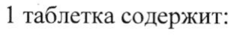
- стр. 2: «вируса с тройной мутацией 150У+М46ИТЯ47У значения 50% ингибирующей» — низкая уверенность: «150У+М46ИТЯ47У» (2)  
  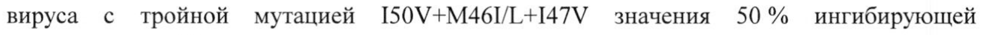
- стр. 2: «концентрации (ИК5о) для ампренавира возрастают более чем в 10 раз. Подобный профиль» — низкая уверенность: «(ИК5о)» (59)  
  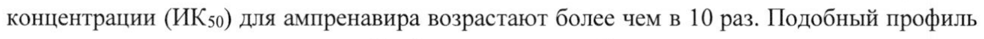
- стр. 2: «© 5 раз. Тройной мутантный штамм I50V+M46I/L+147V был нестабилен при пассаже т vitro» — низкая уверенность: «I50V+M46I/L+147V» (39)  
  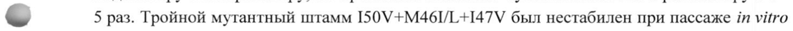
- стр. 3: «принимали фосампренавир 700 мг + ритонавир 100 мг два раза в сутки, к 48 неделе» — низкая уверенность: «700» (32), «100» (77)  
  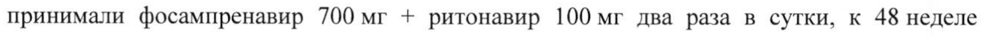
- стр. 3: «ритонавир 100 мг два раза в сутки: п=107) у пациентов с вирусологической» — низкая уверенность: «100» (6)  
  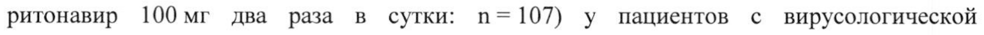
- стр. 4: «лопинавиром + ритонавиром (400 мг + 100 мг) два раза в сутки в комбинации с» — низкая уверенность: «(400» (51)  
  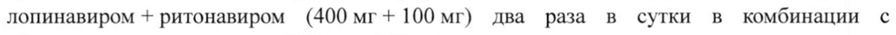
- стр. 5: «РНК ВИЧ-1| впоследствии восстановилась до > 1000 копий/мл). Однако, только 65 %» — низкая уверенность: «ВИЧ-1|» (40)  
  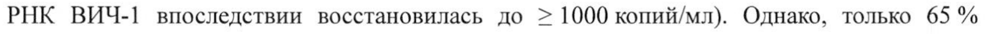
- стр. 8: «Чайлд-Пью) применение фосампренавира в дозе 700 мг два раза в сутки и снижение» — низкая уверенность: «700» (74)  
  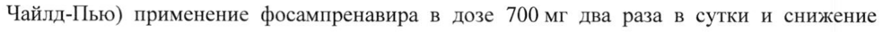
- стр. 8: «АЧСо-12) ампренавира в плазме крови (на 22 %), сходной общей С; (концентрация через» — низкая уверенность: «АЧСо-12)» (2)  
  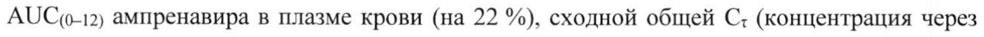
- стр. 8: «в плазме крови примерно на 35 % и увеличение С; несвязанного ампренавира в плазме» — повторное чтение: «в плазме крови примерно на 35%и увеличение С; несвязанного ампренавира в плазме»  
  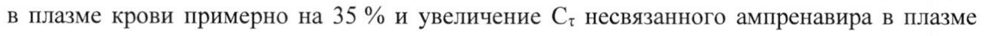
- стр. 8: «ампренавира в плазме крови на 19 %, уменьшению АОСц(о-12) на 23 %, уменьшению С: на» — низкая уверенность: «АОСц(о-12)» (29)  
  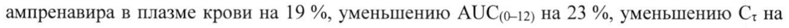
- стр. 8: «тяжести наблюдалось увеличение Cmax ритонавира на 64%, увеличение AUC 0-24)» — низкая уверенность: «0-24)» (64)  
  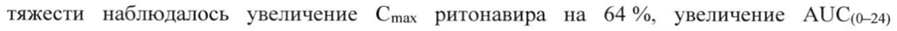
- стр. 11: «- После применения фосампренавира с ритонавиром в дозе 700 мг + 100 мг два раза в сутки» — повторное чтение: «»  
  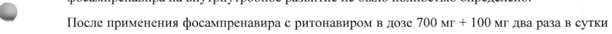
- стр. 16: «препаратов в течение 10—21 суток.» — низкая уверенность: «10—21» (75)  
  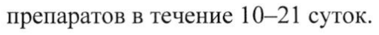
- стр. 18: «400 мг + 100 мг два разав | Лопинавир: AUC ft 37% не рекомендуется.» — низкая уверенность: «37%» (72)  
  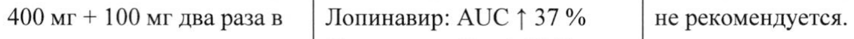
- стр. 18: «© Ампренавир: AUC | 63 %» — повторное чтение: «о | | Азиуржнавир: AUG | 68 %»  
  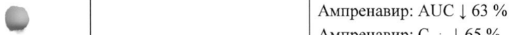
- стр. 19: «Cmax | 51% (-75 %; -3 %) приеме после еды), что может» — низкая уверенность: «51%» (77), «-3» (44)  
  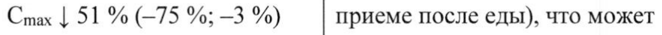
- стр. 19: «AUC | 25% (-42 %; -3 %)» — низкая уверенность: «25%» (73)  
  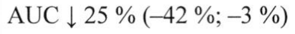
- стр. 19: «Cmax | 56 % (-70 %; —34 %)» — низкая уверенность: «—34» (58)  
  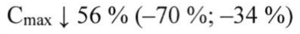
- стр. 19: «AUC | 54 % (-66 %; —-37 %)» — низкая уверенность: «(-66» (70), «—-37» (57)  
  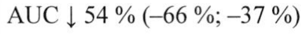
- стр. 24: «Рифабутин Рифабутин: Cmax | 14 %* Повышение концентрации 25-» — повторное чтение: «Рифабутин | Рифабутин: Cmax | 14 We | Повышение концентрации 25-»  
  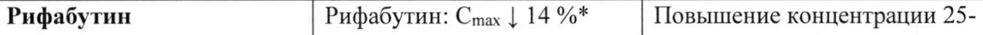
- стр. 24: «150 мг через сутки Рифабутин: АЦОС‹-48) <>* О-дезацетилрифабутина» — низкая уверенность: «АЦОС‹-48)» (0)  
  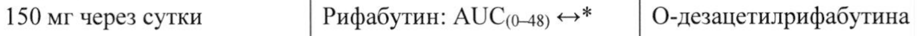
- стр. 25: «© течение 4 суток кратное. кетоконазола или» — повторное чтение: «©, | течение 4 уток | | кратное. —_ | ne _»  
  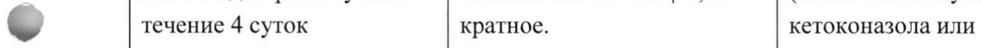
- стр. 25: «(эквивалентно 3,6 г Ампренавир: Cmin (С12ч) => применении антацидов,» — низкая уверенность: «(С12ч)» (1)  
  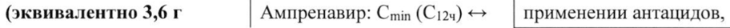
- стр. 26: «(фосампренавир 1400 мг Ампренавир: Cmin (C124) =>» — низкая уверенность: «(C124)» (56)  
  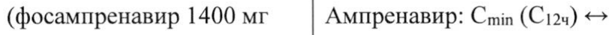
- стр. 26: «w Ампренавир: Cmin 1 19 %» — низкая уверенность: «1» (71); повторное чтение: «eo | Автренинир Cain’ 10»  
  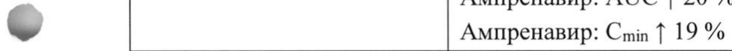
- стр. 33: «& более 100 мг два раза в сутки He было изучено в клинических условиях. Применение более» — повторное чтение: «Фо 0 ree ee eee es»  
  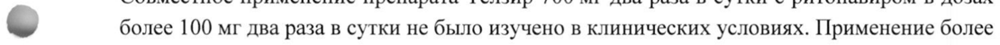
- стр. 37: «По 60 таблеток во флакон из полиэтилена высокой плотности, укупоренный» — низкая уверенность: «60» (72)  
  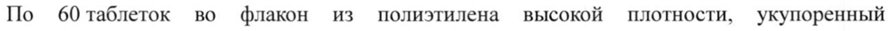
