# Фреманезумаб — парентерально

- Препарат: Аджови (раствор для подкожного введения;)
- АТХ: N02CD03
- Источник: ГРЛС, инструкция по медицинскому применению, РУ ЛП-006070, файл от 2024-05-02 (https://grls.rosminzdrav.ru/Grls_View_v2.aspx?routingGuid=8ef6e38f-2d9b-4082-9b4d-4e34696010eb)
- Распознано автоматически (OCR): 23 из 23 стр.
- Инструкция к другому РУ того же препарата: ЛП-006070 (национальное РУ, переоформленное по правилам ЕАЭС, решение от 15.04.2024). Текст может быть старше действующего
- Сомнительных строк после OCR: 16 (см. раздел «Проверка распознавания»)

## Общие сведения

| МИНЗДРАВ РОССИИ | ‚/--906070- 9540:
МИНИСТЕРСТВО ЗДРАВООХРАНЕНИЯ РОССИЙСКОЙ ФЕДЕРАЦИИ ео |
ИНСТРУКЦИЯ ПО МЕДИЦИНСКОМУ ПРИМЕНЕНИЮ ЛЕКАРСТВЕННОГО ПРЕПАРАТА
Аджови Регистрационный номер:
Торговое наименование препарата: Аджови Международное непатентованное или группировочное наименование: фреманезумаб

## 3. Лекарственная форма

раствор для подкожного введения
раствор для подкожного введения

## 2. Состав

1мл содержит: действующее вещество фреманезумаб 150 мг; вспомогательные
& вещества: Г-гистидин 0,543 мг, [.-гистидин гидрохлорид моногидрат 2,620 мг, сахароза 66 мг, динатрия эдетат дигидрат 0,136 мг, полисорбат 80 0,02 % м/о, вода для инъекций до 1 мл.
Описание Прозрачный или слегка опалесцирующий раствор от бесцветного до светло-желтого цвета.
Фармакотерапевтическая группа: антагонисты кальцитонин-ген родственного пептида.
Код ATX: NO2CD03 Фармакологические свойства
Фармакодинамика р Фреманезумаб — полностью гуманизированное моноклональное антитело класса
© IgG2Aa/k, которое специфично связывается с лигандом кальцитонин-ген родственного пептида (Calcitonin gene-related peptide, CGRP) и блокирует связывание а- и В- изоформ
СОКР с рецептором СОКР.
Точный механизм действия, посредством которого фреманезумаб предупреждает приступы мигрени, неизвестен, однако предполагается, что благоприятный эффект достигается в результате модуляции системы тройничного нерва. Концентрация CGRP существенно увеличивается во время приступа мигрени и возвращается к норме после купирования головной боли.
Фреманезумаб высоко специфичен к CGRP и не связывается с другими близко родственными членами этого семейства пептидов (например, амилином, кальцитонином, интермедином и адреномедуллином).
Эффективность предупреждения приступов эпизодической или хронической мигрени фреманезумаба оценивалась в двух многоцентровых рандомизированных, двойныхслепых, плацебо-контролируемых исследованиях продолжительностью 12 недель
(исследование | и исследование 2, соответственно). Все группы участников исследований были сбалансированы и сопоставимы в отношении демографических показателей и исходной характеристики заболевания.
Пожилые лица (старше 70 лет), пациенты, ежемесячно использующие опиоиды или барбитураты более 4 дней, больные с инфарктом миокарда, цереброваскулярными и тромбоэмболическими событиями в анамнезе исключались из исследований.
Эпизодическая мигрень В исследование | включались взрослые пациенты с эпизодической мигренью в анамнезе
© (пациенты с < 15 днями головной боли в месяц). Все пациенты были рандомизированы в группы для получения подкожных инъекций 675 мг фреманезумаба 1 раз в 3 месяца
(n=291), 225 мг фреманезумаба 1 раз в месяц (n=290) или плацебо 1 раз в месяц (n=294) на протяжении периода лечения продолжительностью 12 недель.
В исследовании 1 было рандомизировано всего 875 пациентов (742 женщины и 133 мужчины) в возрасте от 18 до 70 лет. Медиана возраста пациентов составила 42 года, 85% из которых были женского пола и 80% - представителями белой расы. Среднее количество дней с мигренью на исходном уровне составляло около 9 дней в месяц и было схожим во всех группах лечения. Всего 791 пациент завершил двойную-слепую фазу продолжительностью 12 недель.
Первичной конечной точкой было среднее изменение относительно исходного уровня
© ежемесячного числа дней с мигренью в течение периода лечения продолжительностью 12 недель. Вторичными конечными точками были: доля пациентов, достигших не менее 50% уменьшения среднего числа дней с мигренью в месяц (частота 50% положительного ответа на лечение); среднее изменение, относительно исходного уровня субъективной оценки по шкале MIDAS, числа дней с мигренью в течение месяца; а также среднее изменение, относительно исходного уровня, среднего числа дней использования препаратов для лечения приступов головной боли в месяц.
Схемы лечения с применением фреманезумаба ежемесячно (1 раз в месяц) и ежеквартально (1 раз в 3 месяца) продемонстрировали статистически значимые улучшения по конечным точкам эффективности в сравнении с плацебо начиная с первого месяца и на протяжении всего периода исследования (см. таблицу 1).
Таблица 1. Ключевые показатели эффективности в Исследовании 1 у пациентов с эпизодической мигренью
(n=290) 675 мг 1 pa3 B 3 Mec. 225 мг 1 pa3 B Mec.
(n=288) (n=287)
(-2,68, -1,71 omy “mel Pee eee (95% ДИ)
РЯ БАНИ БОИ ОБИ плацебо)” -1,88, -1,06 Ен И БАБББЕЛИ ВЛИ
© 95% ДИ} mage ome МАИ ГОА ОБОИ плацебо)" обв ПИН БИА БИ плацебо)
FA ОИ БИН ИИ плацебо)” 14,47)
ааа И НИИ ИИ плацебо)" ° купирования головной боли 1,20 a | Re боб 95% JIM)°
Fld И ИИ плацебо)" ДИ — доверительный интервал; MIDAS (Migraine Disability Assessment) — шкала оценки степени дезадаптации, связанной с мигренью; CO — стандартное отклонение.
“Для всех конечных точек среднее значение и ДИ рассчитывали с помощью ковариационной модели, которая в качестве факторов с фиксированными эффектами включала лечение, пол, регион и наличие исходной профилактической терапии (да/нет), а в качестве ковариат — соответствующее исходное значение и длительность заболевания.
бДля оценки различия между группами использовали смешанную модель с повторными измерениями, которая в качестве факторов с фиксированными эффектами включала лечение, пол, регион, наличие исходной профилактической терапии (да/нет), месяц и месяц лечения, а в качестве ковариат — соответствующее исходное значение и длительность заболевания.
Хроническая мигрень В исследование 2 включались взрослые пациенты с хронической мигренью в анамнезе
(пациенты с > 15 днями головной боли в месяц). Исходный уровень частоты головной боли у пациентов в среднем составлял 21 день в месяц (при этом, на протяжении 13 дней не менее чем средней степени тяжести). Все пациенты были рандомизированы в группы для получения подкожных инъекций начальной дозы 675 мг фреманезумаба с последующим введением 225 мг фреманезумаба 1 раз в месяц (n=379), 675 мг фреманезумаба 1 раз в 3 месяца (n=376) или плацебо раз в месяц (п=375) на протяжении периода лечения продолжительностью 12 недель.
В исследовании 2 было рандомизировано всего 1130 пациентов (991 женщина и 139 мужчин) в возрасте от 18 до 70 лет. Медиана возраста пациентов, 88% из которых были
© женского пола и 79% - представителями белой расы, составила 41 год. Всего 1034 пациента завершили двойную-слепую фазу продолжительностью 12 недель.
Первичной конечной точкой было среднее изменение относительно исходного уровня ежемесячного числа дней головной боли не менее умеренной степени тяжести в течение периода лечения продолжительностью 12 недель. Вторичными конечными точками были:
достижение не менее 50% уменьшения среднего числа дней с головной болью, по крайней мере средней тяжести, в месяц (частота 50% положительного ответа на лечение); среднее изменение, относительно исходного уровня субъективной оценки по шкале HIT-6, числа дней с мигренью в течение месяца; а также среднее изменение относительно исходного уровня среднего числа дней использования препаратов для лечения приступов головной боли.
© Обе схемы лечения с применением фреманезумаба 1 раз в месяц и 1 раз в 3 месяца продемонстрировали статистически значимые улучшения ключевых параметров эффективности в сравнении с плацебо начиная с первого месяца и на протяжении всего периода исследования (см. таблицу 2).
Таблица 2. Ключевые показатели эффективности в Исследовании 1 у больных хронической мигренью
Показатель эффективности Плацебо Фреманезумаб Фреманезумаб
(n=371) 675 мг 1 раз в 3 мес. | 225 мг 1 раз в мес.
(n=375) со стартовой дозой 675 мг (n=375)
Ежемесячное количество дней с головной болью не менее чем средней степени тяжести
Среднее изменение" (95% ДИ) |-2,5 -4,3 (-4,87, -3,66) -4,6 (-5,16, -3,97)
(3,06, -1,85 Различие между группами -1,8 (-2,45, -1,13) -2,1 (-2,77, -1,46)
95% ДИ)
Исходное значение (CO) 13,3 (5,80) 13,2 (5,45) 12,8 (5,79)
[Значение _р (сравнение ‹с|- ___ [р<0.0001 p<0,0001
Вилащебо)
2,47)
Ей ОИ БАБЫ ББаБЫЛИ 95% ДИ)
РЯ ОИ ee плацебо)“ степени тяжести на 50% ee ИИ плацебо)" степени тяжести на 75% м
© плацебо)" -5,38, -3,60 бай ИИ ИИ ИИ плацебо)” пирования головной боли
-2,48, -1,28
Ее ОНИ ББ БЫЛИ 95% ДИ} FA a A a плацебо)”
ДИ - доверительный интервал; HIT-6 — шкала оценки влияния головной боли на повседневную активность;
СО — стандартное отклонение.

& аДля всех конечных точек среднее значение и ДИ рассчитывали с помощью ковариационной модели, которая в качестве факторов с фиксированными эффектами включала лечение, пол, регион и наличие исходной профилактической терапии (да/нет), а в качестве ковариат — соответствующее исходное значение и длительность заболевания (в годах).
бДля оценки различия между группами использовали смешанную модель с повторными измерениями, которая в качестве факторов с фиксированными эффектами включала лечение, пол, регион, наличие исходной профилактической терапии (да/нет), месяц и месяц лечения, а в качестве ковариат — соответствующее исходное значение и длительность заболевания (в годах).

Долгосрочное исследование

В долгосрочном исследовании (исследование 3) у пациентов с эпизодической и

хронической мигренью, получавших лекарственный препарат в дозе 225 мг 1 раз в месяц

или 675 мг 1 раз в 3 месяца, эффективность фреманезумаба сохранялась на протяжении до

12 месяцев. Всего 79% пациентов завершили исследование 3.

Спустя 15 месяцев ежемесячная частота приступов мигрени при обоих режимах

дозирования препарата совокупно снизилась относительно исходного уровня в исследованиях 1 и 2 на 6,6 дней. В последний месяц испытания 50% ответа удалось

достичь у 61% пациентов, завершивших исследование 3.

Во время 15-месячного периода комбинированного лечения каких-либо сигналов со

стороны безопасности лекарственного препарата выявлено не было.

Внутренние и внешние факторы

Эффективность и безопасность фреманезумаба не зависела от возраста, пола, расы,

наличия сопутствующей профилактической — медикаментозной терапии (В-

адреноблокаторами, блокаторами кальциевых каналов/производными бензоциклопентена,

антидепрессантами, противосудорожными препаратами), лечения мигрени топираматом

или онаботулотоксином А в анамнезе и злоупотребления лекарственными средствами для

купирования острой головной боли. Данные об использовании фреманезумаба у лиц в
= возрасте 65 лет и старше ограничены (2% больных).

Мигрень, трудно поддающаяся лечению

Эффективность и безопасность фреманезумаба у пациентов, страдающих как

эпизодической, так и хронической мигренью с документально подтвержденным

недостаточным ответом на предшествующее лечение профилактическими препаратами от

мигрени от 2-х до 4-х терапевтических классов были оценены в рандомизированном

исследовании (исследование 4).

Исследование состояло из двойного слепого плацебо-контролируемого периода лечения

за которым следовал открытый период, оба - продолжительностью 12 недель.

В исследовании 4 было рандомизировано всего 838 пациентов. Все пациенты были

рандомизированы в группы для получения подкожных инъекций в начальной дозе 675 мг
© фреманезумаба с последующим введением 225 мг фреманезумаба 1 раз в месяц (п=379),

675 мг фреманезумаба 1 раз в 3 месяца (n=376) или плацебо раз в месяц (n=375) на

протяжении периода лечения, продолжительностью 12 недель.

Первичной конечной точкой было среднее изменение относительно исходного уровня

ежемесячного числа дней с головной болью в течение периода лечения

продолжительностью 12 недель.

Вторичными конечными точками были: достижение не менее 50% уменьшения среднего

числа дней с головной болью, по крайней мере средней тяжести, в месяц; а также среднее

изменение относительно исходного уровня среднего числа дней с использованием

препаратов для лечения приступов головной боли.

Оба режима дозирования фреманезумаба (1 раз в месяц и 1 раз в 3 месяца) имели

статистически и клинически значимое преимущество перед плацебо в отношении

улучшения, по сравнению с исходным уровнем, в соответствии с ключевыми конечными

точками. Таким образом, результаты исследования 4 согласуются с основными выводами предыдущих исследований эффективности и, кроме того, демонстрируют эффективность при мигрени, трудно поддающейся лечению, включая среднее снижение ежемесячного количества дней с мигренью на -3,7 дня (95% ДИ от -4,38 до -3,05) у пациентов, принимавших фреманезумаб 1 раз в 3 месяца, и -4,1 дня (95% ДИ от -4,73 до -3,41) у пациентов, принимавших с фреманезумаб 1 раз в месяц, по сравнению с -0,6 дня (95% ДИ от —1,25 до 0,07) у больных, получавших плацебо. У 34% пациентов, получавших фреманезумаб 1 раз в 3 месяца, и у 34% пациентов, получавших фреманезумаб 1 раз в месяц, наблюдалось снижение ежемесячного количества дней с мигренью по крайней мере на 50% по сравнению с 9% у пациентов, получавших плацебо (р<0,0001) в течение 12-недельного периода лечения. Положительный эффект от назначения лекарственного
© препарата наблюдался начиная с первого месяца исследования и сохранялся на протяжении всего периода лечения. Во время 6-месячного периода лечения каких-либо значимых нежелательных явлений выявлено не было.
Доклинические данные по безопасности В ходе доклинических испытаний не было выявлено какой-либо опасности для людей, исходя из данных общепринятых исследований фармакологической безопасности, токсичности при многократном применении и репродуктивной токсичности.
Поскольку фреманезумаб относится к моноклональным антителам, исследований генотоксичности или канцерогенности не проводили.

## 5.2. Фармакокинетика

Всасывание. После однократного подкожного введения в дозе 225 мги 675 мг медиана
Всасывание. После однократного подкожного введения в дозе 225 мги 675 мг медиана
& времени достижения максимальной концентрации (Tmax) фреманезумаба составляет от 5 до 7 дней, а фармакокинетические параметры носят пропорциональный характер.
Абсолютная биодоступность в диапазоне дозировок от 225 мг до 900 мг составляет от 55% до 66%. При применении препарата в дозе 225 мг подкожно 1 раз в месяц и 675 мг подкожно 1 раз в 3 месяца равновесная концентрация отмечалась спустя приблизительно 168 дней (около 6 месяцев) после начала лечения. Медиана коэффициента накопления при назначении лекарственного средства 1 раз в месяц и 1 раз в 3 месяца составляет около 2,4 и 1,2 соответственно.
Распределение. Объем распределения после подкожного введения в дозах 225 мг, 675 мги 900 мг - 3,6 л.
Метаболизм. Аналогично другим моноклональным антителам, фреманезумаб распадается под действием протеолитических ферментов до низкомолекулярных пептидов и аминокислот.
Выведение. Общий клиренс фреманезумаба составляет около 0,09 л/сут, период полувыведения (Т\2) — 30 дней. Образующиеся в ходе метаболизма низкомолекулярные пептиды и аминокислоты участвуют в de novo синтезе белков либо выводятся через почки.
Особые популяции В рамках популяционного фармакокинетического анализа, проведенного на основании данных, полученных у 2546 пациентов, определялось влияние возраста, расы, пола и массы тела на эффективность препарата. Согласно полученным результатам коррекция дозы препарата при массе тела от 43,5 кг до 131,8 кг не требуется.
Данные о соотношении экспозиции и эффективности фреманезумаба у пациентов с массой тела более 132 кг отсутствуют.
Пациенты с нарушениями функции печени или почек
© Нарушение функции печени или почек, как ожидается, не отразится на фармакокинетике
| фреманезумаба. Популяционный фармакокинетический анализ сводных данных из клинических исследований препарата не выявил различий в фармакокинетике фреманезумаба у пациентов с легкой или умеренной печеночной недостаточностью относительно пациентов с нормальной функцией печени (см. раздел «Способ применения и дозы»). Пациенты с тяжелой печеночной недостаточностью не участвовали в клинических исследованиях фреманезумаба.
Показания для применения Профилактическое лечение мигрени у взрослых, имеющих 4 и более дней с мигренью в месяц.
© Противопоказания для применения e Повышенная чувствительность к действующему веществу, а также вспомогательным веществам, входящим в состав препарата.
® Возраст до 18 лет.

## 4.3. С осторожностью

Пациенты с серьезными сердечно-сосудистыми заболеваниями (см. раздел «Особые указания»).

## 4.6. Применение при беременности и в период грудного вскармливания

Беременность Рекомендуется избегать применения препарата в период беременности.
Данные о применении препарата Аджови у беременных женщин ограничены.
Результаты доклинических испытаний фармакологической безопасности, токсичности при многократном назначении, а также токсичности в отношении репродуктивной функции и потомства свидетельствуют OO — отсутствии прямого или — опосредованного неблагоприятного влияния лекарственного средства на репродуктивную функцию человека.
Поскольку фреманезумаб относится к моноклональным антителам, исследований генотоксичности или канцерогенности не проводилось.
Период грудного вскармливания Сведения о проникновении Ффреманезумаба в грудное молоко, влиянии На вскармливаемого грудью ребенка или выработку молока отсутствуют. В первые дни после родов человеческие антитела класса IgG выделяются с грудным молоком, однако вскоре
© концентрация последних в нем снижается. В этот короткий период времени нельзя исключить риск для ребенка. Впоследствии вопрос о применении лекарственного препарата Аджови во время грудного вскармливания можно рассматривать только при клинической необходимости.
Фертильность Данные о влиянии фреманезумаба на фертильность у человека отсутствуют. На основании результатов доклинических исследований терапия препаратом Аджови не предполагает отрицательного воздействия на фертильность.

## 4.2. Способ применения и дозы

Терапию следует начинать под руководством врача, имеющего опыт в диагностике и лечении мигрени.
Терапию следует начинать под руководством врача, имеющего опыт в диагностике и лечении мигрени.
- Препарат назначается пациентам, имеющим 4 и более дней с мигренью в месяц.
Доступны два режима дозирования:
1) 1 раз в месяц: один, предварительно заполненный раствором препарата, шприц для инъекций или автоинжектор (шприц-ручка) (225 мг)
или 2) 1 раз в три месяца: три, предварительно заполненных раствором препарата, шприца для инъекций или автоинжектора (шприц-ручки) (675 мг), которые вводятся посредством трех последовательных инъекций.
Решение о длительности курса лечения принимает лечащий врач.
При переходе с одного режима на другой, новую дозу лекарственного препарата назначают в следующий запланированный день, согласно предыдущему режиму терапии.
После начала терапии фреманезумабом сопутствующее профилактическое лечение мигрени может быть продолжено, если врач считает, что в этом есть необходимость.
Эффективность терапии следует оценивать через 3 месяца после ее начала. Любое дальнейшее решение о продолжении лечения должно приниматься в индивидуальном порядке. Впоследствии оценку необходимости продолжения терапии рекомендуется проводить регулярно.
Пропущенная доза Если доза лекарственного препарата Аджови, согласно графику приема, была пропущена, необходимо ввести ее как можно скорее. Возмещение пропущенной дозы путем ее удвоения не требуется.
Особые группы пациентов © Пожилые пациенты (старше 65 лет)
Данные о применении препарата Аджови у пациентов в возрасте от 65 лет и старше ограничены. Исходя из результатов популяционного фармакокинетического анализа коррекции дозы препарата не требуется.
Нарушения функции почек и/или печени У пациентов с легкой или умеренной поченой или печеночной недостаточностью коррекции дозы препарата не требуется.
Дети Препарат не рекомендован к применению у пациентов до 18 лет, поскольку безопасность и эффективность препарата Аджови у данной группы пациентов не установлены.
Способ применения © Препарат вводится подкожно.

Внутривенная или внутримышечная инъекции недопустимы.
Препарат Аджови применяют подкожно в области живота, бедра или плеча. Следует менять места инъекций при многократном назначении препарата.
Инъекция препарата Аджови может быть проведена медицинским персоналом, пациентами и/или ухаживающими за ними лицами. Перед использованием пациенты и/или ухаживающие за ними лица должны пройти соответствующее обучение порядку подготовки к применению и введению препарата Аджови. Необходимо сообщить пациентам и/или ухаживающим за ними лицам о том, что им требуется ознакомиться с инструкцией по медицинскому применению и следовать ей при каждом использовании препарата Аджови.
Подробные указания по хранению, обращению и технике введения препарата приведены в разделе «Указания по применению препарата Аджови».

## 4.8. Побочное действие

Безопасность препарата Аджови оценивали у более, чем 2500 пациентов с мигренью, получивших не менее одной дозы лекарственного препарата. Таким образом, экспозиция составила более 1900 пациенто-лет. Более, чем у 1400 пациентов длительность терапии составила не менее 12 месяцев.
Безопасность препарата Аджови оценивали у более, чем 2500 пациентов с мигренью, получивших не менее одной дозы лекарственного препарата. Таким образом, экспозиция составила более 1900 пациенто-лет. Более, чем у 1400 пациентов длительность терапии составила не менее 12 месяцев.
К часто развивавшимся нежелательным реакциям (НР) относились местные реакции в месте инъекции [боль (24%), уплотнение (17%), эритема (16%) и зуд (2%)].
Описанные в клинических исследованиях НР перечислены в соответствии с системноорганным классом Медицинского словаря нормативно-правовой деятельности (Мед ОКА).
НР систематизированы в соответствии с Классификацией Всемирной организации здравоохранения (ВОЗ): очень часто (1/10); часто (21/100, <1/10); нечасто (>1/1000,

© <1/100); редко (>1/10000, <1/1000); очень редко (<1/10000); частота неизвестна
(невозможно определить исходя из доступных данных).
Системно-органный Частота Нежелательная реакция класс MedDRA
Нарушения со стороны нечасто реакции гиперчувствительности, такие иммунной системы — как сыпь, зуд, крапивница и отеки нарушения в месте
Описание отдельных нежелательных реакций

Реакции в месте инъекции

® К наиболее часто наблюдаемым местным реакциям в месте инъекции относились боль, уплотнение и эритема. Все местные реакции в месте инъекции были преходящими и в основном легкой или средней степени тяжести. Боль, уплотнение и эритема, как правило, возникали сразу же после инъекции, тогда как зуд и сыпь проявлялись в среднем через 24 и 48 4, соответственно. Все реакции в месте инъекции обычно разрешались в течение нескольких часов или дней. В целом, данные неблагоприятные реакции не требовали отмены лекарственного средства.
Иммуногенность В плацебо-контролируемых исследованиях антитела к препарату (в низком титре)
наблюдались у 0,4% (6 из 1701) пациентов после начала лечения фреманезумабом. У 1 из этих 6 пациентов были обнаружены нейтрализующие антитела. Через 12 месяцев лечения антитела к препарату были обнаружены у 2,3% (43 из 1888) пациентов, у 0,95% пациентов

были выявлены нейтрализующие антитела. Наличие подобных антител не влияло на

безопасность и эффективность лекарственного средства.

## 4.9. Передозировка

Максимальная доза препарата в ходе клинических исследований составила 2000 мг при

внутривенном введении. Развитие нежелательных реакций и дозолимитирующей

токсичности не наблюдалось. В случае передозировки пациенту рекомендуется

находиться под наблюдением врача с целью обнаружения возможных нежелательных

реакций. При необходимости проводить симптоматическое лечение.

## 4.5. Взаимодействие с другими лекарственными средствами

Формальных клинических исследований лекарственного взаимодействия с
© фреманезумабом не проводилось. Исходя из свойств фреманезумаба фармакологические

лекарственные взаимодействия маловероятны. Кроме того, одновременное применение

лекарственных препаратов, принимаемых для лечения приступа мигрени (особенно

анальгетиков, алкалоидов спорыньи и триптанов) и препаратов для профилактического

лечения мигрени не повлияло на фармакокинетику фреманезумаба.

## 4.4. Особые указания

Гиперчувствительность

Такие реакции гиперчувствительности к фреманезумабу, как сыпь, зуд, крапивница и

отеки, отмечались редко (см. раздел «Побочное действие»). Большинство реакций

возникало в течение нескольких часов или одного месяца после введения препарата.
| Реакции в основном были легкими или умеренными, но некоторые приводили к
~ прекращению лечения или требовали лечения кортикостероидами. В случае развития

реакции гиперчувствительности необходимо рассмотреть вопрос об отмене препарата

Аджови и назначить соответствующее лечение.

Пациенты с сердечно-сосудистыми (СС) заболеваниями

Из клинических исследований исключались пациенты со значимыми сердечно-

сосудистыми заболеваниями, сосудистой ишемией или тромботическими событиями,

такими как острое нарушение мозгового кровообращения, микроинсульты, тромбоз

глубоких вен или легочная эмболия. Безопасность и эффективность препарата Аджови у

таких пациентов не установлены.

Вспомогательные вещества

В одной дозе (1,5 мл) препарата Аджови содержится менее | ммоль натрия (23 мг), то есть

препарат практически свободен от натрия.

Хранение Препарат Аджови следует хранить в холодильнике при температуре от 2 °С до 8 °С в оригинальной упаковке для защиты от воздействия света. При необходимости препарат
Аджови допускается хранить при комнатной температуре от 20°С до 25°С в оригинальной упаковке не более 24 часов. После извлечения из холодильника препарат
Аджови должен быть использован в течение 24 часов или утилизирован.
ЗАПРЕЩАЕТСЯ замораживать и встряхивать препарат. Кроме того, ЗАПРЕЩАЕТСЯ использовать препарат, подвергнутый воздействию высоких температур или прямого солнечного света.

## 4.7. Влияние на способность управлять транспортными средствами, механизмами

© Препарат Аджови не влияет на способность управления транспортными средствами и работу с механизмами. В случае развития побочного действия следует соблюдать осторожность.

## 6.5. Форма выпуска

Раствор для подкожного введения, 150 мг/мл.
Раствор для подкожного введения, 150 мг/мл.
По 1,5 мл препарата в одноразовом шприце из бесцветного стекла типа I с фиксированной иглой из нержавеющей стали, защищенной двойным колпачком, состоящим из внутренней резиновой части и внешней твердой части из полипропилена, с поршнем из полипропилена и уплотнителем поршня из бромбутилового каучука. | или 3 шприца в ячейковый контейнер. 1 ячейковый контейнер вместе с инструкцией по применению в
© картонной пачке с контролем первого вскрытия, на которую дополнительно могут быть нанесены защитные наклейки.
По 1,5 мл препарата в одноразовом шприце из бесцветного стекла типа I с фиксированной иглой из нержавеющей стали, защищенной двойным колпачком, состоящим из внутренней резиновой части и внешней твердой части из полипропилена, с поршнем из полипропилена и уплотнителем поршня из бромбутилового каучука в автоинжекторе
(шприц-ручке). 1 или 3 автоинжектора (шприц-ручки) в ячейковый контейнер. 1 ячейковый контейнер вместе с инструкцией по применению в картонной пачке с контролем первого вскрытия, на которую дополнительно могут быть нанесены защитные наклейки.

## 6.4. Условия хранения

Хранить при температуре от 2 до 8 °С в оригинальной упаковке.
Хранить при температуре от 2 до 8 °С в оригинальной упаковке.
Не замораживать.

Хранить в недоступном для детей месте!

## 6.3. Срок годности

шприца: 3 года.

автоинжектора (шириц-ручки): 2 года.

Не применять по истечении срока годности.

Условия отпуска

Отпускают по рецепту.

Наименование держателя (владельца) регистрационного удостоверения

Тева Фармацевтические Предприятия Лтд., Израиль

Производитель

Веттер Фарма-Фертигунг ГмбХ и Ко. КГ,

Мосвизен 2, 88214 Равенсбург, Германия

Упаковщик

Веттер Фарма-Фертигунг ГмбХ и Ко. КГ,

Мосвизен 2, 88214 Равенсбург, Германия

или

Меркле ГмбХ,

Людвиг-Меркле-Штрассе 3, 89143 Блаубойрен, Германия w Выпускающий контроль качества

Меркле ГмбХ,

Граф-Арко-Штрассе 3, 89079 Ульм, Германия

Организация, принимающая претензии потребителей

ООО «Тева», 115054, Москва, ул. Валовая, 35,

тел.: +7 (495) 644 22 34, факс: +7 (495) 644 22 35

Адрес в интернете: www.teva.ru

Указания по применению препарата Аджови Инструкция по применению препарата Аджови, раствор для подкожного введения, 150 мг/мл, в предварительно заполненном шприце
Внимательно прочитайте эту инструкцию перед применением препарата Аджови
Важная информация:
® Каждый шприц предназначен только для однократного использования.
e Каждый шприц препарата Аджови содержит 225 мг фреманезумаба. В зависимости от назначенного врачом режима дозирования могут потребоваться один или три шприца.
e Препарат Аджови вводится подкожно. Перед использованием необходимо пройти соответствующее обучение порядку подготовки к применению и введению раствора препарата Аджови в шприце для подкожных инъекций у лечащего врача или медицинской
© сестры.
® Следует внимательно прочесть инструкцию по медицинскому применению препарата
Аджови, чтобы узнать больше о лекарственном средстве.
e Нельзя тянуть поршень обратно, так как это может привести к поломке шприца.
e Нельзя встряхивать шприц, так как это может повлиять на работу медицинского устройства.
e Если в картонной пачке остались неиспользованные шприцы необходимо незамедлительно убрать ее обратно в холодильник.
Колпачок для иглы Дата истечения Упор поршня
| Игла срока годности Поршень | | l w a =
Корпус шприца ] Упор для пальцев Шаг 1 Подготовка к проведению подкожной инъекции а) Убедитесь в том, что все необходимое для инъекции в наличии:
- один (при дозе 225 мг) или три (при дозе 675 мг) одноразовых предварительно заполненных шприца препарата Аджови,
- спиртовая салфетка,
- ватный тампон,
- контейнер для использованных шприцев или острых отходов.
6) Поместите расходные материалы на чистую ровную поверхность.
в) Для уменьшения дискомфорта во время инъекции дайте препарату Аджови нагреться до комнатной температуры в течение 30 мин:
- избегайте воздействия на шприц прямого солнечного света,
- не нагревайте шприц с помощью микроволновой печи или любого иного источника тепла.
г) Вымойте руки с мылом и насухо вытрите их полотенцем.
д) Осмотрите шприц с препаратом Аджови, убедитесь, что:
- на этикетке указано наименование Аджови,
- шприц содержит прозрачный или слегка опалесцирующий раствор от бесцветного до светло-желтого цвета,
- наличие мелких пузырьков воздуха в предварительно заполненном шприце,
© является нормальным и допустимым.
НЕ ИСПОЛЬЗУЙТЕ шприц, если:
" шприц поврежден, "= срок годности, указанный на этикетке шприца (а также картонной пачке) истек,
" раствор выглядит мутным, изменил окраску или содержит посторонние видимые частицы.
Co Г Ese - — м © < НН е) Выберите место для инъекции:
Возможные зоны для самостоятельных инъекций: зона живота (избегайте области примерно 5 см вокруг пупка), передняя часть бедер (область, которая находится, по крайней мере, на 5 см выше колена и на 5 см ниже паха), задняя часть плеча.
Для инъекций в труднодоступные зоны (например, задняя часть плеча) может потребоваться помощь другого человека.

о Если при введении дозы 675 мг используется одна и та же анатомическая область для трех отдельных инъекций (3 отдельных одноразовых предварительно заполненных шприца), необходимо убедиться, что вторая и

третья инъекции производятся не в то же место введения, которое было использовано для предыдущих инъекций.
Sm | yt р НЕ СЛЕДУЕТ:
" проводить инъекции в болезненные места, покрасневшие участки кожи, в области с огрубевшей кожей, с уплотнениями, гематомами, татуировками,
© шрамами или растяжками, " вводить препарат Аджови в то же место, в которое был введен другой лекарственный препарат.
ж) Подготовьте место для инъекции: обработайте зону инъекции салфеткой, смоченной спиртовым раствором. Дайте высохнуть зоне инъекции в течение 10 секунд.
Шаг 2 Техника выполнения подкожной инъекции а) Снимите (потяните в прямом направлении) защитный колпачок с иглы:
Не прокручивайте защитный колпачок.
После снятия колпачка с иглы одноразового шприца не прикасайтесь к игле и не надевайте повторно защитный колпачок на иглу во избежание травмы или
© инфекции.
* => Не надевайте обратно защитный Al колпачок На иглу
RE SEES | | ЗИК, О № — — = aS li 6) Введите препарат, выполнив следующие 4 действия:
1. Предварительно слегка | 2. Располагая иглу шприца | 3. Когда игла | 4. Медленно и соберите не менее 2,5 см | под углом 45 — 90 градусов к | полностью войдет | равномерно кожи в обработанной зоне | месту инъекции проколите | в кожу, | надавливайте на для инъекций в складку | кожу. равномерно упор поршня, большим и указательным надавливайте вводя содержимое пальцами. большим пальцем | шприца в место на упор поршня | инъекции шприца. полностью.
м So, Se. y = ee | | — * 90" и й 74 о м Gi if. a у Hh so co ЕВ noe tad Uf 7 == A
= а в) Удалите иглу движением шприца перпендикулярно месту инъекции.
ыы és ` —— —__ г) Осторожно прижмите чистый ватный тампон к месту инъекций на несколько секунд. Не трите место инъекции.
Шаг 3 Утилизация: поместите шприц и сопутствующие материалы в контейнер для использованных шприцев или острых отходов. Не выбрасывайте снятые иглы, шприц или предварительно заполненный шприц вместе с бытовым мусором. Спросите у врача или провизора, как утилизировать препарат, если он больше не требуется. Эти меры помогут
© защитить окружающую среду. Храните шприцы и сопутствующие материалы в недоступном для детей месте.
Если Вам назначена доза 675 мг (3 шприца) для того, чтобы полностью ее вести повторите этапы с Шаг 1 д) по Шаг 3 со 2-м и 3-м предварительно заполненным шприцем.
Инструкция по применению препарата Аджови, раствор для подкожного введения, 150 мг/мл, в автоинжекторе (шприи-ручке)
Внимательно прочитайте эту инструкцию перед применением препарата Аджови
Важная информация:
e Каждый автоинжектор предназначен только для однократного использования.
e Каждый автоинжектор препарата Аджови содержит 225 мг фреманезумаба. В зависимости от назначенного врачом режима дозирования могут потребоваться один или три автоинжектора.
e Препарат Аджови вводится подкожно. Перед использованием необходимо пройти соответствующее обучение порядку подготовки к применению и введению раствора препарата Аджови в автоинжекторе для подкожных инъекций у лечащего врача или
© медицинской сестры.
® Следует внимательно прочесть инструкцию по медицинскому применению препарата
Аджови, чтобы узнать больше о лекарственном средстве.
e Нельзя встряхивать автоинжектор, так как это может повлиять на работу медицинского устройства.
® Если в картонной пачке остались неиспользованные автоинжекторы необходимо незамедлительно убрать ее обратно в холодильник.
Автоинжектор (шпириц-ручка) до применения
Защита иглы Г Защитный —— колпачок Смотровое окошко
Автоинжектор (шприц-ручка) после применения ния 23 2 = i. mp Серый
= 1. ограничитель | =" Шаг 1 Подготовка к проведению инъекции а) Убедитесь в том, что все необходимое для инъекции в наличии:
- один (при дозе 225 мг) или три (при дозе 675 мг) одноразовых предварительно заполненных автоинжектора (шприц-ручки) препарата Аджови,
- спиртовая салфетка,
- ватный тампон,
- контейнер для использованных шприцев или острых отходов.
6) Поместите расходные материалы на чистую ровную поверхность.
в) Для уменьшения дискомфорта во время инъекции дайте препарату Аджови нагреться до комнатной температуры в течение 30 мин:
- избегайте воздействия на автоинжектор прямого солнечного света,
© - He нагревайте автоинжектор с помощью микроволновой печи или любого иного источника тепла.
г) Вымойте руки с мылом и насухо вытрите их полотенцем.
д) Осмотрите автоинжектор с препаратом Аджови, убедитесь, что:

- на этикетке указано наименование Аджови,

- лекарственный препарат в смотровом окошке автоинжектора выглядит как прозрачный или слегка опалесцирующий раствор от бесцветного до светложелтого цвета,

- наличие мелких пузырьков воздуха является нормальным и допустимым.

НЕ ИСПОЛЬЗУЙТЕ автоинжектор, если:
" автоинжектор поврежден, © " срок годности, указанный на этикетке автоинжектора (а также картонной пачке), истек или автоинжектор находился не в холодильнике более 24 ч;
" раствор выглядит мутным, изменил окраску или содержит посторонние видимые частицы.
co Смотровое окошко е) Выберите место для инъекции:
Возможные зоны для самостоятельных инъекций: зона живота (избегайте области примерно 5 см вокруг пупка), передняя часть бедер (область, которая находится, по крайней мере, на 5 см выше колена и на 5 см ниже паха), задняя часть плеча.
Для инъекций в труднодоступные зоны (например, задняя часть плеча) может потребоваться помощь другого человека.

о Если при введении дозы 675 мг используется одна и та же анатомическая область для трех отдельных инъекций (3 отдельных автоинжектора), необходимо убедиться, что вторая и третья инъекции производятся не в то же место введения, которое было использовано для предыдущих инъекций.

рн . [I iia oe:
bay 1 yt | НЕ СЛЕДУЕТ:
" проводить инъекции в болезненные места, покрасневшие участки кожи, в области с огрубевшей кожей, с уплотнениями, гематомами, татуировками, шрамами или растяжками,
" вводить препарат Аджови в то же место, в которое был введен другой лекарственный препарат.
© ж) Подготовьте место для инъекции: обработайте зону инъекции салфеткой, смоченной спиртовым раствором. Дайте высохнуть зоне инъекции в течение 10 секунд.
Шаг 2 Техника выполнения инъекции а) Снимите (потяните в прямом направлении) защитный колпачок с иглы:
"= He прокручивайте защитный колпачок.
"= После снятия колпачка с иглы автоинжектора не прикасайтесь к игле и не надевайте повторно защитный колпачок на иглу во избежание травмы или инфекции.
" He прикасайтесь к области защиты иглы.
ee => |) a М =) р > а 7) . & 6) Введите препарат, выполнив следующие действия:
- Установите автоинжектор под углом 90° к коже в месте для инъекции.
« | V %* <7 р Г оч - Нажмите на автоинжектор и продолжайте удерживать прижатым к коже в течение примерно 30 секунд. Не прекращайте прижимать, пока не будут выполнены следующие 3 действия:
1. Вы слышите первый | 2. Вы слышите второй «щелчок» | 3. Подождите еще 10 секунд
«щелчок» (это сигнал, что | (спустя примерно 15 секунд после | (чтобы убедиться, что препарат инъекция начата, и синий | первого; поршень пройдет до низа | введен полностью).
© поршень начал движение). | смотрового окошка, когда препарат будет введен).
р " = ‚| Прижать и = Прижать и || - | „удерживать | удерживать i |
| He Fe а - | ———} | № ЧР | 4 | 4 4 $0 | (Ви: | (\
| о №. wt 1 о m = | < | | Ч | | Ч | | | | | У второй | | м 4S А в) Убедитесь, что синий поршень заполнил смотровое окошко и удалите автоинжектор:
— После окончания инъекции (синий поршень заполнил смотровое окошко и виден серый ограничитель), удалите автоинжектор вертикальным движением вверх и утилизируйте в контейнер для острых отходов (см. Шаг 3).
— После удаления автоинжектора защита иглы возвращается в исходное положение и фиксируется на месте закрывая иглу.
— He надевайте обратно защитный колпачок на автоинжектор во избежание травмы или инфекции.
1 Их
Ра»
u ==” ~ \ В / Серый ограничитель г) Осторожно прижмите чистый ватный тампон к месту инъекций на несколько секунд. Не трите место инъекции. Не используйте автоинжектор повторно.
Шаг 3 Утилизация: поместите автоинжектор и сопутствующие материалы в контейнер для использованных шприцев или острых отходов. Не выбрасывайте снятые иглы, автоинжектор или предварительно заполненный автоинжектор вместе с бытовым мусором. Спросите у врача или провизора, как утилизировать препарат, если он больше не требуется. Эти меры помогут защитить окружающую среду. Храните автоинжектор и сопутствующие материалы в недоступном для детей месте.
= Если Вам назначена доза 675 мг (3 автоинжектора (шприц-ручки)) для того, чтобы полностью ее вести повторите этапы с Шаг 1 д) по Шаг 3 со 2-м и 3-м автоинжектором (шприц-ручкой).
Видео-инструкцию по самостоятельному введению препарата Аджови пациентами можно посмотреть, используя ОВ-код:
lyst: _ = aie < \ =: nh “th ; ` р, 4 ote у \
. |= es Dhan Poa)
Менеджер по регистрации Горковец Т.К.
## Проверка распознавания

Страницы-сканы распознаны автоматически. В 16 строках с дозировками цифры могли распознаться с ошибкой — сверьте с вырезкой из оригинала:

- стр. 1: «1мл содержит: действующее вещество фреманезумаб 150 мг; вспомогательные» — низкая уверенность: «150» (24)  
  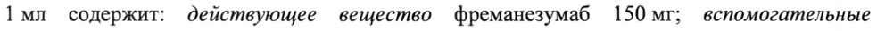
- стр. 3: «© 95% ДИ}» — повторное чтение: «@ = | Gea’»  
  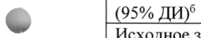
- стр. 4: «© женского пола и 79% - представителями белой расы, составила 41 год. Всего 1034» — повторное чтение: «| о а 6»  
  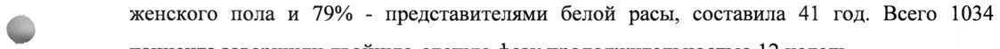
- стр. 4: «(n=371) 675 мг 1 раз в 3 мес. | 225 мг 1 раз в мес.» — низкая уверенность: «1» (71); повторное чтение: «(n=371) | 675 мг 1 раз в 3 мес. | 225 мг 1 раз B Mec.»  
  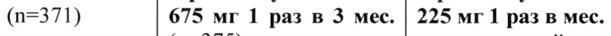
- стр. 4: «675 мг (n=375)» — повторное чтение: «675 мг (n=375)»  
  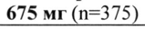
- стр. 5: «или 675 мг 1 раз в 3 месяца, эффективность фреманезумаба сохранялась на протяжении до» — низкая уверенность: «1» (72)  
  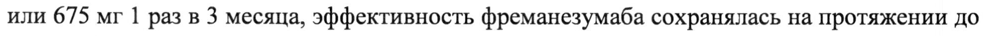
- стр. 6: «исследованиях 1 и 2 на 6,6 дней. В последний месяц испытания 50% ответа удалось» — низкая уверенность: «1» (50)  
  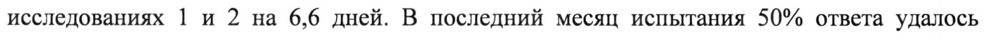
- стр. 6: «= возрасте 65 лет и старше ограничены (2% больных).» — повторное чтение: «Qe et nei epee Some»  
  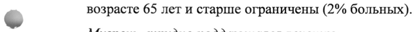
- стр. 6: «© фреманезумаба с последующим введением 225 мг фреманезумаба 1 раз в месяц (п=379),» — повторное чтение: «© Пренавезумаоа с поедим Пе 225 мг Фреманезумабв 1 раз в ее sails ie»  
  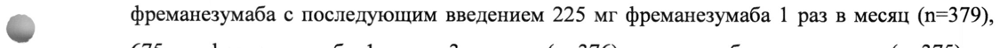
- стр. 7: «принимавших фреманезумаб 1 раз в 3 месяца, и -4,1 дня (95% ДИ от -4,73 до -3,41) у» — низкая уверенность: «-4,1» (48)  
  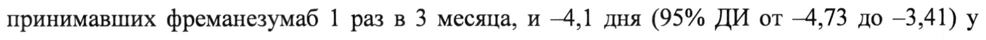
- стр. 7: «пациентов, принимавших с фреманезумаб 1 раз в месяц, по сравнению с -0,6 дня (95% ДИ» — низкая уверенность: «-0,6» (70)  
  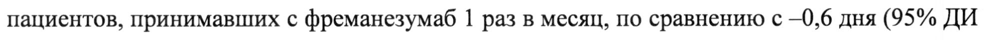
- стр. 7: «подкожно 1 раз в 3 месяца равновесная концентрация отмечалась спустя приблизительно» — повторное чтение: «подкожно 1 раз в 3 месяца равновесная концентрация отмечалась спустя приблизительно»  
  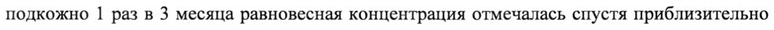
- стр. 7: «назначении лекарственного средства 1 раз в месяц и 1 раз в 3 месяца составляет около 2,4» — низкая уверенность: «1» (79); повторное чтение: «назначении лекарственного средства 1 раз в месяц и 1 раз в 3 месяца составляет около 2,4»  
  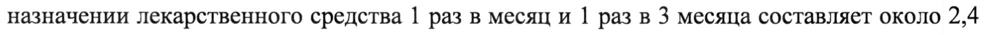
- стр. 9: «1) 1 раз в месяц: один, предварительно заполненный раствором препарата, шприц» — низкая уверенность: «1» (77)  
  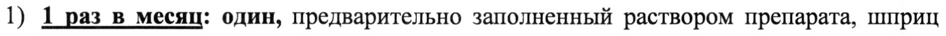
- стр. 11: «месте инъекции [боль (24%), уплотнение (17%), эритема (16%) и зуд (2%)].» — низкая уверенность: «(2%)].» (76)  
  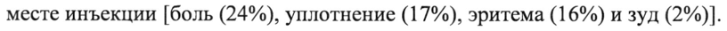
- стр. 20: «истек или автоинжектор находился не в холодильнике более 24 ч;» — повторное чтение: «истек или автоинжектор находился не в холодильнике более 24 q»  
  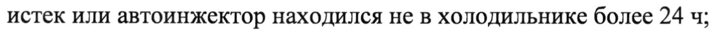
