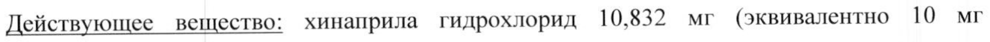
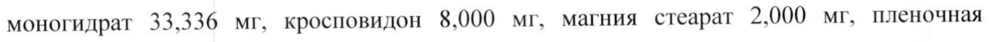
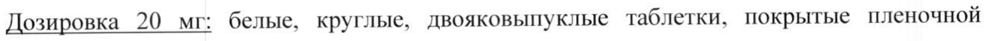
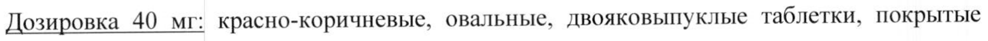
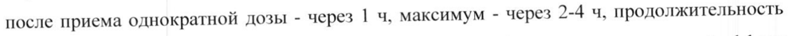
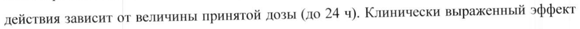
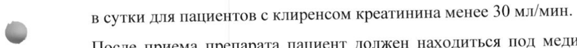
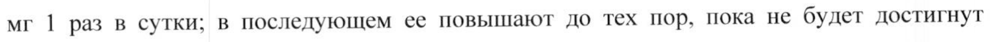
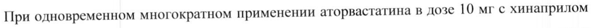

# Хинаприл — внутрь

- Препарат: Аккупро® (таблетки, покрытые пленочной оболочкой;)
- АТХ: C09AA06
- Источник: ГРЛС, инструкция по медицинскому применению, РУ П N014329/01, файл от 2025-09-08 (https://grls.rosminzdrav.ru/Grls_View_v2.aspx?routingGuid=821e909a-ab47-4de1-a0bd-815c9fc742ef)
- Распознано автоматически (OCR): 19 из 19 стр.
- Инструкция к другому РУ того же препарата: П N014329/01 (исключено из реестра, решение от 02.09.2025). Текст может быть старше действующего
- Сомнительных строк после OCR: 11 (см. раздел «Проверка распознавания»)

## Общие сведения

МИНИСТЕРСТВО ЗДРАВООХРАНЕНИЯ РОССИЙСКОЙ ФЕДЕРАЦИИ
ИНСТРУКЦИЯ ПО МЕДИЦИНСКОМУ ПРИМЕНЕНИЮ ЛЕКАРСТВЕННОГО ПРЕПАРАТА
AKKYIIPO* | МИНЗЛРАВ РОССИИ Регистрационный номер: П №014329/01 | eee” /c iain
| Торговое наименование ПИ [й) р Yad Y O/- 2704 q 0
З i | ~ АККУПРО*® | СОГЛАСОВАНО | Международное непатентованное наименование:
хинаприл Лекарственная форма:
таблетки, покрытые пленочной оболочкой Состав:
1 таблетка, покрытая пленочной оболочкой, дозировкой 5 мг содержит:
Действующее вещество: хинаприла гидрохлорид 5,416 мг (эквивалентно 5 мг хинаприла).
© Вспомогательные вещества: магния карбонат 46,584 мг, желатин 5,000 мг, лактозы моногидрат 38,000 мг, кросповидон 4,000 мг, магния стеарат 1,000 мг, пленочная оболочка: Опадрай белый OY-S-7331*, воск травяной 0,050 мг.
*Опадрай белый ОУ-5-7331 содержит: гипромеллозу 1,200 мг, гипролозу 0,900 мг, титана диоксид 0,600 мг, макрогол-400 0,300 мг.
1 таблетка, покрытая пленочной оболочкой, дозировкой 10 мг содержит:
Действующее вещество: хинаприла гидрохлорид 10,832 мг (эквивалентно 10 мг хинаприла).
Вспомогательные вещества: магния карбонат 93,168 мг, желатин 10,000 мг, лактозы моногидрат 76,000 мг, кросповидон 8.000 мг, магния стеарат 2,000 мг, пленочная оболочка: Опадрай белый OY-S-7331*, воск травяной 0,100 мг.
*Опадрай белый ОУ-5-7331 содержит: гипромеллозу 2,400 мг, гипролозу 1,800 мг, титана диоксид 1,200 мг, макрогол-400 0,600 мг.
1 таблетка, покрытая пленочной оболочкой, дозировкой 20 мг содержит:
Действующее вещество: хинаприла гидрохлорид 21,664 мг (эквивалентно 20 мг хинаприла).

Вспомогательные вещества: магния карбонат 125,000 мг, желатин 10,000 мг, лактозы моногидрат 33,336 мг, кросповидон 8.000 мг, магния стеарат 2,000 мг, пленочная оболочка: Опадрай белый OY-S-7331*, воск травяной 0,100 мг.

*Опадрай белый OY-S-7331 содержит: гипромеллозу 2,400 мг, гипролозу 1,800 мг, титана диоксид 1,200 мг, макрогол-400 0,600 мг.

1 таблетка, покрытая пленочной оболочкой, дозировкой 40 мг содержит:
Действующее вещество: хинаприла гидрохлорид 43,328 мг (эквивалентно 40 мг

- хинаприла).

Вспомогательные вещества: магния карбонат 250,000 мг, желатин 20,000 мг, лактозы моногидрат 66,672 мг, кросповидон 16,000 мг, магния стеарат 4,000 мг, пленочная оболочка: Опадрай коричневый Y-5-9020G*, воск травяной 0,200 мг.

*Опадрай коричневый Y-5-9020G содержит гипромеллозу 4,800 мг, гипролозу 3,600 мг, титана диоксид 1,368 мг, макрогол-400 1,200 мг, краситель железа оксид красный 1,032 мг.

Описание

Дозировка 5 мг: белые, овальные, двояковыпуклые таблетки, покрытые пленочной оболочкой, с риской и цифрой «5» на обеих сторонах.

- Дозировка 10 мг: белые, треугольные, двояковыпуклые таблетки, покрытые пленочной

оболочкой, с риской на обеих сторонах и цифрой «10» на одной стороне.

Дозировка 20 мг: белые, круглые, двояковыпуклые таблетки, покрытые пленочной оболочкой, с риской на обеих сторонах и цифрой «20» на одной стороне.

Дозировка 40 мг: красно-коричневые, овальные, двояковыпуклые таблетки, покрытые пленочной оболочкой, с цифрой «40» на одной стороне и «РО 535» на другой.
Фармакотерапевтическая группа:

Ангиотензинпревращающего фермента (АПФ) ингибитор.

Код ATX: CO9AA06.

Crp. 2 из 19 Фармакологические свойства Фармакодинамика
АПФ представляет собой фермент, катализирующий превращение ангиотензина I B ангиотензин Il, который оказывает сосудосуживающее действие и повышает тонус сосудов, в том числе за счет стимуляции секреции альдостерона корой надпочечников.
Хинаприл конкурентно ингибирует АПФ и вызывает снижение вазопрессорной активности и секреции альдостерона. Устранение отрицательного влияния ангиотензина П на секрецию ренина по механизму обратной связи приводит к увеличению активности ренина плазмы крови. При этом снижение артериального давления (АД) сопровождается
© уменьшением общего периферического сосудистого сопротивления (ОПСС) и сопротивления почечных сосудов, в то время как изменения частоты сердечных сокращений (ЧСС), сердечного выброса, почечного кровотока, скорости клубочковой фильтрации и фильтрационной фракции являются незначительными или отсутствуют.
Хинаприл повышает толерантность к физической нагрузке. При длительном применении способствует обратному развитию гипертрофии миокарда у пациентов с артериальной гипертензией; улучшает кровоснабжение ишемизированного миокарда. Усиливает коронарный и почечный кровоток. Снижает агрегацию тромбоцитов. Начало действия после приема однократной дозы - через 1 4, максимум - через 2-4 ч, продолжительность действия зависит от величины принятой дозы (до 24 ч). Клинически выраженный эффект развивается через несколько недель после начала терапии.
© Фармакокинетика Концентрация хинаприла в плазме крови после приема внутрь достигает максимума в течение | 4, хинаприлата — 2 4. Прием пиши не влияет на степень всасывания, но может увеличить время достижения максимальной концентрации (TCmax) (жирная пища может уменьшить всасывание). С учетом выведения хинаприла и его метаболитов почками степень всасывания составляет примерно 60 %. Под действием печеночных ферментов хинаприл быстро метаболизируется до хинаприлата путем отщепления эфирной группы
(основной метаболит — двухосновная кислота хинаприла), который является мощным ингибитором АПФ.
Около 38 % от принятой внутрь дозы хинаприла циркулирует в плазме крови в виде хинаприлата. Период полувыведения (Т!2) хинаприла из плазмы крови составляет около 1-2 4, хинаприлата — 3 4. Выводится почками — 61 % (56 % в виде хинаприла и хинаприлата) и через кишечник — 37 %. Примерно 97 % хинаприла и хинаприлата циркулируют в плазме крови в связанном с белками виде. Хинаприл и его метаболиты не проникают через гематоэнцефалический барьер.
У пациентов с почечной недостаточностью Т!2 хинаприлата увеличивается по мере снижения клиренса креатинина (КК). Выведение хинаприлата снижается также у пожилых пациентов (старше 65 лет) и тесно коррелирует с нарушениями функции почек, однако, в целом различий в эффективности и безопасности лечения пациентов пожилого и более молодого возраста не выявлено.
У пациентов с алкогольным циррозом печени концентрация хинаприлата снижается за счет нарушения деэтерификации хинаприла.

## 4.1. Показания к применению

Артериальная гипертензия
Артериальная гипертензия
~ (в монотерапии или в комбинации с тиазидными диуретиками и бета-адреноблокаторами).
Хроническая сердечная недостаточность (в комбинации с диуретиками и/или сердечными гликозидами).

## 4.3. Противопоказания

® Повышенная чувствительность к хинаприлу, любому другому компоненту препарата или другим ингибиторам АПФ.
® Повышенная чувствительность к хинаприлу, любому другому компоненту препарата или другим ингибиторам АПФ.
° Ангионевротический отек в анамнезе в результате предшествующей терапии ингибиторами АПФ, наследственный и/или идиопатический ангионевротический отек.
° Одновременное применение с ингибиторами нейтральной эндопептидзаы
© (например, с препаратами, содержащими сакубитрил) в связи с высоким риском развития ангионевротического отека.
e Возраст до 18 лет.
° Беременность и период грудного вскармливания.
= Дефицит лактазы, непереносимость лактозы и синдром глюкозо-галактозной мальабсорбции.
° Одновременное применение с алискиреном и алискиренсодержащими средствами или с антагонистами рецепторов ангиотензина П (APA II) или с другими препаратами, ингибирующими ренин-ангиотензин-альдостероновую систему (РААС) (двойная блокада
РААС):
- у пациентов с сахарным диабетом или у пациентов с сахарным диабетом с поражением органов-мишеней (диабетическая нефропатия);
- у пациентов с нарушением функции почек (скорость клубочковой фильтрации (СКФ)
менее 60 мл/мин/1,73 м²);
- у пациентов с гиперкалиемией (более 5 ммоль/л);
- у пациентов © хронической сердечной недостаточностью и артериальной гипертензией.

## 4.3. С осторожностью

Симптоматическая артериальная гипотензия у пациентов, ранее принимавших диуретики и соблюдающих диету с ограничением потребления поваренной соли; тяжелая сердечная недостаточность у пациентов с высоким риском артериальной гипотензии; состояния, сопровождающиеся снижением объема циркулирующей крови (ОЦК) (в т.ч. рвота и диарея); гиперкалиемия; угнетение костно-мозгового кроветворения; аортальный стеноз,
Симптоматическая артериальная гипотензия у пациентов, ранее принимавших диуретики и соблюдающих диету с ограничением потребления поваренной соли; тяжелая сердечная недостаточность у пациентов с высоким риском артериальной гипотензии; состояния, сопровождающиеся снижением объема циркулирующей крови (ОЦК) (в т.ч. рвота и диарея); гиперкалиемия; угнетение костно-мозгового кроветворения; аортальный стеноз,
© гипертрофическая обструктивная кардиомиопатия, митральный стеноз; недостаточность мозгового кровообращения, ишемическая болезнь сердца - резкое снижение АД на фоне терапии ингибиторами АПФ, может ухудшить течение данных заболеваний;
двусторонний стеноз почечных артерий или стеноз артерии единственной почки, состояние после трансплантации почки; нарушение функции почек; у пациентов, находящихся на гемодиализе (КК менее 10 мл/мин) (данных о применении Аккупро® у таких пациентов недостаточно); аутоиммунные системные заболевания соединительной ткани (в том числе системная красная волчанка, склеродермия), иммуносупрессивная терапия, одновременное применение аллопуринола или прокаинамида, или комбинация указанных осложняющих факторов (риск развития нейтропении и агранулоцитоза);
нарушения функции печени (особенно при одновременном применении с диуретиками);
~ при одновременном применении с калийсберегающими диуретиками, сахарный диабет;
обширные хирургические вмешательства и проведение общей анестезии; одновременный прием других гипотензивных средств, а также ингибиторов ферментов MTOR и ДИП-4;
ангионевротический отек в анамнезе, одновременное проведение десенсибилизации аллергеном из яда перепончатокрылых, одновременное проведение процедуры афереза липопротеинов низкой плотности с использованием декстран сульфата, гемодиализ с использованием высокопроточных полиакрилонитриловых мембран, одновременное применение с препаратами калия, калийсодержащими заменителями пищевой соли, одновременное применение с препаратами лития, применение у пациентов негроидной расы.

## 4.6. Применение при беременности и в период грудного вскармливания

Беременность Применение препарата Аккупро” противопоказано во время беременности, у женщин, планирующих беременность, а также у женщин репродуктивного возраста, не применяющих надежные методы контрацепции.
Женщины репродуктивного возраста, принимающие препарат Аккупро”, должны применять надежные методы контрацепции.
При диагностировании беременности препарат Аккупро® следует отменить как можно раньше.
Применение ингибиторов АПФ во время беременности сопровождается увеличением риска развития аномалий со стороны сердечно-сосудистой и нервной систем плода. Кроме того, на фоне приема ингибиторов АПФ во время беременности, описаны случаи маловодия, преждевременных родов, рождения детей с артериальной гипотензией,
- патологией почек (включая острую почечную недостаточность), гипоплазией костей черепа, контрактурами конечностей, черепно-лицевыми уродствами, гипоплазией легких, задержкой внутриутробного развития, открытым артериальным протоком, а также случаи внутриутробной гибели плода и смерти новорожденного. Часто маловодие диагностируется после того, как плод был необратимо поврежден.
Новорожденных, которые подвергались воздействию ингибиторов АПФ внутриутробно, следует наблюдать с целью выявления артериальной гипотензии, олигурии и гиперкалиемии. При появлении олигурии следует поддерживать АД и перфузию почек.
Период грудного вскармливания Неболыное количество фармакокинетических данных свидетельствует о ТОМ, что в
© женском грудном молоке содержится очень низкая концентрация препарата Аккупро®.
Тем не менее, несмотря на то, что величина этих концентраций кажется клинически незначимой, препарат Аккупро® не следует применять при кормлении грудью недоношенных новорожденных, а также на первых неделях после родов, поскольку нельзя исключить потенциальный риск отрицательных эффектов на сердечно-сосудистую систему и почки младенца, а достаточного клинического опыта применения во время кормления грудью нет.

## 4.2. Способ применения и дозы

Принимают внутрь, не разжевывая, вне зависимости от времени приема пищи, запивая водой.
Принимают внутрь, не разжевывая, вне зависимости от времени приема пищи, запивая водой.
Артериальная гипертензия Монотерапия: начальная доза хинаприла для пациентов, принимающих диуретики, составляет 5 мг 1 раз в сутки; рекомендуемая начальная доза препарата Аккупро” у пациентов, не получающих диуретики, составляет 10 мг 1 раз в сутки. В зависимости от клинического эффекта дозу можно повышать (увеличивая вдвое) до поддерживающей дозы 20 или 40 мг/сут, которую обычно назначают в 1 или 2 приема. Как правило, менять дозу следует с интервалами в 4 недели. У большинства пациентов применение препарата Аккупро® 1 раз в сутки позволяет добиться стойкого терапевтического ответа.
-
Максимальная суточная доза составляет - 80 мг/сут.
Комбинация с диуретиками: рекомендуемая начальная доза препарата Аккупро® у пациентов, продолжающих прием диуретиков, составляет 5 мг 1 раз в сутки; в последующем ее повышают (как указано выше) до тех пор, пока не будет достигнут оптимальный терапевтический эффект (см. раздел «Взаимодействие с другими лекарственными препаратами»).
Хроническая сердечная недостаточность Препарат применяется в качестве вспомогательной терапии в сочетании с диуретиками и/или сердечными гликозидами.
Рекомендуемая начальная доза препарата Аккупро® составляет 5 мг 1 раз в сутки и 2,5 мг
© в сутки для пациентов с клиренсом креатинина менее 30 мл/мин.
После приема препарата пациент должен находиться под медицинским наблюдением с целью выявления симптоматической артериальной гипотензии. В случае хорошей переносимости начальной дозы препарата Аккупро®, ее можно повышать до 10-40 мг/сут разделив на 2 приема.
Применение у пациентов с нарушением функции почек
С учетом клинических и фармакокинетических данных у пациентов с нарушенной функцией почек начальную дозу рекомендуется подбирать следующим образом:
ere И en eS Если переносимость начальной дозы хорошая, то препарат Аккупро® можно применять 2 раза в сутки. Дозу препарата Аккупро® можно постепенно, не чаще одного раза в неделю, увеличивать с учетом клинического, гемодинамического эффектов, а также функции почек.
Применение у пожилых пациентов Рекомендуемая начальная доза препарата Аккупро® у пожилых пациентов составляет 10 мг 1 раз в сутки; в последующем ее повышают до тех пор, пока не будет достигнут оптимальный терапевтический эффект.
Побочное действие w Нежелательные явления при применении препарата Аккупро © обычно являются слабо выраженными и преходящими. Чаще всего отмечаются головная боль (7,2 %), головокружение (5,5 %), кашель (3,9 %), повышенная утомляемость (3,5 %), ринит (3,2 %), тошнота и/или рвота (2,8 %) и миалгия (2,2 %). Следует отметить, что в типичном случае кашель является непродуктивным, стойким и проходит после прекращения лечения.
Частота случаев отмены препарата Аккупро* в результате проявления побочных эффектов наблюдалась в 5,3 % случаев.
Ниже приведен перечень нежелательных реакций, распределенных по системам органов и частоте возникновения (классификация Всемирной организации здравоохранения):
очень часто - более 1/10, © часто - от более 1/100 до менее 1/10, нечасто - от более 1/1000 до менее 1/100, редко - от более 1/10000 до менее 1/1000, очень редко - от менее 1/10000, включая отдельные сообщения.
Нарушения со стороны крови и лимфатической системы
Нечасто: гемолитическая анемия*, тромбоцитопения*.
Нарушения со стороны иммунной системы Нечасто: анафилактические реакции*.
Редко: ангионевротический отек.
Нарушения со стороны нервной системы Часто: головная боль, головокружение, бессонница, парестезия, повышенная утомляемость.
Нечасто: депрессия, повышенная возбудимость, сонливость, вертиго.
Нарушения со стороны органа зрения Нечасто: нарушение зрения.
Нарушения со стороны сердца/Нарушения со стороны сосудов
Часто: выраженное снижение АД.
Нечасто: стенокардия, ощущение сердцебиения, тахикардия, сердечная недостаточность, инфаркт миокарда, инсульт, повышение АД, кардиогенный шок,
| ортостатическая гипотензия*, обморок*, симптомы вазодилатации.
Нарушения со стороны дыхательной системы, органов грудной клетки и средостения
Часто: кашель, диспноэ, фарингит, боль в груди.
Нарушения со стороны желудочно-кишечного тракта
Часто: тошнота и/или рвота, диарея, диспепсия, боль в животе.
Нечасто: сухость слизистой оболочки рта или горла, метеоризм, панкреатит», ангионевротический отек кишечника, желудочно-кишечное кровотечение.
Редко: гепатит.
© Нарушения со стороны кожи и подкожных тканей
Нечасто: алопеция*, эксфолиативный дерматит*, повышенное потоотделение, пузырчатка*, реакции фоточувствительности*, кожный зуд, кожная сыпь.
Нарушения со стороны скелетно-мышечной и соединительной ткани
Часто: боль в спине.
Нечасто: артралгия.
Нарушения со стороны почек и мочевыводящих путей
Нечасто: инфекции мочевых путей, острая почечная недостаточность.
Нарушения со стороны половых органов и молочной железы
Нечасто: снижение потенции.
Crp. 9 из 19 Общие расстройства и нарушения в месте введения
Нечасто: отеки (периферические или генерализованные), недомогание, вирусные инфекции.
Прочие:
Редко: эозинофильный пневмонит.
Лабораторные и инструментальные данные:
очень редко отмечали агранулоцитоз и нейтропению, хотя причинно-следственная связь с применением препарата Аккупро” пока не установлена.
Гиперкалиемия: (см. «Особые указания»).
~ Гипонатриемия: (см. раздел «Особые указания»).
Креатинин и азот мочевины крови: повышение (более чем в 1,25 раза по сравнению с верхней границей нормы) концентрации креатинина в сыворотке крови и азота мочевины крови наблюдалось соответственно у 2 % и 2 % пациентов, получавших монотерапию
Аккупро®. Вероятность увеличения этих показателей у пациентов, одновременно получающих диуретики, выше, чем на фоне применения одного препарата Аккупро®. При проведении дальнейшей терапии, показатели часто возвращаются к норме.
* - менее частые нежелательные явления или отмеченные во время постмаркетинговых исследований.
- Передозировка
Симптомы: выраженное снижение АД, головокружение, слабость, нарушения зрения.
Лечение — симптоматическое. Пациенту следует принять горизонтальное положение, целесообразно проведение внутривенной инфузии с применением 0,9 % раствора натрия хлорида (с целью увеличения ОЦК).
Гемодиализ и перитонеальный диализ не эффективны.

## 4.5. Взаимодействие с другими лекарственными средствами

Тетрациклин_ и другие препараты, взаимодействующие с магнием: одновременное применение тетрациклина с хинаприлом снижает всасывание тетрациклина примерно на 28-37 % за счет наличия магния карбоната в качестве вспомогательного компонента препарата. При одновременном применении следует учитывать возможность подобного взаимодействия.
Литий: у пациентов, одновременно получавших препараты лития и ингибиторы АПФ, наблюдали повышение содержания лития в сыворотке крови и признаки интоксикации литием за счет усиления выведения натрия. Применять указанные препараты одновременно следует с осторожностью; при лечении показано регулярное определение содержания лития в сыворотке крови. Одновременный прием диуретиков может усилить риск интоксикации литием.
Диуретики: при одновременном применении хинаприла с диуретиками отмечается усиление антигипертензивного действия (см. раздел «Особые указания»).
Препараты, повышающие содержание калия _в_ сыворотке крови: если пациенту, получающему хинаприл, показаны калийсберегающие — диуретики (например,
- спиронолактон, триамтерен или амилорид), препараты калия, заменители соли, содержащие калий, и другие препараты, влияющие на увеличение содержания калия в сыворотке крови, то применять их следует осторожно под контролем содержания калия в сыворотке крови. У пожилых пациентов и пациентов с нарушением функции почек одновременный прием ингибиторов АФИ с сульфаметоксазолом/триметопримом сопровождался тяжелой гиперкалиемией, которая, как считается, была вызвана триметопримом. Поэтому хинаприл следует применять с осторожностью одновременно с препаратами, содержащими триметоприм, постоянно контролируя содержание калия в плазме крови.
Этанол (напитки, содержащие алкоголь): этанол усиливает антигипертензивное действие
| хинаприла.
~ Гипогликемические средства для приема внутрь и инсулин: терапия ингибиторами АПФ иногда сопровождается развитием гипогликемии у пациентов, страдающих сахарным диабетом, получающих инсулин или гипогликемические средства для приема внутрь.
Хинаприл усиливает эффект гипогликемических средств для приема внутрь и инсулина.
Циклоспорин: при одновременном применении ингибиторов АПФ с циклоспорином может возникать гиперкалиемия. Рекомендуется мониторинг уровня калия в сыворотке крови.
Гепарин: при одновременном применении ингибиторов АПФ с гепарином может возникать гиперкалиемия. Рекомендуется мониторинг уровня калия в сыворотке крови.
Антациды: могут снижать биодоступность хинаприла.
Нейролептики: усиление гипотензивного эффекта препарата Аккупро®.
Системные кортикостероиды: снижение количества лейкоцитов в крови (лейкопения).
Другие препараты:
Хинаприл увеличивает риск развития лейкопении при одновременном применении с аллопуринолом, цитостатическими средствами, иммунодепрессантами, прокаинамидом.
Гипотензивные препараты, наркотические анальгетики, лекарственные средства для общей анестезии усиливают антигипертензивное действие хинаприла.
Эстрогены, нестероидные противовоспалительные препараты (НПВП) (в т.ч. селективные ингибиторы циклооксигеназы-2 (ЦОГ-2)) ослабляют антигипертензивный эффект хинаприла вследствие задержки жидкости. Антигипертензивный эффект хинаприла может снижаться при применении ацетилсалициловой кислоты. Не противопоказано применение хинаприла в комбинации с ацетилсалициловой кислотой в низких дозах (применяемой в качестве антиагрегантного средства).
Кроме того, у пожилых пациентов, у пациентов со сниженным ОЦК (включая пациентов,
- получающих терапию диуретиками) или у пациентов с нарушенной функцией почек, одновременное применение НИВИ (включая селективные ингибиторы ЦОГ-2, с ингибиторами АПФ, в том числе хинаприлом, может приводить к ухудшению почечной функции, включая возможную острую почечную недостаточность. Следует регулярно контролировать состояние функции почек у пациентов, получающих одновременно
НПВП и хинаприл.
Применение АРА II, ингибиторов АПФ или алискирена может приводить к «Двойной»
блокаде активности РААС. Данный эффект может проявляться снижением АД, гиперкалиемией и изменениями в функции почек (включая острую почечную недостаточность) по сравнению с монотерапией.
Не следует одновременно примененять хинаприл с алискиреном и
- алискиренсодержащими средствами или с АРА П или с другими препаратами, ингибирующими РААС (двойная блокада РААС):
- у пациентов с сахарным диабетом или у пациентов с сахарным диабетом с поражением органов-мишеней (диабетическая нефропатия);
- у пациентов с нарушением функции почек (скорость клубочковой фильтрации (СКФ)
менее 60 мл/мин/1,73 м²);
- у пациентов с гиперкалиемией (более 5 ммоль/л);
- у пациентов с хронической сердечной недостаточностью и артериальной гипертензией.
Лекарственные средства, вызывающие угнетение функции костного мозга, повышают риск развития нейтропении и/или агранулоцитоза.
При одновременном применении ингибиторов АПФ и препаратов золота (натрия ауротиомалат, внутривенно) описан симптомокомплекс, включающий гиперемию лица, тошноту, рвоту и снижение АД.
Пациенты, одновременно получающие терапию ингибиторами ферментов mTOR
(например, темсиролимус) или ингибиторами ДИП-4 (глиптины) или ингибиторами нейтральной эндопептидазы (НЭП) или эстрамустином могут быть подвержены большему риску развития ангионевротического отека. Следует соблюдать осторожность при одновременном применении этих препаратов с препаратом Аккупро*.
Ингибиторы_нейтральной эндопептидазы: сообщалось о повышенном риске развития ангионевротического отека при одновременном применении ингибиторов АПФ и рацекадотрила (ингибитор энкефалиназы).
| При одновременном применении ингибиторов АПФ с лекарственными препаратами,
- содержащими сакубитрил (ингибитор неприлизина), возрастает риск развития ангионевротического отека, в связи с чем одновременное применение указанных препаратов противопоказано. Ингибиторы АПФ следует назначать не ранее, чем через 36 часов после отмены препаратов, содержащих сакубитрил.
Противопоказано назначение препаратов, содержащих сакубитрил, пациентам, получающим ингибиторы АПФ, а также в течение 36 часов после отмены ингибиторов
АПФ.
Тканевые _ активаторы _ плазминогена: _в обсервационных исследованиях выявлена повышенная частота развития ангионевротического отека у пациентов, принимавших ингибиторы АПФ, после применения алтеплазы для тромболитической терапии ишемического инсульта.
-
Фармакокинетические взаимодействия _хинаприла: признаков клинически значимого фармакокинетического взаимодействия хинаприла с пропранололом, гидрохлоротиазидом, дигоксином или циметидином не выявлено. Применение хинаприла 2 раза в день существенно не отражалось на антикоагулянтном эффекте варфарина при его однократном применении (оценивали на основании протромбинового времени).
При одновременном многократном применении аторвастатина в дозе 10 мг с хинаприлом в дозе 80 мг не приводило к значительным изменениям в равновесных фармакокинетических параметрах аторвастатина.

## 4.4. Особые указания

Ангионевротический отек тканей головы и шеи
Ангионевротический отек тканей головы и шеи
При лечении ингибиторами АПФ описаны случаи ангионевротического отека в области головы и шеи, в том числе и у 0,1% пациентов, получавших Аккупро®. При появлении гортанного свиста или ангионевротического отека лица, языка или голосовых складок препарат Аккупро® следует немедленно отменить. Пациенту необходимо назначить адекватное лечение и наблюдать до регрессии симптомов отека. Для уменьшения симптомов могут быть применены антигистаминные средства. Ангионевротический отек с вовлечением гортани может привести к летальному исходу. Если отек языка, голосовых складок или гортани угрожает развитием обструкции дыхательных путей, необходима адекватная неотложная терапия, включающая в себя подкожное введение раствора эпинефрина (адреналина) 1:1000 (0,3-0,5 мл).
Пациенты, одновременно получающие терапию ингибиторами ферментов шТОК
(например, темсиролимус) или ингибиторами ДПП-4 (глиптины) или ингибиторами
- нейтральной эндопептидазы (НЭП) или эстрамустином могут быть подвержены большему риску развития ангионевротического отека. Следует соблюдать осторожность при одновременном применении этих препаратов с препаратом Аккупро“.
Ангионевротический отек стенок кишечника
При лечении ингибиторами АПФ описаны также случаи ангионевротического отека кишечника. У пациентов отмечали боль в животе (с/без тошноты или рвоты); в некоторых случаях без предшествующего ангионевротического отека лица и нормальной активностью С1-эстеразы. Диагноз устанавливали с помощью компьютерной томографии брюшной области, ультразвукового исследования или в момент хирургического вмешательства. Симптомы исчезали после прекращения приема ингибиторов АПФ.
Поэтому у пациентов с болью в области живота, принимающих ингибиторы АПФ, при
- установлении дифференциального диагноза необходимо учитывать возможность развития ангионевротического отека кишечника.
У пациентов, у которых в анамнезе наблюдался ангионевротический отек, не связанный с ингибитором АПФ, может быть повышен риск его развития при лечении препаратами этой группы.
Анафилактоидные реакции У пациентов, получающих ингибиторы АПФ во время проведения десенсибилизирующей терапии ядом перепончатокрылых, могут развиться анафилактоидные реакции, угрожающие жизни. Путем временного прекращения применения ингибиторов АПФ этих реакций удавалось избежать, однако они возникали вновь при случайном приеме указанных препаратов.
Анафилактоидные реакции могут также развиваться при применении ингибиторов АИФ у пациентов, которым проводили аферез липопротеинов низкой плотности абсорбцией с помощью декстран сульфата или у пациентов, находящихся На гемодиализе с использованием высокопроточных мембран, таких как полиакрилонитриловые. Поэтому подобных комбинаций следует избегать, применяя либо другие гипотензивные препараты, либо альтернативные мембраны для гемодиализа.
Артериальная гипотензия Симптоматическая артериальная гипотензия редко встречается при лечении препаратом
Аккупро® у пациентов с неосложненной артериальной гипертензией, однако она может развиться в результате терапии ингибиторами АПФ у пациентов со сниженным ОЦК, например, при соблюдении диеты с ограниченным потреблением поваренной соли, проведении гемодиализа. В случае появления симптоматической артериальной
- гипотензии, необходимо провести симптоматическую терапию (пациента следует уложить, ноги приподнять и при необходимости провести ему внутривенную инфузию с применением 0,9 % раствора натрия хлорида). Преходящая артериальная гипотензия не является противопоказанием к дальнейшему применению препарата, однако в подобных случаях следует снизить его дозу или оценить целесообразность одновременной терапии с диуретиками.
Другие причины снижения ОЦК, такие как рвота или диарея, также могут привести к выраженному снижению АД. В подобных случаях пациентам следует обратиться к врачу.
У пациентов, получающих диуретики, применение препарата Аккупро® также может привести к развитию симптоматической артериальной гипотензии. Таким пациентам целесообразно временно прекратить прием диуретика за 2-3 дня до начала лечения
- препаратом Аккупро®, кроме пациентов со злокачественной или трудно поддающейся лечению артериальной гипертензией. Если монотерапия препаратом Аккупро*® не дает необходимого терапевтического эффекта, то лечение диуретиками следует возобновить.
Если отменить диуретик невозможно, то препарат Аккупро® применяют в низкой начальной дозе.
У пациентов с хронической сердечной недостаточностью, у которых повышен риск выраженной артериальной гипотензии, лечение препаратом Аккупро® следует начинать с рекомендуемой дозы под тщательным контролем врача; пациентов необходимо наблюдать в течение первых двух недель лечения, а также во всех случаях, когда повышается доза препарата Аккупро*.
Агранулоцитоз При терапии ингибиторами АПФ у пациентов с неосложненной артериальной гипертензией в редких случаях развивался агранулоцитоз, который чаще встречался у пациентов с нарушенной функцией почек и заболеваниями соединительной ткани. При лечении препаратом Аккупро® агранулоцитоз развивался редко. При применении этого препарата (как и других ингибиторов АПФ) у пациентов с заболеваниями соединительной ткани и/или заболеванием почек следует контролировать число лейкоцитов в крови.
Нарушение функции почек У восприимчивых пациентов подавление активности РААС может привести к нарушению функции почек. У пациентов с тяжелой хронической сердечной недостаточностью, у которых функция почек может зависеть от активности РААС, лечение ингибиторами
АПФ. включая хинаприл, может сопровождаться олигурией и/или прогрессирующей
. азотемией, а в редких случаях, острой почечной недостаточностью и/или летальным
~ исходом.
Применение APA II, ингибиторов АПФ или алискирена может приводить к «двойной»
блокаде активности РААС. Данный эффект может проявляться снижением АД, гиперкалиемией и изменениями в функции почек (включая острую почечную недостаточность) по сравнению с монотерапией. Следует тщательно контролировать АД, функцию почек и содержание электролитов в плазме крови у пациентов, принимающих препарат Аккупро” и другие препараты, влияющие на РААС. Следует избегать одновременного применения РААС-активных средств и хинаприла. При необходимости применения этой комбинации следует в каждом индивидуальном случае оценивать отношение ожидаемой пользы к возможному риску применения комбинации и регулярно контролировать функцию почек и содержание калия.
~ У пациентов с хронической сердечной недостаточностью или артериальной гипертензией с односторонним или двусторонним стенозом почечной артерии, при лечении ингибиторами АПФ в некоторых случаях наблюдали повышение содержания азота мочевины в крови и сывороточного креатинина. Эти изменения практически всегда были обратимыми и исчезали после отмены ингибитора АПФ и/или диуретика. В подобных случаях в течение первых нескольких недель лечения следует контролировать функцию почек.
Период полувыведения хинаприлата увеличивается при снижении КК. У пациентов с КК менее 60 мл/мин препарат Аккупро® следует применять в более низкой начальной дозе. У таких пациентов дозу препарата следует повышать с учетом терапевтического эффекта, при регулярном контроле функции почек, хотя в клинических исследованиях не было отмечено дальнейшего ухудшения функции почек при лечении препаратом.
Нарушение функции печени Аккупро® в комбинации с диуретиками следует применять с осторожностью пациентам с нарушением функции или прогрессирующим заболеванием печени, так как небольшие изменения водно-электролитного баланса могут вызывать развитие печеночной комы.
Гиперкалиемия Ингибиторы АПФ, включая хинаприл, могут повышать содержание калия в сыворотке крови.
Применение препарата Аккупро” в составе комбинированной терапии Сс калийсберегающими диуретиками не изучалось. Учитывая риск дальнейшего увеличения содержания калия в сыворотке крови, комбинированную терапию с калийсберегающими диуретиками или другими препаратами, влияющими на увеличение содержания калия в сыворотке крови, следует проводить с осторожностью, под контролем содержания калия в
~ сыворотке крови. Аккупро® может уменьшить гипокалиемию, вызываемую тиазидными диуретиками при одновременном применении.
Гипонатриемия и синдром неадекватной секреции антидиуретического гормона (СНСАГ)
У некоторых пациентов при лечении другими ингибиторами АПФ наблюдался синдром неадекватной секреции антидиуретического гормона (СНС АДГ) и последующая гипонатриемия. Рекомендуется проводить регулярный мониторинг концентрации натрия в сыворотке крови у пожилых пациентов, а также у пациентов всех возрастных групп, на риск возникновения гипонатриемии.
Гипогликемия и сахарный диабет Пациентам с сахарным диабетом может потребоваться более тщательное наблюдение и коррекции дозы гипогликемических средств для приема внутрь и инсулина, особенно во
- время первого месяца терапии ингибитором АПФ, включая хинаприл.
Кашель При лечении ингибиторами АПФ, включая хинаприл, отмечали развитие кашля. В типичном случае он является непродуктивным, стойким и проходит после прекращения терапии. При дифференциальной диагностике кашля следует учитывать его возможную связь с ингибиторами АПФ.
Пациенты, подвергающиеся хирургическому вмешательству шили анестезии
Перед хирургическим вмешательством (включая стоматологию) необходимо предупредить хирурга/анестезиолога о применении ингибиторов АПФ.
Нейтропения При появлении любых симптомов инфекции (например, острого тонзиллита, лихорадки)
пациенту следует немедленно обратиться к врачу, так как они могут быть проявлением нейтропении.
Состояния, затрудняющие отток крови из левого желудочка
Применение препарата Аккупро” противопоказано у пациентов с состоянием, затрудняющим отток крови из левого желудочка (аортальный или митральный стеноз;
гипертрофическая обструктивная кардиомиопатия).
Трансплантация почки Применение препарата Аккупро® противопоказано у пациентов после трансплантации почки
Этнические различия | Ингибиторы АПФ чаще вызывают ангионевротический отек у пациентов негроидной
- расы, чем у европеоидной. Так же, как при применении других ингибиторов АПФ, хинаприл может оказаться менее эффективным для снижения АД у пациентов негроидной расы.
Пациенты пожилого возраста Особенно в начале лечения препарат Аккупро® следует применять обязательно в сочетании с тщательным контролем артериального давления и/или репрезентативных лабораторных параметров.

## 4.7. Влияние на способность управлять транспортными средствами, механизмами

При применении препарата Аккупро® следует соблюдать осторожность при управлении
| транспортными средствами или выполнении другой работы, требующей повышенного
- внимания, особенно в начале лечения.

## 6.5. Форма выпуска

Таблетки, покрытые пленочной оболочкой, 5 мг:
Таблетки, покрытые пленочной оболочкой, 5 мг:
10 таблеток в блистере из алюминий - ПА/алюминий/ПВХ фольги, 3 блистера вместе с инструкцией по применению в картонной пачке с контролем первого вскрытия или без него.
Таблетки, покрытые пленочной оболочкой, 10 мг:
10 таблеток в блистере из алюминий - ПА/алюминий/ПВХ фольги, 3 блистера вместе с инструкцией по применению в картонной пачке с контролем первого вскрытия или без него.
Таблетки, покрытые пленочной оболочкой, 20 мг:
10 таблеток в блистере из алюминий - ПА/алюминий/ПВХ фолыти, 3 блистера вместе с инструкцией по применению в картонной пачке с контролем первого вскрытия или без него.
Таблетки, покрытые пленочной оболочкой, 40 мг:
6 таблеток в блистере из алюминий - ПА/алюминий/ПВХ фольги, 5 блистеров вместе с инструкцией по применению в картонной пачке с контролем первого вскрытия или без него.
Условия хранения щм— При температуре не выше 25 °С. | МИНЗДРАВ РОССИИ
Хранить в недоступном для детей месте. ый Pi Uf 9 a Y /; р /- 27049 y

## 6.3. Срок годности

СОГЛАСОВАНО | = 3 года. ees 7 ‘re
СОГЛАСОВАНО | = 3 года. ees 7 ‘re

Не применять по истечении срока годности, указанного на упаковке.

Условия отпуска

Отпускают по рецепту.

Фирма-производитель: «Пфайзер Мэнюфэкчуринг Дойчленд ГмбХ», Германия
Юридический адрес: Моосвальдаллее 1, 79090 Фрайбург, Германия.

Претензии потребителей направлять по адресу ООО «Пфайзер Инновации»:

123112, Москва, Пресненская Ha6., д. 10

БЦ «Башня на Набережной» (Блок С)

- Тел.: +7 (495) 287-50-00
Факс: +7 (495) 287-53-00/287-50-67 Е he ®
Fy АИ Руководитель отдела регистрации || = RS hela = Осипова С.А.
ВАЗА о) 7:
Le noe * Crp. 19 из 19
## Проверка распознавания

Страницы-сканы распознаны автоматически. В 11 строках с дозировками цифры могли распознаться с ошибкой — сверьте с вырезкой из оригинала:

- стр. 1: «© Вспомогательные вещества: магния карбонат 46,584 мг, желатин 5,000 мг, лактозы» — повторное чтение: «- тете вещества: магния карбонат 46,584 +, желатин 5,000 мг, лактозы»  
  
- стр. 1: «Действующее вещество: хинаприла гидрохлорид 10,832 мг (эквивалентно 10 мг» — низкая уверенность: «10» (78)  
  
- стр. 2: «моногидрат 33,336 мг, кросповидон 8.000 мг, магния стеарат 2,000 мг, пленочная» — низкая уверенность: «8.000» (80)  
  
- стр. 2: «- Дозировка 10 мг: белые, треугольные, двояковыпуклые таблетки, покрытые пленочной» — повторное чтение: «1 зировка шее баны,  преугольные,  вояковыпуклые таблетки, покрытые пленочной»  
  
- стр. 2: «Дозировка 20 мг: белые, круглые, двояковыпуклые таблетки, покрытые пленочной» — повторное чтение: «Дозировка 20 мг: белые, круглые, двояковыпуклые таблетки, покрытые пленочной»  
  
- стр. 2: «Дозировка 40 мг: красно-коричневые, овальные, двояковыпуклые таблетки, покрытые» — низкая уверенность: «40» (73)  
  
- стр. 3: «после приема однократной дозы - через 1 4, максимум - через 2-4 ч, продолжительность» — повторное чтение: «после приема однократной дозы - через 1 ч, максимум - через 2-4 ч, а Aaa»  
  
- стр. 3: «действия зависит от величины принятой дозы (до 24 ч). Клинически выраженный эффект» — повторное чтение: «cnn зависит от величины принятой дозы (до 24 4). Клинически выраженный эффект»  
  
- стр. 7: «© в сутки для пациентов с клиренсом креатинина менее 30 мл/мин.» — повторное чтение: «»  
  
- стр. 8: «мг 1 раз в сутки; в последующем ее повышают до тех пор, пока не будет достигнут» — низкая уверенность: «1» (74); повторное чтение: «мг 1 раз в сутки; в последующем ее повышают до тех пор, пока не будет достигнут»  
  
- стр. 13: «При одновременном многократном применении аторвастатина в дозе 10 мг с хинаприлом» — повторное чтение: «При одновременном многократном применении аторвастатина в дозе 10 мгс хинаприлом»  
  
