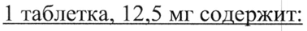
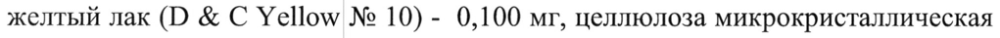
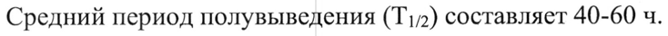

# Хлорталидон — внутрь

- Препарат: Дикардплюс® (таблетки;)
- АТХ: C03BA04
- Источник: ГРЛС, инструкция по медицинскому применению, РУ ЛП-006508, файл от 2022-07-21 (https://grls.rosminzdrav.ru/Grls_View_v2.aspx?routingGuid=beb0f4ea-1fcb-464c-8ca7-315b88ef6bbf)
- Распознано автоматически (OCR): 16 из 16 стр.
- Инструкция к другому РУ того же препарата: ЛП-006508 (национальное РУ, переоформленное по правилам ЕАЭС, решение от 18.05.2022). Текст может быть старше действующего
- Сомнительных строк после OCR: 3 (см. раздел «Проверка распознавания»)

## Общие сведения

МИНИСТЕРСТВО ЗДРАВООХРАНЕНИЯ РОССИЙСКОЙ ФЕДЕРАНИИ __
ИНСТРУКЦИЯ ПО МЕДИЦИНСКОМУ ПРИМЕНЕНИЮ ЛЕКАРСТВЕННОГО ПРЕПАРАТА
ДИКАРДПЛЮС (DICARDPLUS)
Регистрационный номер:
Торговое наименование препарата: ДИКАРДПЛЮС (Dicardplus)
Международное непатентованное наименование: хлорталидон
> Лекарственная форма: таблетки Состав Состав на 1 таблетку:
1 таблетка, 12,5 мг содержит:
Действующее вещество: хлорталидон — 12,50 мг.
Вспомогательные вещества: целлюлоза микрокристаллическая (тип 101) - 52,900 мг, крахмал прежелатинизированный - 1,875 мг, краситель хинолиновый желтый лак (О & С Yellow № 10) - 0,100 мг, целлюлоза микрокристаллическая
(тип 102) - 5,000 мг, натрий карбоксиметилкрахмал - 1,500 мг, кремния диоксид w коллоидный - 0,375 мг, стеариновая кислота- 0,750 мг.
1 таблетка, 25,0 мг содержит:
Действующее вещество: хлорталидон — 25,00 мг.
Вспомогательные вещества: целлюлоза микрокристаллическая (тип 101) - 105,80 мг, крахмал прежелатинизированный - 3,75 мг, краситель хинолиновый желтый лак (D & С Yellow № 10) - 0,20 мг, целлюлоза микрокристаллическая
(тип 102) - 10,00 мг, натрий карбоксиметилкрахмал - 3,00 мг, кремния диоксид коллоидный - 0,75 мг, стеариновая кислота - 1,50 мг.
Описание Круглые, плоскоцилиндрические таблетки желтого цвета со скошенными краями, гладкие с обеих сторон.
Фармакотерапевтическая группа: диуретическое средство
Код ATX: C0O3BA04 Фармакологические свойства

## 5.1. Фармакодинамика

Хлорталидон — тиазидоподобный диуретик — подавляет активную реабсорбцию ионов натрия в почечных канальцах (кортикальный сегмент восходящей части петли Генли), увеличивая выведение ионов натрия и хлора и усиливая диурез.
Хлорталидон — тиазидоподобный диуретик — подавляет активную реабсорбцию ионов натрия в почечных канальцах (кортикальный сегмент восходящей части петли Генли), увеличивая выведение ионов натрия и хлора и усиливая диурез.
Кроме того, хлорталидон увеличивает выведение ионов калия, магния и бикарбоната, задерживает ионы кальция и мочевую кислоту.
Антигипертензивный эффект хлорталидона развивается постепенно с ww достижением максимального терапевтического эффекта через 2-4 недели после начала терапии.
У пациентов с артериальной гипертензией хлорталидон обеспечивает постепенное снижение артериального давления (АД). Несмотря на то, что механизм действия хлорталидона до конца не изучен, его антигипертензивное действие основано на выведении натрия и жидкости. При длительном применении поддержание антигипертензивного эффекта обеспечивается, вероятно, за счет уменьшения общего периферического сосудистого сопротивления. Сердечный выброс возвращается к исходным значениям,
© сохраняется небольшое уменьшение объема плазмы крови, возможно повышение активности ренина плазмы крови.
Повышает выведение бикарбоната, фосфата и магния (преимущественно в проксимальных канальцах) и натрия, хлорида и калия (преимущественно в дистальных отделах); повышенное выведение ионов калия обусловлено усиленной (зависит от скорости тока крови) секрецией калия, которая повышается при высоком потреблении соли. Напротив, выведение ионов кальция (дистальный отдел) снижается, что оказывает благоприятное действие при гиперкальциурии и камнях в почках.
Диуретический эффект развивается через 2-4 часа после приема хлорталидонана внутрь, достигает максимума через 12 часов и сохраняется в течение 2-3 суток.
Как и большинство тиазидных диуретиков, хлорталидон является ингибитором карбоангидразы, его ингибирующее действие на карбоангидразу в 70 раз выше, чем у гидрохлоротиазида.

## 5.2. Фармакокинетика

Всасывание После приема внутрь хлорталидон всасывается из желудочно-кишечного тракта приблизительно на 65%. Максимальная концентрация в плазме крови отмечена примерно через 12 часов после приема внутрь.
Всасывание После приема внутрь хлорталидон всасывается из желудочно-кишечного тракта приблизительно на 65%. Максимальная концентрация в плазме крови отмечена примерно через 12 часов после приема внутрь.
Распределение Несмотря на то, что незначительное количество хлорталидона попадает в кровь, w большая часть хлорталидона связывается с карбоангидразой эритроцитов (98%), а не с белками плазмы крови. Концентрация в эритроцитах в 50-80 раз превышает концентрации в плазме крови или сыворотке крови.
Метаболизм Хлорталидон в основном выводится в неизмененном виде. Данных о сравнительных количествах хлорталидона, выводимого в неизмененном виде и в виде метаболитов, нет. Метаболиты не выявлены. Метаболизм и выведение через кишечник с желчью являются вспомогательными путями выведения.
Выведение © 50 - 65% дозы, принятой внутрь, выводится почками в неизмененном виде, 10% выводится через кишечник.
Средний период полувыведения (Т!/2) составляет 40-60 ч.
Фармакокинетика в особых группах Пациенты пожилого возраста
Хлорталидон у пожилых пациентов выводится медленнее, чем у молодых, что, предположительно, связано с возрастными изменениями функции почек и приводит к увеличению Т!/2. Снижение элиминации не является клинически значимым.
При нарушении функции почек Возможна кумуляция хлорталидона.
При нарушении функции печени Данных по фармакокинетике нет.

## 4.1. Показания к применению

- артериальная гипертензия (в монотерапии или в комбинации с другими гипотензивными средствами);
- артериальная гипертензия (в монотерапии или в комбинации с другими гипотензивными средствами);
- хроническая сердечная недостаточность П или Ш функционального класса по классификации МУНА.
- отечный синдром.

## 4.3. Противопоказания

- повышенная чувствительность к хлорталидону, другим производным wr сульфонамида, а также к любому из вспомогательных веществ препарата;
- повышенная чувствительность к хлорталидону, другим производным wr сульфонамида, а также к любому из вспомогательных веществ препарата;
- анурия;
- печеночная энцефалопатия или тяжелые нарушения функции печени
(более 9 баллов по шкале Чайлд-Пью);
- тяжелые нарушения функции почек
(клиренс креатинина (КК) менее 30 мл/мин);
- рефрактерная гипокалиемия, гипонатриемия и гиперкальциемия;
- трудно контролируемый сахарный диабет;
- болезнь Аддисона;
© - беременность и период грудного вскармливания (см. раздел «Применение при беременности и в период грудного вскармливания»);
- возраст до 18 лет (эффективность и безопасность не установлены);
- одновременное применение препаратов лития.

## 4.3. С осторожностью

Следует соблюдать осторожность при гипокалиемии, гипонатриемии, гиперкальциемии, нарушениях функции почек (КК более 30 мл/мин), сахарном диабете, при одновременном применении с сердечными гликозидами, препаратами лития (см. раздел «Взаимодействие с другими лекарственными средствами»), у пациентов с ишемической болезнью сердца, прогрессирующими заболеваниями печени (риск развития печеночной комы), циррозом печени (риск развития гипомагниемии), с гиперхолестеринемией, гиперглицеридемией, гиперурикемией, системной красной волчанкой, при применении у пациентов с подагрой, при гиперпаратиреозе, при отягощенном аллергологическом анамнезе и бронхиальной астме.
Следует соблюдать осторожность при гипокалиемии, гипонатриемии, гиперкальциемии, нарушениях функции почек (КК более 30 мл/мин), сахарном диабете, при одновременном применении с сердечными гликозидами, препаратами лития (см. раздел «Взаимодействие с другими лекарственными средствами»), у пациентов с ишемической болезнью сердца, прогрессирующими заболеваниями печени (риск развития печеночной комы), циррозом печени (риск развития гипомагниемии), с гиперхолестеринемией, гиперглицеридемией, гиперурикемией, системной красной волчанкой, при применении у пациентов с подагрой, при гиперпаратиреозе, при отягощенном аллергологическом анамнезе и бронхиальной астме.

## 4.6. Применение при беременности и в период грудного вскармливания

Беременность Контролируемых клинических исследований применения хлорталидона у беременных не проводилось.
Следует избегать применения диуретиков в терапии физиологических отеков или артериальной гипертензии во время беременности, поскольку их
= применение связывают с риском развития гиповолемии, повышенной вязкостью крови и снижением плацентарного кровотока. Сообщалось о нескольких случаях подавления функции костного мозга плода, тромбоцитопении, эмбриональной желтухи и желтухи новорожденных на фоне применения тиазидных диуретиков.
При беременности применение хлорталидона противопоказано при артериальной гипертензии. В остальных случаях применение возможно только по строгим показаниям в минимально эффективной дозе и когда ожидаемая польза для матери превышает потенциальный риск для плода.
Период грудного вскармливания © Хлорталидон выделяется в грудное молоко. При необходимости применения в период лактации, грудное вскармливание следует прекратить.

## 4.2. Способ применения и дозы

Препарат принимают внутрь, строго по назначению врача. Таблетку следует проглатывать целиком, не разжевывая, запивая достаточным количеством жидкости.
Препарат принимают внутрь, строго по назначению врача. Таблетку следует проглатывать целиком, не разжевывая, запивая достаточным количеством жидкости.
Дозу препарата Дикардплюс подбирают индивидуально для каждого пациента.
Если препарат Дикардплюс включают в схему лечения пациента, состояние которого стабилизировали с помощью другого гипотензивного средства, необходимо с самого начала снизить дозу гипотензивного средства во избежание возможного возникновения артериальной гипотензии тяжелой степени.
Артериальная гипертензия Монотерапия В терапии артериальной гипертензии рекомендуемая начальная доза препарата
Дикардпилюс составляет 12,5-25 мг/сутки. Этой дозы достаточно для обеспечения максимального антигипертензивного эффекта у большинства пациентов. Если снижение АД при приеме дозы 25 мг в сутки неудовлетворительное, дозу увеличивают до 50 мг в сутки. Если требуется дальнейшее снижение АД, возможно включение дополнительной гипотензивной терапии к схеме лечения.
При лечении пациентов с артериальной гипертензией доза препарата не должна превышать 50 мг в сутки (увеличение риска побочного действия без усиления

& антигипертензивного эффекта).
Комбинированная терапия Если для терапии артериальной гипертензии требуется проведение комбинированной терапии, сначала корректируют дозу посредством применения каждого препарата в монотерапии. Если оптимальная поддерживающая доза соответствует соотношению в комбинированном препарате, применение комбинированного препарата с фиксированной дозой допускается. Если требуется коррекция дозы, каждый препарат применяется повторно в монотерапии.

© Стабильная хроническая сердечная недостаточность (П или Ш функииональный класс по классификации NYHA)
Рекомендуемая начальная доза препарата Дикардплюс составляет от 25 до 50 мг/сутки, в тяжелых случаях возможно увеличение дозы до 100-200 мг/сутки.
Стандартная поддерживающая доза - это минимально эффективная доза, например, 25-50 мг в сутки ежедневно или через день. Если ответная реакция пациента неудовлетворительная, допускается применение сердечных гликозидов или ингибитора АПФ в отдельности или обоих лекарственных препаратов.
Отечный синдром

Стандартная начальная доза препарата Дикардилюс составляет 50-100 мг в сутки, желательно утром после приема пищи, однократно. Или терапию начинают с дозы 100 мг через день или 3 раза в неделю. Некоторым пациентам может потребоваться применение дозы 150-200 мг ежедневно или через день.
Дозы, превышающие 200 мг в сутки, не вызывают увеличения терапевтического эффекта.
У пациентов с отеком снижение дозы препарата Дикардплюс до минимальной поддерживающей дозы возможно по истечении 7 дней терапии или по достижению массы тела до появления отека.
Особые группы пациентов ы У пациентов с КК ниже 30 мл/мин хлорталидон и тиазидные диуретики утрачивают свой диуретический эффект, применение препарата Дикардплюс противопоказано (см. раздел «Противопоказания»).
Пациентам с почечной недостаточностью легкой и умеренной степени тяжести и пожилым пациентам рекомендуется минимально эффективная доза препарата
Дикардплюс.
У пожилых пациентов хлорталидон выводится медленнее, чем у здоровых пациентов молодого возраста, несмотря на одинаковую всасываемость. Таким образом, может потребоваться снижение рекомендуемой дозы препарата
© Дикардплюс. Во время терапии препаратом Дикардплюс следует проводить тщательное медицинское обследование пациентов пожилого возраста:
контролировать концентрацию креатинина в плазме крови с учетом возраста, массы тела.
У пациентов с тяжелыми нарушениями функции печени применение препарата
Дикардплюс противопоказано (см. раздел «Противопоказания»).

## 4.8. Побочное действие

Частота побочных реакций определялась в соответствии с рекомендациями
Частота побочных реакций определялась в соответствии с рекомендациями
Всемирной организации здравоохранения: очень часто (>1/10); часто (>1/100,
<1/10); нечасто (>1/1000, <1/100); редко (>1/10000, <1/1000); очень редко
(<1/10000), включая отдельные сообщения; неуточненной частоты (частота не может быть подсчитана по доступным данным).
Нарушения со стороны крови и лимфатической системы: редко — тромбоцитопения, лейкопения, агранулоцитоз, эозинофилия; частота неизвестна — апластическая анемия.
Нарушения со стороны обмена веществ и питания: очень часто — гиперлипидемия; очень редко - глюкозурия, декомпенсация имеющегося сахарного диабета, гипохлоремический алкалоз, гипергликемия, гиперурикемия.
Нарушения со стороны пищеварительной системы: часто — тошнота, рвота, потеря аппетита, гастроспазм; редко — запор, диарея; очень редко — панкреатит.
= Нарушения со стороны нервной системы: редко — головная боль; частота неизвестна — головокружение, вертиго, парестезия, возбуждение.
Нарушения со стороны органа зрения: частота неизвестна — ксантопия, нарушения зрения.
Нарушения со стороны cepoua: редко — аритмия.
Нарушения со стороны сосудов: часто — выраженное снижение артериального давления и связанные с этим симптомы (ортостатическая гипотензия).
Нарушения со стороны дыхательной системы, органов грудной клетки и средостения: редко — аллергический отек легких.
© Нарушения со стороны печени и желчевыводящих путей: редко — внутрипеченочный холестаз, желтуха.
Нарушения со стороны кожных покровов и подкожных тканей: часто — крапивница, кожная сыпь; редко — фотосенсибилизация, кожный васкулит, реакции повышенной чувствительности; частота неизвестна - синдром
Лайелла (токсический эпидермальный некролиз), пурпура.
Нарушения со стороны скелетно-мышечной системы и соединительной ткани: частота неизвестна — спазмы мыщц.
Нарушения со стороны почек и мочевыводящих путей: редко — интерстициальный нефрит.
Нарушения со стороны половых органов и молочной железы: очень редко - сексуальная дисфункция.
Общие расстройства и нарушения в месте введения: частота неизвестна — слабость.
Лабораторные и инструментальные данные: очень часто - гипокалиемия, гипонатриемия; часто — гипомагниемия; редко — гиперкальциемия.

## 4.9. Передозировка

Симптомы: тошнота, слабость, сонливость, гиповолемия, выраженное снижение артериального давления, головокружение и нарушения водно-электролитного баланса, аритмия, судороги.
Симптомы: тошнота, слабость, сонливость, гиповолемия, выраженное снижение артериального давления, головокружение и нарушения водно-электролитного баланса, аритмия, судороги.

— Лечение: специфического антидота нет. Для снижения абсорбции следует промыть желудок, принять активированный уголь.
Следует осуществлять тщательный мониторинг артериального давления и водно-электролитного баланса и принять соответствующие корректирующие меры (инфузионная терапия), симптоматическая терапия.

## 4.5. Взаимодействие с другими лекарственными средствами

Нежелательное сочетание лекарственных средств
Литий — диуретики снижают почечный клиренс лития и повышают риск развития токсического действия лития; одновременное применение не

© рекомендуется.
При необходимости применения соответствующей комбинированной терапии рекомендуется регулярный контроль концентрации лития в сыворотке крови.
Сочетания препаратов, требующие внимания
С тиазидными диуретиками такие лекарственные средства, как этанол, барбитураты и наркотические средства, могут потенцировать риск развития ортостатической гипотензии.
Хлорталидон усиливает действие курареподобных миорелаксантов и гипотензивных средств (в том числе гуанетидина, метилдопы, бетаадреноблокаторов, вазодилатирующих средств, блокаторов «медленных»

кальциевых каналов), ингибиторов ангиотензинпревращающего фермента

(АПФ), ингибиторов моноаминооксидазы.

Одновременное применение хлорталидона с аллопуринолом может привести к

увеличению частоты развития реакций гиперчувствительности на аллопуринол.

Хлорталидон может увеличивать риск развития побочных реакций,

обусловленных амантадином.

Антихолинергические препараты (например, атропин, бипериден) могут

увеличивать биодоступность хлорталидона, снижая моторику желудочно-

кишечного тракта и эвакуацию содержимого желудка.

Гипокалиемическое действие хлорталидона усиливается при одновременном
| применении с глюкокортикостероидами, адренокортикотропным гормоном,

амфотерицином, или рВ2-адреноблокаторами, карбеноксолоном. Пациентам во

время комбинированной терапии следует контролировать содержание калия в

сыворотке крови.

Гипогликемические средства (для приема внутрь и инсулин) — может

потребоваться коррекция дозы гипогликемических средств при одновременном

применении с хлорталидоном.

Фармакологические эффекты солей кальция и витамина Д могут увеличиваться

до клинически значимого уровня при одновременном применении с
© хлорталидоном. Возникшая гиперкальциемия, как правило, носит преходящий

характер, однако у пациентов с гиперпаратиреозом возможен риск развития

устойчивой гиперкальциемии, сопровождающейся симптомами (слабость,

повышенная утомляемость, анорексия).

Одновременное применение с циклоспорином может увеличивать риск развития

гиперурикемии и таких осложнений как подагра.

Колестирамин нарушает всасывание хлорталидона. Возможно снижение

фармакологического эффекта хлорталидона.

Миорелаксанты недеполяризующего типа действия (например, тубокурарин) —

усиление эффекта миорелаксантов.

Прессорные амины (например, эпинефрин, норэпинефрин) — снижение выраженности ответа на прием прессорных аминов.
Нестероидные противовоспалительные препараты (НПВП) (включая ингибиторы циклооксигеназы-2 (ЦОГ-2)) — могут снижать диуретический, натрийуретический и антигипертензивный эффект диуретиков.
У некоторых пациентов с нарушением функции почек (например, пожилые пациенты или пациенты с обезвоживанием, в том числе принимающие диуретики), получающих терапию НПВП, включая ингибиторы ЦОГ-2, лечение антагонистами рецепторов ангиотензина П или ингибиторами АПФ может вызывать дальнейшее ухудшение функции почек, включая развитие острой
= почечной недостаточности. Данные эффекты обратимы. Одновременное применение этих препаратов должно проводиться с осторожностью у пациентов с нарушением функции почек.
Цитостатические препараты, например, циклофосфамид, метотрексат:
увеличивается миелоподавляющее действие за счет замедления выведения из организма.
Сердечные гликозиды. гипокалиемия и гипомагниемия, вызванные применением тиазидных диуретиков, увеличивают риск развития аритмий при лечении сердечными гликозидами.
© Снижение объема циркулирующей жидкости, вызванное приемом диуретика, может усиливать нефротоксичность аминогликозидов.
Хлорталидон снижает активность протромбина. Тиазидоподобные диуретики могут усиливать подавление функции костного мозга, вызванное химиотерапией при лечении опухолевых заболеваний (например, нейтропения).
Йодсодержащие контрастные вещества — при дегидратации, вызванной приемом диуретиков, повышается риск развития острой почечной недостаточности, особенно при введении высоких доз Йодсодержащих препаратов. Перед введением подобных средств пациенту должна быть проведена регидратация.

## 4.4. Особые указания

Артериальная гипотензия на фоне нарушения водно-электролитного баланса
Артериальная гипотензия на фоне нарушения водно-электролитного баланса
У пациентов со сниженным объемом циркулирующей крови и/или с гипонатриемией (в результате рвоты, диареи, приема больших доз диуретиков или соблюдения диеты с ограничением приема поваренной соли) может развиваться клинически значимая артериальная гипотензия после начала терапии препаратом Дикардплюс. Гиповолемию и водно-электролитный баланс следует скорректировать перед началом лечения. Преходящая артериальная гипотензия не является противопоказанием к дальнейшему лечению, которое может быть продолжено после стабилизации АД.
Гипокалиемии можно избежать применением калийсодержащих препаратов или
> пищи, богатой калием (фрукты, овощи), особенно в случае усиленной потери калия (усиленный диурез, продолжительное лечение) или одновременного лечения сердечными гликозидами или кортикостероидными препаратами.
Нарушения функции печени При применении тиазидных и тиазидоподобных диуретиков у пациентов с нарушениями функции печени возможно развитие печеночной энцефалопатии, особенно в случае нарушения водно-электролитного баланса. В этом случае прием диуретиков следует немедленно прекратить.
Фоточувствительность © Есть информация о случаях развития реакций фоточувствительности при применении тиазидных диуретиков (см. раздел «Побочное действие»). Если реакция фоточувствительности возникнет в ходе лечения, то рекомендуется приостановить лечение. Если принято решение о необходимости возобновления приема диуретика, необходимо защищать области тела, которые могут быть подвергнуты воздействию солнечных или ультрафиолетовых лучей типа А и избегать пребывания на солнце.
Водно-электролитный баланс - содержание натрия в плазме крови:
До начала терапии следует определить содержание натрия в плазме крови. На фоне применения препарата необходимо регулярно контролировать данный показатель. Необходим постоянный контроль содержания натрия, так как первоначальное снижение содержания натрия в плазме крови может быть бессимптомным. Более частый контроль содержания натрия необходим пациентам с циррозом печени и пожилым пациентам (см. разделы «Побочное действие», «Передозировка»).
Все диуретические препараты могут вызывать гипонатриемию, приводящую иногда к крайне тяжелым последствиям. Гипонатриемия и гиповолемия могут приводить к обезвоживанию и ортостатической гипотензии. Сопутствующее снижение содержания хлора может приводить к вторичному компенсаторному метаболическому алкалозу: частота и степень выраженности этого эффекта
> незначительны.
- содержание калия в плазме крови:
При терапии тиазидными и тиазидоподобными диуретиками основной риск заключается в резком снижении содержания калия в плазме крови и развитии гипокалиемии. Необходимо избегать развития гипокалиемии (< 3,4 ммоль/л) у пациентов следующих категорий: пожилого возраста, ослабленных или получающих сочетанную медикаментозную терапию, пациентов с циррозом печени, периферическими отеками или асцитом, ишемической болезнью сердца, сердечной недостаточностью. Гипокалиемия у этих пациентов усиливает
© токсическое действие сердечных гликозидов и повышает риск развития аритмии.
При появлении гипокалиемии должно быть назначено соответствующее лечение.
Диуретические препараты и нарушения функции почек
Тиазидные и тиазидоподобные диуретики эффективны в полной мере только у пациентов с нормальной или незначительно нарушенной функцией почек. У пациентов пожилого возраста нормальная концентрация креатинина в плазме крови рассчитывается с учетом возраста и массы тела.
Следует учитывать, что в начале лечения у пациентов может наблюдаться снижение скорости клубочковой фильтрации, обусловленное гиповолемией, которая, в свою очередь, вызвана потерей жидкости и натрия на фоне применения диуретических средств. Как следствие, в плазме крови может увеличиваться концентрация мочевины и креатинина. Если функция почек не нарушена, такая временная функциональная почечная недостаточность, как правило, проходит без последствий, однако при уже имеющейся почечной недостаточности состояние пациента может ухудшаться. У пациентов с нарушением функции почек препарат может кумулировать и вызывать развитие азотемии. При развитии олигурии следует рассмотреть возможность отмены препарата.
Сахарный диабет Лечение тиазидами нарушает толерантность к глюкозе. Во время длительного w курса лечения при манифестном и латентно протекающем сахарном диабете необходим систематический контроль метаболизма углеводов; может потребоваться коррекция дозы гипогликемических средств. В период лечения необходим периодический контроль концентрации мочевой кислоты. Алкоголь, барбитураты, наркотические анальгетики усиливают антигипертензивный эффект тиазидных диуретиков.
Хлорталидон может повышать концентрацию холестерина и триглицеридов в крови.
Гиперкальциемия © Тиазидные диуретики могут вызывать снижение экскреции кальция почками и приводить к преходящему умеренному повышению содержания кальция в сыворотке крови в отсутствие установленного нарушения кальциевого метаболизма. Выраженная гиперкальциемия может быть доказательством имеющегося у пациента гиперпаратиреоза. Прием тиазидных диуретиков следует прекратить до проведения исследований функций паращитовидных желез.
Показано, что тиазиды увеличивают выведение магния почками, что может приводить к гипомагниемии.
Системная красная волчанка Есть данные о том, что тиазидные диуретики могут вызывать обострение течения системной красной волчанки или волчаночноподобные реакции. Тем не менее, о случаях обострения течения системной красной волчанки на фоне применения хлорталидона не сообщалось. Требуется усиленный контроль за пациентами с нарушенным метаболизмом мочевой кислоты.
Спортсмены Хлорталидон может давать ложноположительные результаты при проведении допинг-контроля.
Реакции повышенной чувствительности Реакции повышенной чувствительности могут развиваться у пациентов,
> имеющих отягощенный аллергологический анамнез или бронхиальную астму.

## 4.7. Влияние на способность управлять транспортными средствами, механизмами

Не проводилось специальных исследований по изучению влияния препарата
Дикардплюс на способность управлять транспортными средствами, механизмами.
Следует соблюдать осторожность при управлении транспортными средствами, работе с механизмами и выполнении другой работы, требующей повышенной концентрации внимания (риск развития головокружения).
, Форма выпуска © Таблетки, 12,5 мг, 25,0 мг.

По 10 таблеток в ПВДХ/ПВХ/Ал блистер.
По 3 блистера в картонную пачку вместе с инструкцией по применению.

## 6.4. Условия хранения

При температуре не выше 25°С.
При температуре не выше 25°С.
Хранить в недоступном для детей месте.

## 6.3. Срок годности

2 года. Не применять после истечения срока годности.
2 года. Не применять после истечения срока годности.
Условия отпуска Отпускают по рецепту

Наименование и адрес держателя (владельца) регистрационного удостоверения
Ипка Лабораториз Лимитед, Индия 48, Kandivli Industrial Estate, Kandivli (West), Mumbai 400 067, India
Производитель <<логотип фирмы (на английском языке)>>
Ипка Лабораториз Лимитед, Индия Р.О. Sejavta, District Ratlam, 457002, Madhya Pradesh, India п/о Седжавта, Район Ратлам, 457002, Мадхья Прадеш, Индия
Организация, принимающая претензии потребителей:
| Представительство компании Ипка Лабораториз Лимитед (Индия)

121609, г. Москва, Рублевское шоссе, д. 36, корп. 2, офис 233-235
Тел: (495) 415-43-04/09 Факс: (495) 415-43-90

Ро \

Gi № Руководитель отдела регистрации ЛС g {\; | ‘ek
© компании «Ипка Лабораториз Лимитед» ot, 7) Т.А. Шафеев
BOR Ay
## Проверка распознавания

Страницы-сканы распознаны автоматически. В 3 строках с дозировками цифры могли распознаться с ошибкой — сверьте с вырезкой из оригинала:

- стр. 1: «1 таблетка, 12,5 мг содержит:» — низкая уверенность: «1» (77)  
  
- стр. 1: «желтый лак (О & С Yellow № 10) - 0,100 мг, целлюлоза микрокристаллическая» — низкая уверенность: «10)» (71)  
  
- стр. 3: «Средний период полувыведения (Т!/2) составляет 40-60 ч.» — низкая уверенность: «(Т!/2)» (79)  
  