# Хориогонадотропин альфа — парентерально

- Препарат: Овитрель® (раствор для подкожного введения;)
- АТХ: G03GA08
- Источник: ГРЛС, инструкция по медицинскому применению, РУ ЛС-002622, файл от 2022-09-29 (https://grls.rosminzdrav.ru/Grls_View_v2.aspx?routingGuid=e1cf7b1f-1c4c-45e3-b20d-236bb5f41e45)
- Распознано автоматически (OCR): 8 из 8 стр.
- Инструкция к другому РУ того же препарата: ЛС-002622 (национальное РУ, переоформленное по правилам ЕАЭС, решение от 12.08.2022). Текст может быть старше действующего
- Сомнительных строк после OCR: 12 (см. раздел «Проверка распознавания»)

## Текст

> . 4 oe, » cof roe ‘ oo ` НИ “ И И. о. "Л©-002622-0908 1,
ИК: РИ oF cy ‚ 7 т, о. i тт .° , 8 я аа aa т ‚ ran ‚ ие a os у _ . ть. иг.” , би
‚7... ‘МИНИСТЕРСТВО ЗДРАВООХРАНЕНИЯ И СОЦИАЛЬНОГО РАЗВИТИЯ и и ee oe Г РОССИЙСКОЙ ФЕДЕРАЩИИ о ПИТЬ
.7 | a Mes we - 7 ce os, 7 va a В и” a come

_ att „ и, . И м, о. a, №

, № Инструкция по применению лекарственного препарата. ‘о ©... т.”
УЖ № и, и. для медицинского применения oy и . у вии
‚ iy * . . “¢ wy , ' . - : : ь о и, сено Овитрель® , и нь a ms Coe, “ whe Jf a , | ar , . и т. : hat an i ae Регистрационный номер: a О и Say por ge Торговое название препарата: Овитрель® Е т: Lo .
a :. ‘MH: Хориогонадотропин альфа - oo _ x a р о an ‘ ‚ ° Лекарственная форма: раствор для подкожного введения > _ ey ; | и. и, В О ОСЬ (о аи о и
. © } о, Состав: один заполненный шприц с 0,5 мл раствора содержит: активное вещество - oo . a oy i | : хориогонадотропин альфа 250 мкг (6500 МЕи вспомогательные вещества: маннитол. г. | р р
| 7 о 27,3 Mr, метионин 0,1 мг, полоксамер 188 0,05 мг, фосфорная кислота 0,49 мг, натрия 7 ca | в
| | ‘. . тидроксид 49.5. для корректировки рН, вода для инъекций. до 0,5 го | rote Panes oo
. ' ‘ ry $ ох ‚ ve noe . .!

-° Описание: прозрачный или ‘слегка опалесцирующий бесцветный или, светло-желтый И

О paerpop a |“ и, © Фармакотерапевтическая группа: Лютсинизирующее средство. ; аи и
7. Kom ATX: 6036408, и И

7 а, 5.” , .. ils, о „1 а ФАРМАКОЛОГИЧЕСКИЕ СВОЙСТВА ‚ ys) ** и,
- we . ‚ Фармакодинамика и о "3 `.. "и CoG a . me и В ‘о’ .
ИИ Овитрель® содержит хориогонадотропин ‘альфа, который производится: при. помощи ” (т,
- ® и’ рекомбинантной ДНК технологии. ОН имеет.ту же’ аминокислотную, последовательность, “. a в что и естественный человеческий хорионический гонадотропин. : Хорнонический < Я т. cee '‘гонадотропин связывает трансмембранные рецепторы лютеинизирующего гормона GIP) we и м . | ‚на поверхности клеток теки и гранулезы яичника. Вызывает инициирование ооцитарного' . |

: ". = мейоза, ‚ разрыв фолликулов ',(овуляцию),; формирование желтого ‘тела, продукцию Lat

| _ oo | прогестерона и эстрадиола желтым телом... 7 И ы ‚. Е “, i eit | Фармакокинетика К т, | во р о" Веавывание и распределение и’ м ‚о wel

| После внутривенного введения. хориогонадотропин-альфа—— распределяется Bo

| ‘внеклеточную жидкость с периодом полураспределения около 4,5 часов. Стационарный _
`объем распределения и общий клиренс составляют 6 л и 0,2 л/час соответственно. |
ООО ООО о т . re ‘ , й “ 4 ‚ 1: + , , . > sy . sof ro a , , e y te, 1 В иней . у. у , + ЛС-002622-090811'. .
“se eS St 7, в . CoG ° foyet rn) : Jef :
, . ', . Stet . . ‹ , wt й , 4 . р 2 .. a te ы у * а‘ + . + кз ‚ ы 4 ’ . . "
- % ‘ ae ИИ ’ af ae ‘ . й > . . й ‚ О
|, И ‚ При подкожном -введении хориогонадотропина:. альфа абсолютная, биодоступность foot
2. * ~ , ‘ ы 7 ‘

„ В ; , ‘ re ‘ „ . 4 * й к г 1%" _ г составляет приблизительно 40%, конечный период полувыведения — около 30 часов. |, . ‘oe в: ; . вре , af ‘ y . ey } , . »^ ‘ ey ¢ 7 }.
, . . | ’ go ; й ы 1

и . ‚. Выведение и метаболизм | . oe ae ‚ a tak 4 , , 2 й . ° : , ¥ ‚ - 4 1 4 `, . А ,

_v'\, ‚ Метаболизм и ‘выведение хориогонадотропина’ альфа‘ аналогичны эндогенному _— rr GS aoe so о р 4a " ae

a '. | Хорионическому гонадотропину. poo my ; ye |

i у 2 . a ., . й ., 1 ; ` > vf . |

, , . ‘ , " у ы 7 2 : ы ; , и, , . Ц 4 . и WO . ty , vy , й , :

. ; . ПОКАЗАНИЯ ДЛЯ ПРИМЕНЕНИЯ с’ | 2 of Cue tet ae

4 , eye т ‘ aa ‘ ce и . ‘

pe ‚ - В протоколе индукции множественного созревания фолликулов для вспомогательных — |.
: , ы * ‘ и В é ’ a ® ` я ', В ‘+ . | be 2 > > ‘ ~ vy ; репродуктивных технологий (BPT), в TOM числе для экстракорпорального оплодотворения `, | i 5 , ve ‘ , soe ‚ „’ , aft a й } f , ы

5 у (ЭКО), 'с.целью индукции финального‘ созревания фолликулов и лютеинизации после’ |

, > af ; 4 ‘ , ) и. . . ‘a , ac . д ‘ 0 . ’ стимуляции препаратами гонадотропинов. | , , ', . ‘ "

Loe -„При ановуляторном или олигоовуляторном. бесплодии‘ для’ индукции овуляции и

i Tt лютеинизации в конце стимуляции роста фолликулов. tet ‘ Poe

? cot м : ` t , ‘ «ях ‘ а . й . № эти у ` `, `

4 , . у у a \ 4 ¢ ' ‚` ‚7 , Je 4 -*c co. if , we

ы , si _ tooo . у ‚ , , i a 7 . r .‹ К |

cn ., ; ПРОТИВОПОКАЗАНИЯ ДЛЯ ПРИМЕНЕНИЯ OC: Го И

у . oo 4 ; ‚ . и, .. , a , ,

4 +4 ' ° ‘ , ° , -. р ' 72+» . , 1

и . < *Гиперчувствительность `к` активному компоненту и‘к любому из `вспомогательных .. ‚.
, 4 - „ ‘ . £ й + ‹ . a ae ta В м , цу 5 1 . ы Но 4 ‘| 1 * rye . . , м z 4 ве . ,,' ++ Компонентов, входящих в состав препарата; ° ‚’, a, : ., о
.’ . Lb - Опухоли гипотоламуса и гипофиза; . Я _ tos a у ty , 4 * ‘ ` . 4 na + a у : ,
- - Объемные новообразования яичника или кисты, несвязанные с поликистозом яичников. . .
‘ау ии : , у К . ИА my oe 4! ‚ - Вагинальные кровотечения неясной этиологии. = * ue ‘ бе, : a
: 2%: ‘ Pad , a? . ‘ ’ we . ` ; = . . moe, :
| ; Г . - Рак яичника, матки или молочной железы. Sos . ” mot rr .
й 1 . ” ‚ к . ah te у к ” р ae 1 + В ' a * ‘. ‚` ‘ ` ы ° ‘3 | р; 2тВнематочная беременность в течение 3 предыдущих месяцев. ©’ т’ т: ^, то ‘ен; 1 = Тромбоэмболия . . о. . - ; So, ‘ reo
‘ 1 t ` , > В ; ‘ 5” . 4 ; ‘. , РА м 7 , ‘ “
- ‘ле - Первичная овариальная недостаточность. АН Г. и 7 р . . + - В , , . 5. у ros « , .
г ® . - Врожденные пороки развития половых органов, несовместимые с беременностью. .’. ‘’,
``, = Фибромиома матки, несовместимая с беременностью. * О ОС ОО ВОО и,“ °, wt ‚. ОР : И р . - Постменопауза.. он (we и ‚ .- о
< ‹*“ } : . ы ы 4 . i ы ’ 7 2 4 5 4 * + а ;
р . ’. 7+, C осторожностью следует назначать Овитрель® ’ пациенткам, страдающим тяжелыми Г.
' и , . и “4 ы . , , } ” * , :
- :** системными заболеваниями, в тех случаях, когда беременность может привести к их, . |
‚ . ‘+ обострению. , | о Та ve oo _ р vee й ` 7 , , м , . a Lae + м 7, . . ! г з ‘ 7 , у - . La, , |
_ ПРИМЕНЕНИЕ В ПЕРИОД БЕРЕМЕННОСТИ И КОРМЛЕНИЯ ГРУДЬЮ '° - .

й “ , у t “ ‘ ‘, . ` , # i . .. ., ‚. + 3 ay р ' >

A a й 4 . 3 ` ’ “

‘ ' В период беременности и грудного вскармливания препарат Овитрель® не назначается.” о
РИА ВАНО РИЧИ ИРА ИНЬ memati bhi nile inane aE ERR a alt EEE tle tne a nde
| ‘* Данные об экскреции хориогонадотропина альфа в грудное молоко отсутствуют. | i ; ИНО a 2
—__ ии ди ии ишШшШШ и. ite pe . ’ . 1 `*, "о i , a „> у `, р \ a a о” Пи, ЛС-002622-0908 1 .
ve ‘6 ee к и vty ие о у poy | 77.) . СПОСОБ ПРИМЕНЕНИЯ И ДОЗЫ м, ао
.. В rout Lets _Овитрель® вводится подкожно. Каждый шприц предназначен только ‘для однократного ." К vp |
| но. on ._ использования. у оу, ” me aan ne on Sf tee ye _
, , , too. ra . ‘ ‚ ош. sy! и. aan ah о’ в” Лечение следует проводить только ‘под руководством врача, имеющего опыт B лечении: | - , | 7 7 foe и. бесплодия. о . т 10 oe Е в т: .. И и В протоколе индукции множественного созревания фолликулов для BPT, в том числе для й Se
".. .. ит а ЭКО, с ‘целью инд укции финального созревания: фоллику лов и: лютеинизации‘ после ' wr 7 ae 7 | , . стимуляции пр спаратами гонадотр опинов: | И . — oo 4 К тт, С a pe SE Овитрель® в дозе 250 мкг (содержимое 1 шприца) вводится однократно через 24-48 часов" * > > +, civ "и. ^ после последнего ' введения препарата фолликулостимулирующего гормона`или ЛГ и a ve 4 „‘. достижения оптимального уровня развития фолликула. ` ОВ
‚. _ *’ При ановуляторном или олигоовуляторном бесплодии’ для индукции овуляции и :. о
.. ® (+ лютеинизации в’конце стимуляции роста фолликулов: |, sk Я
И . Овитрель® в дозе 250 мкг (содержимое-1‘ шприца) вводится однократно через 24-48 часов в ` :
. 1 4. ("y+ после достижения оптимального, уровня развития фолликула. Рекомендуется, половой-. | bly "| контакт в день введения nperiapata Овитрель® и на следующий День. Doug . “ hae a г. |
‚. +, * РЕКОМЕНДАЦИИ ПО: САМОСТОЯТЕЛЬНОМУ ВВЕДЕНИЮ ПРЕПАРАТА | ``)
. oe te Овитрель®.: 7 _ : ees 7 _ / oO a " ‹ | :, ИИ ое o a fe Самостоятельное введение возможно только пациентами, прошедшими соответствующее /`. ``”.
т - обучение и имеющими возможность обратиться за советом к врачу-специалисту. | oo о м При самостоятельном введении пациентке следует внимательно прочитать и строго‘, ..
-. ce a следовать пижеприведениой инструкции по введёнию препарата:. - п. ко po р ча . ° 1; Вымойте руки. Важно чтобы Ваши руки и-предметы; которые Вы используете, были ; " ‚ .
:° ‚©. : _ 2: Подготовьте чистую поверхность и разложите на ней все, что нужно для инъекции: ". = . | и ‚ = Два тампона, смоченных спиртом (к упаковке не прилагаются); ие. й И .
№ Co, - один шприц с препаратом. ‘3.0%: и. оли и. | 7 :,
| в | й 3. Введение инъекции: Сразу же проведите инъекцию: Выберите место для инъекции в 1” ое! соответствии с рекомендациями Вашего лечащего врача или, с о А sR р медсестры (живот, передняя часть бедра). Протрите выбранный a | и к was участок тампоном со спиртом. Сильно стяните кожу ‘пальцами и -. °
_ о. a коротким энергичным движением и направьте иглу под YOM”
| - " "45° - 90° B кожную складку. Проводите подкожную инъекцию, как Вас учили. Избегайте 7 ° "о о 5 попадания, препарата непосредственно в вену. Вводите раствор, осторожно нажимая. на
'. поршень. Используйте столько времени, сколько Вам нужно для того, чтобы ввести весь ` |
ООО ВИН ООН | о . | . _ . - ve , ‘ A ce va у ‘ re ‘ ‚14 ' ; у ve a OE et „ЛС-002622-090811 .
st ae 1 .’ ‘ ; ‘ у ` ne В . ‘ » ‘ . ve . ‘ и . 7
. , ”. о ‘ . ‘ ‘ Е“ wy „* и: ‚# т. i - No. , о“ vo т РИ и,
, co , _ bo ‘ . - ‘ a . . , ~ _ a ‚ , объем раствора. Сразу же после инъекции выньте иглу и протрите круговыми движениями‘, .,. | apo . м : , ot , у . т „.’ ‚ ‚- . ‘ mn у ‘ . , mA ‘ _* a |
> 9%, Кожу в месте инъекции тампоном со спиртом. ›: " Hg yee ee ye, o* 4. Утилизация использованных принадлежностей: Сразу после‘инъекции поместите *, , | р at i“ 2 Soy 4 ets „ " и ^ „ ы ы Ц ‘ ty ‘ < |
‚„‘}- +“ использованный . шприц в, ‚контейнер для хранения. острых предметов. Bech’ |" ‘| й “ й f , > `, , ы . + ‚7 , ‹ ` ’ . , ’ rir t |
(7. м’, : неиспользованный раствор должен быть уничтожен. ° “ ‘ а о о
' ‚ р , , ta ‘ ‚+ . ae . r у 4 feos р р |
Е . 4 var © * 5 <? ’ . tw y 4 ы * у ’‘ | cate i 4 arn го о“ ‘ м ‚‘ ‘ ary . ; . x ы 5
| `` у ‘ ‘ ‘ tye д > у ‘ ` м a ‘ 4 . + “ a. ~ , ы 2 °. , ; |
? - 2. Если; Вы ‚ввели ‘слишком большую дозу препарата, могут появиться симптомы “,;' —
"4 ^ a “. wns tO iy 3 ~ "e aa ae ‚, , / t 1 А 1 ‘ . , 1 r ¢ .* | cus ,t.*. синдрома гиперстимуляции яичников (СГЯ), которые ‘описаны: в’ разделе «Особые, а
. ; й a . "+ ‚., р ` st pote , > ~ ` 4 2 3 + ve |
‚с Указания» > или’ «Побочные : эффекты». ` „Если эти’ симптомы — появились, © +
; . ‚ проконсультируйтесь с врачом. oe - ‘ - ‚ tes ey} eat р ‘oot .’ “ ' a , д. a ра, ° Если Вы забыли ввести препарат, проконсультируйтесь с врачом как можно скорее. .’ а t * , mn an) > т. . . ' , ‹ 1
, м fox? , И ", . . ., в " , . 4 й .. ‘ В ‚ us ‚- Sey И, ' ‘ Ae , у vo 1 J ‘ , .
° ® о ПОБОЧНОЕ ДЕЙСТВИЕ .. | у ео р , 4 2 , “> - 4 e й a | 6 -, 5 , . 4 ы to re . В , . 1
‘ +» а’ При применении лекарственного препарата Овитрель® возможно развитие побочных р 7 o3 t o* teow wy oF ” , . fee ‘ ` : я . * te
, ря й pts 4: “ и- ‘ , РО № а эффектов, которые в зависимости от частоты появления расцениваются как очень частые и
‹ € > r r ‘ ‘ _ “ ` ' . ry у тя 4 ° ‘ ‘ 3 . й wf = .
ы ia ' 1’ 11); частые > 1/100 и < 1/10), нечастые (>1/1000 и <1/100), редкие, (>1/10000 и <°.. ’ | й . t . 2 ws 2 . , о , . roy ` ‚4 А о ‘ м “ae . ‚ .‘
_ + + (1/1000), очень, редкие (<1/10000, включая’ единичные сообщения). Частота побочных ``, © :
аи. ' .* й vos oe й “3 ss ‹“ й a , ue “es oot fy , й |
", .%. 7 4°" Эффектов в каждой группе указана в порядке убывания. В` зависимости от частоты - “
, . й ния В , rf ' te Ы 1 4 В ` . . ч :
a , x a ` . t ^ . y ; В a _ | встречаемости побочные явления могут быть разделены на группы:. = - р ;
ине, ‚ Иммунная система: очень редко — от легкой до тяжелой реакции гиперчувствительности, о | р ‚ "| „включая анафилактические реакции и шок. `` .. * В: _
, ; 2 an oe : ; aoe . a Хх: ° : . ' ` - ‘ . , й ye .
| > + + 7c ЦНС: нечасто — депрессия, раздражительность, возбуждение. © |”; а
' ‘, 7, * bom ’ ’ { ‚ БК . , . , г ‚ * > oe ‘ ‘ mae , | * x he . .
| _ +. Heppuas система: часто — головная боль. т.“ `, О to
‚ : ro tor = . en , - у ; ^ . sof | р a r ak yes В . ; . ‘ =, e . v foe
Nout ’ ," Сосудистая система: очень редко — тромбоэмболия, обычно связанная с тяжелой формой. ' о
“3 * * - + +? < 7s ! В .‘ i . A, . , t ‘ . . & a . Я . +, .
®.. СГЯ. 4 moa, РОИА ‘ a И, ` Пищеварительная система: часто — тошнота, рвота, боль в животе, нечасто — диарея. ‹ 1 о a ‚`` х'’Кожа и подкожная клетчатка: очень редко — легкие обратимые кожные реакции в виде. |
| в fe, re . , ‘ chy Th, . . А ° ;.. о , ‘¢ , сыпи, эн’ . _ В у * . ° . р .
“Ve . , t | , ve , ` й , ane a . ' ‘ , “ ` , < at Е
``. +: т Репродуктивная система и молочные железы: " часто — СГЯ легкой или средней степени, |
‘ ` ‘, i ила 4 ” .’ as ‘ | . . ° ryt ‘ po ow FE an ' |
` ‚ тяжести, нечасто — тяжелая форма СГЯ, болезненность молочных желез. ; a to, Rea? , ' eo ~ “2 8 . an sft . | она ‚ ' Общие и местные реакции: часто — утомляемость, реакции в месте инъекции. = © ’.. , |
+ ‘ , 5 i у * + ы . И 3 и р * , = : a й > . ' <? , ‚. * | й ve , .у , » . . . t 4 ~ у » ' a ee ‘ . ПЕРЕДОЗИРОВКА Lo ‘ oe . и ` ' .
АОИ ВОЕН DUE UD ODDS WwW SSW W INS SOY EONS SOE. УР РЧРН Е NGPLY SUOPEI7 РЕ РААРР UD WEED SnD TODS VET РИИЕЧАААНЬААЧАООААОРИРИАИРААОРАИЧОРИВ | ы ‘ ' —
Данные о передозировке препаратом отсутствуют. Тем не менее, при передозировке в ‘ |
. . ‘ А , s | процессе стимуляции яичников возможно развитие 'СГЯ (см. «Особые ` указания»). . |
| м”, } ~~ ~ 4 — [a | i , >? oe й . :, “et , “ . ‘ . . + .. = а
$, thy ` ЗЫ ‘ sts ; о о, ' . | не.” ЛС-002622-090811 |
‘ ‘ Г , . ‘ | . , , : а р р . foe , 4 , |
“z+ 4. |), « Клинически он характеризуется образованием крупных кист яичника с риском их разрыва * и ‚+ сво. СООО _! } a .
"а ‚ (перфорации), симптомами асцита и циркуляторными расстройствами. .... sot . :
+ А fea у or а „ . у ` ‘г >. ‘ › ‘ Ш af Ё 1 ` oe + у ' ` ры - Г ; soy yf « р . ’ . | ох № пе, fo й ‘ а м 2 > . ‘ .. ‚т ,
Г: Я ВЗАИМОДЕЙСТВИЕ С ДРУГИМИ ЛЕКАРСТВЕННЫМИ СРЕДСТВАМИ : : Se и Данные о взаимодействии с другими лекарственными‘ средствами отсутствуют. Тем ‘не. + ` т й aoe ’ wy, . te | м . . : , wine so. 4 я ; ь .
. ‚ ‚ Менее, пациентке необходимо информировать врача‘о ‘всех лекарственных средствах (в ‘ .„
В ' ? . .¢ ‘ no ` й ба ‘ ; ` ы to ‘ ‚’ й
. , лом числе, безрецептурных), которые она принимает в. настоящее‘ время‘ или недавно °`
“oe “ ве , . a , ‘ . ’ „, ‚ м Sly tone . 2.
„' принимала. : ops rot, а. ОИ и, , ry? x? , » Fs , В ‘ “4 ‹ ‘ at ' * } { . { во ‘ |
. a у : `? . . . м ый 4 hos т‘. ‘ в ‚, . , < * ‘, и .? МЫ ry + ‘ ` . ‘
. | ОСОБЫЕ УКАЗАНИЯ ’. ' a 4 . Ba, mot, и ! 4 . 3 ‘. , р р foe ot
Перед началом лечения необходимо установить причины бесплодия у пациентки:и ее
« . ‘ ы . ’ $ + * их ры ‘ ‘ ` - ‘ ы 4 : . - a ‘ г sys $ as |
, ‚ партнера и оценить предполагаемые факторы риска‘ при наступлении беременности. *’
“ 1 oat = 2 ‘ 4 ‘ . , ‘7 . м р 5 r у 4 re 4 a $ 4
© ‚ Особенно, следует учитывать,’ симптомы. гипотиреоза, адренокортикальной ‘
, , aos ‹ roe ' ке . Ly , 4 . , 4 t .¢ , а. й |
. недостаточности, гиперпролактинемии, наличие опухолей гипофиза или гипоталамуса, и. `, |
, т р РИ a oho, Jo. t toy Ste 14 \ 4 , ct ? а | 7 , применяемые специфические методы терапии. '. И би т" |
. ха ; , `, 1 ‘ a, Le ; . . : ‘ , 7 ; ’ , „ И и . ы A 1 "he, р а , roy ao, те у . ви ’ те, ‘ _ р .. ", у fy ae an ane № ; a и : и ie р р ‘ у c+. ? ++ ` Синдром гиперстимуляции яичников (СГЯ) о, О
‘ ae a ‚' .’ , и ., , ty .’ . , woo 4 . й . : 4 , “С } аи . | 7 , ans a ы 1 + | , . | ‘ rs “ `, ‘ ‘ ‘ .
_ К В процессе стимуляции яичников повышается риск возникновения СГЯ из-за‘ Po И.
Oy Le ’ oy , 4, ca . 4 ‘ ‘ oy й „м. , , ‘ ен’ `, ‚ . ‚ , |
. "°°, одновременного созревания большого числа фолликулов. * '^’..‹ ' К "о
| wo , ‘oy ' > ’. . oh coe 74 > . _ te 4 ‘ an 1 rig | oo ^, +» СГЯ может стать серьезным осложнением, характеризующимся. образованием крупных ‹_`“..
о. нь (о. . г. Se oo , , | ‘, 1" | KMCT яичника © риском их разрыва, увеличением веса, одышкой, олигурией или наличием | |
|" .’ ‚у at 3 Вр , ` а ny "oe ptt ‘ Leg ., р й . ити о асцита в клинической картине циркуляторных нарушений. СГЯ тяжелой степени в редких ° “ $.
| 7 о a rt ay . oy ы + А : . с , и ; , ‘ tay , : , 7 ‘ = . к |
| 8. "y+ блучаях может сопровождаться гемоперитонеумом, острым. легочным. дистресс-‘ +. * | в © - синдромом, перекрутом яичника и тромбоэмболией. 3 Fo т... . , | so, ^ ` › nO , ; >? , . a e ’ | са i. ,, ., р t 7 `, |
„. te , = ` ? 5 , . о 1... ` `С целью снижения риска СГЯ в протоколе стимуляции роста фолликулов рекомендуется о
| oS , 7 4 te ew tr yeas . , о ‚ тщательное наблюдение за ответной реакцией яичников при помощи ультразвукового J 1 2 . , 4 , РО ` , ; . 2 . й й 7 . . . -. . ` » . toe t . . в a < 5 + . ы . ‘ att - ‚ исследования и определение уровня эстрадиола в крови перед началом курса лечения иво ‘”. ‹
. . ‘ xy . ‘ ‚ ae ` y ¢ , 4 % ay ‘ ve > ’ -` on я 4 of ^ ‚ у ла . ы , ^ й “ и -
| и. время него. . ‚ com а“ - Cia, ' р ;
7 и » ° у 37 a | a .“ у as ° ' ‘ й т ` , ny , a . ‹ о
| 2? .. , 1 ae ay , ‘ р р 1 . ‘ : ara . ‘л ‹ ‚у . ы , и. +’ При ановуляции риск развития СГЯ повышается при концентрации эстрадиола в плазме Е:
_, . . В ". ‹ . ‘^ 1 В , . „ , 7 ` + , й
Е“ крови -> 1500 пг/мл (5400 пмоль/Лл) и наличие более 3 фолликулов диаметром 14 мм или .
. wg gt +. . а $ (т Loe , ‘ . yet ee более. При BPT риск развития СГЯ повышается при концентрации эстрадиола > 3000,
ООО ИИА ИИ ИОАННА a о пг/мл (11000 пмоль/л) или наличии 18 или более фолликулов диаметром 11 мм и более...
ООО —__ _ -— — ИИ - ‚ | 4 . , ° , .’ 7 t 5 й $; й ы a 7 .
р . ` В . , ., т: В b 4 ‘ , ` sos Mey ge de, he mee ms и р! 1 oe о. ИВ (р pote JIC-002622-090811 а и а, nop 7 RT / ‘ ot en .. у bor toys goa fs to ге и, т. А, р ‘ a я an и 4 roy roy
: eof oo 6 .} . ‚‘ . tae a и, > or oS й { ’, “, ъ , + С и . , i , - aA т , we ь ‘ , , : , ’ , * Ye v 7+ * . СГЯ, вызванный чрезмерным ответом яичника, можно избежать, если отменить * ‹, О
“ ‘ + if ‘ ; ' ” S ` ma 4 + , 7, ве ‘ . 4 ` Вы . и _ ы , “ `
' с г введение чХГ. Поэтому, если уровень эстрадиола в сыворотке крови > 5500 пг/мл (20; «°° .,
_ , . из. ` 1 . as -, + “4 . я ес ` . . ty ia
|, «* +, 000 пмолы/л) и/или когда в наличии 30 или более фолликулов, следует воздержаться от =, | ы ‘ ? .,“ ‘ ‘ ", и ‘ “ . he - ‘ , ? t : . a ; J , я . , 7 ”
‚и. тр.‘ применения чХГ. Пациенткам рекомендуют воздержаться от коитуса или использовать °, ”. v
‹. и, барьерные методы контрацепции не менее 4-х дней... ’, № . _ wu
. at! a ‘ у ‘ Ра ы .“ } 1 > voy у tote | oh 4 ! ; ` ’. : 1 ‘. oa тн os и `` о те! 1, wot’ . ot .а “.
‘ , Многоплодная беременность ‚. о уе vo.
te! По ‘сравнению с естественным оплодотворением при проведении стимуляции возрастает ++. |!
be ‚ риск многоплодной беременности.. В большинстве: случаев рождаются. двойни. При +, + *
. ‘г ‚т р , » . а , . .’ ' 7 2? ‘ te : a sy . ' is р , ‹ применении методов вспомогательной репродукции количество ‘родившихся младенцев ’, р . и, Иа ‚ р Peg we ty i о , ‘ у .“
(и. , г. боответствует числу эмбрионов; перенесенных в полость матки. (6 ›; , ‘ ry
‘ ^ , , voy Pa 4 , , hy ‘ ам р i. ы 3 , i ‘ ;
, * 3 ‘ ’ г ., , И Использование рекомендованных доз препарата Овитрель®, схемы лечения и тщательный 4
. ‘ r . . г } ы ’ . “, ty хин’ ro а ы “+ “
: Je . MOHHTOpHr в процессе терапии минимизируют риск возникновения СГЯ и многоплодной , >
. my a ы ‘ ‹ - ' ‘ + “ ‚з .з 7 2 , . ‘ . Z и ’ x , . + n it ‘ , 4 3 , „ о
@: беременности. ~, 70. 4 , ae, rn a .
й й » В . , . „ . ws s ^ . . « ’,- 4 ‘. * . ` г « sot
} р . ‚> a hog .,” on ; , ., В И - . ие, >= : Lt, "7. ron ny к г , ‚
.’) a Sk SO и . : 1 мы . ‘ ) “ 4 чм чу . a ; ` Oo ‘ „ “ te -, 4 , 4 ny ` «o4 a Невынашивание беременности - С И о.
, уе. ` . , sa ’ В 7 ‘oo: , t , ao » , 1 - , й , вх } , ше Статистика выкидышей после лечения ановуляторного бесплодия, в том числе с помощью; р a, 7 . ВРТ, превышает показатели в среднем по популяции, но сравнима с’ другими‘ видами о
” : “ . ы sort a” $ * ‘ ‘ ‘ ‘ ы , > te a ce vo у * i ’ ‘- bots, re ‚. бесплодия. . } =, of ge ы И: ое: 7 mu | о НИ : а ‚ ‘ |
‘ „> ’ . 4 rs an ' ай , и, й Pas . ' , ., Pas a - , . ;. 7 tae, ^ Внематочная беременность '..'’. °, СОВЫ уе
| , , ПА г , aan ие я ` в pans yy ._ ‚ . ‘ an ’
| . + a : „ ии,” , г... -_ a 7 '- | ` О у ; : р .,. .
‘ ; ’У пациенток с заболеваниями `маточных труб в анамнезе повышен, риск внематочной а
¢ 1? be oboe core , , , t ee > у .
ae ‘ 1 of ., 2. ct , . а . д, |. ` (+ ва a wos беременности‘ независимо от того, получена ли, беременность обычным путем.или в ‹ :
. т 7 ‘ + > ` ” : vo 4‘ tes ‚ ‘ ‘oe . “+ , roo. : „' р са’ . '
> у `. процессе лечения бесплодия. Вероятность внематочной беременности после применения’ = ’'`, у Ре `. ь .* ” д т . м ’ . wt ' ‘ ‘oye
‚ + + вспомогательных репродуктивных технологий выше, чем в общей популяции. „``, ‚. у
| ®. ИА ``. Г. pm 7 ха" и | ен rs oot - ‚ и fa, 7 4 ВИ ‘ , , .
’. Врожденные аномалии развития; „ с; ОИ И а,
. ro , ; В о oe № ' . * . ¢ ; vy и +. °}. . `. i , (2, te a
Toes Частота врожденных аномалий после применения программ ВРТ может быть несколько» ‘.`’ .
.’ ne ‚` р и °' в у А ы у „“ 7 4 . у р “ .“ ; .’
» . ", | Выще, чем при естественной беременности и родах. Тем не менее, неизвестно, связано ли may vos ’. t . > , « an - О £ N . В t . ’ 4 , . г, * as * + an “
И это с особенностью родителей. (например. возраст матери, качество спермы) и 7 to ‘ 4 sty ши ; . <“ ‘ : . й й их - ; ro.
’ ‘ a ^ . г ` : , В 1 а ’ многоплодной беременностью или же непосредственно с процедурами ВРТ.. . . Soe oe
:, , к о’: ". 4 _ , “ 7 : , » “, = , ey a С .. ‘. , 2 ‚ .. ` , , .
, 5 й ‘ « ая, my й ы , to Г , , ` , \ an my Тромбоэмболические осложнения ., - rhe ЗОО ООО ay a В , , „“ .’ й > . a . are 7 й 4 ‘ Н р , a
. . , ь ts at vo : " ote м tae peal ; ,”, й 2 ‹‘ ху | ий '’ У пациенток _с ‘недавно. _перенесенными _ или текущими тромбоэмболическими Cs
‘ . ' ‘ . и —Х—ы—— ` . заболеваниями, а также при вероятном риске их возникновения при наличии заболевания =
. . В : . ’ a г + в анамнезе или у родственников, применение гонадотропинов может увеличить этот риск уД—— жди ри © ——.
{ é - ‘ + . , , й . ' + . ы 2 ed rs. 41 ® , . ‘ ‘ , y° ; '
~ % , ы ^ 1° . ‘ on. ge .
a | i." ЛС-002622-0908 11.
‹ .. ', ` “- и , ‘ . ‹ . . ‚, р р 1 р , 4 t . о ы ’ . й . vet a me ". ‚, ИЛИ осложнить течение данных заболеваний. Для. пациенток данной группы польза от ° |
‘ a „Е н* 74 , В и ы . В ¢ ‘ - „| , - „‘, ‚ терапии ‘должна быть соотнесена, с возможным.‘риском. Следует отметить, . что ++ | ' и oe й ‘ Z у | ‘ oy yy ‘ 7 ‘+ 4 ‘+ беременность сама по себе, как и СГЯ, несет повышенный риск тромбоэмболических,. , , a 1 . v . v a af аи»
о, ’. нарушений, таких как эмболия легких, ишемический инсульт или инфаркт миокарда. . В
‘’.’ Влияние на лабораторные показатели |, ‘ pT ros
‘ ’ ‘ у my ‘ ы В ух . ct т ard ы т , oo Ведение препарата Овитрель® может влиять на иммунологическую картину уровня чХГ в
“ | у | . 2.” * у “ , „.^“ ы „ 1 + Г ‘ ane ‚ сыворотке крови и в моче в. течение 101 дней и привести к появлению .
‹ * * s+ Ложноположительной реакции при проведении теста на беременность. Г’ Se
. a 7 В > ' В * , , “ , „. уе ‘ . i ' , ие ‚‘ 2 r+ 4, |
* th ‘ ‘ ` ` a г. . ve у ‘ $, у Прочая информация - ‚’ : wo '
‘ ` й .“ ° и В f t > а ‘ , 4 4 ‹ ^ м" Во, время. проведения терапии препаратом Овитрель® возможна’ незначительная ny
Jo + , Стимуляция функции щитовидной железы. —‘. .’ Я ` a a 3 , : , a , , ‘ а `. ° > ‚ i 4 у ' . ' и * an у ® ‚ Если проявления побочных ‘реакций усиливаются или Вы отмечаете побочные эффекты; oo boas ‘ 4 rf ‘ ‘ , ‘ 5 at ы |
Lt | : о | И . не упомянутые в инструкции, пожалуйста, сообщите об этом Вашему лечащему врачу. °^.’ у
. > лу , в 3 ' м с’ | , . 1 а , ” ft, 7 , , р ; ey й ’ . fed) й |
| - . р ., : ‘ »? . * ‘ у * . , .
", , ‘ . “ ъ : } . + , +: й < . а В и - os . В течение срока годности препарат может храниться вне холодильника при температуре . ` | т ‘.’ ‘не выше 25 °С 30 дней. Если по истечении 30 дней такого хранения препарат не был © * |
, * ‘ ‹, > a * й В . a | a 5 : ‘ , 4 ‘ fe !
. использован, OH должен быть уничтожен. “~ - ‘ . . ae _
* "og ° t ° 4 ‘ > | ' ‘ * ` | | + ' ы ' № ' . >; ‘ г ` ‘ m4 , yoy р oe! a . |
| . ° ВЛИЯНИЕ НА УПРАВЛЕНИЕ ТРАНСПОРТНЫМИ СРЕДСТВАМИ у ‚о в’ 1 ‘ - ? ‘ * , * ‘ . 4 бо 7 р potas .
я Практически не влияет на управление транспортным средством или каким-либо другим so
’ : „ у ‘ » a + te р . ’ + # . „ . у , иг механизмом. a, ОО .‘ и.
, & " :. . ! “| т ‘ ” ^ 4 - a . , . Sad м ы ; , ы ..
В ” 7 , + ‘, » ¢ to | | у И | ‘ . | ‚ ФОРМА ВЫПУСКА ` . mo, ms у 5 Oe ee
.. | y : « в . ’ | s ? и у | | . ® Раствор для подкожного введения, 250 мкг/0,5 мл. ‚ on р
} . > „7 . р | + , 4 * 1 ae ‘ ° 0,5 Ma раствора; содержащего 250 мкг .(6500 ME) ‚хориогонадотропина альфа“ в *' ‚о
Иа ‘ * з р ., ^ ‘ ° ‚ . , - ‚ ди | и бесцветном стеклянном шприце с иглой для инъекций, закрытой защитным колпачком с ‚. — es : ы м “ « > 4 .
Soy ae ли va iy 1 | а, резиновой прокладкой. 2 . feof rr ons, ‘
’` t . ва. . , , : К . 7 : .
a ‚Шприц упакован в пластиковый контейнер, помещенный’ в. картонную Mauky .c, `’. |
‘ t ~ ‘ 4 Wt 1 *; ” ‘ * am # ‘ ; ‘ . | и ‚, _ Инструкцией по применению. ° . ий . , т | ие, 7 . . , Ее р , . р
$ В i , , 1 : + > , ‹“ УСЛОВИЯ ХРАНЕНИЯ .. , _ mo 1 ‘ * . ’
При температуре 2~ 8 °C в оригинальной упаковке:Не замораживать
; Хранить в недоступном для детей месте. И ит
ООО - . ft. a é , № ' ; ^^ у +? 4 + ae , > ; .
- . fC . ‚5.‘ ЛС-002622-090811: ;.
‘ ; . ‘ . (и : ‘ s 5 , f , ‘ , РИ _ ¥ ce ы f , ы ‘ . a , .
, В , . , у , ; СРОК ГОДНОСТИ О а р (о ‚
| . ы . ‘ . os :
.) 2 года. . я и. Le?
a eo, о ‚ Не использовать препарат после истечения срока годности... ‘``’; |,” , и,
, te . а , | . + = 4 f te ard 7 ‚ ’ . ; ..
, . о . ‚ ‚. ; te, ! ‚ р on УСЛОВИЯ ОТПУСКА | лы es
‘ а . * . ot № , s, 7 , 5 ^ wo ay TH ‘ 4 ’ В ; a . :
_* По рецепту. ,. , в’ И Г, о , ‘ an у . “ ^ “ “ р ft wv “3
‘ А | ‘ 3 у <” °, 7 “` и ` у ; t 4 " и ` НАИМЕНОВАНИЕ И АДРЕС ЮРИДИЧЕСКОГО ЛИЦА, НА ИМЯ КОТОРОГО ° _’ |
, ы 2 = ~ * ~ у , | 7 x Са . , . :
ВЫДАНО РЕГИСТРАЦИОННОЕ УДОСТОВЕРЕНИЕ: , 4 ' №
* фу тей , . 4° к * у ` ' | . r! ‘ ~ 3 ' * ‹ a !
Мерк Сероно С.п.А. 2 et ' , - № 4 # > y : hee х “4 .
; Bua Касилина 125, 00176 Pum, Италия - | а ' ‚ .. ‘
. 5)
® АДРЕС ПРОИЗВОДСТВА =e ий a . my ° Mepk Сероно С.л.А. °` `. | Dota Se |
Loy ’ Виа делле Маниолие 15 ‘ , № _ -) : |
(район Индустриальной зоны) ‚, ° , us . ° '.
. _ ‘ at , | ’ й . +. > . t | a . 70026 Модунго (BA)* , . _ ae ы + + , 7 . ;
- Италия . „о Oo, . ~ 4s , 1
| a a м , й t { з . “ ' ’ ? , _ ` Претензии потребителей и информацию о нежелательных‘ явлениях следует =~”
‘+ направлять по адресу: | и | | ; «Представительство компании Арес Трейдинг C.A.», ue os 4 6 . wy? + и .“ ‘ , - s a „ i) у р
- ‘ Poceniicxaa Федерация, 125445 Москва, ул. Смольная 24Д, офис OOO «Мерк» |
® Тел: (495)937-33-04, факс: (495) 937-33-05, e-mail: safety@merck.ru: . oO . 7
| к. ‘ ’ vo _ | “ ; + , ’ > , » § e sy | ‘ |
. ы i ' -, , , р . , у , , ‘ ‘ . :
Представитель фирмы: ` cot | — : :
° . ° ‚ ~ ae ” >> POBOA , | у Моргунова Е.В. Jo = ам ° , , - 4 , . . oy ; 4 | we ‚. » „ 4 + и : ‚о.
тн, Менеджер по регуляторным вопросам 9 3 - р |
О к | АРЕС ТРЕЙДИНГ 5 . | i ` ` ; ы 5. С.А." ©
. . ^ Ф 9S t ` | = ы , Oo (Швейцария) (5. р “ |
ОД ыы . , «> фу , ' # МОСК” ООО 8
## Проверка распознавания

Страницы-сканы распознаны автоматически. В 12 строках с дозировками цифры могли распознаться с ошибкой — сверьте с вырезкой из оригинала:

- стр. 1: «. © } о, Состав: один заполненный шприц с 0,5 мл раствора содержит: активное вещество - oo . a» — повторное чтение: «(©... $oeran: on заполненный ump © 05 ма pacreopa содержит: автивное вешёсто- ^ С1 ,»  
  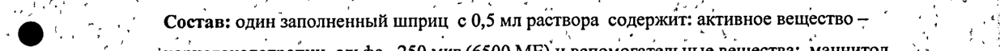
- стр. 1: «oy i | : хориогонадотропин альфа 250 мкг (6500 МЕи вспомогательные вещества: маннитол. г. | р р» — повторное чтение: «»  
  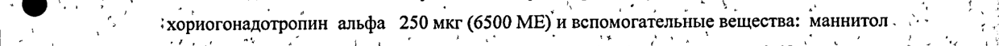
- стр. 1: «| 7 о 27,3 Mr, метионин 0,1 мг, полоксамер 188 0,05 мг, фосфорная кислота 0,49 мг, натрия 7 ca | в» — низкая уверенность: «7» (40), «7» (45); повторное чтение: «. 7 _ 173 Mr, метнойин 0,1 ur, полоксамер 188 0.05 мг, фосфорная ки слота 0,49 мг, apa 7 в “ ь»  
  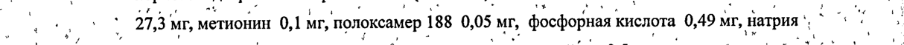
- стр. 1: «`объем распределения и общий клиренс составляют 6 л и 0,2 л/час соответственно. |» — повторное чтение: «объем распределения и общий клиренс составляют 6 ли 0,2 л/час соответственно. | |»  
  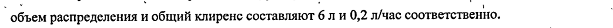
- стр. 2: «1%" _ г составляет приблизительно 40%, конечный период полувыведения — около 30 часов. |, . ‘oe» — низкая уверенность: «1%"» (30); повторное чтение: «: a | ro составляет приблизительно 40%, конечный период полувыведения — около 30 часов. . - у ` „>»  
  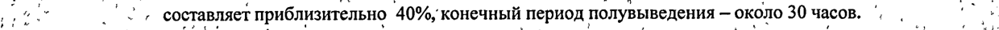
- стр. 2: «: 2%: ‘ Pad , a? . ‘ ’ we . ` ; = . . moe, :» — низкая уверенность: «2%:» (72); повторное чтение: «' $ | у 6: аи a ies о ws sews a ` : t , в . , и ы . d ` * .., у»  
  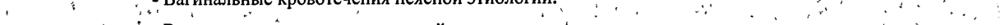
- стр. 3: «И . Овитрель® в дозе 250 мкг (содержимое-1‘ шприца) вводится однократно через 24-48 часов в ` :» — низкая уверенность: «(содержимое-1‘» (0)  
  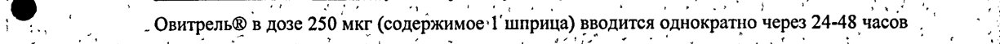
- стр. 3: «№ Co, - один шприц с препаратом. ‘3.0%: и. оли и. | 7 :,» — низкая уверенность: «‘3.0%:» (0), «7» (43); повторное чтение: «в в ; - один шприц с препаратом. ^ os : . с. 7 | ИИ `.' . : . we -»  
  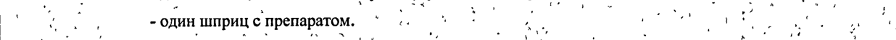
- стр. 4: «> 9%, Кожу в месте инъекции тампоном со спиртом. ›: " Hg yee ee» — низкая уверенность: «9%,» (18); повторное чтение: «ит wt 7 кожу в месте инъекции тампоном со спиртом, ›: й a ye, mt»  
  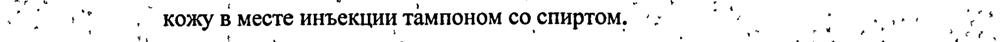
- стр. 5: «. . ‘ xy . ‘ ‚ ae ` y ¢ , 4 % ay ‘ ve > ’ -` on я» — низкая уверенность: «4» (67); повторное чтение: «a —_ . 7 , 2 es ae cre a rn nate а, ее "о а. ar ИИ —_ ..»  
  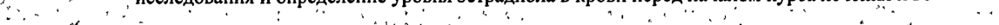
- стр. 7: «. ® Раствор для подкожного введения, 250 мкг/0,5 мл. ‚ on р» — низкая уверенность: «мкг/0,5» (42); повторное чтение: «. @ _ раствор для подкожного ВВЕДЕНИЯ, 250 mxr/0,5 Ma. , т. | _ _ _ a 7»  
  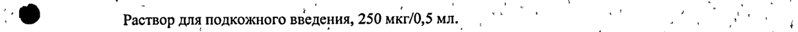
- стр. 7: «ae ‘ ° 0,5 Ma раствора; содержащего 250 мкг .(6500 ME) ‚хориогонадотропина альфа“ в *' ‚о» — низкая уверенность: «0,5» (48), «.(6500» (73); повторное чтение: «т 0,5` мл раствора; содержащего 250 мкг ‚(6500 МЕ) ‚хориогонадотропина альфа- в. 7 7»  
  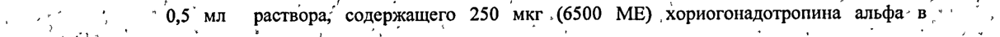
