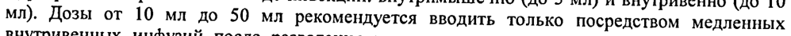
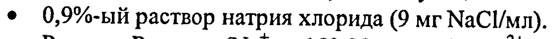
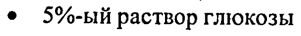
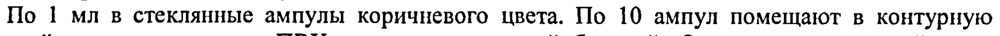
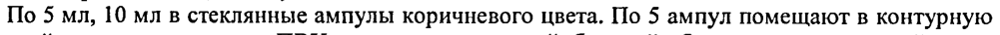

# Церебролизин® концентрат — парентерально

- Препарат: Церебролизин® (раствор для инъекций;)
- АТХ: N06BX
- Источник: ГРЛС, инструкция по медицинскому применению, РУ П N013827/01, файл от 2024-06-17 (https://grls.rosminzdrav.ru/Grls_View_v2.aspx?routingGuid=f1b69bf9-f160-48e0-9d08-03cadc1893dd)
- Распознано автоматически (OCR): 6 из 6 стр.
- Инструкция к другому РУ того же препарата: П N013827/01 (национальное РУ, переоформленное по правилам ЕАЭС, решение от 07.06.2024). Текст может быть старше действующего
- Сомнительных строк после OCR: 5 (см. раздел «Проверка распознавания»)

## Общие сведения

IT N013827/01-080707 ы ¢ a © | ИНСТРУКЦИЯ по медицинскому применению препарата
Церебролизин® (Cerebrolysin®)
Регистрационный номер:
Торговое название препарата: Церебролизин®
® Международное название препарата: отсутствует

## 3. Лекарственная форма

раствор для инъекций
раствор для инъекций

## 2. Состав

Активное вещество: | мл водного раствора препарата содержит 215,2 мг концентрата церебролизина (комплекс пептидов, полученных из головного мозга свиньи). Активная фракция Церебролизина представлена пептидами, молекулярный вес которых не превышает 10 000 дальтон.
Вспомогательные вещества натрия гидроксид и вода для инъекций.
ОПИСАНИЕ Прозрачный раствор янтарного цвета.
ФАРМАКОТЕРАПЕВТИЧЕСКАЯ ГРУППА: ноотропное средство
@ kon ATX: NoBX ФАРМАКОЛОГИЧЕСКОЕ ДЕЙСТВИЕ.

## 5.1. Фармакодинамика

Церебролизин содержит низкомолекулярные биологически активные нейропептиды, которые проникают через гематоэнцефалический барьер и непосредственно поступают к нервным клеткам. Препарат обладает органоспецифическим мультимодальным действием на головной мозг, т.е. обеспечивает метаболическую регуляцию, нейропротекцию, функциональную нейромодуляцию и нейротрофическую активность.
Церебролизин содержит низкомолекулярные биологически активные нейропептиды, которые проникают через гематоэнцефалический барьер и непосредственно поступают к нервным клеткам. Препарат обладает органоспецифическим мультимодальным действием на головной мозг, т.е. обеспечивает метаболическую регуляцию, нейропротекцию, функциональную нейромодуляцию и нейротрофическую активность.
а) метаболическая регуляция: церебролизин повышает эффективность аэробного энергетического метаболизма головного мозга, улучшает внутриклеточный синтез белка в развивающемся и стареющем головном мозге.
_ П NO13827/01-080707 , ¢ 6) нейропротекция: церебролизин защищает нейроны от повреждающего действия лактацидоза, предотвращает образование свободных радикалов, повышает выживаемость и предотвращает гибель нейронов в условиях гипоксии и ишемии, снижает повреждающее нейротоксическое действие возбуждающих аминокислот (глутамата).
в) нейротрофическая активность: церебролизин — единственный ноотропный пептидергический препарат с доказанной нейротрофической активностью, аналогичной действию естественных факторов нейронального роста (NGF), но проявляющейся в условиях периферического введения.
г) функциональная нейромодуляция: церебролизин оказывает положительное влияние при нарушениях когнитивных функций, на процессы запоминания

## 5.2. Фармакокинетика

Сложный состав Церебролизина, активная фракция которого состоит из сбалансированной и стабильной смеси биологически активных олигопептидов, обладающих суммарным полифункциональным действием, не позволяет провести обычный фармакокинетический анализ отдельных компонентов.
Сложный состав Церебролизина, активная фракция которого состоит из сбалансированной и стабильной смеси биологически активных олигопептидов, обладающих суммарным полифункциональным действием, не позволяет провести обычный фармакокинетический анализ отдельных компонентов.

## 4.1. Показания к применению

Болезнь Альцгеймера, синдром деменции различного генеза, хроническая цереброваскулярная недостаточность, ишемический инсульт, травматические повреждения головного и спинного мозга; задержка умственного развития у детей, гиперактивность и дефицит внимания у детей; в комплексной терапии — при эндогенной депрессии, резистентной к антидепрессантам
Болезнь Альцгеймера, синдром деменции различного генеза, хроническая цереброваскулярная недостаточность, ишемический инсульт, травматические повреждения головного и спинного мозга; задержка умственного развития у детей, гиперактивность и дефицит внимания у детей; в комплексной терапии — при эндогенной депрессии, резистентной к антидепрессантам

## 4.3. Противопоказания

" индивидуальная непереносимость препарата
" индивидуальная непереносимость препарата
= острая почечная недостаточность "= эпилептический статус

## 4.6. Применение при беременности и в период грудного вскармливания

© С осторожностью препарат назначают в I триместре беременности и в период лактации.
© С осторожностью препарат назначают в I триместре беременности и в период лактации.
В период беременности и во время грудного вскармливания Церебролизин следует применять только после тщательного анализа соотношения положительного эффекта лечения и риска, связанного с его проведением. Результаты экспериментальных исследований не дают оснований полагать, что Церебролизин обладает каким-либо тератогенным действием или оказывает токсическое влияние на плод. Однако аналогичные клинические исследования не проводились. .

## 4.2. Способ применения и дозы

Применяется парентерально. Дозы и продолжительность лечения зависят от характера и тяжести заболевания, а также от возраста больного. Возможно назначение однократных доз, fy | у TI N013827/01-080707 e величина которых может достигать 50 мл, однако более предпочтительно проведение курса лечения.
Применяется парентерально. Дозы и продолжительность лечения зависят от характера и тяжести заболевания, а также от возраста больного. Возможно назначение однократных доз, fy | у TI N013827/01-080707 e величина которых может достигать 50 мл, однако более предпочтительно проведение курса лечения.
Рекомендуемый оптимальный курс лечения представляет собой ежедневные инъекции в течение 10-20 дней.
e Острые состояния (ишемический инсульт, черепно-мозговая
® В резидуальном периоде мозгового инсульта и травматического повреждения головного и спинного мозга: от 5 мл до 50 мл e При болезни Альцгеймера, деменции сосудистого и сочетанного
® Для повышения эффективности лечения могут быть проведены повторные курсы до тех пор, пока наблюдается улучшение состояния пациента вследствие лечения, После проведения первого курса периодичность назначения доз может быть снижена до 2 или 3 раз в неделю.
Церебролизин применяют в виде инъекций: внутримышечно (до 5 мл) и внутривенно (до 10 мл). Дозы от 10 мл до 50 мл рекомендуется вводить только посредством медленных внутривенных инфузий после разведения предложенными стандартными растворами для инфузий. Продолжительность инфузии составляет от 15 до 60 минут.

## 4.8. Побочное действие

Частые побочные эффекты — более 1/100 — менее 1/10; редкие побочные эффекты — более 1/1000 — менее 1/100; очень редкие побочные эффекты — более 1/10000 — менее 1/1000; крайне редкие побочные эффекты — менее 1/10000.
Частые побочные эффекты — более 1/100 — менее 1/10; редкие побочные эффекты — более 1/1000 — менее 1/100; очень редкие побочные эффекты — более 1/10000 — менее 1/1000; крайне редкие побочные эффекты — менее 1/10000.
При чрезмерно быстром введении в редких случаях возможно ощущение жара,
© потливость, головокружение и (в единичных случаях) возможно учащенное сердцебиение или аритмии.
Со стороны желудочно-кишечного тракта: в редких случаях наблюдались потеря аппетита, диспепсия, диарея, запоры, тошнота и рвота.
Со стороны ЦНС и периферической нервной системы: в редких случаях предполагаемый эффект активации сопровождался возбуждением (проявлявшимся агрессивным поведением, спутанностью сознания, бессонницей). Имеются сообщения о возникновении в единичных случаях (<0,01%) больших эпилептических припадков и судорог в период лечения
Церебролизином.
Со стороны иммунной системы: в крайне редких случаях отмечались реакции повышенной чувствительности или аллергические реакции, проявляющиеся головной болью; болевыми ощущениями в шее, конечностях, нижней части спины; одышкой, ознобом и коллаптоидным состоянием.
№ | "os П №013827/01-080707 e Местные реакции: в редких случаях отмечается покраснение кожи, зуд и жжение в месте инъекции.
Прочие: по результатам исследований сообщалось о крайне редких случаях гипервентиляции, артериальной гипертонии, артериальной гипотонии, усталости, тремора, депрессии, апатии, головокружения и гриппоподобных симптомов (кашля, насморка, инфекций дыхательных путей).
Следует учесть, что некоторые нежелательные эффекты (возбуждение, артериальная гипертония, артериальная гипотония, вялость, тремор, депрессия, апатия, головокружение, головная боль, одышка, диарея, тошнота) были выявлены в ходе клинических испытаний и возникали в равной мере как у пациентов, получавших Церебролизин, так и у пациентов группы плацебо.

## 4.9. Передозировка

® Не выявлено ВЗАИМОДЕЙСТВИЕ С ДРУГИМИ ЛЕКАРСТВЕННЫМИ СРЕДСТВАМИ
® Не выявлено ВЗАИМОДЕЙСТВИЕ С ДРУГИМИ ЛЕКАРСТВЕННЫМИ СРЕДСТВАМИ
С учетом фармакологического профиля Церебролизина следует уделить особое внимание возможным аддитивным эффектам при совместном назначении с антидепрессантами или ингибиторами МАО. В таких случаях рекомендуется снизить дозу антидепрессанта.
Не следует смешивать в одном растворе для инфузий Церебролизин и сбалансированные растворы аминокислот.
Церебролизин несовместим с растворами, в состав которых входят липиды, и с растворами, изменяющими рН среды (5,0-8,0).

## 4.4. Особые указания

При чрезмерно быстром выполнении инъекций возможно ощущение жара, потливость, головокружение. Поэтому препарат следует вводить медленно.
При чрезмерно быстром выполнении инъекций возможно ощущение жара, потливость, головокружение. Поэтому препарат следует вводить медленно.
Проверена и подтверждена совместимость препарата (в течение 24 часов при комнатной
® температуре и наличии освещения) со следующими стандартными растворами для инфузий:
® 0,9%-ый раствор натрия хлорида (9 мг МаСИмл).
® Раствор Рингера (Ма” - 153,98 ммоль/л; Са?* - 2,74 ммоль/л; К* - 4,02 ммоль/л; СГ - 163,48 ммоль/л).
® 5%-ый раствор глюкозы Допускается одновременное назначение Церебролизина с витаминами и препаратами, улучшающими сердечное кровообращение, однако эти препараты не следует смешивать в одном шприце с Церебролизином.
Использовать только прозрачный раствор и только однократно.
fy | VN = 4 П N0O13827/01-080707 “ ВЛИЯНИЕ НА СПОСОБНОСТЬ К УПРАВЛЕНИЮ — ТРАНСПОРТНЫМИ
СРЕДСТВАМИ Клинические испытания показали, что Церебролизин не оказывает влияния на способность к управлению транспортными средствами и использованию механизмов.

## 6.5. Форма выпуска

Раствор для инъекций ампулы 1 мл
Раствор для инъекций ампулы 1 мл
По 1 мл в стеклянные ампулы коричневого цвета. По 10 ампул помещают в контурную ячейковую упаковку из ПВХ, покрытую вощеной бумагой. Одну контурную ячейковую упаковку с инструкцией по применению помещают в картонную пачку.
Упаковка «in bulk»
По 10 ампул (1 мл) помещают в блистер из ПВХ, покрытый вощеной бумагой. По 50 или 225 блистеров с инструкцией по применению помещают в картонную коробку.
@ Раствор для инъекций ампулы 5 mau 10 ma
По 5 мл, 10 мл в стеклянные ампулы коричневого цвета. По 5 ампул помещают в контурную ячейковую упаковку из ПВХ, покрытую вощеной бумагой. Одну контурную ячейковую упаковку с инструкцией по применению помещают в картонную пачку.
Раствор для инъекций флаконы 30 мл По 30 мл во флакон из коричневого стекла, укупоренный резиновой пробкой под алюминиевой предохранительной обкаткой с отверстием для иглы в центре и закрытый защитной пластмассовой крышкой. По | или 5 флаконов с инструкцией по применению помещают в картонную пачку.

## 6.4. Условия хранения

Хранить в защищенном от света месте при температуре не выше 25°С,
Хранить в защищенном от света месте при температуре не выше 25°С,
Тщательно оберегать от детей.
Примечание: после вскрытия ампулы/флакона раствор должен использоваться
® незамедлительно.

## 6.3. Срок годности

Срок хранения ампул — 5 лет.
Срок хранения ампул — 5 лет.
Срок хранения флаконов - 4 года.
Не применять по истечении срока годности, указанного на упаковке.
УСЛОВИЯ ОТПУСКА ИЗ АПТЕК По рецепту ПРОИЗВОДИТЕЛЬ
ЭБЕВЕ Фарма Гес.м.6.Х.Нфг.КГ А-4866 Унтерах, Австрия, Европа.
fr | (ть , П №013827/01-080707 % УПАКОВЩИК (ампулы 1 мл)
ЗАО «БИОКОМ», Россия, 355016, г. Ставрополь, Чапаевский проезд, 54
Тел.: (8652) 36-53-56, 36-53-54 Факс: (8652) 36-53-55
Адрес представительства:
127473 Москва, 3-й Самотечныйзлер., д.3 Тел./факс: (495) 933 87,02 25a зенит» ых
Seer тя bY <\ ИА И.о.Директора ИДКЗЛОСЬ пежаое, 23x А.Н. Васильев
S28, oy anos “iy ® и Представитель фирмы tho КЕ ( А.В. Юдина
ERE УЕ/РВагта €s.m.H. Nfg.KG A- 4866 nterach / Austria
ТИТ
## Проверка распознавания

Страницы-сканы распознаны автоматически. В 5 строках с дозировками цифры могли распознаться с ошибкой — сверьте с вырезкой из оригинала:

- стр. 3: «мл). Дозы от 10 мл до 50 мл рекомендуется вводить только посредством медленных» — повторное чтение: «мл). Дозы от 10 мл до 50 _мл рекомендуется вводить только посредством медленных»  
  
- стр. 4: «® 0,9%-ый раствор натрия хлорида (9 мг МаСИмл).» — низкая уверенность: «0,9%-ый» (65)  
  
- стр. 4: «® 5%-ый раствор глюкозы» — низкая уверенность: «5%-ый» (69)  
  
- стр. 5: «По 1 мл в стеклянные ампулы коричневого цвета. По 10 ампул помещают в контурную» — низкая уверенность: «1» (72); повторное чтение: «По I мл в стеклянные ампулы коричневого цвета. По 10 ампул помещают в контурную»  
  
- стр. 5: «По 5 мл, 10 мл в стеклянные ампулы коричневого цвета. По 5 ампул помещают в контурную» — повторное чтение: «По 5 мл, 10 млв стеклянные ампулы коричневого цвета. По 5 ампул помещают в контурную»  
  
