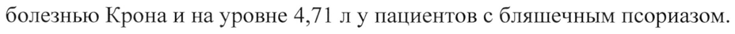
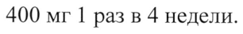
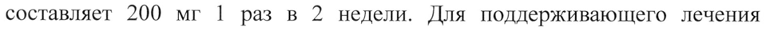
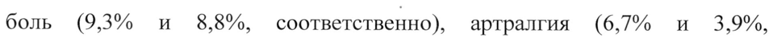
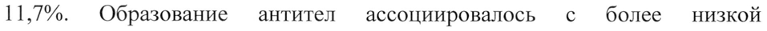

# Цертолизумаб пэгол — парентерально

- Препарат: Симзия® (раствор для подкожного введения;)
- АТХ: L04AB05
- Источник: ГРЛС, инструкция по медицинскому применению, РУ ЛП-000008, файл от 2021-10-20 (https://grls.rosminzdrav.ru/Grls_View_v2.aspx?routingGuid=2407b390-1aec-4191-8247-0568b62ecb52)
- Распознано автоматически (OCR): 43 из 43 стр.
- Инструкция к другому РУ того же препарата: ЛП-000008 (национальное РУ, переоформленное по правилам ЕАЭС, решение от 06.10.2021). Текст может быть старше действующего
- Сомнительных строк после OCR: 5 (см. раздел «Проверка распознавания»)

## Общие сведения

и И МИНЗДРАВ РОССИИ 000004 060821 МИНИСТЕРСТВО ЗДРАВООХРАНЕ РОССИИСКОИ ФЕДЕРА
СОГЛАСОВАНО ИИ ИНСТРУКЦИЯ ПО МЕДИЦИНСКОМУ ПРИМЕНЕНИЮ
ЛЕКАРСТВЕННОГО ПРЕПАРАТА СИМЗИЯ® (CIMZIA®)
наименование лекарственного препарата © Регистрационный номер: лП-000008
Торговое наименование: Симзия® МНН: цертолизумаба пэгол (certolizumab pegol)
© Лекарственная форма: раствор для подкожного введения
Состав на 1 мл препарата активное вещество: цертолизумаба пэгол 200,0 мг;
© вспомогательные вещества: натрия ацетат 1,36 мг, натрия хлорид 7,31 мг, вода для инъекций до 1,00 мл.
Описание Прозрачная или опалесцирующая бесцветная или желтого цвета жидкость, свободная от видимых частиц.
Фармакотерапевтическая группа Антитела моноклональные
Код ATX: LO4AB05 Фармакологические свойства
Цертолизумаба пэгол — ингибитор фактора некроза опухоли альфа (ФНО).
ФНО является основным цитокином, поддерживающим воспалительный процесс при ревматоидном артрите, болезни Крона, аксиальном спондилоартрите, псориатическом артрите и псориазе. Цертолизумаба пэгол обладает высокой специфической способностью нейтрализовывать
ФНОа человека (1С90 — концентрация для ингибирования 90% субстрата составляет 4 нг/мл для ингибирования ФНОа in vitro в процессе цитотоксического анализа клеток мышиной фибросаркомы L929).
& Цертолизумаба пэгол не обладает нейтрализующей активностью в отношении лимфотоксина а (ФНОв).
Показано, что цертолизумаба пэгол дозозависимо нейтрализует связанный с мембраной и растворимый человеческий DHOa. Инкубирование человеческих моноцитов с кцертолизумаба пэголом приводило к
© дозозависимому ингибированию ЛИС(липополисахарид)-индуцированного синтеза ФНОа и ингибированию продукции моноцитами человека интерлейкина-1 бета (ИЛ-1В).
Цертолизумаба пэгол не содержит кристаллизующегося фрагмента (Ес),
© который содержится в полном антителе, и поэтому не фиксирует комплемент и не приводит к развитию антителозависимой клеточной цитотоксичности in vitro.
Цертолизумаба пэгол не вызывает апоптоз моноцитов и лимфоцитов периферической крови человека in vitro, а также не приводит к дегрануляции нейтрофилов.

## 5.1. Фармакодинамика

Повышенная концентрация ФНОа определяется в синовиальной жидкости пациентов с ревматоидным артритом и играет важную роль в прогрессировании воспалительных, пролиферативных и деструктивных изменений в суставах, что является основным проявлением заболевания.
Повышенная концентрация ФНОа определяется в синовиальной жидкости пациентов с ревматоидным артритом и играет важную роль в прогрессировании воспалительных, пролиферативных и деструктивных изменений в суставах, что является основным проявлением заболевания.
Биологические свойства ФНОа включают активацию молекул клеточной адгезии и хемокинов, активацию молекул I и П класса главного комплекса гистосовместимости и прямую активацию лейкоцитов. ФНОа стимулирует образование клеточных медиаторов воспаления, включая ИЛ-1, простагландины, фактор активации тромбоцитов, оксид азота.
Увеличение концентрации ФНОа играет важную роль в патофизиологических механизмах развития болезни Крона, ревматоидного
© артрита, аксиального спондилоартрита, псориатического артрита и псориаза. Цертолизумаба пэгол избирательно связывается с ФНО, подавляя его роль, как основного медиатора воспаления. При болезни Крона
ФНО определяется в значительной концентрации в пораженных участках стенки кишечника, а его концентрация в кале пациентов с болезнью Крона
- отражает клиническую тяжесть заболевания.
После лечения цертолизумаба пэголом у пациентов с болезнью Крона отмечено снижение концентрации С-реактивного белка (CPb) в крови.
На фоне лечения препаратом Симзия” у пациентов с аксиальным спондилоартритом выраженное уменьшение признаков воспаления
© отмечалось и в крестцово-подвздошных сочленениях, и в межпозвоночных суставах, — как в общей популяции пациентов с аксиальным спондилоартритом, так и отдельно в подгруппах пациентов с анкилозирующим спондилитом и с аксиальным спондилоартритом без рентгенологических признаков.
Применение препарата Симзия® сопровождалось выраженным улучшением основных показателей эффективности, которые включали мобильность позвоночника и функциональные показатели, интенсивность болевых ощущений, выраженность слабости и качество жизни.
Пациенты с активным псориатическим артритом, который дебютировал в зрелом возрасте, продемонстрировали существенное улучшение всех основных показателей эффективности на фоне применения препарата
Симзия®. На 12 и 24 неделе лечения препаратом Симзия® у пациентов с псориатическим артритом отмечалось улучшение — параметров, характеризующих периферические признаки активности заболевания
(например, количество припухших суставов, количество болезненных суставов, выраженность одактилита и энтезита). Было отмечено существенное улучшение физической функции, уменьшение боли в
© суставах, уменьшение усталости по сравнению с плацебо.
Пациенты с бляшечным псориазом на фоне лечения препаратом Симзия® в течение от 16 до 48 недель продемонстрировали достижение клинически значимого улучшения симптомов, которое наблюдалось вплоть до 1 года.
Пациенты, получающие лечение препаратом Симзия®, сообщали о ww значительном улучшении качества жизни.

## 5.2. Фармакокинетика

Всасывание: после подкожного введения максимальная концентрация цертолизумаба пэгола в плазме крови достигается через 54-171 ч.
Всасывание: после подкожного введения максимальная концентрация цертолизумаба пэгола в плазме крови достигается через 54-171 ч.
© Биодоступность цертолизумаба пэгола составляет около 80% (от 76 до 88%).
Распределение: по данным популяционного анализа параметров фармакокинетики цертолизумаба пэгола равновесный объем распределения оценивался в диапазоне от 6 до 8 лу пациентов с ревматоидным артритом и болезнью Крона и на уровне 4,71 л у пациентов с бляшечным псориазом.
Метаболизм: метаболизм цертолизумаба пэгола в клинических исследованиях не изучался.
Выведение: Ковалентное присоединение полимеров полиэтиленгликоля
(ПЭГ) к белкам — ПЭГилирование — способствует замедлению выведения этих комплексных соединений из кровотока посредством различных механизмов, включая снижение почечного клиренса, снижение протеолиза

и иммуногенности. Таким образом, конъюгация с ПЭГ цертолизумаба,

который является ЕаБ’-фрагментом антитела, способствует увеличению

периода полувыведения (Т1/2) ЕаБ`-фрагмента до значения, сопоставимого с

Тр целого антитела.

Ti цертолизумаба пэгола составляет около 14 дней для всех изученных доз.

В ходе клинических исследований у здоровых добровольцев клиренс

цертолизумаба пэгола при внутривенном введении составлял от 9,21 мл/ч

до 14,38 мл/ч. По данным популяционного фармакокинетического анализа,
© у пациентов с болезнью Крона и ревматоидным артритом клиренс цертолизумаба пэгола при подкожном введении в среднем составлял 17 мл/ч

и 21,0 мл/ч, соответсвенно. У пациентов с ревматоидным артритом и массой

тела 70 кг клиренс цертолизумаба пэгола на 29% ниже, чем у пациентов с

массой тела 40 кг, и на 38% выше, чем у пациентов массой тела 120 кг.
ww Клиренс после подкожного введения у пациентов с псориазом составлял 14

мл/ч с колебаниями между пациентами в 22,2% (коэффициент вариабельности).

ЕаБ`-фрагмент представляет собой белок, который в процессе протеолиза
| деградирует до простых белков и аминокислот. Деконъюгированный ПЭГ
© быстро выходит из плазмы и выводится из организма почками, но в какой

пропорции - не установлено. Концентрация цертолизумаба пэгола в плазме

крови пропорциональна дозе вводимого препарата.

Параметры фармакокинетики у пациентов с ревматоидным артритом,

болезнью Крона и псориазом не отличаются от соответствующих

показателей у здоровых добровольцев.

Особые группы пациентов

Пациенты с нарушением функций почек

Специальных клинических исследований для оценки влияния почечной

недостаточности на фармакокинетику цертолизумаба пэгола не

проводилось, однако предполагается, что фармакокинетика ПЭГ зависит от почечной функции. Недостаточно данных, позволяющих рекомендовать особый режим дозирования препарата при почечной недостаточности средней и тяжелой степени тяжести. Популяционный фармакокинетический анализ среди пациентов с легкой степенью почечной недостаточности не выявил влияния показателя клиренса креатинина на фармакокинетику препарата.
Пациенты с нарушением функций печени Специальных клинических исследований по изучению фармакокинетики
© цертолизумаба пэгола у пациентов с нарушениями функций печени не проводилось.
Пожилые пациенты (> 65 лет) | Результаты популяционного фармакокинетического анализа не показали влияния возраста пациентов на фармакокинетику цертолизумаба пэгола.
w Пол Пол пациентов не оказывал влияния на параметры фармакокинетики цертолизумаба пэгола. Поскольку с уменьшением массы тела клиренс снижается, у женщин может наблюдаться несколько большая системная
| экспозиция цертолизумаба пэгола.
© Сопутствующее применение метотрексата не оказывало влияния на параметры фармакокинетики цертолизумаба пэгола у пациентов с болезнью
Крона и ревматоидным артритом.
Только масса тела и присутствие антител к цертолизумаба пэголу оказывали существенное влияние на фармакокинетику препарата. Тем не менее, результаты фармакодинамического анализа не подтвердили терапевтического преимущества применения дозовых режимов, рассчитанных по массе тела пациентов. Присутствие антител к цертолизумаба пэголу увеличивало клиренс препарата в 3,6 раза.

## 4.1. Показания к применению

Ревматоидный артрит
Ревматоидный артрит
Лечение ревматоидного артрита умеренной и высокой степени активности у взрослых (с 18 лет):
- в комбинации с метотрексатом при недостаточном ответе на лечение базисными противовоспалительными препаратами (БИВП), включая метотрексат, или
- в качестве монотерапии при непереносимости или нецелесообразности дальнейшего лечения метотрексатом.
© Было показано, что Симзия® при совместном применении с метотрексатом снижает прогрессирование повреждения суставов, оцениваемое с помощью рентгенографии, и улучшает физические функции.
Болезнь Крона Лечение болезни Крона с умеренной и высокой степенью активности ww заболевания у взрослых при неэффективности терапии БИВП.
Аксиальный спондилоартрит Симзия® показана для лечения тяжелого активного аксиального спондилоартрита у взрослых, включая:
= - Анкилозирующий спондилит (АС) (аксиальный cnonduloapmpum, подтвержденный результатами рентгенологического исследования)
Тяжелый активный анкилозирующий спондилит при недостаточном ответе на лечение нестероидными противовоспалительными препаратами (НИВП)
или при их непереносимости у взрослых.
- Аксиальный спондилоартрит без рентгенологических признаков анкилозирующего — спондилита — (нерентгенологический —аксиальный спондилоартрит)
Тяжелый активный аксиальный спондилоартрит без рентгенологических признаков AC, но с объективными признаками воспаления, проявляющимися повышением концентрации СРБ и/или соответствующими изменениями при магнитно-резонансной томографии
(МРТ), при недостаточном ответе на терапию НИВП или при их непереносимости.
Псориатический артрит Лечение активного псориатического артрита у взрослых:
- в комбинации с метотрексатом при недостаточном ответе на терапию w БИВП;
- в качестве монотерапии в случае непереносимости или нецелесообразности дальнейшего лечения метотрексатом.
Бляшечный псориаз & Лечение бляшечного псориаза умеренной и высокой степени активности у взрослых, которым показана системная терапия.

## 4.3. Противопоказания

& - Повышенная чувствительность к цертолизумаба пэголу или другим компонентам, входящим в состав препарата;
& - Повышенная чувствительность к цертолизумаба пэголу или другим компонентам, входящим в состав препарата;
- сепсис или риск возникновения сепсиса, а также тяжелые хронические или локализованные инфекции в активной стадии (в том числе туберкулез, абсцесс, оппортунистические инфекции, включая грибковые (гистоплазмоз, кандидоз, аспергиллез, бластомикоз, кокцидиоидомикоз, нокардиоз, листериоз и др.)), пневмоцистные и вирусные инфекции, включая вирусный гепатит В в стадии реактивации;
- сердечная недостаточность Ш-[ГУ функционального класса по NYHA
(классификация Нью-Йоркской ассоциации кардиологов);
- детский возраст (до 18 лет);
- одновременное применение анакинры, абатацепта и этанерцепта.
Меры предосторожности Отслеживаемость Чтобы биологический лекарственный препарат было проще отследить, необходимо четко указывать название и номер серии вводимого препарата.
Инфекции © Пациенты должны быть тщательно обследованы на наличие инфекций, в том числе хронических и местных очагов инфекции, до назначения препарата Симзия“, в ходе лечения и после его окончания. Принимая во внимание длительный период полувыведения препарата Симзия®, выведение цертолизумаба пэгола может занять до 5 месяцев, в связи с чем w наблюдение за пациентами должно осуществляться в течение этого периода после окончания лечения. Пациенты с впервые выявленной инфекцией на фоне лечения препаратом Симзия® должны находиться под тщательным наблюдением.
При применении ингибиторов ФНО@, включая препарат Симзия®,
© сообщалось о сепсисе, туберкулезе и других тяжелых инфекциях с бактериальными, микобактериальными, инвазивными грибковыми, вирусными и/или паразитарными возбудителями.
Среди оппортунистических инфекций наиболее часто сообщалось о гистоплазмозе, аспергиллезе, кандидозе, кокцидиоидомикозе, нокардиозе, листериозе и пневмоцистозе.
В случае развития тяжелой инфекции лечение препаратом Симзия® следует прекратить.
Перед назначением препарата Симзия® следует тщательно оценить соотношение пользы и риска данной терапии у пациентов с хроническими или рецидивирующими или оппортунистическими инфекциями в анамнезе, у пациентов, которым проводят сопутствующую иммуносупрессивную терапию, при состояниях пациентов, предрасполагающих к развитию инфекций, а также при смене места жительства или поездках в районы с высокой заболеваемостью туберкулезом, микозами, гистоплазмозом и другими инфекциями.
У пациентов с ревматоидным артритом симптомы инфекционного заболевания могут носить стертый характер. Поэтому раннее выявление любого инфекционного заболевания, особенно атипичных клинических
© проявлений тяжелой инфекции, крайне важно для своевременной постановки диагноза и безотлагательного начала лечения.
Туберкулез Как и на фоне применения других ингибиторов ФНОа, при лечении препаратом Симзия® отмечались случаи реактивации туберкулеза или w новые случаи туберкулеза (включая милиарный легочный туберкулез, туберкулез внелегочной локализации и диссеминированный туберкулез).
До назначения препарата Симзия® необходимо оценить соотношение пользы и риска данной терапии с учетом факторов риска развития
; туберкулеза.
© До начала лечения препаратом Симзия® всем пациентам необходимо провести обследование для исключения активного или скрытого
(латентного) туберкулеза. Это обследование должно включать детальное изучение анамнеза пациента с целью исключения перенесенного ранее туберкулеза, выявления возможных контактов с больными туберкулезом, а также получения данных о проведенной или продолжающейся иммуносупрессивной терапии. Всем пациентам проводят соответствующие исследования, которое включает туберкулиновый кожный тест, при необходимости — иное исследование для выявления латентного туберкулеза, и рентгенографию органов грудной клетки. Необходимо учитывать, что в некоторых случаях возможно получение ложноотрицательного результата туберкулинового теста, особенно у пациентов с тяжелыми заболеваниями и сниженным иммунным статусом. При проведении туберкулиновой пробы размер папулы 5 мм и более свидетельствует о положительной реакции на пробу, даже если ранее проводилась вакцинация БЦЖ (бацилла КальметтаГерена). Следует рассмотреть необходимость проведения профилактического курса лечения туберкулеза до назначения препарата
Симзия® у тех пациентов, у которых, при наличии указаний на ранее перенесенный туберкулез или признаки его латентного течения,
© невозможно подтвердить предшествующую адекватную противотуберкулезную терапию, а также у пациентов группы риска развития туберкулеза, несмотря на отрицательный результат обследования на латентный туберкулез. Для решения вопроса о необходимости курса противотуберкулезной терапии для каждого конкретного пациента
- необходима консультация врача-фтизиатра.
Несмотря на предшествующую или сопутствующую профилактическую противотуберкулезную терапию, у пациентов, получающих терапию ингибиторами ФНОоа, включая препарат Симзия®, могли развиваться случаи активного туберкулеза. У некоторых пациентов, в прошлом успешно
© прошедших лечение по поводу активного туберкулеза, на терапии препаратом Симзия® туберкулез мог развиться повторно.
Следует тщательно контролировать состояние пациентов, обращая внимание на возникновение таких симптомов, как упорный кашель, отделение мокроты, снижение массы тела, субфебрильная лихорадка, которые могут свидетельствовать о наличии туберкулеза. Если активный туберкулез диагностирован до начала терапии или на фоне лечения, не следует начинать или продолжать лечение препаратом Симзия*®, и должна быть начата соответствующая противотуберкулезная терапия.
Реактивация вирусного гепатита В (НВУ)
и Сообщалось о случаях реактивации вирусного гепатита В у пациентов, являющихся хроническими носителями данного вируса (в том числе имеющих положительный тест на поверхностный антиген), которые получали ингибиторы ФНОа, включая препарат Симзия®. В некоторых случаях заболевание имело летальный исход. Перед назначением препарата
Симзия® пациенты должны пройти обследование для выявления вируса гепатита В. Пациентам, у которых результаты тестов на наличие вируса гепатита В оказались положительными, должна быть рекомендована консультация специалиста по лечению гепатита В.

© Пациенты-носители вируса гепатита В, которым показано лечение препаратом Симзия®, должны находиться под постоянным наблюдением для своевременного выявления признаков и симптомов активной НВУ инфекции в течение всего курса терапии и в последующие несколько месяцев после окончания лечения. Соотвествующие данные о лечении

- пациентов-носителей НВУ инфекции противовирусными препаратами для профилактики реактивации HBV одновременно с ингибиторами ФНОа отсутствуют.
При появлении у пациентов симптомов реактивации вируса гепатита В следует прекратить применение препарата Симзия® и назначить

- эффективную противовирусную и соответствующую поддерживающую терапию.
Вакцинация Вакцинация пациентов, получающих лечение препаратом Симзия*, допускается, за исключением применения живых или живых ослабленных вакцин.
Нет данных о реакции на вакцинацию и вторичной передаче инфекции через живую вакцину у пациентов, получающих препарат Симзия®. Живые вакцины и живые ослабленные вакцины не должны вводиться на фоне лечения препаратом (Симзия®. Все необходимые мероприятия по

вакцинации должны проводиться в соответствии с действующим национальным календарем прививок, по возможности, до начала лечения препаратом Симзия®. Симзия® не подавляет гуморальный иммунный ответ на введение инактивированных вакцин, в том числе пневмококковой полисахаридной вакцины или вакцины против гриппа.
Злокачественные и лимфопролиферативные заболевания
В клинических исследованиях лимфома и другие злокачественные новообразования чаще встречались у пациентов, получавших препарат
Симзия®, по сравнению с пациентами группы плацебо. Однако
©, ограниченное число пациентов контрольной группы и непродолжительное время их лечения не позволяют сделать однозначные выводы. Не было проведено исследований, в которых участвовали бы пациенты со злокачественными новообразованиями в анамнезе, или исследований, в которых лечение препаратом Симзия® было бы продолжено после
- выявления злокачественных новообразований. Поэтому у данной группы пациентов лечение препаратом Симзия® рекомендуется назначать с осторожностью.
У пациентов с ревматоидным артритом, особенно в подгруппе с очень
, высокой активностью заболевания, риск развития лимфомы повышен.
© У пациентов с болезнью Крона и другими заболеваниями, при которых назначается длительная иммуносупрессивная терапия, риск развития лимфомы, по сравнению с популяцией в целом, также может быть повышен, даже если терапия ингибиторами ФНО не проводится.
Случаи острого и хронического лейкоза были зарегистрированы при применении ингибиторов ФНОс при ревматоидном артрите и при других показаниях. Даже в отсутствие терапии ингибиторами ФНО, риск развития лейкоза у пациентов с ревматоидным артритом выше (примерно в 2 раза), чем в популяции в целом. Имеются сообщения о злокачественных новообразованиях, в том числе с летальным исходом, у детей, подростков и молодых людей в возрасте до 22 лет, получавших лечение ингибиторами
@MHOa (при начале лечения в возрасте до 18 лет включительно).
Приблизительно в половине этих случаев диагностированы лимфомы
(включая лимфому Ходжкина и неходжкинские лимфомы). Оставшиеся случаи включали различные злокачественные новообразования, в том числе и редкие, которые, как правило, ассоциированы с иммуносупрессивной терапией. Злокачественные новообразования развивались в среднем через 30 месяцев лечения (от 1 до 84 месяцев). Большая часть пациентов получала сопутствующую терапию иммунодепрессантами. Об этих случаях было
© сообщено в пострегистрационном периоде, и получены они были из различных источников информации, включая регистры и спонтанные пострегистрационные сообщения.
В ходе пострегистрационного наблюдения у пациентов, получавших терапию ингибиторами ФНО, были зарегистрированы случаи печеночноw селезеночной Т-клеточной лимфомы (hepatosplenic T-cell lymphoma -
HSTCL) — редкого типа Т-клеточной лимфомы, имеющей чрезвычайно агрессивное течение заболевания и, как правило, летальный исход.
Большинство случаев, связанных с применением ингибиторов ФНОа, наблюдалось у подростков и молодых мужчин с болезнью Крона и
> язвенным колитом. Почти все эти пациенты получали лечение иммунодепрессантами азатиоприном и/или 6-меркаптопурином в комбинации с ингибиторами ФНО@а на момент или до установления диагноза.
Рак кожи При применении ингибиторов ФНО@, включая препарат Симзия*, сообщалось о случаях меланомы и карциномы из клеток Меркеля.
Рекомендуется проводить периодический осмотр кожи всех пациентов, и особенно тех, которые имеют факторы риска развития рака кожи.
Хроническая обструктивная болезнь легких (ХОБЛ)
В исследовании другого препарата из группы ингибиторов ФНОа у пациентов с умеренной и тяжелой ХОБЛ отмечено больше случаев злокачественных новообразований (в основном, с локализацией в легких, а также в области головы и шеи) в группе пациентов, получавших ингибитор
ФНО, по сравнению с группой контроля. Все пациенты были активными курильщиками. В связи с этим, следует соблюдать осторожность при лечении ингибиторами ФНОа пациентов с ХОБЛ, а также пациентов, имеющих повышенный риск развития злокачественных новообразований в связи с активным курением.

© Хроническая сердечная недостаточность (ХСН)
При лечении ингибиторами ФНОа, включая препарат Симзия®, имелись сообщения о случаях развития хронической сердечной недостаточности
(ХСН) и ее прогрессирования. Следует с осторожностью применять препарат у пациентов с ХСН 1-П функционального класса по классификации

w NYHA. Препарат Симзия® следует отменить при впервые диагностированной ХСН или выявлении симптомов ее прогрессирования.
Рекомендуется назначить симптоматическую терапию.
Реакции повышенной чувствительности

В редких случаях у пациентов отмечались тяжелые реакции

© гиперчувствительности. Следующие симптомы могли сопровождать реакции повышенной чувствительности после введения препарата Симзия®:
ангионевротический отек, одышка, снижение артериального давления, сыпь, сывороточная болезнь, крапивница. Некоторые из этих реакций отмечены после первого применения препарата Симзия®.
При возникновении вышеуказанных реакций введение препарата Симзия® следует немедленно прекратить и начать соответствующее лечение.
Данные о применении препарата Симзия® среди пациентов, у которых отмечались тяжелые реакции гиперчувствительности на другие ингибиторы

@MHOa, ограничены. У таких пациентов препарат Симзия® должен назначаться с осторожностью.
Повышенная чувствительность к латексу Колпачок иглы предварительно заполненного шприца с препаратом
Симзия® содержит дериват натурального каучукового латекса. Контакт с натуральным каучуковым латексом может привести к развитию серьезных аллергических реакций у людей. чувствительных к латексу. В колпачке не выявлено присутствия латексного белка-антигена. Тем не менее, нельзя полностью ИСКЛЮЧИТЬ возможность развития реакций гиперчувствительности к латексу у предрасположенных лиц.

© Неврологические нарушения Применение ингибиторов ФНОа в редких случаях ассоциировалось с развитием вновь или нарастанием тяжести уже существующих клинических симптомов и/или рентгенологических признаков демиелинизирующих заболеваний, включая рассеянный склероз.

© У пациентов с уже существующим или недавно развившимся демиелинизирующим заболеванием соотношение риск/польза должно быть тщательно взвешено перед началом терапии препаратом Симзия®. Редкие случаи неврологических заболеваний, включая судорожные расстройства, невриты и периферические нейропатии были отмечены при лечении

© препаратом Симзия®.
Иммуносупрессия В связи с тем, что ФНОч является медиатором воспаления и модулирует клеточный иммунный ответ, при лечении ингибиторами ФНО, включая препарат Симзия®, нельзя исключить вероятность угнетения иммунной системы организма, снижения сопротивляемости организма инфекциям и развитию злокачественных новообразований.
Образование аутоантител

Лечение препаратом Симзия® может сопровождаться образованием антинуклеарных антител (АНА) и, нечасто, развитием
«волчаночноподобного» синдрома.
Если на фоне лечения препаратом Симзия® у пациента развиваются симптомы, сходные с «волчаночноподобным» синдромом, лечение должно быть прекращено. Влияние длительной терапии препаратом Симзия® на развитие аутоиммунных заболеваний неизвестно. Специальные исследования препарата Симзия® при системной красной волчанке не проводились.

© Гематологические реакции Сообщалось о редких случаях панцитопении и, очень редко, апластической анемии при использовании ингибиторов DHOa. Следует проявлять осторожность при назначении препарата Симзия® пациентам, у которых в анамнезе отмечались выраженные изменения показателей крови. Все

- пациенты и их родственники должны быть осведомлены о необходимости немедленной медицинской помощи в случае развития у пациента на фоне лечения препаратом Симзия® признаков и симптомов, характерных для гематологических нарушений или инфекции (например, продолжительная лихорадка, боль в горле, образование гематом, кровотечение, бледность

© кожных покровов). Таким пациентам рекомендуется провести медицинское обследование, включая развернутый клинический анализ крови. При подтверждении диагноза панцитопении или других значимых гематологических нарушениях лечение препаратом Симзия® следует прекратить.
Комбинированная терапия с другими биологическими препаратами
Сообщения о тяжелых инфекциях и нейтропении были получены в клинических исследованиях при комбинированном применении препарата
Симзия® с другими биологическими препаратами: анакинрой (ингибитор интерлейкина-1) или абатацептом (модулятор С28), а также с другим

ингибитором ФНОа этанерцептом. Совместное применение препарата
Симзия® с этими и другими биологическими противоревматическими препаратами не показало дополнительного клинического преимущества и, поэтому, не рекомендуется.
Пожилые пациенты В клинических исследованиях отмечена более высокая частота инфекционных заболеваний у пациентов в возрасте 65 лет и старше, по сравнению с более молодыми пациентами, хотя эти данные ограничены.
Рекомендуется соблюдать осторожность при применении препарата
© Симзия® у пожилых пациентов; особого внимания требуют пожилые пациенты в отношении возможного развития инфекций.
Влияние на показатели свертываемости крови
На фоне применения препарата Симзия® возможно ложноположительное повышение АЧТВ (активированное частичное тромбопластиновое время) у w пациентов, не имеющих нарушений свертываемости крови. Повышение
АЧТВ наблюдалось при использовании различных методов, включая тест с волчаночным антикоагулянтом. Не получено данных о влиянии терапии препаратом Симзия® на свертывание крови in vivo.
У пациентов, получающих лечение препаратом Симзия®, с особым
© вниманием нужно интерпретировать показатели свертывания крови, выходящие за рамки нормальных значений, независимо от аналитического метода.
Влияния на другие показатели свертываемости крови (тромбиновое время, протромбиновое время и др.) не установлено.
Хирургические вмешательства Имеются ограниченные данные о проведении хирургических операций у пациентов, получающих препарат Симзия®. При планировании хирургической операции необходимо учитывать, что период полувыведения цертолизумаба пэгола составляет 14 суток. Если во время лечения препаратом Симзия” пациенту требуется хирургическое вмешательство, необходимо обеспечить постоянное наблюдение за пациентом для своевременного выявления признаков инфекций и принятия соответствующих мер.

## 4.6. Применение при беременности и в период грудного вскармливания

Женщинам репродуктивного возраста следует использовать надежные методы контрацепции. У женщин, планирующих беременность, следует рассмотреть возможность использования надежных методов контрацепции
© в течение 10 недель после последней инъекции препарата Симзия®, что обусловлено скоростью выведения препарата. При принятии решения должна учитываться потребность пациентки в терапии.
Данные об использовании препарата Симзия® у более, чем 500 беременных женщин с известным исходом беременности, включая 400 случаев
- применения препарата в первом триместре беременности, свидетельствуют о том, что применение препарата Симзия® не вызывает пороков развития у плода. Однако, полученный на сегодняшний день клинический опыт весьма ограничен, чтобы уверенно говорить об отсутствии повышенного риска, связанного с применением препарата Симзия® во время беременности.
® В исследованиях у животных с использованием антител к ФНОа крысы негативного влияния препарата на фертильность животных или развитие плода выявлено не было. Однако этих данных недостаточно для оценки токсичности препарата в отношении репродуктивной функции у человека.
Ингибирование активности ФНОа при лечении препаратом Симзия® во время беременности может повлиять на формирование нормального иммунного ответа у новорожденного.
Препарат Симзия® следует применять во время беременности только при наличии терапевтической необходимости.
Результаты доклинических исследований свидетельствуют о низком или очень низком уровне трансплацентарного переноса гомолога Еаб-фрагмента цертолизумаба пэгола (не имеет Ес-фрагмента).
В клиническом исследовании 16 женщин получали цертолизумаба пэгол в дозах 200 мг каждые 2 недели или 400 мг каждые 4 недели во время беременности. Концентрации цертолизумаба пэгола в крови были измерены у 14 детей сразу после рождения. У 13 из 14 детей концентрация цертолизумаба пэгола в крови была ниже предела количественного определения (ПКО); у одного ребенка она составляла 0,042 мкг/мл
© (отношение концентрации в крови ребенка к концентрации в крови матери в момент рождения составляло 0,09%). Ha 4-й и 8-й неделях после рождения концентрации препарата у всех детей были ниже ПКО. Клиническая значимость низких уровней цертолизумаба пэгола в крови у детей неизвестна. Вакцинацию ребенка живыми и живыми аттенуированными

w вакцинами (например, БЦЖ) рекомендуется отложить минимум на 5 месяцев от последнего введения препарата Симзия® матери во время беременности, за исключением тех случаев, когда польза от вакцинации явно перевешивает возможные связанные с ней риски.

- В клиническом исследовании с участием 17 женщин, получавших препарат
Симзия® в период лактации, было показано, что цертолизумаба пэгол поступает из крови в грудное молоко в минимальных концентрациях.
Относительная детская доза цертолизумаба пэгола составляла 0,04-0,30%.
Кроме того, поскольку цертолизумаба пэгол представляет собой белок, который после приема внутрь распадается в желудочно-кишечном тракте, ожидаемая абсолютная биодоступность препарата у ребенка, находящегося на грудном вскармливании, будет очень низкой.

Таким образом, препарат Симзия® может применяться в период грудного вскармливания.
В исследованиях у самцов грызунов было обнаружено влияние препарата на

подвижность и сокращение числа сперматозоидов без очевидного

воздействия на фертильность.

В клиническом исследовании, в котором оценивалось влияние

цертолизумаба пэгола на качественные характеристики спермы, 20

здоровых добровольцев были рандомизированны в группы на получение

однократной дозы 400 мг цертолизумаба пэгола или плацебо. В течение 14

недель наблюдения влияния цертолизумаба пэгола на качество спермы, по
© сравнению с плацебо, выявлено не было.

## 4.2. Способ применения и дозы

Подкожно.

Лечение должно назначаться и контролироваться врачом, имеющим опыт в w диагностике и лечении заболеваний, при которых показано назначение

препарата Симзия*.

После надлежащего обучения пациента технике введения препарата врач

может разрешить самостоятельное введение препарата (см. далее

инструкцию по введению) с соответствующим медицинским наблюдением.
© Симзия® применяется в виде готового раствора для инъекций в дозировке

200 мг (одноразовый шприц, содержащий 1,0 мл раствора цертолизумаба

пэгола).

Индукционная доза

Рекомендуемая индукционная доза препарата Симзия® для взрослых

пациентов составляет 400 мг в виде двух подкожных инъекций по 200 мгв

первый день лечения, и далее на второй и на четвертой неделе лечения.

Поддерживающая доза

Болезнь Крона

После индукционной дозы рекомендованная поддерживающая доза

препарата Симзия® для взрослых пациентов с болезнью Крона составляет

400 мг 1 раз в 4 недели.

Ревматоидный артрит

После индукционной дозы рекомендованная поддерживающая доза

препарата Симзия® для взрослых пациентов с ревматоидным артритом

составляет 200 мг 1 раз в 2 недели. Для поддерживающего лечения

заболевания возможно использование альтернативного режима
© дозирования 400 мг 1 раз в 4 недели.

Аксиальный спондилоартрит

Анкилозирующий спондилит

После индукционной дозы рекомендованная поддерживающая доза

препарата Симзия” для взрослых пациентов с анкилозирующим w спондилоартритом составляет 200 мг 1 раз в 2 недели или 400 мг 1 раз в 4

недели.

Аксиальный спондилоартрит без рентгенологических признаков

анкилозирующего спондилита

После индукционной дозы рекомендованная поддерживающая доза
© препарата Симзия® для взрослых пациентов с аксиальным

спондилоартритом без рентгенологических признаков анкилозирующего

спондилита составляет 200 мг 1 раз в 2 недели или 400 мг 1 раз в 4 недели.

Псориатический артрит

После индукционной дозы поддерживающая доза препарата Симзия® для

взрослых пациентов составляет 200 мг 1 раз в 2 недели. После ответа На

терапию возможно использование альтернативного режима дозирования

400 мг 1 разв 4 недели.

Для ревматоидного артрита, аксиального спондилоартрита и

псориатического артрита имеющиеся данные свидетельствуют, что

клинический ответ обычно достигается в течение 12 недель лечения.
Решение о дальнейшем лечении пациентов, у которых терапевтический эффект не развился в течение первых 12 недель терапии, должно быть тщательно взвешено.
Бляшечный псориаз После индукционной дозы рекомендованная поддерживающая доза препарата Симзия® для взрослых пациентов с бляшечным псориазом составляет 200 мг 1 раз в 2 недели. У пациентов с недостаточным ответом на терапию можно рассмотреть возможность назначения препарата
| ® Симзия® в дозе 400 мг 1 разв 2 недели.
Данные, полученные в исследованиях с участием взрослых пациентов, свидетельствуют о том, что клинический ответ обычно возникает в течение 16 недель от начала лечения. У пациентов, не отвечающих на терапию препаратом Симзия® в течение первых 16 недель, следует тщательно
- пересмотреть целесообразность продолжения терапии. У некоторых пациентов с частичным ответом на терапию препаратом Симзия® к 16 неделе, возможно дальнейшее улучшение на фоне продолжающейся терапии после 16 недели.
© Пропущенная доза Пациентам, которые пропустили введение очередной дозы, нужно рекомендовать ввести пропущенную дозу препарата Симзия®, как только они вспомнили об этом, а затем продолжить введение последующих доз согласно первоначальному плану лечения.
Пациенты в возрасте до 18 лет Эффективность и безопасность цертолизумаба пэгола у детей и подростков до 18 лет не установлена, соответствующие данные отсутствуют.
Пожилые пациенты (65 лет и старше)
Коррекции дозы не требуется.
Инструкция по выполнению подкожной инъекции предварительно заполненным шприцем
После соответствующего обучения, пациент — самостоятельно или при помощи кого-то из членов семьи или друзей — может вводить себе препарат подкожно. Далее приводится инструкция по выполнению подкожной инъекции. Пожалуйста, прочтите инструкцию внимательно и
© следуйте пошаговым рекомендациям. Технику выполнения подкожной инъекции вам может показать врач или медработник. Не пытайтесь вводить себе препарат, пока вы не убедитесь, что вам понятно, как подготовить и выполнить инъекцию.
Препарат нельзя смешивать в одной инъекции ни с каким другим
>. лекарственным препаратом.
1. Подготовка к выполнению инъекции
Выньте упаковку препарата Симзия® из холодильника.
Возьмите из упаковки один или два предварительно заполненных шприца, в зависимости от назначенной вам дозы, а также одну или две спиртовых
® салфетки, и разместите все на чистой ровной поверхности.
Не используйте препарат с истекшим сроком годности. Дата истечения срока годности указана на упаковке и шприце. Датой истечения срока годности считается последний день указанного месяца.
Дайте шприцу нагреться до комнатной температуры, обычно для этого требуется 30 минут. Это позволит уменьшить ощущение дискомфорта при введении препарата. Не подогревайте шприц — позвольте ему нагреться самому.
Не снимайте защитный колпачок шприца, пока вы не будете готовы к выполнению инъекции.
Тщательно вымойте руки.
2. Выбор и подготовка места введения
Выберите участок кожи на животе или бедре.
[= - Чередуйте места для инъекции — каждый раз выбирайте для инъекции новое место, отличное от предыдущего места введения.
Не вводите препарат в участки кожи с кровоизлияниями, а также в
© участки, где кожа затвердела, покраснела или повреждена.
Обработайте место инъекции спиртовой салфеткой — круговыми движениями от центра кнаружи.
Не прикасайтесь к обработанному месту до инъекции.
© 3. Введение препарата Не встряхивайте шприц.
Убедитесь в наличии препарата в шприце.
Не используйте шприц, если раствор внутри шприца изменил цвет, помутнел или содержит видимые частицы.
Вы можете увидеть пузырьки воздуха. Это нормально. Подкожное введение раствора, содержащего пузырьки воздуха, безопасно.
Снимите колпачок с иглы, потянув вверх за пластиковое кольцо.
Соблюдайте осторожность, не дотрагивайтесь до иглы и не прикасайтесь иглой ни к чему. Не сгибайте иглу. Выполните инъекцию до истечения 5 минут после снятия колпачка.
Рукой мягко соберите кожную складку заранее обработанного участка кожи и крепко ее удерживайте.
} в 7 зы | м 4 5 < ~
2 WA
© Другой рукой держите шприц, расположив иглу под углом 45° к поверхности кожи. Одним быстрым коротким движением введите иглу на всю толщину кожной складки. Нажмите поршень шприца и удерживайте его до полного введения раствора под кожу, это может занять до 10
= секунд.
После этого осторожно извлеките иглу из кожи под тем же углом, под которым она была введена, и отпустите кожную складку.
Прижмите место инъекции марлевым тампоном на несколько секунд.
| Не протирайте место инъекции!
© Можно наложить небольшую давящую повязку на место введения, при необходимости.
4. Использованные шприцы и иглы
Шприцы повторному использованию не подлежат. Не закрывайте иглу использованного шприца колпачком.
Немедленно после инъекции выбросьте использованные шприцы и иглы в специальный контейнер, рекомендованный вам врачом, медсестрой или работником аптеки.
ES)

Держите этот контейнер в недоступном для детей месте.

Повторите описанные выше шаги, если Вам требуется вторая инъекция (с
© шага 2).

## 4.8. Побочное действие

Ревматоидный артрит

В рамках плацебо-контролируемых и открытых исследований препарат
- Симзия® получали 4049 пациентов с ревматоидным артритом.

Продолжительность лечения составляла до 92 месяцев.

В плацебо-контролируемых исследованиях длительность воздействия

препарата Симзия*, в 4 раза превышала длительность воздействия в группе
; плацебо. Эта разница обусловлена более высокой частотой выбывания из
© исследования пациентов из группы плацебо. Кроме того, в исследованиях

КА-Г и КА-П обязательным было выбывание пациентов, не достигших

ответа на 16 неделе, большинство из которых получали плацебо.

Доля пациентов, прекративших лечение по причине нежелательных

явлений в ходе контролируемых исследований, составила 4,4% среди

получавших препарат Симзия® и 2,7% в группах плацебо.

Наиболее часто наблюдались нежелательные реакции, относящиеся к

группе «инфекций и инвазий», —у 14,4% пациентов, получающих препарат

Симзия®, иу 8,0% пациентов группы плацебо, «общие расстройства и

реакции в месте введения» у 8,8% пациентов, получавших препарат

Симзия®, и 7,4% - на плацебо, а также «нарушения со стороны кожи и подкожной клетчатки» у 7,0% пациентов, получавших препарат Симзия*, и 2,4% - на плацебо.
Болезнь Крона У пациентов с болезнью Крона в плацебо-контролируемых исследованиях серьезные нежелательные явления отмечены в 10,8% случаев при лечении препаратом Симзия®, и 8,6% - в группе плацебо. Наиболее частыми нежелательными реакциями были ринофарингит (11,1% и 6,7%, соответственно), тошнота (8% и 6,7%, соответственно), инфекции органов
| мочевыделительной системы (5,1% и 4,4%, соответственно), абдоминальная боль (9,3% и 8,8%, соответственно), артралгия (6,7% и 3,9%, соответственно), головная боль (14,8% и 13,8%, соответственно).
Из-за нежелательных реакций терапию прекратили 11,3% пациентов, получавших препарат Симзия*, и 12,6% - получавших плацебо. В плацебо-
~ контролируемых клинических исследованиях наиболее частыми нежелательными реакциями, приводившими к отмене препарата Симзия® или плацебо, были: диарея (0,5% и 0,2%, соответственно), боль в животе
(0,9% и 0,4%, соответственно) и тошнота (0,4% и 0,2%, соответственно).
© Аксиальный спондилоартрит В исследовании А$001, длительностью до 4 лет, которое включало 24недельную плацебо-контролируемую фазу с последующим 24-недельным слепым периодом с сокрытием информации относительно дозы и 156недельный открытый период, оценивали профиль безопасности препарата
Симзия® у 325 пациентов с активным аксиальным спондилоартритом
(включая анкилозирующий спондилит и нерентгенологический аксиальный спондилоартрит). Действие препарата Симзия® также изучали у 317 пациентов с нерентгенологическим аксиальным спондилоартритом в рамках плацебо-контролируемого исследования длительностью 52 недели
(AS0006). В обоих исследованиях профиль переносимости у пациентов с аксиальным спондилоартритом соответствовал таковому при ревматоидном артрите и предыдущему опыту применения препарата Симзия®.
Псориатический артрит В исследовании РзА001, длительностью до 4 лет, которое включало 24недельную плацебо-контролируемую фазу с последующим 24-недельным слепым периодом с сокрытием информации относительно дозы и 168недельный открытый период, оценивали профиль безопасности препарата
Симзия® у 409 пациентов с псориатическим артритом. Профиль безопасности препарата Симзия® при применении у пациентов с w псориатическим артритом соответствовал таковому при ревматоидном артрите и предыдущему опыту применения препарата.
Бляшечный псориаз Профиль переносимости препарата Симзия® оценивали у 1112 пациентов с псориазом в рамках контролируемых и открытых исследований
- длительностью до 3 лет. В программе исследований Ш фазы за начальным и поддерживающим периодами следовал открытый период лечения продолжительностью 96 недель (см. раздел «Фармакодинамика»). При длительном применении профили безопасности разных схем дозирования
© препарата Симзия® (400 мг каждые 2 недели и 200 мг каждые 2 недели) были схожими и согласовывались с предыдущим опытом применения препарата.
В ходе 16-недельных плацебо-контролируемых фаз исследований серьезные нежелательные явления отмечались у 3,5% пациентов, получавших препарат Симзия®, иу 3,7% пациентов, получавших плацебо.
Доля больных, прекративших лечение из-за нежелательных явлений в ходе контролируемых исследований, составила 1,5% у пациентов, получавших препарат Симзия*, и 1,4% - плацебо.
Наиболее часто в течение первых 16 недель исследований наблюдались нежелательные реакции, относящиеся к группе «инфекций и инвазий», - у 6,1% пациентов, получавших препарат Симзия®, и у 7% пациентов группы плацебо, «общие расстройства и реакции в месте инъекции» у 4,1% пациентов, получавших препарат Симзия®, иу 2,3% - плацебо, а также
«нарушения со стороны кожи и подкожной клетчатки» у 3,5% пациентов, получавших препарат Симзия*®, иу 2,8% - плацебо.
Побочные реакции сгруппированы по частоте возникновения: очень часто
(21/10); часто (>1/100, <1/10); нечасто (>1/1000, <1/100); редко (>1/10000,
<1/1000); очень редко (<1/10000); частота не установлена (оценить по
~ имеющимся данным невозможно).
Инфекционные и паразитарные заболевания: часто — бактериальные инфекции (включая абсцесс), вирусные инфекции (включая вызванные вирусом герпеса, гриппа, папилломавирусом); нечасто — сепсис (включая
®, полиорганную недостаточность и септический шок), туберкулез (включая милиарный, диссеминированный и внелегочный), грибковые инфекции
(включая оппортунистические).
Доброкачественные опухоли, злокачественные новообразования и
© неуточненные новообразования (включая кисты и полипы): нечасто — злокачественные заболевания крови и лимфатической системы, включая лимфому и лейкоз, солидные опухоли органов, немеланоцитарный рак кожи, предраковые поражения (лейкоплакия слизистой оболочки полости рта, меланоцитарный невус), доброкачественные опухоли и кисты (включая папиллому кожи); редко — новообразования желудочно-кишечного тракта, меланома; неизвестно - саркома Капоши.
Нарушения со стороны крови и лимфатической системы: часто - эозинофилия, лейкопения (т.ч. лимфопения и нейтропения); нечасто - анемия, тромбоцитопения, лимфаденопатия, тромбоцитоз; редко - панцитопения, спленомегалия, эритроцитоз, морфологические изменения лейкоцитов.
Нарушения со стороны иммунной системы: нечасто — васкулиты, СКВ
(системная красная волчанка), повышенная лекарственная чувствительность, включая анафилактический шок, аллергические реакции, положительный тест на аутоантитела; редко — ангионевротический отек, саркоидоз, сывороточная болезнь, панникулит (включая узловатую эритему).
Нарушения со стороны эндокринной системы: редко — нарушение функции

© щитовидной железы.
Нарушения со стороны обмена веществ и питания: нечасто — электролитные нарушения, дислипидемия, нарушение аппетита, изменение массы тела; редко — изменение концентрации глюкозы в плазме крови, гипоальбуминемия, гипопротеинемия, гемосидероз.

~ Нарушения психики: нечасто — тревога (включая психическое напряжение), изменение настроения (и связанные с этим симптомы); редко — суицидальные попытки, бред, снижение мыслительной активности, агрессия.

© Нарушения со стороны нервной системы: часто — головная боль (в том числе мигрень), нарушения чувствительности; нечасто — периферическая нейропатия, головокружение, тремор; редко — демиелинизирующие заболевания включая невриты черепных нервов, — судороги, экстрапирамидные нарушения, невралгия тройничного нерва, нарушение координации движений и чувства равновесия, дисфония, маскообразное выражение лица, нарушение сна.
Нарушения со стороны органа зрения: нечасто — нарушения зрения
(включая снижение остроты зрения), воспаление глаза и века, нарушение слезоотделения.

Нарушения со стороны органа слуха и лабиринтные нарушения: нечасто — вертиго, шум в ушах.
Нарушения со стороны сердечно-сосудистой системы: часто — повышение артериального давления; нечасто — кардиомиопатия, сердечная недостаточность, ишемическая болезнь сердца, аритмии (включая фибрилляцию предсердий (мерцательную аритмию)), ощущение сердцебиения, кровоизлияния, кровотечения, венозная тромбоэмболия
(тромбоэмболия легочной артерии (ТЭЛА), тромбофлебит), обморок, снижение артериального давления, отеки (лица, конечностей), экхимозы
© (гематомы, петехии); редко — перикардит, атриовентрикулярная блокада, шок, инсульт, атеросклероз, синдром Рейно, сетчатое ливедо, телеангиэктазии.
Нарушения со стороны дыхательной системы, органов грудной клетки и средостения: нечасто — плевральный выпот (и связанные с ним симптомы),
~ бронхиальная астма и ее проявления, одышка, застойные и воспалительные изменения в легких, кашель; редко — интерстициальные заболевания легких, пневмонит, изъязвления слизистой оболочки носа.
Нарушения со стороны желудочно-кишечного тракта: часто — тошнота,
© рвота; нечасто — асцит, симптомы болезни Крона (стенозирование), язвенное поражение и перфорация (различных отделов ЖКТ), воспаление слизистой оболочки ЖКТ, диспепсия, стоматит, вздутие живота, сухость слизистой оболочки полости рта и глотки; редко — кишечная непроходимость, болезненное глотание, анальные трещины, повышенная моторика кишечника.
Нарушения со стороны печени и желчевыводящих путей: часто — гепатит, повышение активности «печеночных» ферментов; нечасто — заболевания печени, включая цирроз печени, холестаз, повышение концентрации билирубина в плазме крови; редко — холелитиаз.
Нарушения со стороны кожи и подкожных тканей: часто — сыпь; нечасто
— алопеция, возникновение псориаза или утяжеление его симптомов (в ТОМ числе ладонно-подошвенный пустулезный псориаз), дерматит, экзема, нарушение функции потовых желез, изъязвления кожи, повышенная фоточувствительность, акне, нарушения пигментации кожи, сухость кожи, поражения ногтевой пластинки и ногтевого ложа; редко — острый фебрильный нейтрофильный дерматоз, эксфолиация и десквамация кожи, буллезный дерматит, нарушение структуры волос, лихеноидные реакции.
Нарушения со стороны опорно-двигательного аппарата: нечасто —
© нарушения CO стороны мышц.
Нарушения со стороны мочевыделительной системы: нечасто — нарушение функции почек, гематурия, нефролитиаз, уретрит, цистит; редко
— нефропатия, нефрит.
Нарушения со стороны репродуктивной системы и молочной железы:
~ нечасто — нарушения менструального цикла, маточное кровотечение, аменорея, дисфункция молочных желез, азооспермия; редко — спонтанный аборт, выделения из влагалища, сексуальная дисфункция, баланит.
Общие расстройства и реакции в месте введения: часто — гипертермия,
© боль (неуточненной локализации), астения, зуд (неуточненной локализации), реакции в месте инъекции; нечасто — озноб, гриппоподобный синдром, нарушение температурной чувствительности, ночная потливость,
«приливы»; повреждения кожных покровов, медленное заживление ран;
редко — образование фистул (неуточненной локализации).
Лабораторные и инструментальные данные: нечасто — повышение активности креатининфосфокиназы (КФК), щелочной фосфатазы, общего билирубина, увеличение времени свертывания крови, изменения общего анализа мочи; редко — повышение концентрации мочевой кислоты в крови.
Следующие побочные реакции связывают с применением препаратов из класса ингибиторов ФНОа: карцинома из клеток Меркеля, рассеянный склероз, синдром Гийена-Барре, но частота их возникновения при применении препарата Симзия® неизвестна.
Следующие редкие побочные реакции связывают с применением препаратов из класса ингибиторов ФНОа: синдром Стивенса-Джонсона, многоформная эритема, ухудшение симптомов дерматомиозита.
Инфекции В контролируемых исследованиях у пациентов с ревматоидным артритом новые случаи инфекционных заболеваний наблюдались с
© частотой 1,03 случая на | пациенто-год у получавших лечение препаратом
Симзия® и с частотой 0,92 случаев на | пациенто-год у получавших плацебо.
Инфекции были представлены, в основном, заболеваниями верхних и нижних дыхательных путей, заболеваниями мочевыделительной системы и герпетическими заболеваниями.
we В плацебо-контролируемых исследованиях у пациентов с ревматоидным артритом случаев серьезных инфекционных заболеваний в группе получавших лечение препаратом Симзия® отмечено больше (0,07 на 1 пациенто-год, на всех режимах дозирования), чем в группе получавших
| плацебо (0,02 на 1 пациенто-год). Наиболее частыми среди серьезных
~ инфекций были пневмония и туберкулез. Данных за повышение риска развития инфекций с увеличением продолжительности применения препарата Симзия® получено не было.
Частота инфекций в контролируемых исследованиях у пациентов с болезнью Крона составила 38,6% у получавших лечение препаратом
Симзия® и 30,6% у пациентов, получавших плацебо. В основном отмечались инфекционные заболевания дыхательных путей (18,9% у пациентов, получавших лечение препаратом Симзия* иу 12,4% - плацебо).
Частота развития клинически значимых серьезных инфекций в ходе контролируемых исследований составила 2,6% среди получавших лечение препаратом Симзия® и 1,3% - плацебо. Серьезные инфекции включали как бактериальные, так и вирусные заболевания, пневмонию и пиелонефрит.
Частота новых случаев инфекций в плацебо-контролируемых клинических исследованиях применения препарата Симзия® при псориазе составила 1,37 на | пациенто-год у пациентов, получавших лечение препаратом Симзия®, и 1,59 на 1 пациенто-год у пациентов, получавших плацебо. Это были, в основном, инфекции верхних дыхательных путей и вирусные инфекции (в том числе герпесвирусная). Частота развития серьезных инфекций на фоне применения препарата Симзия® составила 0,02 на 1 пациенто-год. Среди
© пациентов, получавших плацебо, серьезных инфекций зарегистрировано не было. Данных за повышение риска развития инфекций с увеличением продолжительности применения препарата Симзия® получено не было.
Туберкулез Применение препаратов группы ингибиторов ФНОа может сопровождаться
& развитием активного туберкулеза. Имеются сообщения о тяжелых и летальных случаях туберкулеза на фоне лечения препаратом Симзия®. В завершенных и продолжающихся клинических исследованиях по всем известным показаниям среди 5118 пациентов, которые получали лечение препаратом Симзия”, частота выявления туберкулеза составила
- приблизительно 0,61 на 100 пациенто-лет. Наибольшее количество случаев наблюдалось в странах, эндемичных по туберкулезу. Сообщения включали случаи легочного, диссеминированного и внелегочного туберкулеза, а также редкие случаи развития оппортунистических инфекций. Редкие случаи туберкулеза и оппортунистических инфекций имели летальный исход.
Злокачественные и лимфопролиферативные заболевания
В контролируемых исследованиях ингибиторов ФНОа больше случаев злокачественных новообразований, включая лимфомы, было зарегистрировано в группе пациентов, получавших ингибиторы ФНО, по сравнению с контрольной группой.

Исключая немеланомный рак кожи, в клинических исследованиях препарата Симзия® у 4049 пациентов с ревматоидным артритом (9277 пациенто-лет) зарегистрировано 121 злокачественное новообразование
(включая 5 случаев лимфомы). В клинических исследованиях препарата
Симзия® у пациентов с ревматоидным артритом частота лимфомы у пациентов, получавших препарат Симзия®, составляла 0,05 на 100 пациенто-лет, а частота меланомы — 0,08 на 100 пациенто-лет.

с По данным плацебо-контролируемых и открытых фаз клинических исследований препарата Симзия® у пациентов с болезнью Крона и по другим показаниям — злокачественные — новообразования (кроме немеланомного рака кожи) отмечались с частотой (доверительный интервал 95%) 0,5 (0,4 и 0,7) на 100 пациенто-лет среди 4650 пациентов, получавших

& препарат Симзия®. При этом аналогичный показатель в группе плацебо составил 0,6 (0,1 и 1,7) на 100 пациенто-лет среди 1319 пациентов. По данным контролируемых клинических исследований из 2657 пациентов, получавших препарат Симзия® по поводу болезни Крона, у | пациента

| диагностирована лимфома; также, | случай лимфомы наблюдался в

~ контрольной группе пациентов, включавшей 1319 человек.

Частота развития злокачественных новообразований, включая лимфомы, в клинических исследованиях препарата Симзия® не может быть сопоставлена с результатами исследований других ингибиторов ФНО и не может служить основанием для прогнозирования частоты этих заболеваний при применении препарата Симзия® у более широкой популяции пациентов.
У пациентов с болезнью Крона, которым требуется длительная терапия иммунодепрессантами, риск развития лимфомы повышен, по сравнению с популяцией в целом, даже если им не проводится лечение ингибиторами
ФНО.

В клиническом исследовании лимфома была диагностирована у одного пациента с псориатическим артритом.
За исключением немеланомного рака кожи, в клинических исследованиях препарата Симзия® с участием 1112 пациентов с псориазом (2300 пациентогод) было зарегистрировано 11 злокачественных новообразований, в том числе 1 случай лимфомы.
Хроническая сердечная недостаточность На фоне лечения препаратом Симзия® отмечены как новые случаи ХСН, так и прогрессирование имевшихся ранее симптомов ХСН. Большая часть этих
© случаев были легкими или умеренными по свой тяжести и были диагностированы в течение первого года лечения препаратом.
Иммуногенность Ревматоидный артрит Общее количество пациентов с ревматоидным артритом с антителами к препарату Симзия®, которые определялись как минимум однократно, составило 9,6% в плацебо-контролируемых исследованиях препарата.
Примерно у 1/3 этих пациентов антитела проявляли нейтрализующую активность in vitro. У пациентов, которые одновременно принимали иммунодепрессанты (метотрексат), показатель образования антител был
~ ниже, чем у пациентов, которые их исходно не получали. Образование антител ассоциировалось с более низкой концентрацией препарата Симзия® в плазме крови, а у некоторых пациентов — с его более низкой эффективностью.
Болезнь Крона При болезни Крона у 8% пациентов, получавших длительное лечение препаратом Симзия®, определялись антитела к препарату. Примерно у 6% из них антитела проявляли нейтрализующую активность in vitro. Не установлено очевидной взаимосвязи между образованием антител и эффективностью препарата Симзия®. У пациентов, одновременно принимавших иммунодепрессанты, показатель образования антител был ниже, чем у пациентов их не принимавших (3% и 11%, соответственно).
Аксиальный спондилоартрит Общий процент пациентов, у которых до недели 24 были хотя бы один раз обнаружены антитела к препарату Симзия®, составил 4,4% по данным плацебо-контролируемого исследования Ш фазы А$001, проводимого у пациентов с аксиальным спондилоартритом (с анкилозирующим спондилитом и с нерентгеологическим аксиальным спондилоартритом).
Образование антител было связано с пониженной концентрацией препарата
© в плазме крови.
В течение всего исследования (до 192 недели) общий процент пациентов с антителами к препарату Симзия®, определяемыми минимум однократно, составлял 9,6% (у 4,8% антитела были транзиторными, и еще у 4,8% антитела к препарату Симзия® присутствовали постоянно). Общий процент пациентов с антителами, у которых наблюдалось снижение концентрации препарата в плазме крови, составлял 6,8%.
Псориатический артрит | Общее количество пациентов с псориатическим артритом в плацебо-
~ контролируемом исследовании, у которых, как минимум, однократно в течение 24 недель были выявлены антитела к препарату Симзия®, составило 11,7%. Образование антител ассоциировалось с более низкой концентрацией препарата в плазме крови. Количество пациентов с антителами к препарату Симзия® было недостаточным для того, чтобы дать определенную оценку взаимосвязи между титром антител и эффективностью препарата.
Бляшечный псориаз В плацебо-контролируемых исследованиях Ш фазы доля пациентов с антителами к препарату Симзия®, определяемыми минимум однократно во время лечения вплоть до 48 недель, составляла 8,3% (22/265) и 19,2%
(54/281) при применении препарата Симзия* в дозе 400 мг каждые 2 недели или 200 мг каждые 2 недели, соответственно. В исследованиях CIMPASI-1 и CIMPASI-2 антитела обнаруживалисьу 60 пациентов, у 27 из которых они обладали нейтрализующей активностью. Образование антител было связано со снижением концентрации препарата в плазме крови и у некоторых пациентов с уменьшением эффективности.
Для всех показаний Приведенные выше данные, отражающие процент пациентов, у которых
© результаты теста ELISA на антитела к препарату Симзия® были сочтены положительными, во многом зависят от чувствительности и специфичности метода. Кроме того, на наблюдаемую частоту образования антител могут повлиять несколько факторов, в том числе способ отбора проб (обращение с пробами), время получения образцов крови, одновременно применяемые препараты и характер основного заболевания. По этим причинам сравнение частоты образования антител к препарату Симзия® с частотой образования антител к другим ингибиторам ФНОа не является корректным.
Нерентгенологический axc-CnA В плацебо-контролируемом исследовании у пациентов é
® нерентгенологическим аксиальным спондилоартритом при применении метода анализа, более чувствительного и меньше зависящего от присутствия препарата в крови по сравнению с ранее использованным методом, общее число пациентов, у которых в период лечения (52 недели)
были обнаружены антитела к цертолизумаба пэголу, составило 97% (248 из 255 пациентов). Только максимальные титры антител ассоциировались с пониженным уровнем цертолизумаба пэгола в плазме крови, однако влияния на эффективность при этом не наблюдалось. Из пациентов, у которых хотя бы один раз были обнаружены антитела к цертолизумаба пэголу, приблизительно у 22% (у 54 из 248) антитела были классифицированы как нейтрализующие.
Образование аутоантител В клинических исследованиях у 4% пациентов с болезнью Крона, получавших препарат Симзия®, и у 2% пациентов, получавших плацебо, отмечено образование антинуклеарных антител (АНА). В исследованиях ингибиторов ФНО, в том числе препарата Симзия®, у отдельных пациентов с ревматоидным артритом также отмечено образование антинуклеарных
© антител (АНА). В клинических исследованиях препарата Симзия® при ревматоидном артрите и болезни Крона у некоторых пациентов наблюдалось развитие симптомов, сходных с волчаночноподобным синдромом. Влияние длительного лечения препаратом Симзия® на развитие аутоиммунных заболеваний неизвестно.
& Реакции повышенной чувствительности В редких случаях отмечаются следующие симптомы, которые имеют сходство с реакциями повышенной чувствительности, после введения препарата Симзия®: ангионевротический отек, аллергический дерматит,
| зудящая сыпь, одышка, «приливы», снижение артериального давления,
~ реакции в месте введения, ощущение недомогания, гипертермия, сыпь, сывороточная болезнь и обморок.
Реакции в месте введения препарата У некоторых пациентов на фоне лечения препаратом Симзия® наблюдались следующие реакции в месте введения препарата: эритема, зуд, подкожная гематома, боль, отек или образование «синяков».
Случаев отмены препарата в связи с развитием местных реакций не отмечено.
Повышение активности креатинфосфокиназы (КФК)
Частота случаев повышения активности КФК у пациентов с аксиальным спондилоартритом (аксСпА) была, в целом, выше, чем в популяции пациентов с ревматоидным артритом (РА). Эта частота была выше при обоих показаниях (аксСпА и РА), как у получавших плацебо (2,8% и 0,4% соответственно), так и на фоне лечения препаратом Симзия® (4,7% и 0,8%, соответственно).
Повышение КФК у пациентов с аксСпА в большинстве случаев было преходящим, клинически незначимым, и не являлось причиной прекращения приема препарата ни у одного пациента.

© Передозировка В рамках клинических исследований не было выявлено ограничений по дозе ввиду токсичности. При подкожном введении препарата Симзия® в дозе до 800 мги внутривенном введении в дозе 20 мг/кг серьезных нежелательных

w явлений отмечено He было. В случае передозировки необходимо тщательное наблюдение за симптомами и состоянием пациента и проведение симптоматической терапии.

## 4.5. Взаимодействие с другими лекарственными средствами

~ Одновременное применение препарата Симзия® с глюкокортикостероидами, —нестероидными — противовоспалительными препаратами (НИВП), анальгетиками, салицилатами, антибактериальными, противовирусными препаратами, а также иммунодепрессантами
(азатиоприн, 6-меркаптопурин, метотрексат) не оказывало влияния на параметры фармакокинетики препарата.

## 4.7. Влияние на способность управлять транспортными средствами, механизмами

После введения препарата Симзия® возможно появление головокружения, нарушения зрительного восприятия и ощущения усталости, что может оказывать неблагоприятное влияние на способность к осуществлению видов деятельности, требующих концентрации внимания и высокой скорости психомоторных реакций. Поэтому, при появлении указанных симптомов следует воздержаться от управления транспортными средствами и сложными механизмами.

## 6.5. Форма выпуска

© Раствор для подкожного введения 200 мг/мл.

По 1,0 мл препарата в однодозовых шприцах из прозрачного бесцветного боросиликатного стекла (тип I) с асимметричным упором для пальцев и шток-поршнем с резиновым уплотнителем, снабженных инъекционной иглой из нержавеющей стали 25G x 1/2” с резиновым (бутадиеновая резина,

& содержащая производное натурального латекса) защитным колпачком и внешним колпачком из полипропилена, оборудованным кольцом для удобства вскрытия.

По 2 шприца помещают в контурную упаковку из листового пластика
(коррекс).

- По 1 коррексу в комплекте с 2 индивидуально упакованными салфетками, пропитанными изопропанолом 70%, вместе с инструкцией по применению помещают в картонную упаковку-книжечку типа «Бумажник».

## 6.4. Условия хранения

В защищенном от света месте при температуре от 2 до 8°С.
В защищенном от света месте при температуре от 2 до 8°С.
Не замораживать.
Хранить в недоступном для детей месте.

## 6.3. Срок годности

2 года.
2 года.

Не использовать по истечении срока годности, указанного на упаковке.

Условия отпуска

Отпускают по рецепту.

Производитель

Веттер Фарма-Фертигунг ГмбХ и Ко. КГ,

Айзенбанштрассе 2-4, 88085 Лангенарген, Германия.

Организация, осуществляющая упаковку и выпускающий контроль

качества

ЮСБ Фарма СА,

Шемин дю Форе, Б-1420 Брэйн-л`Аллю, Бельгия.

Владелец — регистрационного удостоверения / Организация,

принимающая претензии потребителей

ЮСБ Фарма СА,

| Алле де ля Решерш 60, Б-1070 Брюссель, Бельгия. /
~ OOO «ЮСБ Фарма»,

Российская Федерация, 105082, Москва, Переведеновский nep., д.13, стр. 21.

Тел.: (495) 644-3322; факс: (495) 644-3329.

Менеджер по регистрации La Н.Е. Тюрин
## Проверка распознавания

Страницы-сканы распознаны автоматически. В 5 строках с дозировками цифры могли распознаться с ошибкой — сверьте с вырезкой из оригинала:

- стр. 4: «болезнью Крона и на уровне 4,71 л у пациентов с бляшечным псориазом.» — повторное чтение: «болезнью Крона и на уровне 4,71 лу пациентов с бляшечным псориазом.»  
  
- стр. 22: «400 мг 1 раз в 4 недели.» — низкая уверенность: «1» (79)  
  
- стр. 22: «составляет 200 мг 1 раз в 2 недели. Для поддерживающего лечения» — низкая уверенность: «1» (72)  
  
- стр. 28: «боль (9,3% и 8,8%, соответственно), артралгия (6,7% и 3,9%,» — низкая уверенность: «8,8%,» (65)  
  
- стр. 38: «11,7%. Образование антител ассоциировалось с более низкой» — низкая уверенность: «11,7%.» (78)  
  
