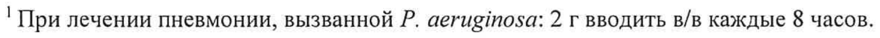
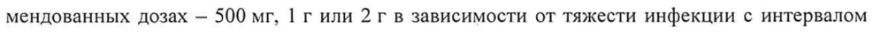
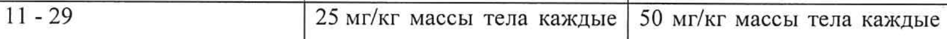
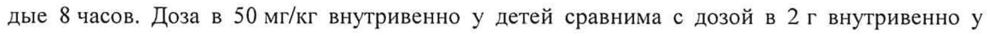

# Цефипим — парентерально

- Препарат: Цефепим (порошок для приготовления раствора для инъекций)
- АТХ: J01DE01
- Источник: ОХЛП, Единый реестр ЛС ЕАЭС, запись 65f81dad30dcf812d752a328, документ от 2025-05-05
- Распознано автоматически (OCR): 19 из 19 стр.
- Сомнительных строк после OCR: 4 (см. раздел «Проверка распознавания»)

## Общие сведения

| -АетрЕ [т -РЕСПУБАЯ| у ЕТ «ОСЛЕДОВАТЕЛЬНОТЬ 0.0.07 ПП-007439 -РРУЙЙЕТСТ Е стерео о ом
ОБЩАЯ ХАРАКТЕРИСТИКА ЛЕКА PCTBEHHOFO РЕПАРАТА

## 1. Наименование лекарственного препарата

Цефепим, | г, порошок для приготовления раствора для внутривенного и внутримышечного введения.
Международное непатентованное название: Cefepime.

## 2. Качественный и количественный состав

Действующее вещество: цефепим (в виде цефепима гидрохлорида и Г.-аргинина).
Один флакон содержит: цефепима —1 г (в виде цефепима гидрохлорида и Г.-аргинина).
Полный перечень вспомогательных веществ приведен в разделе 6.1.

## 3. Лекарственная форма

Порошок для приготовления раствора для внутривенного и внутримышечного введения.
Порошок от белого до светло-желтого цвета.

## 4. Клинические данные

## 4.1. Показания к применению

Взрослые Лечение инфекций, вызванных чувствительными штаммами соответствующих микрооргаHH3MOB:
- пневмония (от умеренной до тяжелой), вызванная Streptococcus pneumoniae, включая случаи с одновременной бактериемией, Pseudomonas aeruginosa, Klebsiella pneumonia или Enterobacter species;
- эмпирическое лечение пациентов с фебрильной нейтропенией.
У пациентов с высоким риском тяжелой инфекции (включая пациентов с недавней трансплантацией костного мозга в анамнезе, с артериальной гипотензией на момент обращения, гематологическими злокачественными новообразованиями или с тяжелой или длительной нейтропенией) монотерапия противомикробными препаратами может быть нецелесообразной. Недостаточно данных, подтверждающих эффективность монотерапии цефепимом у таких пациентов;
- неосложненные и осложненные инфекции мочевыводящих путей (в том числе пиелоне-
(put), вызванные Escherichia coli или Klebsiella pneumoniae, любой степени тяжести, а также легкие и умеренно тяжелые инфекции, вызванные Proteus mirabilis, включая случаи, связанные с одновременной бактериемией этими микроорганизмами;
- неосложнённые инфекции кожи и ее структур, вызванные Staphylococcus aureus (только метициллин-чувствительные штаммы) или Streptococcus pyogenes;
- осложнённые интраабдоминальные инфекции (в сочетании с метронидазолом), вызванные
Echerichia coli, стрептококками группы viridens, Pseudomonas aeruginosa, Klebsiella pneumoniae, Enterobacter species или Bacteroides fragilis.

ПОСЛЕДОВАТЕЛЬНОСТЬ ОЧИРУ ЕТС , ‘ TCT EPOTR ния
(ПОСЛЕДОВАТЕ НИНА БЕААРИОЫ 1 |

Дети ЛП-№0074 35 =РГ-в дикаЗ"МинистеВства ‘здравоохранения
Инфекции, вызванные микроорганизмами, чувствительными к цефепиму:
- бактериемия, связанная с одной из упомянутых инфекций, или предположительно связанная;
- тяжёлая пневмония;
- тяжёлые инфекции мочевыводящих путей;
- бактериальный менингит;
- эмпирическое лечение фебрильных эпизодов у пациентов с умеренной (нейтрофилы < 1000/мм?) или тяжёлой (нейтрофилы < 500/мм3) нейтропенией. У пациентов с высоким риском серьёзной инфекции (например, у пациентов с недавней трансплантацией костного мозга, низким начальным артериальным давлением, онкогематологическими заболеваниями или тяжёлой, или длительной нейтропенией) антимикробная монотерапия не применима.
Имеющиеся данные по эффективности монотерапии цефепимом у таких пациентов недостаточны. Если необходимо, рекомендуется комбинированная терапия с антибиотиком из группы аминогликозидов или гликопептидов с учётом индивидуального профиля риска пациента.
Чтобы уменьшить развитие лекарственноустойчивых бактерий и поддерживать эффективность Цефепима и других антибактериальных препаратов, лекарственный препарат следует использовать только для лечения инфекций, которые вызваны чувствительными бактериями.
Когда информация о культуре и восприимчивости доступна, препарат следует использовать только для лечения инфекций, которые вызваны чувствительными бактериями. При отсутствии таких данных выбору эмпирической терапии могут способствовать эпидемиологические данные.

## 4.2. Режим дозирования и способ применения

Режим дозирования Дозы и способ введения препарата зависят от чувствительности возбудителя, тяжести инфекции, функции почек и общего состояния пациента.
Рекомендации относительно дозирования лекарственного препарата приведены в таблице |.
Таблица 1. Дозирование у пациентов с нормальной функцией почек (клиренс креатинина
(КК) более 50 мл/мин).
Локализация и тип инфекции Доза Частота ПродолжительПневмония умеренной или тяжелой степе- | 1-2 г в/в Каждые ни, вызванная 5. риеитошае*, Р. aeruginosa!, 12 часов
К. pneumoniae или Enterobacter spp.

| УТВЕРНЕ ПОСЛЕДОВАТЕЛЬНОСТЬ 1-7 [министре НО ——
LOOT BE ВУЕТ я АВООХРАНЕНИЯ ПОСДЕЛОВА Рае о ete
Эмпирическая терапия пациентов с фебриль- | 2\-в/в-—— Каждые ed
Я ПОНИ == ЗИ И Неосложненные или осложненные инфекции | 0,5-1 г в/в | Каждые 7-10 и el esa ИИ
Тяжелые неосложнённые или осложненные | 2 гв/в Каждые инфекции мочевых путей, в том числе пие- 12 часов лонефрит
Инфекции кожи и ее структур, вызываемые | 2 r B/B Каждые 10 он ВИ [ten ИИ
Осложнённые интраабдоминальные инфек- | 2 гв/в 8-12 часов 7-10 р [И
Возраст Тяжёлые инфекции: Очень тяжёлые инфекции: сеппневмония, сис, бактериальный менингит, осложнённые инфекции моче- | эмпирическое лечение эпизодов выводящих путей. фебрильной нейтропении.
2 месяца — 12 лет (с мас- | 50 мг/кг массы тела каждые | 50 мг/кг массы тела каждые сой тела < 40 кг) 12 часов. 8 часов.
Серьёзные инфекции: 50 мг/кг массы тела каждые 8 часов.
От | до 2 месяцев 30 мг/кг массы тела каждые | 30 мг/кг массы тела каждые 12 часов. 8 часов.
Серьёзные инфекции: 30 мг/кг массы тела каждые 8 часов.
* В том числе случаи, связанные с одновременной бактериемией.
** Или до окончания нейтропении. У пациентов со снижением температуры, но нейтропенией более 7 дней, должна быть пересмотрена необходимость продолжения антибактериальной терапии.
*** Внутримышечный путь введения показан только для легкой и умеренной неосложненной или осложненной инфекции мочевыводящих путей, вызванной EL. coli.
'При лечении пневмонии, вызванной Р. aeruginosa: 2 г вводить в/в каждые 8 часов.
УТВЕРЖЕЕ- | ПОСЛЕДОВАТЕЛЬНОСТЬ-0> В, DoT CTE) виниожерствоми StekasoO TE)
NN-007435|-Pr-py OT badder ИВ БЕЛАРУСЬ , (ПОСЛЕДОВАТ рено дравроранения
Продолжительность лечения, как правило, сосТавяяет-е до О-дней-№МаксимячениЗЯУЧеро должительность в целом — не менее 7, HO не более 14 дней. Продолжительность эмпирического лечения фебрильной нейтропении: от 7 дней до исчезновения нейтропении.
Особые группы пациентов Пациенты с нарушенной функцией почек. Цефепим выводится почками путем клубочковой фильтрации, поэтому больным с нарушениями функции почек (клиренс креатинина (КК) менее 50 мл/мин) дозу Цефепима необходимо откорректировать. У этих пациентов рекомендуемая начальная доза цефепима должна быть такой же, как у пациентов с КК более 50 мл/мин, за исключением пациентов, подвергающихся гемодиализу (таблица 2).
Таблица 2. Рекомендуемые дозы Цефепима для взрослых.
a ТЕ ОИ ЕСИ ПОНИ И БО И ПО О АО О И ОДЕССЕ О И
* В день проведения диализа инъекцию лекарственного препарата необходимо выполнять после окончания процедуры диализа.
Если известна только концентрация креатинина в сыворотке крови, тогда КК можно определять по нижеуказанным формулам.
Мужчины: КК (мл/мин) = масса тела (кг)х(140 — возраст): 72хкреатинин плазмы крови (мг/дл).
Женщины: КК (мл/мин) = показатель у мужчинх0,85.
При гемодиализе за 3 часа удаляется приблизительно 68 % дозы препарата. При непрерывном амбулаторном перитонеальном диализе препарат можно применять в исходных рекомендованных дозах — 500 mr, 1 г или 2 г в зависимости от тяжести инфекции с интервалом 48 часов.
Дети и подростки Опыт применения у детей в возрасте до | месяца ограничен и основывается на расчете доз, исходя из опыта применения дозы 50 мг/кг массы тела, полученной на основании фармакокинетических данных у пациентов старше 1 месяца, что соответствует дозе 30 мг/кг массы тела каждые 12 или 8 часов для детей в возрасте от 1 до 2 месяцев. Дети этого возраста должны тщательно контролироваться во время введения препарата.
ОМТНВЕР ЕР ПОСЛЕДОВАТЕЛЬНОСТЬ 030-7 Tay pmenatePereb АМН Ти,
NN-#007 435 -РГ-ВУ_ СТ Сиань [ПОСЛЕДОВА | Pach Bet Злравофуранения
У детей с массой тела более 40 кг рекомендуется-неза;-как-няя-взроельн-беметрите-таби ity——— 1). У детей старше 12 лет с массой тела менее 40 кг рекомендуется доза, как для детей с массой тела < 40 кг. Максимальная доза у детей не должна превышать максимальную дозу для взрослых (2,0 г каждые 8 часов).
У детей при нарушении функции почек рекомендуются изменения режима дозирования, пропорциональные тем, которые применяются у взрослых, в соответствии с приведённой ниже таблицей 3.
Таблица 3.
Клиренс креатинина | Тяжёлые инфекции: Очень тяжёлые инфекции:
(мл/мин) пневмония, сепсис, бактериальный меосложнённые инфекции мо- | нингит, эмпирическое лечечевыводящих путей. ние эпизодов фебрильной нейтропении.
>50 50 мг/кг массы тела каждые | 50 мг/кг массы тела каждые 30-50 50 мг/кг массы тела каждые | 50 мг/кг массы тела каждые a ee 11 - 29 25 мг/кг массы тела каждые | 50 мг/кг массы тела каждые
ОИ БИ ne < 10 12,5 мг/кг массы тела каж- | 25 мг/кг массы тела каждые rs ele
Расчет показателей KK у детей КК (мл/мин/1,73 м2) = 0,55хрост (см): креатинин плазмы крови (мг/дл) или
КК (мл/мин/1,73 м?) = 0,52хрост (см): креатинин плазмы крови (мг/дл) —3,6.
Способ применения После соответствующего восстановления Цефепим можно вводить путем прямой внутривенной инъекции в течение 3-5 минут или путем внутривенной инфузии в течение не менее 30 минут, или путем глубокой внутримышечной инъекции в большую мышечную массу.
Сведения о несовместимости и инструкции по приготовлению лекарственного препарата перед введением см. в разделах 6.2 и 6.6.
Восстановленный раствор лекарственного препарата может быть от светло-жёлтого до янтарно-жёлтого цвета.
Перед введением приготовленного раствора лекарственного препарата необходимо убедить5
| УТВЕРЖНЕНЕ | ПОСЛЕДОВАТЕЛЬНОСТ» ВЕСТ 2) минивтеротвоМ дВАВОБХРАЯЕИЕ
ПП-#007435 РГ - ВУРт “Pri crops pence, [ПОСЛЕДОВА E Иан ранения ся, что раствор является прозрачным и не содержит-нерастворенных"частите А
Продолжительность терапии Продолжительность лечения, как правило, составляет от 7 до 10 дней. В целом цефепим рекомендуется применять не менее 7, но не более 14 дней.
При эмпирическом лечении фебрильной нейтропении продолжительность лечения обычно составляет до 7 дней или до окончания нейтропении.

## 4.3. Противопоказания

Повышенная чувствительность к цефепиму или Г.-аргинину, а также к цефалоспориновым антибиотикам, пенициллинам или другим В-лактамным антибиотикам. Детский возраст до 1 месяца.
Из-за содержания Г.-аргинина этот препарат также противопоказан пациентам с гиперчувствительностью к Г.-аргинину и ацидозом. Поэтому рекомендуется соблюдать осторожность в случаях гиперкалиемии. |

## 4.4. Особые указания и меры предосторожности при применении

Реакции гиперчувствительности Перед началом лечения Цефепимом следует тщательно собрать анамнез с целью определения наличия у пациента реакции гиперчувствительности к Цефепиму или любому другому препарату группы цефалоспоринов, пенициллинов или В-лактамных антибиотиков. При наличии сомнений необходимо присутствие врача при первом введении для принятия неотложных мер в случае возникновения анафилактической реакции. При возникновении аллергических реакций необходимо прекратить введение препарата. Рекомендуется соблюдать особую осторожность при необходимости введения цефепима пациентам с бронхиальной астмой или любыми аллергическими реакциями в анамнезе.
Пациенты с нарушениями функций почек У пациентов с почечной недостаточностью (клиренс креатинина < 50 мл/мин) или другими факторами, которые влияют на функцию почек, доза цефепима должна быть скорректирована, чтобы компенсировать более медленный клиренс лекарственного препарата почками. Поскольку у пациентов с нарушениями функций почек или другими факторами, которые влияют на функции почек, при обычных дозах уровень цефепима в сыворотке может быть высоким и сохраняться длительно, у них поддерживающая доза должна быть уменьшена (см. разделы 4.2 и 5.1).
Нейротоксичность Во время постмаркетинговых наблюдений были зарегистрированы серьёзные побочные эффекты в виде обратимой энцефалопатии (расстройства сознания со спутанностью сознания, галлюцинациями, ступором и комой), афазия, миоклонус, судороги и бессудорожный эпилептический статус и/или почечная недостаточность. В большинстве случаев энцефалопатия
ПОСЛЕДОВАТЕЛЬНОСТЬ В О IPF ICTE М ПП-#007435 -РГ-ВУ (ПОС femen ивимереты деве ван
(ПОСЛЕ Министерства здравобхфацения наблюдалась у пациентов с почечной недостаточностью; которье=нолунал я loser ИНенима | выше рекомендуемых. Обычно нейротоксические симптомы проходили после прекращения лечения цефепимом или после гемодиализа, но были случаи со смертельным исходом.
Если происходит нейротоксичность, связанная с терапией цефепимом, прекратите применение цефепима и примите соответствующие меры.
Следует тщательно контролировать функцию почек, если вместе с цефепимом применяются препараты с нефротоксическим потенциалом, такие как аминогликозиды и сильнодействующие диуретики.
Влияние на результаты лабораторных исследований
Глюкоза в моче Введение цефепима может привести к ложноположительной реакции на глюкозу в моче при использовании некоторых методов, основанных на восстановлении меди (например, раствор Бенедикта, Фелинга, таблетки Clinitest), но не с помощью ферментативных тестов
(глюкозооксидазных) на глюкозурию.
Тесты Кумбса Сообщалось о положительных прямых тестах Кумбса во время лечения цефепимом. Если у пациента развивается гемолитическая анемия, следует отменить применение препарата и начать соответствующую терапию.
Положительный тест Кумбса может наблюдаться у новорожденных, матери которых ранее получали антибактериальные препараты цефалоспоринового ряда.
У пациентов, получавших цефепим два раза в день, был описан положительный тест
Кумбса без признаков гемолиза.
Протромбиновое время Многие цефалоспорины, включая цефепим, вызывают снижение активности протромбина. В группу риска входят пациенты с почечной или печеночной недостаточностью или плохим нутритивным статусом, а также пациенты, получающие длительный курс антимикробной терапии. У пациентов группы риска следует контролировать протромбиновое время и по показаниям вводить экзогенный витамин К.
Антибиотик-ассоциированная диарея В случае появления диареи на фоне лечения, следует учитывать возможность развития антибиотик-ассоциированной диареи, в том числе псевдомембранозного колита, диагностика которого основывается на данных колоноскопии. Легкие формы колита не требуют назначения симптоматической терапии; умеренные или тяжелые случаи могут потребовать специального лечения. Антибиотик-ассоциированная диарея может наблюдаться в течение двух и более месяцев после применения антибактериальных препаратов. Если такой диагноз подозревается, следует прекратить терапию цефепимом и начать соответствующее лечение.
остретсУВЕРЖАЕНО, ПОСЛЕДОВАТЕЛЬНОСТЬ “9 ‘| ТС | PwinncreeTeOM ЗдеАебОнАНЕНИЯ 51 03.ОРЕСПУВЛИКИ: ВЕПАРУСЬ
ПП-#1007435 РГ ВСВ ооочень Длительное применение Цефепима может приводить к колонизации-нечуветвительной-мик-— рофлорой. При развитии суперинфекций во время лечения необходимо принять соответствующие меры.
Антибактериальная активность цефепима Из-за относительно ограниченного спектра антибактериальной активности, цефепим не подходит для лечения некоторых видов инфекций, особенно когда возбудитель ещё не установлен и не определена чувствительность выявленных микроорганизмов к цефепиму. По крайней мере, должна быть очень высокая вероятность того, что цефепим подходит для лечения данной инфекции
Применение у детей Безопасность и эффективность цефепима при лечении неосложненных и осложненных инфекций мочевыводящих путей (включая пиелонефрит), неосложненных инфекций кожи и мягких тканей, пневмонии, а также при эмпирическом лечении пациентов с нейтропенической лихорадкой была подтверждена в отношении детей в возрасте от | месяца до 16 лет.
Применение Цефепима в этих возрастных группах обосновано результатами адекватных и хорошо контролируемых исследований применения цефепима у взрослых и дополнительными данными касательно фармакокинетики и безопасности, полученными в ходе исследований с участием детей.
Безопасность и эффективность применения у детей в возрасте до 1 месяца не изучена. Существует недостаточное количество клинических данных, подтверждающих целесообразность применения Цефепима у детей в возрасте до 1 месяца или для лечения тяжелых инфекций у детей в случаях, где подозреваемым или установленным возбудителем является Haemophilus influenzae типа b.
У нациентов с менингитом, у которых инфекция распространяется из удаленного очага, или у пациентов с подозреваемым или диагностированным менингитом, должен применяться альтернативный препарат с доказанной клинической эффективностью.
Применение у пациентов пожилого возраста
В ходе клинических исследований Цефепим применяли у более 6400 взрослых пациентов
(35 % старше 65 лет, и 16 % 75 лет и старше). При применении обычной рекомендуемой дозы для взрослых клиническая эффективность и безопасность препарата были сопоставимы с таковыми у взрослых пациентов, не относящихся к пожилому и старческому возрасту.
Серьезные нежелательные явления наблюдались у пациентов пожилого возраста с почечной недостаточностью, у которых коррекция доз цефепима не осуществлялась, в том числе сообщалось об опасных для жизни или смертельных случаях, включая: энцефалопатию, миоклонус и судороги.
СООТВЕТСТВУЕТ ЗВЕРЯ BHery ПОСЛЕДОВАТЕЛЬНОСТЕ 9 tt yo HUF HTEEUT BOM ЗДРАВООХРАНЕНИЯ
OT 14.14. ОРЕСПУБЛИКИЕБЕЛАРУСЬ AN-F007 485 -РГНВУСЛЕД фезжкавйиниеерсчва, ЗДбыБОбхранения
Препарат, как известно, выводится, главным образом, почками, и риск возникновения {аи | ческих реакций может быть выше у пациентов с нарушенной функцией почек. В силу того, что у пациентов пожилого возраста ухудшение почечной функции более вероятно, чем у пациентов других групп, следует обратить особое внимание на выбор дозы. Также должен осуществляться постоянный контроль функции почек.

## 4.5. Взаимодействие с другими лекарственными препаратами и другие виды взаимодействия

Исследования взаимодействия не проводились.
Сопутствующее лечение бактериостатическими антибиотиками может нарушать действие бета-лактамных антибиотиков.
Взаимодействие с лабораторными тестами Сообщалось о ложноположительных результатах теста Кумбса (при отсутствии гемолиза) у пациентов, получавших цефепим.
Введение цефепима при использовании определенных лабораторных методов может привести к ложноположительной реакции на глюкозу в моче (см. раздел 4.4). Рекомендуется применять тесты на глюкозу, основанные на ферментативных глюкозооксидазных реакциях.
Аминогликозиды Если одновременно с Цефепимом должны вводиться аминогликозиды, рекомендуется мониторинг функций почек в связи с высоким потенциалом нефротоксичности и ототоксичности аминогликозидных антибактериальных препаратов.
Диуретики Сообщалось о нефротоксичности при одновременном применении других цефалоспоринов с сильнодействующими диуретиками, такими как фуросемид. Рекомендуется мониторинг функций почек при одновременном применении цефепима с сильнодействующими диуретиками.

## 4.6. Фертильность, беременность и лактация

Беременность, лактация и фертильность |

Беременность Имеются ограниченные данные о применении цефепима беременными женщинами. Исследования на животных не выявили прямого или косвенного вредного воздействия, связанного с репродуктивной токсичностью (см. раздел 5.3). Цефепим проникает через плаценту. Из-за недостаточного клинического опыта препарат Цефепим следует применять только после тщательного анализа соотношения риск/польза, особенно в первые 3 месяца беременности.
Кормление грудью Поскольку цефепим выделяется с грудным молоком, препарат Цефепим следует применять в период грудного вскармливания только после тщательного анализа соотношения риск/польза, принимая во внимание потенциальное неблагоприятное воздействие на ребенка r——-~YTReEpwnhla.
| ПОСЛЕДОВАТЕЛЬНО ВТС а НЕТ ЛП-007435-РГ “BY or от 3.04 «РВОЯУВРИВИ БЕЛАРУСЬ |
ПОСЛЕ инистеротвагадоаврояранения (необходимо учитывать воздействие на кишечную микрофлору с BOSMOIRHOH-HpOAORERUL RO= лонизацией и сенсибилизацией к цефалоспоринам).
Фертильность Нет данных о влиянии цефепима на фертильность человека. Исследования репродуктивной функции животных не показали влияния на фертильность.
4.7. Влияние на способность управлять транспортными средствами и работать с механизмами
Исследований о влиянии на способность управлять транспортными средствами и другими механизмами не проводилось. Следует иметь в виду потенциальные побочные эффекты, такие как нарушение сознания, головокружение, спутанность сознания или галлюцинации, которые могут повлиять на способность управлять транспортными средствами и другими механизмами. Пациентам рекомендуется соблюдать осторожность и не управлять транспортом или другими сложными механизмами.

## 4.8. Нежелательные реакции

Описанная ниже частота возникновения нежелательных реакций соответствует шкале: очень часто > 1/10; часто: >1/100, но <1/10; нечасто: > 1/1000, но <1/100; редко: > 1/10000, но
<1/1000; очень редко: <1/10000, частота неизвестна — на основании имеющихся данных оценить невозможно.
Инфекции и инвазии Нечасто: оральный кандидоз.
Редко: неспецифический кандидоз.
Нарушения со стороны крови и лимфатической системы
Очень часто: положительная реакция Кумбса.
Часто: анемия.
Редко: эозинофилия, нейтропения, тромбоцитопения, лейкопения, снижение гематокрита, панцитопения, пролонгация протромбинового времени и активированного частичного тромбопластинового времени, кровотечения.
Частота неизвестна: апластическая анемия, гемолитическая анемия, агранулоцитоз.
Нарушения со стороны иммунной системы Редко: аллергические реакции, зуд, крапивница и лихорадка.
Частота неизвестна: анафилактический шок, ангионевротический отёк.
Нарушения метаболизма и питания Частота неизвестна: ложноположительная реакция на глюкозу в моче.
Нарушения со стороны нервной системы Нечасто: головная боль.
Редко: судороги, парастезия, изменение вкуса, головокружение.
: УТВЕРЖДЕНО — ПОСЛЕДОВАТЕЛЬ СТ yg ЕЕ ооуелнания
ЛП-№007 35 -РГ -ВУу 9т 03} Овика8 Министёретеа здравоохранения
(ПОСЛЕДФВАТЕ [Ве 9убики Беарубь H

Частота неизвестна: кома, ступор, энцефалопатия; нарушение сознания; миоклонус.
Нарушения со стороны органа слуха и лабиринта
Редко: тиннитус (звон в ушах).
Нарушения со стороны сердца Очень редко: артериальная гипотензия.
Нарушения со стороны дыхательной системы, органов грудной клетки и средостения
Очень редко: одышка.
Нарушения со стороны сосудов Очень редко: вазодилатация.
Желудочно-кишечные нарушения Часто: диарея.
Нечасто: тошнота, рвота, стоматит.
Очень редко: боль в животе, колит, псевдомембранозный колит, запор, диспепсия, язвы в полости рта.
Нарушения со стороны печени и желчевыводящих путей
Редко: умеренное и преходящее повышение активности трансаминаз (АсТ, AnT), увеличение билирубина в сыворотке крови, нарушения функций печени, включая холестаз.
Нарушения со стороны кожи и подкожных тканей
Часто: сыпь.
Нечасто: эритема, крапивница, кожный зуд.
Редко: отек, аллергические реакции, эритема.
Частота неизвестна: токсический эпидермальный некролиз, синдром Стивенса-Джонсона, эритема многоформная.
Нарушения со стороны костно-мышечной системы и соединительной ткани
Очень редко: боль в суставах.
Нарушения со стороны почек и мочевыводящих путей
Редко: увеличение мочевины, креатинина в сыворотке крови, токсическая нефропатия, почечная недостаточность.
Нарушения со стороны репродуктивной системы и молочной железы
Очень редко: вагинит.
Общие нарушения и реакции в месте введения
Нечасто: раздражение в месте введения, флебит и тромбофлебит, боль и воспаление в месте инъекции.
Редко: озноб.
Лабораторные и инструментальные данные Редко: ложноположительная реакция на глюкозу в моче.

ПОСЛЕДОВАТЕЛЬНОСТЬ OTP TCT =f vlnehepe aon supdabones lh
N-007 435 ~PT ~BY co hipmasMemncrepcreaenpoepecpancwnn
Очень редко: увеличение щелочной фосфатазы B CBIBOPOTKe крови Бесфа У ОЛИИ Benagves J уменьшение концентрации кальция в сыворотке крови.
Сообщение о подозреваемых нежелательных реакциях
Важно сообщать о подозреваемых нежелательных реакциях после регистрации лекарственного препарата с целью обеспечения непрерывного мониторинга соотношения «польза-риск»
лекарственного препарата. Медицинским работникам рекомендуется сообщать о любых подозреваемых нежелательных реакциях лекарственного препарата через национальную систему сообщения о нежелательных реакциях.
Республика Беларусь Адрес: 220037, г. Минск, пер. Товарищеский, 2а
УП «Центр экспертиз и испытаний в здравоохранении»
Телефон: +375 (17) 242-00-29 Факс: +375 (17) 242-00-29
Электронная почта: repl@rceth.by Сайт: http//www.rceth.by
Российская Федерация 109012, г. Москва, Славянская площадь, д. 4, стр. 1
Федеральная служба по надзору в сфере здравоохранения (Росздравнадзор)
Телефон: +7 (800) 550-99-03 Электронная почта: pharm@roszdravnadzor.gov.ru
Сайт: https://www.roszdravnadzor.gov.ru Республика Армения 0051, г. Ереван, пр. Комитаса, 49/5
«Научный центр экспертизы лекарств и медицинских технологий им. академика Э. Габриеляна» АОЗТ
Телефон: (+374 10) 23-16-82, 23-08-96, 23-47-32, 23-20-91
Телефон горячей линии отдела мониторинга безопасности лекарственных средств:
(+374 10) 20-05-05, (+374 96) 22-05-05, Факс: (+374 10) 23-21-18, 23-29-42
Электронная почта: admin@pharm.am Сайт: http://www. pharm.am
Республика Казахстан 010000, г. Астана, ул. А. Иманова, 13 (БЦ «Нурсаулет 2»)
PIT на ПХВ «Национальный центр экспертизы лекарственных средств и медицинских изделий» КМ и ФК МЗРК
Телефон: +7 (7172) 78-98-28 Электронная почта: farm@dari.kz
ПОСЛЕДОВАТЕЛЬНОЙ ТР ЕТСТВУЕТУКЕЕРНОЕ A GIT]
“T COE Ta oTB am ЗДРАВООХРАНЕНИЯ ПП-1007 435 -РГ- ВУОслЕад SERNA вЕлАРУЫ
БИ (Tid sta ерства здравбохоанения

Сайт: http://www.ndda.kz Республика Кыргызстан 720044, г. Бишкек, ул. 3-я линия, 25
Департамент лекарственных средств и медицинских изделий при Министерстве здравоохранения Кыргызской Республики
Телефон: + 996 (312) 21-92-88 Электронная почта: dilsmi@pharm.kg
Сайт: https://www.pharm.kg

## 4.9. Передозировка

Симптомы.
Проявляются в случаях существенного превышения рекомендуемых доз, особенно у больных с нарушенной функцией почек. Симптомы передозировки включают энцефалопатию
(нарушения сознания, включая спутанность сознания, галлюцинации, ступор и кому), миоклонус, судороги, нервно-мышечную возбудимость и неконвульсивный эпилептический статус.
Лечение. Необходимо прекратить введение препарата, провести симптоматическую терапию. Применение гемодиализа ускоряет удаление Цефепима из организма; перитонеальный диализ малоэффективен. Тяжелые аллергические реакции немедленного типа требуют применения адреналина и других форм интенсивной терапии.

## 5. Фармакологические свойства

## 5.1. Фармакодинамические свойства

Фармакотерапевтическая группа: Антибактериальные препараты системного действия.
Другие антибактериальные препараты. Цефалоспорины четвертого поколения.
Код ATX: JOIDEO1.
Механизм действия Механизм действия цефепима основан на нарушении синтеза бактериальной клеточной стенки (в фазе роста) путём ингибирования пенициллинсвязывающих белков (ПСБ), например, транспептидазы. Это приводит к бактерицидному эффекту.
Активен в отношении грамположительных аэробов:
Staphylococcus aureus и Staphylococcus epidermidis (только метициллиночувствительные штаммы)
Staphylococcus saprophyticus Streptococcus pyogenes (группа A)
Streptococcus agalactiae (группа В)
Streptococcus pneumoniae Streptococcus viridans

ПОСЛЕЛОВАТЕ t at ВЕС ТВУЕТ SYOBEP OKIE HST)
от 03 МИНИСТЕРСТВОМ ЗДРАВООХРАНЕНИЯ ПП-007435 РОВ hagas РР ик
Грамотрицательных аэробов — Enterobacter spp. (в 1.4. Enterobacter cloacae, Enterobacter aerogenes, Enterobacter agglomerans и Enterobacter sakazakii)
Proteus mirabilis Proteus vulgaris Acinetobacter calcoaceticus подгруппа мой
Acinetobacter pittii | Citrobacter diversus
Citrobacter freundii Haemophilus ducreyi
Haemophilus influenzae (включая штаммы, продуцирующие B-akTama3y)
Hafnia alvei Morganella morganii Moraxella catarrhalis (включая штаммы, продуцирующие В-лактамазы)
Providencia rettgeri Providencia stuartii
Serratia marcescens Serralia liquifaciens.
Виды микроорганизмов, которые могут приобретать устойчивость
Аэробные грамположительные микроорганизмы
Staphylococcus aureus” Staphylococcus epidermidis*
Staphylococcus haemolyticus* Staphylococcus hominis*
Аэробные грамотрицательные микроорганизмы
Acinetobacter baumannii Enterobacter cloacae
Escherichia coli” Klebsiella oxytoca” Klebsiella pneumonia”
Pseudomonas aeruginosa Устойчивые виды Аэробные грамположительные микроорганизмы
Enterococcus spp.
| Listeria monocytogenes Staphylococcus aureus (метициллин-резистентный)
ПОСЛЕДОВАТЕЛЬНОСТЬСОО B71 Сус КОВ ЧЕ ПП-#007435-РГ-ВУ эле
[ПОСЛ НиказАИвистьроувя здравобхбанёния |
Аэробные грамотрииательные микроорганизма iE ———PreenySninkn-Benapyes——
Legionella spp.
Stenotrophomonas maltophilia Анаэробные микроорганизмы
Bacteroides fragilis Clostridium difficile
Другие микроорганизмы | Chlamydia spp.
Chlamydophila spp. | Mycoplasma spp.
Примечания:
*— в амбулаторной практике уровень резистентности составляет <10%;
+ - по меньшей мере, в одной области, уровень резистентности составляет более 50%;
% - все штаммы, продуцирующие бета-лактамазы расширенного спектра, устойчивы.
Большинство изолятов энтерококков, например, Enterococcus faecalis и устойчивых к метициллину стафилококков, устойчивы к цефепиму. Цефепим неактивен против многих изолятов Stenotrophomonas maltophilia.

## 5.2. Фармакокинетические свойства

Фармакокинетика цефепима линейная в диапазоне от 250 мг до 2 г. Кумуляции препарата у здоровых взрослых добровольцев мужского пола при применении средних терапевтических доз в течение 9 дней не наблюдалось.
Абсорбция Средние концентрации цефепима в плазме у здоровых взрослых добровольцев мужского пола после однократной 30-минутной инфузии (в/в) цефепима 500 мг, | ги 2 г наблюдались в разное время (см. Таблицу 4).
После внутримышечного применения цефепим полностью абсорбируется. Средние концентрации цефепима в плазме в разное время после однократной внутримышечной инъекции приведены в Таблице 5. Фармакокинетика линейна в диапазоне от 500 мг до 2 г внутримышечно и остается неизменной вне зависимости от продолжительности лечения.
Таблица 4 Средние концентрации цефепима в плазме в мкг/мл и фармакокинетические параметры
(+ стандартное отклонение) после внутривенного введения
ПИ ee ce ПОСЛЕДОВАТЕЛЬНОСТЬ 00522 -тс MUUETEROTEON 2RABOOXPARERUET
MN-ROO7435+PT-BY нина sapasooxpye |

О С СО Таблица 5

Средние концентрации цефепима в плазме в мкг/мл и фармакокинетические параметры
ПИ bee poe ar —— КО СИ СИ АОИ О СО СООО

Распределение

Объем распределения цефепима в равновесном состоянии составляет (18 =2) л. Связывание с

белками сыворотки крови составляет около 20% и не зависит от концентрации цефепима в

сыворотке крови. Цефепим выделяется с грудным молоком. Новорожденный на грудном

вскармливании, потребляющий примерно 1000 мл грудного молока в день, может получить

примерно 0,5 мг цефепима в день.

Цефепим проникает через воспаленный гематоэнцефалический барьер. В настоящее время

клиническая значимость этих данных является неопределённой.

Биотрансформация и элиминация

Цефепим метаболизируется до М-метилпирролидина (NMP), который быстро преобразовы-

вается в N-oxcug (ММР-М№-оксид). Примерно 85 % дозы выводится с мочой в неизменном ви-

де. Менее 1% дозы — в виде М-метилпирролидина, 6,8 % - ММР-М№-оксида и 2,5 % в виде

эпимера цефепима. Выведение цефепима осуществляется путем почечной экскреции со

средним (+ SD) периодом полувыведения (2 + 0,3) часа и общим клиренсом (120 + 8) мл/мин

у здоровых добровольцев. Поскольку почечная экскреция является основным способом вы-

ПОСЛЕДОВАТЕЛЬНОСТЬ 0 9 ЧСУТВЕТСЛМИН@СТЕРЕТВОМЕЗАРАВООХРАНЕНИЯ nr 17,03, PRCOREIMNE BERADYCS
Ifi-#007 435 PT BY Moc Ооо ведения, у пациентов с нарушением функции почек-и-пациентовнаходятщихея-нагемодиея зе, требуется коррекция дозы.
Дети Фармакокинетика цефепима у детей в возрасте от | месяца до 11 лет: после применения paзовой и многократной дозы каждые 8 часов и каждые 12 часов общий клиренс и объем распределения в равновесном состоянии составляли в среднем (3,3 + 1) мл/мин/кг и (0,3 + 0,1) л/кг, соответственно. Выведение с мочой в неизмененном виде составило (60,4 + 30,4) % от дозы, а средний почечный клиренс (2 + 1,1) мл/мин/кг. Ни возраст, ни пол на общий клиренс и объем распределения с поправкой на массу тела не влияли. Кумуляции препарата не наблюдалось при применении 50 мг/кг каждые 12 часов, в то время как Cmax, AUC и Тнах увеличились примерно на 15 % в равновесном состоянии после применения 50 мг на кг каждые 8 часов. Доза в 50 мг/кг внутривенно у детей сравнима с дозой в 2 г внутривенно у взрослых. Абсолютная биодоступность цефепима после применения дозы в 50 мг/кг внутримышечно составила (82,3 = 15) % у восьми пациентов.
Особые группы пациентов Пациенты с почечной недостаточностью: средний период полувыведения у пациентов, нуждающихся в гемодиализе, составил (13,5 + 2,7) часов и у пациентов, нуждающихся в непрерывном перитонеальном диализе, (19 + 2) часов. Общий клиренс цефепима снижался пропорционально клиренсу креатинина у пациентов с нарушенной функцией почек, что служит основанием для коррекции дозы в этой группе пациентов.
Пациенты с печеночной недостаточностью: фармакокинетика цефепима не изменяется у пациентов с печеночной недостаточностью при применении разовой дозы в | г.
Пациенты пожилого возраста: фармакокинетика цефепима у пациентов пожилого возраста
(65 лет и старше) мужского и женского пола, у которых средний (50) клиренс креатинина был (74 + 15) мл/мин характеризуется снижением общего клиренса цефепима в зависимости от клиренса креатинина. Таким образом, доза цефепима у пациентов пожилого возраста должна быть скорректирована по мере необходимости, если клиренс креатинина составляет 50 мл/мин или менее.

## 5.3. Данные доклинической безопасности

Доклинические данные по безопасности

В репродуктивных исследованиях на мышах, крысах и кроликах не было обнаружено прямого или опосредованного влияния на развитие плода. Отсутствуют достаточные доклинические исследования влияния цефепима на фертильность и развитие плода, роды и постнатальное развитие. Поэтому препарат рекомендуется применять при беременности только в случае крайней необходимости, и если терапевтическая польза превышает потенциальный риск.

## 6. Фармацевтические свойства

6.1. Перечень вспомогательных веществ
ГЕ ПОСЛЕДОВАТЕЛЬНОСТЬСТОХ ФЕЙГС иниствтво КОНЕ
ПП-#007439-РГ-ВУ pil мол nce ery (ПОСЛЕ ое sapasomanayenn
Вспомогательное вещество — Г.-аргинин. = Se

## 6.2. Несовместимость

В связи с отсутствием исследований совместимости данный лекарственный препарат не следует смешивать с другими лекарственными препаратами, за исключением упомянутых в разделе 6.6. Имеются литературные данные о физико-химической несовместимости растворов цефепима с растворами ампициллина (если концентрация ампициллина превышает 40 мг/мл), метронидазола, ванкомицина, гентамицина, тобрамицина, нетилмицина сульфата и аминофиллина. Если же эти лекарственные препараты назначаются одновременно с цефепимом, их следует вводить по отдельности.

## 6.3. Срок годности (срок хранения)

Срок годности: 2 года.
В связи с тем, что существует вероятность микробной контаминации готового раствора, рекомендуется вводить свежеприготовленный раствор. Восстановленные и разведенные растворы хранению не подлежат.
6.4. Особые меры предосторожности при хранении
Хранить в оригинальной упаковке (пачке) для защиты от света при температуре не выше 25°С. Условия хранения после приготовления раствора для внутривенного и внутримышечного введения см. в подразделе 6.3 настоящего раздела.
6.5. Характер и содержание первичной упаковки
По | глекарственного препарата во флаконы из стекла.
| флакон вместе с листком-вкладышем помещают в пачку из картона (Nel).
10 флаконов вместе с листком-вкладышем помещают в пачку из картона с картонным вкладышем (№10).
6.6. Особые меры предосторожности при уничтожении использованного лекарственного препарата или отходов, полученных после применения лекарственного препарата, и другие манипуляции с препаратом.
Приготовление раствора для внутривенного введения. |
Цефепим восстанавливают одним из следующих растворителей: вода для инъекций; натрия хлорид 0,9 %; 5 % раствор глюкозы в количествах, указанных в таблице 5.
Восстановленный раствор разбавляют одним из следующих совместимых инфузионных растворов для внутривенного введения: натрия хлорид 0,9 %; 5 % и 10% раствор глюкозы; раствор Рингера-лактата.
Приготовление раствора для внутримышечного введения.
Цефепим восстанавливают одним из следующих растворителей: вода для инъекций; натрия хлорид 0,9 %; 5 % раствор глюкозы в количествах, указанных в таблице 5.
ПОСЛЕДОВАТЕЛЬНОСТЬ 01 Octo) TBET диво бов АЕСДЧЕТУ
NN-RO07 435 -РГ-ВУ (по [лее Таблица 5 еспублики Бёларусь
Путь введения Объем раствора для | Приблизительный объ- | Приблизительная разведения (мл) ем полученного раство- | концентрация ра (мл) Цефепима (мг/мл)
Внутривенное введение:
1 г/флакон 11,4 Внутримышечное введение:
1 г/флакон 3 4,4 230 Весь оставшийся лекарственный препарат и отходы следует уничтожить в установленном порядке.

## 7. Держатель регистрационного удостоверения

Открытое акционерное общество «Борисовский завод медицинских препаратов», Республика
Беларусь, Минская обл., г. Борисов, 222518, ул. Чапаева, 64, тел.+375(177)735612, 744280, e-mail: market@borimed.com
Претензии потребителей направлять держателю регистрационного удостоверения.

## 8. Номер регистрационного удостоверения

## 9. Дата первичной регистрации

Республика Беларусь — 02.11.2007.
10. Дата пересмотра текста
## Проверка распознавания

Страницы-сканы распознаны автоматически. В 4 строках с дозировками цифры могли распознаться с ошибкой — сверьте с вырезкой из оригинала:

- стр. 3: «'При лечении пневмонии, вызванной Р. aeruginosa: 2 г вводить в/в каждые 8 часов.» — повторное чтение: «При лечении пневмонии, вызванной р. aeruginosa: 2 гвводить B/B каждые 8 часов.»  
  
- стр. 4: «мендованных дозах — 500 mr, 1 г или 2 г в зависимости от тяжести инфекции с интервалом» — низкая уверенность: «1» (80); повторное чтение: «мендованных дозах — 500 мг, | г или 2 г в зависимости от тяжести инфекции с интервалом»  
  
- стр. 5: «11 - 29 25 мг/кг массы тела каждые | 50 мг/кг массы тела каждые» — низкая уверенность: «11» (79)  
  
- стр. 17: «дые 8 часов. Доза в 50 мг/кг внутривенно у детей сравнима с дозой в 2 г внутривенно у» — низкая уверенность: «2» (66)  
  
