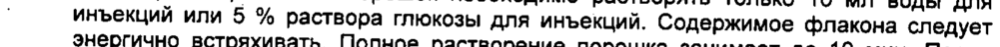
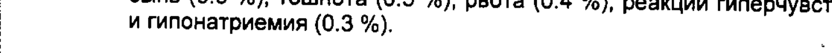
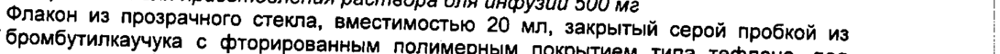

# Цефтобипрол медокарил — парентерально

- Препарат: Зефтера (лиофилизат для приготовления раствора для инфузий;)
- АТХ: J01DI01
- Источник: ГРЛС, инструкция по медицинскому применению, РУ ЛСР-002180/09, файл от  (https://grls.rosminzdrav.ru/Grls_View_v2.aspx?routingGuid=52ef96c8-018a-4bcd-95dc-7daaed564eb1)
- Распознано автоматически (OCR): 9 из 9 стр.
- Инструкция к другому РУ того же препарата: ЛСР-002180/09 (исключено из реестра, решение от 17.02.2011). Текст может быть старше действующего
- Сомнительных строк после OCR: 14 (см. раздел «Проверка распознавания»)

## Общие сведения

. , - | м М—————= xe JICP-002180/09-200309
Ki - . .
; 4 а ‚ Инструкция =... К a oF | по медицинскому применению препарата |
, _ ЗЕФТЕРА (ZEFTERA) | - Регистрационный номер: ©
‚ Торговое название: Зефтера , | Международное непатентованное название: цефтобипрола медокарил |
. i Лекарственная форма: лиофилизат для приготовления раствора для инфузий
| Состав ^ | | | | Активное вещество: = |
В каждом одноразовом флаконе содержится 666,6 мг цефтобипрола медокарила на- `
‚ трия (соответствует 500 мг цефтобипрола). , , ot Вспомогательные вещества: `. °. |
| лимонной кислоты моногидрат, натрия гидроксид, азот (инертный газ при лиофили- .
зации). | , | © Описание ©) Компактная, разломанная или порошкообразная масса _(лиофилизат) белого или от |
` желтоватого до слегка коричневатого цвета | |
Фармакотерапевтическая группа: - Антибиотик цефалоспорин
Код ATX: - 010101 `` Фармакологические`‘свойства” © BE ЖИВИ ВОИ
: Фармакодинамика : :
Механизм действия. | Цефтобипрола медокарил является водорастворимым пролекарством цефтобипрола, цефалоспорина, обладающего бактерицидной активностью в отношении широкого спектра грамположительных бактерий, включая резистентные к метициллину виды
°_ . Staphylococcus, резистентные к пенициллину Streptococcus pneumoniae, а также чув-_ ствительные к ампициллину Enterococcus faecalis. Цефтобипрол активен также в от- — ‘
’ ношении многих грамотрицательных бактерий. Включая многие штаммы семейства ,
© " Enterobacteriaceae и Pseudomonas aeruginosa. . ;
© ‚ Цефтобипрол прочно связывается со многими важными пенициллинсвязывающими
. белками (РВР) как грамположительных, так и грамотрицательных бактерий. Цефтобипрол обладает ярко выраженной бактерицидной активностью в отношении
Staphylococcus, резистентных к метициллину, благодаря прочному связыванию с
РВР2а стафилококков, включая метициллин-резистентные Staphylococcus aureus
(МАЗА).
Установлено, что цефтобипрол активен в отношении большинства изолятов пе-
| речисленных ниже микроорганизмов как in vitro, так и при внутрибольничных инфек-
| ЦИЯхХ.
| | Грамположительные аэробы Enterococcus faecalis (только изоляты, чувствительные к ванкомицину)
| Staphylococcus aureus (изоляты, чувствительные и резистентные к метициллину)
| Staphylococcus epidermidis, Streptococcus agalactiae, Streptococcus pyogenes .
| Enterococcus faecalis (изоляты, резистентные к ванкомицину)
- ' . Staphylococcus: коагулазо-негативные ‘'(изоляты, чувствительные и резистентные к метициллину, включая Staphylococcus haemolyticus, Staphylococcus hominis,
| Staphylococcus lugdunensis и Staphylococcus saprophyticus)
. Streptococcus pneumoniae {изоляты, чувствительные к пенициллину, умеренно рези-
| стентные к пенициллину и резистентные к пенициялину}
| Streptococcus группы viridans.
| О | 1 Ge | ЛСР-002180/09-200309° | Грамотрицательные аэробы . - 7 , ; a
= Enterobacter cloacae, Escherichia coli, Klebsiella pneumoniae |
. Proteus mirabilis, Pseudomonas aeruginosa i
Виды рода Citrobacter (включая Citrobacter freundii и Citrobacter koseri) |
-___..., _ Enterobacter aerogenes, Klebsiella oxytoca, Moraxella catarrhalis, Могдапе!а morganii
"`` Виды рода Neisseria , | Виды рода Providencia |
Serratia marcescens Механизм устойчивости. . | ~
Цефтобипрол устойчив к гидролизу пенициллиназами $. aureus, а также к гидролизу многими бета-лактамазами класса С и класса А, продуцируемыми грамотрицаa тельными бактериями. Как и большинство цефалоспоринов, цефтобипрол гидролизуется бета-лактамазами расширенного спектра (ESBL), карбапенемазами и метал-
: ло-бета-лактамазами. In vitro He наблюдалась селекция высокоуровневой резистент- | ности у стафилококков, стрептококков и Haemophilus influenzae. |
| Перекрестная резистентность | Резистентность к цефтобипролу, вызванная спонтанной мутацией in vitro, наблю-
~~ дается редко. Описана перекрестная резистентность между цефтобипролом и неко-
© торыми другими цефалоспоринами последних поколений. Вместе с тем, некоторые микроорганизмы, резистентные к другим цефалоспоринам, могут быть чувствитель- | ными к цефтобипролу.
`’ Фармакокинетика | Концентрации в плазме .
—.-- --.- - Средние -фармакокинетические_параметры цефтобипрола_у. взрослых.после BBe-. .__.... _ _....
дения одной дозы 500 мг в виде 60-минутной инфузии и многократных доз 500 мг, вводившихся каждые 8 ч в виде 120-минутных инфузий, приведены в табл. 1. Фармакокинетические характеристики сходны после введения одной дозы и после введения многократных доз.
Таблица 1. Средние (стандартное отклонение) фармакокинетические параметры цефтобипрола у взрослых |
Параметры . Одна доза 500 мг в виде | Многократные дозы 500 мг о. 60-минутной инфузии в виде 120-минутных инфу-
© | | , зий каждые 8 ч | = | ше (часы о [2850.55 о [3303 |
Cmax — максимальная концентрация в плазме
, AUC ~ площадь под кривой зависимость концентрации препарата в плазме от времени | . .
| | (1/2 - период полувыведения ;
| С! - клиренс | | Cmax и AUC цефтобипрола увеличиваются пропорционально дозе в диапазоне доз
| 125 мг — 1 г. Стационарные (рвновесные) концентрации достигаются в первый день
| лечения, у людей с нормальной функцией почек введение цефтобипрола каждые 8 ч
| и каждые 12 4 He вызывают его аккумуляции.
: Распределение № № 7 | Цефтобипрол на 16 % связывается с белками плазмы и эта степень связывания oe
| не зависит от его концентрации. Стационарный объем распределения (18 л) цефтобипрола приближается к объему внеклеточной жидкости у человека.
| | 2 > — . . п EN . _ JICP-002180/09-200309 |
Со Метаболизм о . . Биопревращение. из пролекарства цефтобипрола медокарила в активное лекар- | !
CTBO цефтобипрол происходит быстро и катализируется эстеразами плазмы. Концентрации пролекарства ничтожно малы, и его удается обнаружить в плазме и моче a только во время инфузии. -
Цефтобипрол подвергается минимальному метаболизму до нециклического метаболита, который микробиологически неактивен. Концентрация этого метаболита | ниже концентрации самого цефтобипрола и составляет около 4 % от последней. |
| ‚ Выведение | | | Цефтобипрол выводится преимущественно в неизмененном виде посредством | почечной экскреции, и период его полувыведения составляет около 3 ч. Главным ме- | ханизмом почечной экскреции является клубочковая фильтрация, небольшая часть | дозы подвергается канальцевой реабсорбции. В доклинических исследованиях про- | беницид не влиял на фармакокинетику цефтобипрола, что указывает на отсутствие . | активной канальцевой секреции последнего. После введения одной дозы примерно 89 % ее обнаруживается в моче в виде активного цефтобипрола (83 %), метаболита с открытым кольцом (5 %) и цефтобипрола медокарила (<1 %). |
© ‚ Особые группы пациентов | © Пациенты с почечной недостаточностью | |
Фармакокинетика цефтобипрола сходна у здоровых добровольцев и у пациентов |
. С легкой почечной недостаточностью (клиренс креатинина 50 — 80 мл/мин). По сравнению с AUC у здоровых добровольцев с нормальной функцией почек, AUC цефтобипрола была в 2.5 и 3.3 раза выше у пациентов со среднетяжелой (клиренс креати-
.‚ нина 30 — $50 мл/мин) и тяжелой почечной недостаточностью (клиренс креатинина
-- -—... -..$30.мл/мин) соответственно..У пациентов со среднетяжелой._и_-тяжелой.почечной.не- st
_ достаточностью рекомендуется снижать дозу цефтобипрола. | |
‚ AUC цефтобипрола и его микробиологически неактивного метаболита со структурой открытого кольца возрастает у пациентов, которым необходим гемодиализ, по сравнению с AUC у.здоровых добровольцев.
Пациенты с печеночной недостаточностью У пациентов с печеночной недостаточностью фармакокинетику цефтобипрола не изучали. Цефтобипрол подвергается минимальному печеночному метаболизму и |
© экскретируется в основном почками в неизмененном виде, и поэтому нет оснований , :
| °. считать, что клиренс цефтобипрола у пациентов с печеночной недостаточностью Oy
’ дет снижен.
Пожилые пациенты Популяционные исследования фармакокинетики цефтобипрола не выявили независимого влияния возраста на его фармакокинетические параметры. У пожилых пациентов с нормальной функцией почек дозу этого препарата снижать не нужно.
Мужчины и женщины Системные фармакокинетические параметры цефтобипрола у женщин были выше, чем у мужчин (Cmax на 21 % и AUC на 15 %); вместе с тем %Т>МИК был сходным у мужчин и женщин. Следовательно, нет необходимости корректировать дозу этого
| препарата в зависимости от пола пациента.
| Расовая принадлежность | | Популяционные исследования фармакокинетики (включавшие европеоидов и не-
| большое число негроидов и представителей других рас) не выявили влияния расо- ,
| вой принадлежности на фармакокинетические параметры цефтобипрола. Следова-
| тельно, нет необходимости корректировать дозу этого препарата в зависимости от
| расовой принадлежности пациента.
| | 3 i JICP-002180/09-200309.
Показания к применению a Лечение осложненных инфекций. кожи и ее придатков, включая инфицированную , |
. диабетическую стопу без сопутствующего остеомиелита. |

## 4.3. Противопоказания

| | - гиперчувствительность. к цефтобипролу, любому вспомогательному веществу, |
| | - гиперчувствительность. к цефтобипролу, любому вспомогательному веществу, |
. входящему в состав препарата и другим цефалоспоринам
- Пациенты, у которых в анамнезе наблюдались аллергические реакции на бета- - лактамные антибиотики
- детский возраст (до 18 лет) |

## 4.3. С осторожностью

| ‚ т Почечная недостаточность (клиренс креатинина менее 50 мл/мин) .
| ‚ т Почечная недостаточность (клиренс креатинина менее 50 мл/мин) .
"= Эпилепсия - - судорожные припадки (в анамнезе) |
| - псевдомембранозный колит (в анамнезе). | |
7 Применение при беременности и в период лактации. , |
Беременность | | © Доклинические исследования показали, что цефтобипрол не обладает терато- |
‚генной активностью и не влияет на оссификацию, массу тела плода и внутриутроб- .
ное развитие. Исследования применения цефтобипрола у беременных женщин не проводили. Результаты исследования влияния лекарственных средств на репродук- — тивную функцию животных не всегда могут быть интерполированы на соответствующую функцию человека, и поэтому цефтобипрол можно назначать беременным женщинам только в тех случаях, когда ожидаемая польза применения для будущей | матери перевешивает потенциальный риск для плода. .
Период лактации | | | | Неизвестно, способен ли цефтобипрол проникать в грудное молоко кормящих | женщин. Исследования на животных показали, что препарат проникает в молоко.
Учитывая это, женщины, получающие препарат цефтобипрол, должны воздержи_ ваться от грудного вскармливания. ,

## 4.2. Способ применения и дозы

| При инфекциях, которые предположительно или доказано вызваны | a) ‘® а)грамотрицательными бактериями ` | |
| При инфекциях, которые предположительно или доказано вызваны | a) ‘® а)грамотрицательными бактериями ` | |
В ® 6) грамположительными и грамотрицательными бактериями .
© и инфицированной диабетической стопе без сопутствующего остеомиелита реко- ,
| | мендуемая доза цефтобипрола составляет 500 мг каждые 8 чв виде 120-минутных внутривенных инфузий.
При инфекциях, которые доказанно или предположительно вызваны грамположио тельными бактериями, 500 мг цефтобипрола вводят каждые -12-ч в виде 60-минутных внутривенных инфузий. Этот режим дозирования (с 12-часовыми интервалами) не изучали у пациентов с инфицированной диабетической стопой.
| Продолжительность терапии обычно составляет 7 ~ 14 дней.
Дозы у пожилых пациентов | У пожилых пациентов нет необходимости в коррекции дозы. .. ..
| eae Дозы у пациентов с почечной недостаточностью st 57.
| У пациентов с незначительным нарушением функции почек (т. е. с клиренсом
| креатинина 50 — 80 мл/мин) дозу цефтобипрола изменять не нужно. У пациентов со
| среднетяжелым нарушением функции почек (клиренс креатинина 30 — <50 мл/мин) `
| доза цефтобипрола должна составлять 500 мг каждые 12 ч в виде 120-минутных
| внутривенных инфузий. У пациентов с тяжелым Ha ением функции почек (клиренс
| 4 ] = ЛСР-002180/09-200309 | креатинина <30 мл/мин) доза цефтобипрола должна составлять 250 мг каждые 12 чв
| виде. 120-минутных внутривенных инфузий. В связи с ограниченными. клиническими = 7 !
’ т. данными и предполагаемым увеличением концентрации цефтобипрола и его метаболитов препарат Зефтера следует назначать с осторожностью пациентам с тяже- _
| non формой почечной недостаточности. |
° Дозыу пациентов, находящихся на диализе
Цефтобипрол выводится при гемодиализе, однако в настоящее время недостаточно | информации для изменения дозирования у пациентов, находящихся на диализе. Та- . | ким образом, препарат Зефтера не рекомендуется назначать пациентам, находящимся на любом. виде гемодиализа. .
a Дозы у пациентов с печеночной недостаточностью °C 7
° В настоящее время нет опыта применения цефтобипрола у пациентов с печеноч- - ной недостаточностью. Однако, учитывая тот факт, что цефтобипрол подвергается минимальному метаболизму в печени и элиминируется преимущественно почками, | можно считать, что у пациентов с печеночной недостаточностью дозу цефтобипрола | снижать не следует. | |
- . . . . . |
Инструкции по приготовлению раствора и обращению с ним
Приготовление раствора | | | Лиофилизированный` порошок необходимо растворять только 10 мл воды для |
; инъекций или 5 % раствора глюкозы для инъекций. Содержимое флакона следует энергично встряхивать. Полное растворение порошка занимает до 10 мин. Перед | разведением в инфузионном растворе необходимо дать осесть образовавшейся пене. .
-—-— een Разведение, ne ee be ee ee 10 мл готового раствора следует извлечь из флакона и ввести в соответствующий сосуд (например, мешки из поливинилхлорида или полиэтилена, стеклянные бутыли), содержащие 250 мл 0.9 % раствора хлорида натрия, 5 % раствора глюкозы или раствора лактата Рингера для инфузий. Инфузионный раствор осторожно переворачивают вверх-вниз 5 — 10 раз для получения однородного раствора цефтобипрола.
Во избежание образования пены нельзя энергично встряхивать раствор. -
Для пациентов с тяжелой почечной недостаточностью 5 мл готового раствора цефтобипрола разводят в 125 мл 0.9 % раствора хлорида натрия, 5 % раствора глю- .
, козы или раствора лактата Рингера для инфузий. -. ,
© Инфузия | | Инфузионный раствор перед введением визуально проверяют на отсутствие ме-:
‹ ханических включений и при обнаружении последних отбраковывают. .

## 4.8. Побочное действие

Нежелательные эффекты, наблюдавшиеся в клинических исследованиях
Нежелательные эффекты, наблюдавшиеся в клинических исследованиях
. Нежелательные эффекты, возникавшие с частотой 21 % у пациентов, которые получали 500 мг цефтобипрола каждые 8 - 12 4 B виде 60-минутных или 120-
| минутных инфузий, перечислены в табл. 2.
| Нежелательными эффектами, вызвавшими отмену цефтобипрола, были кожная
| сыпь (0.6 %), тошнота (0.5 %), рвота (0.4 %), реакции гиперчувствительности (0.3 %)
| и гипонатриемия (0.3 %). | . . mo .
| | | | | 5 ee | : ; ga НН о >. - . | Е. ЛСР-002180/09-200309 |
Таблица 2. Частота (проценты) нежелательных эффектов, наблюдавшихся в а
‘двух клинических испытаниях фазы Ill с частотой 21%. .’ -° |
| | ждые 12 или 8ч (п = 932) | (n = 661) |
Процент нежелательных | (Ванкомицин и Ванкомицин + | wantin ne |. | эффектов Цефтазидим в исследованиях,
| которые включали пациентов ; | как с грамположительными, Tak и с грамотрицательными инфекциями)
a , Процент нежелательных :
| эффектов НИнфекции и инвазии (грибковые инфекции вульвы и влагалища, полости рта и кожи . . . |
| Иммунная система | | Гиперчувствительность 1 3 |
‚ | (Включает крапивницу, зудящую . . . | сыпь и лекарственную гиперчувст- | 7 вительность | | | |
© Метаболические нарушения !
Гипонатриемия “| | . Нервная система Головная боль 7 6 |
Головокружение ‘3 2 | Извращение вкуса 6 1 |
`| Желудочно-кишечный тракт | | | ОНИ --Тошнота-—--——-: ее в a = м а еее че |
Диарея 7 5 .
Рвота | 7 | 4 | Диспепсия 2 1 | Кожа и подкожные ткани _ 7
Сыпь 4 (Включает макулёзную, папулёз- 3 . | ную, макуло-папулёзную и генерализованную сыпь) . .
Зуд | © Общие нарушения и реакции - | в месте инфузии .
Q) Кожные реакции в месте инфузии | Лабораторные показатели 3 3
Повышение уровней печеночных ферментов | (Включает повышение уровней ‘ ‘ ` |
АПТ и АСТ) _ В большинстве случаев тошнота была легкой, проходила сама по себе и не тре-
| бовала отмены цефтобипрола. Тошнота реже наблюдалась у пациентов, которые ,
: получали 120-минутные инфузии (10 %), чем у тех, кто получал 60-минутные инфу-
| зии (14 %).
| Частота возникновения судорожных припадков, анафилаксии и псевдомембра_ HOSHOrO колита, вызванного Clostridium difficile, при применении цефтобипрола, со- _.
| ‚ ставила MeHee 1%. о | | Передозировка
| В настоящее время нет информации о передозировке цефтобипрола у человека.
| Самая высокая суточная доза, которая была введена в Фазе 1 клинических исследо-
| ваний составила Зг (1 гкаждые 8 ч).
| 6 6 а К Я |
3 JICP-002 180/09-200309 |
` При передозировке следует проводить общую поддерживающую терапию с монито- - |
. ` рированием` основных физиологических показателей. ‘Понизить уровень цефтоби- |
> ° Прола в плазме крови можно с помощью гемодиализа. | | |
| Взаимодействие с другими препаратами и другие формы взаимодействия
Исследования взаимодействия цефтобипрола с другими препаратами не прово-
——-^- - Aun. Цефтобипрол обладает минимальной способностью к взаимодействию с дру-
° гими лекарственными средствами | Цефтобипрол показал минимальную способность ингибировать изоферменты
CYP1A2, CYP2C9, CYP2C19, CYP2D6 и CYP3A4, а также отсутствие способности индуцировать эти изоферменты. Благодаря этому и вследствие того, что’ распределе- | ние цефтобипрола ограничено внеклеточной жидкостью, он обладает низкой способностью влиять на С\УР450-зависимый ‚метаболический клиренс одновременно вво-
’ димых препаратов. Способность других препаратов взаимодействовать с цефтобипролом тоже минимальна, поскольку метаболизму подвергается лишь небольшая | часть дозы этого препарата. Таким образом, нет оснований бояться возникновения ;
клинически значимых лекарственных взаимодействий цефтобипрола. .
Цефтобипрол не секретируется почечными канальцами, и реабсорбируется лишь незначительная часть его дозы, и поэтому лекарственные взаимодействия на уровне |
’ Почек очень мало вероятны. | Не было выявлено влияния на фармакокинетику цефтобипрола следующих одно- |
° временно применяемых препаратов: фентанил, лидокаин, парацетамол, диклофенак, .
© ацетилсалициловая кислота, гепарин, дифенгидрамин, пропофол, гидроморфона гидрохлорид, метадон, гидрокодона битартрат, метамизола натрий и фуросемид.
Совместимость цефтобипрола с другими препаратами не изучали. Цефтобипрол |
‚ не следует смешивать с другими препаратами или добавлять к растворам, содержащим другие лекарственные средства. |
, .
- ---——_-Особые-указания-- —— — о. п ое =
Описаны серьезные и, иногда, летальные реакции гиперчувствительности (ана- | филактические реакции) у пациентов, получавших бета-лактамные антибиотики. Эти реакции чаще возникают у пациентов с аллергией на большое число аллергенов.
~ Перед началом лечения цефтобипролом пациента необходимо подробно расспросить, чтобы установить, были ли у него ранее реакции гиперчувствительности на
. другие цефалоспорины, пенициллины или иные аллергены. В случае возникновения аллергической реакции на цефтобипрол его необходимо сразу же отменить. Серьез-
` НЫе острые реакции гиперчувствительности (анафилаксия) требуют соответствую-
© wero лечения. . ; ; , > Необходимо провести бактериологическое исследование с целью выделения и иден- :
тификации возбудителей инфекций и определения их чувствительности к цефтоби- |
_ пролу. При отсутствии таких данных следует проводить эмпирическую терапию, руководствуясь местными эпидемиологическими данными и информацией о местной структуре чувствительности микроорганизмов.
У пациентов, получающих антибактериальные средства, включая цефтобипрол о может возникнуть псевдомембранозный колит разной степени тяжести. В связи с
° этим, следует помнить о возможности развития псевдомембранозного колита у пациентов, у которых на фоне лечения цефтобипролом возникает диарея.
Длительное применение цефтобипрола, как и других антибиотиков, может вы-
| звать чрезмерное размножение нечувствительных микроорганизмов, включая грибы, и поэтому необходимо периодически оценивать состояние пациента. При возникно-
| вении суперинфекции во время лечения цефтобипролом необходимо принять соот-
| ветствующие меры.
| При применении цефтобипрола, как и других бета-лактамов, пациенты могут испы-
| тывать приступы судорожных припадков. Возникновение припадков, связанных с
_ применением ЦЕФТОБИРПОЛа, чаще всего наблюдаются у пациентов с уже’ имею- 7 a щимися заболеваниями центральной нервной системы. Поэтому рекомендуется со-
| блюдать осторожность при лечении таких больных.
| | | pr 7 . JICP-002 180/09-200309 | ao Влияние на способность вождения автомобиля и работу с механизмами . |
. ‚ Не было проведено ни одного исследования влияния Зефтеры на вождение автомо- . |
= _биля и работу с механизмами. Однако прием препарата Зефтера может вызвать го- | ловокружение, что может оказывать воздействие на вождение автомобиля и работу с | механизмами. Поэтому не рекомендуется применять препарат Зефтера во время .
va... . Вождения автомобиля и работы с механизмами.
| : Форма выпуска | Лиофилизат для приготовления раствора для инфузий 500 мг |
Флакон из прозрачного стекла, вместимостью 20 мл, закрытый серой пробкой из !
`бромбутилкаучука с фторированным полимерным покрытием типа тефлона, под -
| алюминиевой обкаткой, с пластиковой защелкивающейся крышкой | 1 или 10 флаконов в картонной. пачке вместе с инструкцией по медицинскому при- | менению. . , -

## 6.3. Срок годности

| 2 года. ; | He использовать по окончании срока годности.
| 2 года. ; | He использовать по окончании срока годности.
- ® Условия хранения |
| © Флаконы с цефтобипролом следует хранить при температуре 2 — 8°С в оригинальной | упаковке в защищенном от света месте. . |
© Хранить.в недоступном для детей месте. : |
| Хранение приготовленного раствора и инфузионного раствора |
Приготовленный раствор может храниться в течение 1 часа при температуре 25°С и | в течение 24 часов при температуре 2- 8°С. |
. . | | ——- .--__Растворение, -разведение. и-инфузию-необходимо осуществлять в-течение-времени;- —— -----—.-___ казанного ниже в табл. 3.
приготовления инфу- | хранения 25°C температура хранения зии) _ —_... 2 - 8°C (холодильник) .
ИЕ Lc щенном от света | ту от света месте месте a натрия | |
© , cid a ПИ accel `. `_ нике Приготовленный раствор и инфузионный раствор нельзя замораживать и нельзя выставлять на открытые солнечные лучи.
После извлечения из холодильника инфузионным растворам нужно дать нагреться до комнатной температуры и только после этого делать инфузию. В процессе при-
| менения инфузиооный раствор не должен быть защищен от света. |
: Инфузионный раствор должен быть приготовлен в соответствии с инструкциями по
| , приготовлению раствора и обращению с ним (см. раздел Способ применения и до- |
| зы).
| Условия отпуска из аптек.
| По рецепту.
| Производитель: a о a oO Держатель Регистрационного удостоверения:
. . Янссен Фармацевтика H.B., Турнхоутсевег, 30, B-2340, Bepce, Бельгия .
pr | | 8 ы a . . . . . . чи = | мн м | т 5 JICP-002 180/09-200309 |
> Производитель готовой лекарственной формы и первичная упаковка:
‚ а `` Патеон ЮК Лимитед, Кингфишер Драйв, Кавинхам Свиндон,` Вилдшир $МЗ 5 BZ, | ч _ Великобритания | |
Вторичная упаковка и выпускающий контроль: - | тет о Янссен Фармацевтика H.B., Турнхоутсевег, 30, В-2340, Bepce, Бельгия |
| | Представительство компании ЯНССЕН ФАРМАЦЕВТИКА Н.В. в России:
Москва, 121614, ул. Крылатская 17, строение 3 |
Ten.: (495) 755-83-57 | 255 ко | Факс: (495) 755-83-58 < А. |
K "ЯНССЕН я | | | р is ФАРМАЦЕВТИКА Н.В? < oo |
. < LEN 9 | | Ш. ee Js | | ` Представитель фирмы а. ONG ay is |
Менеджер по регистрации oC vine 7, 9/C-B. Арутюнян |
< Моск» | Kory Cpaae’ 9 - | . . . иг храме, @ i к) . .
© hee и | | .0. Директора ИДКЭЛС ФГУ Ц CNP mone ay: А.Н. Васильев |
® . . с 58. лекарс, Very 28 и . .
328 2, ia * fs | 2.2 ре | a oH Phan | о | “У Оскв» |
| . . . .
| | | | ‚
## Проверка распознавания

Страницы-сканы распознаны автоматически. В 14 строках с дозировками цифры могли распознаться с ошибкой — сверьте с вырезкой из оригинала:

- стр. 2: «© | | , зий каждые 8 ч |» — повторное чтение: «[МИ [зрелое»  
  
- стр. 3: «ше, чем у мужчин (Cmax на 21 % и AUC на 15 %); вместе с тем %Т>МИК был сходным» — повторное чтение: «ше, чем у мужчин (Cmax На 21 hun AUC Ha 15 %); вместе с тем %Т>МИК был сходным»  
  
- стр. 4: «| | мендуемая доза цефтобипрола составляет 500 мг каждые 8 чв виде 120-минутных» — повторное чтение: «|  МЕндуемая доза цефтобипрола составляет 500 мг каждые 8 ч в виде 120-минутных»  
  
- стр. 4: «о тельными бактериями, 500 мг цефтобипрола вводят каждые -12-ч в виде 60-минутных» — низкая уверенность: «-12-ч» (46)  
  
- стр. 4: «| среднетяжелым нарушением функции почек (клиренс креатинина 30 — <50 мл/мин) `» — повторное чтение: «’  Фреднетяжелым нарушением функции почек (клиренс креатинина 30 — <50 млими) |»  
  
- стр. 4: «| доза цефтобипрола должна составлять 500 мг каждые 12 ч в виде 120-минутных» — низкая уверенность: «12» (71)  
  
- стр. 5: «| креатинина <30 мл/мин) доза цефтобипрола должна составлять 250 мг каждые 12 чв» — низкая уверенность: «12» (40); повторное чтение: «`.  Юеатинина <30 мпумин) доза цефтобипрола должна составлять 250 мг каждые 12 че.»  
  
- стр. 5: «; инъекций или 5 % раствора глюкозы для инъекций. Содержимое флакона следует» — низкая уверенность: «5» (70)  
  
- стр. 5: «. Нежелательные эффекты, возникавшие с частотой 21 % у пациентов, которые» — повторное чтение: «° _ Нежелательные эффекты, возникавшие с частотой >1 % у пациентов, которые»  
  
- стр. 5: «получали 500 мг цефтобипрола каждые 8 - 12 4 B виде 60-минутных или 120-» — повторное чтение: «получали 500 мг цефтобипрола каждые 8 - 12 ч в виде 60-минутных или 120-»  
  
- стр. 5: «| и гипонатриемия (0.3 %). |» — повторное чтение: «о итипонатривмия (03%.»  
  
- стр. 6: «| ‚ ставила MeHee 1%. о» — низкая уверенность: «1%.» (22)  
  
- стр. 8: «Лиофилизат для приготовления раствора для инфузий 500 мг |» — повторное чтение: «оиофилизат для приготовления раствора для инфузи 500»  
  
- стр. 8: «Флакон из прозрачного стекла, вместимостью 20 мл, закрытый серой пробкой из !» — повторное чтение: «»  
  
