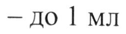
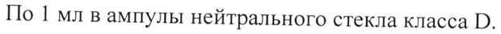

# Цинка бисвинилимидазола диацетат — парентерально

- Препарат: ЦИНКАЗОЛ® (раствор для внутримышечного введения;)
- АТХ: V03AB
- Источник: ГРЛС, инструкция по медицинскому применению, РУ ЛП-007382, файл от 2022-03-28 (https://grls.rosminzdrav.ru/Grls_View_v2.aspx?routingGuid=ef145932-1fb6-4f89-9d60-2ad22eb07b24)
- Распознано автоматически (OCR): 6 из 6 стр.
- Инструкция найдена по торговому наименованию: ЦИНКАЗОЛ®, РУ ЛП-007382
- Сомнительных строк после OCR: 2 (см. раздел «Проверка распознавания»)

## Общие сведения

| _ МИНИСТЕРСТВО ЗДРАВООХРАНЕНИЯ РОССИЙСКОЙ ФЕДЕРАЦИИ
| ИНСТРУКЦИЯ ПО МЕДИЦИНСКОМУ ПРИМЕНЕНИЮ ЛЕКАРСТВЕННОГО ПРЕПАРАТА
ЦИНКА БИСВИНИЛИМИДАЗОЛА ДИАЦЕТАТ Регистрационный номер:
Торговое наименование: Цинка бисвинилимидазола диацетат
“> Международное непатентованное или группировочное наименование:
Цинка бисвинилимидазола диацетат Лекарственная форма: раствор для внутримышечного введения
Состав на 1 мл:
Действующее вещество: цинка бисвинилимидазола диацетат — 60,0 мг
© Вспомогательные вещества: уксусная кислота — 0,005 мл; вода для инъекций
— до 1 мл Описание: Бесцветная прозрачная жидкость с характерным запахом.
Фармакотерапевтическая группа: антидот Код ATX: V03AB
~ Фармакологические свойства Фармакодинамика
Известно, что в условиях воздействия повышенных концентраций оксида углерода (II) проявляется так называемый эффект Холдена, когда в результате кооперативного взаимодействия гемов 4-й гем молекулы гемоглобина лишается способности отдавать кислород, если 3 остальных гема связали оксид углерода (П). Цинка бисвинилимидазола диацетат, являясь комплексным цинкорганическим соединением, за счет снижения кооперативности гемов и относительного сродства гемоглобина к оксиду углерода (II), ингибирует образование карбоксигемоглобина, в результате чего улучшаются кислородсвязывающие и газотранспортные свойства крови при отравлении оксидом углерода (II), ускоряется элиминация оксида углерода (П) из организма. Повышение сродства гемоглобина к кислороду
(0О-) и сдвиг кривой диссоциации оксигемоглобина влево позволяют гемоглобину полностью насыщаться кислородом при гораздо меньших значениях парциального давления Op, вследствие чего повышается устойчивость организма к недостатку кислорода в окружающей среде.
Затруднение в отдаче О› тканям приводит к относительному ухудшению снабжения О› лишь органов и тканей с высоким порогом его усвоения, в то время как жизненно важные органы с низким порогом усвоения Qs,
© например, мозг, находится при этом в лучших условиях, чем в отсутствии левого сдвига.
Цинка бисвинилимидазола диацетат, способствуя ускорению элиминации оксида углерода из организма, снижает выраженность интоксикации при отравлении оксидом углерода (II) по показателям тяжести метаболического ацидоза. Восполняется дефицит цинка в организме.
© Фармакокинетика Всасывание Максимальная концентрация цинка бисвинилимидазола диацетата в крови достигается через 20-30 минут после внутримышечного введения 1 мл (60мг)
ev препарата и сохраняется в плазме крови в течение 4-5 часов.
Метаболизм В основном метаболизируется печенью. Продукты метаболизма выводятся из организма преимущественно через желудочно-кишечный тракт.
Выведение Период полувыведения (Ty,) составляет 1-1,5 часа.

## 4.1. Показания к применению

Лечение и профилактика при отравлениях оксидом углерода (П) различной степени тяжести.
Лечение и профилактика при отравлениях оксидом углерода (П) различной степени тяжести.
Противопоказания e Гиперчувствительность к действующему веществу и/или вспомогательным компонентам препарата;
® — Период грудного вскармливания;
® — Детский возраст до 18 лет (в связи с недостаточностью данных).

## 4.3. С осторожностью

У пациентов с дефицитом меди.
У пациентов с дефицитом меди.

## 4.6. Применение при беременности и в период грудного вскармливания

Беременность Адекватных и строго контролируемых исследований у беременных женщин
“> по оценке влияния цинка бисвинилимидазола диацетата на исход беременности не проводилось. Экспериментальные исследования на животных не выявили у цинка бисвинилимидазола диацетата эмбриотоксических и тератогенных свойств, а также неблагоприятного влияния на репродуктивную функцию.
© Период грудного вскармливания Неизвестно, способен ли цинка бисвинилимидазола диацетат проникать в грудное молоко. В период применения препарата следует прекратить грудное вскармливание.

## 4.2. Способ применения и дозы

-, Внутримышечно.
-, Внутримышечно.
Профилактика 1 мл препарата Цинка бисвинилимидазола диацетат вводят при угрозе отравления за 20-30 минут до предполагаемого воздействия — вхождения в зону задымления/загазованности, при высоком риске ингаляции углерода (П)
в период проведения работ по ликвидации последствий аварий и катастроф, сопровождающихся пожарами, или при тушении самих пожаров и спасении пострадавших. Защитное действие препарата сохраняется в течение 1,5 — 2 часов. Повторное применение препарата Цинка бисвинилимидазола диацетат допускается через | час после первого введения.
Лечение В качестве лечебного средства препарат Цинка бисвинилимидазола диацетат рекомендуется применять при отравлении оксидом углерода (П) в наиболее ранние сроки, вне зависимости от тяжести поражения.
1 мл препарата вводят сразу после извлечения пострадавшего из зоны пожара/загазованного помешения. Через | час допускается повторное введение. В последующем — по | мл 2 — 4 раза в сутки. Максимальная суточная доза для взрослого человека — 240 мг (4 мл). Курс лечения в среднем составляет 7 — 10 дней.

## 4.8. Побочное действие

$ Возможна умеренная болезненность в месте введения.
$ Возможна умеренная болезненность в месте введения.

## 4.9. Передозировка

Симптомы Металлический привкус во рту, головная боль, тошнота.
Симптомы Металлический привкус во рту, головная боль, тошнота.
Лечение & Указанные симптомы проходят после отмены препарата и не требуют специального лечения.

## 4.5. Взаимодействие с другими лекарственными средствами

Не рекомендуется применять препарат Цинка бисвинилимидазола диацетат совместно с димеркаптопропансульфонатом натрия.
wr При совместном применении с другими лекарственными средствами отрицательных эффектов не отмечено.

## 4.7. Влияние на способность управлять транспортными средствами, механизмами

Препарат Цинка бисвинилимидазола диацетат не оказывает неблагоприятного влияния на способность к управлению транспортными средствами и механизмами.

## 6.5. Форма выпуска

Раствор для внутримышечного введения, 60 мг/мл
Раствор для внутримышечного введения, 60 мг/мл
По 1 мл в ампулы нейтрального стекла класса D.
На ампулу наклеивают этикетку из бумаги.
По | или 5 ампул в контурную ячейковую упаковку из плёнки поливинилхлоридной или полиэтилентерефталатной.
По 1, 2, 10 или 20 контурных ячейковых упаковок по | ампуле вместе с инструкцией по применению в пачку из картона.
По 1 или 2 контурных ячейковых упаковки по 5 ампул вместе с инструкцией по применению в пачку из картона.
© По [мл в стеклянные шприцы нейтрального стекла с замком Луер-Лок, с твердым колпачком и комплектующими.
На шприц наклеивают этикетку.
По 1 или 5 шприцев в контурную ячейковую упаковку из пленки поливинилхлоридной или полиэтилентерефталатной. По 1 контурной ячейковой упаковке вместе с | или 5 иглами инъекционными и инструкцией a по применению в пачку из картона.

## 6.3. Срок годности

3 года.
3 года.
Не применять по истечении срока годности.
> Условия хранения При температуре не выше 25 °С.
Хранить в недоступном для детей месте.
Условия отпуска Отпускают по рецепту.
Производитель Федеральное государственное унитарное предприятие Научнопроизводственный центр «Фармзащита» Федерального — медикобиологического агентства (ФГУП НПЦ «Фармзащита» ФМБА России).
141402, Московская обл. г. Химки, Вашутинское ш., д.11.
Владелец регистрационного удостоверения/Организация, принимающая претензии
Федеральное государственное унитарное предприятие Научнопроизводственный центр «Фармзащита» Федерального — медикобиологического агентства (ФГУП НПЦ «Фармзащита» ФМБА России).
141402, Московская обл. г. Химки, Вашутинское ш., д.11 тел./факс (495) 789-65-55
Сайт: www.atompharm.ru E-mail: info@atompharm.ru
$ Главный специалист отдела регистрации и 7 лекарственных средств
ФГУП НПЦ «Фармзащита» ФМБА России С.А. Осокина wy
—
## Проверка распознавания

Страницы-сканы распознаны автоматически. В 2 строках с дозировками цифры могли распознаться с ошибкой — сверьте с вырезкой из оригинала:

- стр. 1: «— до 1 мл» — повторное чтение: «— до | Мл»  
  
- стр. 5: «По 1 мл в ампулы нейтрального стекла класса D.» — низкая уверенность: «1» (75)  
  
