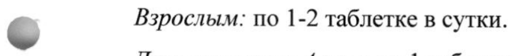

# Цинка сульфата моногидрат — внутрь

- Препарат: Цинктерал®-Тева (таблетки, покрытые пленочной оболочкой;)
- АТХ: A12CB01
- Источник: ГРЛС, инструкция по медицинскому применению, РУ П N011693/01, файл от 2021-11-24 (https://grls.rosminzdrav.ru/Grls_View_v2.aspx?routingGuid=b1530b75-4da7-4209-a8e5-2ef4f34ab2c9)
- Распознано автоматически (OCR): 5 из 5 стр.
- Инструкция к другому РУ того же препарата: П N011693/01 (срок действия истёк, решение от 26.10.2021). Текст может быть старше действующего
- Сомнительных строк после OCR: 1 (см. раздел «Проверка распознавания»)

## Общие сведения

МИНЗДРАВ РОССИИ в 13 0513 МИНИСТЕРСТВО ЗДРАВООХРАНЕНИЯ РОССИЙСКОЙ вы
СОГЛАСОВАНО ИНСТРУКЦИЯ ПО МЕДИЦИНСКОМУ ПРИМЕНЕНИЮ ЛЕКАРСТВЕННОГО ПРЕПАРАТА
Цинктерал®-Тева

Регистрационный номер:
Торговое наименование препарата: Цинктерал®-Тева
Международное непатентованное наименование или группировочное наименование: цинка сульфат

## 3. Лекарственная форма

таблетки, покрытые пленочной оболочкой
таблетки, покрытые пленочной оболочкой

## 2. Состав

© В 1 таблетке содержится: действующее вещество цинка сульфата моногидрат 124,0 мг, что соответствует цинку 45,0 мг; вспомогательные вещества: лактозы моногидрат 78,5 мг, крахмал картофельный 38,75 мг, повидон-К25 20,00 мг, тальк 12,38 мг, магния стеарат 1,37 мг; оболочка: гипромеллоза 6,897 мг, макрогол (полиэтиленгликоль)
0,448 мг, титана диоксид (Е171) 1,79 мг, алюминиевый лак на основе красителя азорубин
(Е122) 0,865 мг.
Описание Круглые двояковыпуклые таблетки, покрытые пленочной оболочкой фиолетоворозового цвета, с гладкой поверхностью без пятен и сколов. На поперечном разрезе - ядро белого или почти белого цвета с возможными серовато-белыми, коричневыми или черными вкраплениями.

| ® Фармакотерапевтическая группа: препарат цинка
Код ATX: А12СВО1 Фармакологические свойства
Цинк является одним из самых важных микроэлементов. Он входит в состав почти 200 ферментов, которые определяют течение различных метаболических процессов, включая синтез белков и углеводный обмен.
Цинк стимулирует синтез коллагена и белка в регенерирующей ткани, оказывает подсушивающее и вяжущее действие; стимулирует синтез инсулина.
Активирует карбоангридразы и супероксидисмутазы эритроцитов, супероксидисмутазы цитозоля, глутаматдегидрогеназы; гидролазу щелочной фосфотазы, аминопептидазы, нейтральные протеазы.

## 4.1. Показания к применению

Профилактика и лечение дефицита цинка, вызванного неполноценным и несбалансированным питанием, нарушением всасывания и другими состояниями, которые нарушают усвоение цинка и увеличивают его потерю организмом.
Профилактика и лечение дефицита цинка, вызванного неполноценным и несбалансированным питанием, нарушением всасывания и другими состояниями, которые нарушают усвоение цинка и увеличивают его потерю организмом.
Acrodermatitis enteropathica (энтеропатический акродерматит), acne pustulosa и acne phlegmonosa (гнойные и флегмонозные угри). При длительном лечении глюкокортикостероидами, особенно в момент отмены препаратов.
В качестве вспомогательного лечения труднозаживающих ран.

## 4.3. Противопоказания

Повышенная чувствительность к компонентам препарата, детский возраст до 4-х лет, непереносимость лактозы, дефицит лактазы, глюкозо-галактозная мальабсорбция;
Повышенная чувствительность к компонентам препарата, детский возраст до 4-х лет, непереносимость лактозы, дефицит лактазы, глюкозо-галактозная мальабсорбция;
© период грудного вскармливания.

## 4.3. С осторожностью

Беременность.
Беременность.

## 4.6. Применение при беременности и в период грудного вскармливания

Беременность Цинк проникает через плацентарный барьер. Исследования влияния солей цинка в обычных дозировках на течение беременности и развитие плода не проводились.
Соответствующие исследования на животных также не проводились.
Лекарственный препарат можно использовать во время беременности только в тех случаях, когда, по мнению врача, польза для матери превышает потенциальный риск для плода.
© Кормление грудью Цинк проникает в грудное молоко. Исследования влияния солей цинка в обычных дозировках у кормящих женщин не проводились. Не рекомендуется применять лекарственный препарат в период кормления грудью.
Влияние на фертильность Нет данных, в какой степени препарат Цинктерал®-Тева способен влиять на фертильность.

## 4.2. Способ применения и дозы

Внутрь. Таблетки нельзя делить или разжевывать.
Внутрь. Таблетки нельзя делить или разжевывать.
Препарат Цинктерал®-Тева следует принимать по рекомендации врача.
В случае пропуска дозы препарата Цинктерал”-Тева следует принять очередную дозу в обычное время. Нельзя принимать двойную дозу, чтобы восполнить пропущенный прием.
Энтеропатический акродерматит Взрослым: 1 таблетка 3 раза в сутки за 1 час до или через 2 часа после еды.
Детям старше 4-х лет: по 1 таблетке в сутки.
По достижении клинического улучшения дозу снижают до 1 таблетки 2 раза в сутки, а затем 1 таблетку в сутки.
Курс лечения продолжают до полного исчезновения симптомов заболевания.
Гнойные и флегмонозные угри Взрослым: 1-2 таблетки в сутки.
Детям старше 4 лет: 1 таблетку в сутки.
Длительность курса лечения от 6 до 12 недель.
Дефицит цинка

© Взрослым: по 1-2 таблетке в сутки.
Детям старше 4 лет: по 1 таблетке в сутки.
Препарат применяют за 1 час до или через 2 часа после еды, так как многие продукты питания могут нарушать всасывание цинка. При возникновении симптомов раздражения желудочно-кишечного тракта препарат можно применять непосредственно перед едой или во время приема пищи, что, в свою очередь, может уменьшить всасывание и ослабить действие препарата.
Курс лечения продолжают до лабораторного подтверждения нормализации содержания цинка в организме.

## 4.8. Побочное действие

Аллергические реакции. Дефицит меди. Могут отмечаться (особенно при приеме
Аллергические реакции. Дефицит меди. Могут отмечаться (особенно при приеме

© больших доз): желудочно-кишечные расстройства (тошнота, диарея, изжога);
гематологические расстройства, обусловленные вызванным цинком дефицитом меди, в том числе лейкопения, сопровождающаяся повышенной температурой, ознобом, болью в горле; нейтропения, сопровождающаяся образованием язв в ротовой полости и глотки;
сидеробластная анемия, сопровождающаяся чувством усталости, слабостью.
Могут появиться головная боль и металлический привкус во рту.
В случае возникновения вышеуказанных симптомов следует прекратить применение препарата и немедленно обратиться к врачу.

## 4.9. Передозировка

Симптомы: жгучая боль в полости рта и глотки, водянистая или кровавая диарея, отрыжка, рвота, снижение артериального давления, отек легких, желтуха.
Симптомы: жгучая боль в полости рта и глотки, водянистая или кровавая диарея, отрыжка, рвота, снижение артериального давления, отек легких, желтуха.
Могут также наблюдаться: гематурия, анурия, коллапс, судороги, гемолиз.
Лечение: принять большое количество молока или воды, при необходимости связаться с

врачом или обратиться за медицинской помощью.

## 4.5. Взаимодействие с другими лекарственными средствами

Соли цинка снижают всасывание тетрациклинов, меди (препарат следует применять не

ранее 2 часов после приема этих препаратов).

Тиазидные диуретики усиливают выведение цинка почками.

Фолиевая кислота может в небольшой степени нарушать всасывание цинка.

Высокие дозы железа, пеницилламин и другие комплексообразующие средства

значительно уменьшают всасывание цинка (должны применяться не ранее 2 часов после

приема этих препаратов).

Комплексные препараты (например, поливитаминные препараты с минералами,

содержащие цинк) - одновременное применение нескольких препаратов, содержащих
© цинк, может привести к высокой концентрации цинка в плазме.

Диета, богатая фосфатами (например, молочные продукты), зерновые хлебобулочные

изделия или овощи - ограничивают всасывание цинка путем связывания в невсасываемые

комплексы; такого рода пища может приниматься не менее чем через 2 часа после

применения солей цинка.

## 4.4. Особые указания

При длительном применении препаратов цинка следует учесть риск возникновения

дефицита меди.

Во время лечения следует избегать употребления спиртных напитков.

## 4.7. Влияние на способность управлять транспортными средствами, механизмами

Препарат не влияет на способность управлять транспортными средствами и
© механизмами.

## 6.5. Форма выпуска

Таблетки, покрытые пленочной оболочкой, 124 мг.

По 25 таблеток в блистер (Al/PVC). По 1 блистеру вместе с инструкцией по применению

помещают в картонную пачку с контролем первого вскрытия.

По 150 таблеток во флакон из полиэтилена высокой плотности с навинчивающейся

крышкой с защитой от вскрытия детьми (типа «нажать и повернуть») из полипропилена

с герметизирующей прокладкой. Каждый флакон вместе с инструкцией по применению

помещают в картонную пачку, на которую дополнительно могут быть нанесены

защитные наклейки.

## 6.4. Условия хранения

Хранить при температуре не выше 25 °С.

Хранить в недоступном для детей месте!

## 6.3. Срок годности

3 года.
3 года.
Не применять по истечении срока годности.
Условия отпуска Отпускают без рецепта.
Производитель Тева Оперейшнс Поланд Сп. 3 0.0., ул. Могильска 80, 31-546 Краков, Польша
Владелец регистрационного удостоверения/Организация, принимающая претензии от потребителей
Тева Фармацевтические Предприятия Лтд., Израиль/
© ООО «Тева», 115054, Москва, ул. Валовая, 35, тел.: +7 (495) 644 22 34, факс: +7 (495) 644 22 35
Адрес в интернете: www.teva.ru {JEERZD, Г ON
Менеджер по регистрации р У В отышева О.В.
55 SA
## Проверка распознавания

Страницы-сканы распознаны автоматически. В 1 строках с дозировками цифры могли распознаться с ошибкой — сверьте с вырезкой из оригинала:

- стр. 3: «© Взрослым: по 1-2 таблетке в сутки.» — повторное чтение: «© eileen по = a B сутки.»  
  
