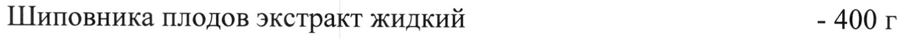
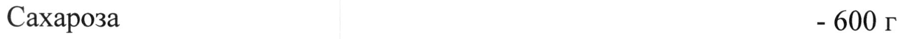
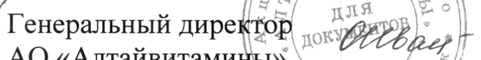

# Шиповника плодов экстракт — внутрь

- Препарат: Холосас® (сироп;)
- АТХ: A05AX
- Источник: ГРЛС, инструкция по медицинскому применению, РУ ЛСР-003841/09, файл от 2022-11-08 (https://grls.rosminzdrav.ru/Grls_View_v2.aspx?routingGuid=39c12ff5-8660-47fc-ad4e-c561a311e077)
- Распознано автоматически (OCR): 3 из 3 стр.
- Инструкция к другому РУ того же препарата: ЛСР-003841/09 (национальное РУ, переоформленное по правилам ЕАЭС, решение от 12.10.2022). Текст может быть старше действующего
- Сомнительных строк после OCR: 3 (см. раздел «Проверка распознавания»)

## Общие сведения

Mp Wit 110322 | МИНИСТЕРСТВО ЗДРАВООХРАНЕНИЯ РОССИЙСКОЙ ФЕДЕРАЦИИ
ИНСТРУКЦИЯ ПО МЕДИЦИНСКОМУ ПРИМЕНЕНИЮ ЛЕКАРСТВЕННОГО ПРЕПАРАТА
Холосас” Регистрационный номер:
Торговое наименование: Холосас® Группировочное наименование: Шиповника плодов экстракт
© Лекарственная форма: Сироп Состав на 1000 г:
Активный компонент:
Шиповника плодов экстракт жидкий - 400 г
© (с содержанием суммы органических кислот в пересчете на яблочную кислоту не менее 2,5 %)
Вспомогательное вещество:
Сахароза - 600 г Описание ©, Густая сиропообразная жидкость, темно-коричневого цвета, с характерным запахом.
Фармакотерапевтическая группа Желчегонное средство растительного происхождения.
Код ATX: А05АХ Фармакологические свойства
Препарат обладает желчегонным действием, обусловленным, главным образом, содержанием флавоноидов.

## 4.1. Показания к применению

В комплексной терапии пациентов с хроническим некалькулезным холецис1 титом и хроническим гепатитом.
В комплексной терапии пациентов с хроническим некалькулезным холецис1 титом и хроническим гепатитом.

## 4.3. Противопоказания

Гиперчувствительность к компонентам препарата, беременность, период лактации, детский возраст до 12 лет.
Гиперчувствительность к компонентам препарата, беременность, период лактации, детский возраст до 12 лет.
Препарат не рекомендован пациентам с редкой — врожденной непереносимостью фруктозы, глюкозо-галактозной — мальабсорбцией, сахаразно-изомальтазной недостаточностью.

## 4.3. С осторожностью

Сахарный диабет (препарат содержит сахар).
Сахарный диабет (препарат содержит сахар).

## 4.6. Применение при беременности и в период грудного вскармливания

- Препарат противопоказан во время беременности и кормления грудью.

## 4.2. Способ применения и дозы

Внутрь, за 30 мин до еды. Взрослым и детям старше 12 лет — по 1 ч. ложке
Внутрь, за 30 мин до еды. Взрослым и детям старше 12 лет — по 1 ч. ложке
(5 мл) 2-3 раза в день. Курс лечения 3-4 недели.

## 4.8. Побочное действие

© Возможны аллергические реакции, изжога.

## 4.9. Передозировка

Не выявлена.
Не выявлена.

## 4.5. Взаимодействие с другими лекарственными средствами

© Сведения отсутствуют.

## 4.4. Особые указания

Холосас® сироп содержит сахар, поэтому прием лекарственного средства не рекомендован пациентам с редкой врожденной непереносимостью фруктозы, глюкозо-галактозной мальабсорбцией, сахаразно-изомальтазной недостаточностью. Принимать с осторожностью пациентам с сахарным диабетом.
Холосас® сироп содержит сахар, поэтому прием лекарственного средства не рекомендован пациентам с редкой врожденной непереносимостью фруктозы, глюкозо-галактозной мальабсорбцией, сахаразно-изомальтазной недостаточностью. Принимать с осторожностью пациентам с сахарным диабетом.
Разовая доза (5 мл) содержит 0,34 хлебных единиц (ХЕ).

## 4.7. Влияние на способность управлять транспортными средствами, механизмами

Препарат не влияет на способность управлять транспортом или заниматься

другими потенциально опасными видами деятельности, требующими повышенной концентрации внимания и быстроты психомоторных реакций.

## 6.5. Форма выпуска

Сироп.
Сироп.
По 90 мл, 95 мл во флаконы темного стекла или по 215 мл в бутылки или флаконы темного стекла. Флакон или бутылку вместе с инструкцией по применению помещают в пачку из картона.

## 6.4. Условия хранения

Хранить при температуре не выше 15 °С.
Хранить при температуре не выше 15 °С.
Хранить в недоступном для детей месте.
- Срок годности 3 года. Не применять после истечения срока годности.
Условия отпуска Отпускают без рецепта.
| Владелец регистрационного удостоверения/Производитель/Организа-
~ ция, принимающая претензии потребителей
АО «Алтайвитамины»
659325, Россия, Алтайский край, г. Бийск, ул. Заводская, д. 69
Телефон: (3854) 338-719, 326-948 Факс: (3854) 326-943 бятаА с и. > [5 ыы длЯ \© о \\ тр р en wTIDB | * |
Г генеральный директор 0% PP,» | AO «Алтайвитамины» \ Г 4) Балушкин А.Ф.
о, БОСС a
## Проверка распознавания

Страницы-сканы распознаны автоматически. В 3 строках с дозировками цифры могли распознаться с ошибкой — сверьте с вырезкой из оригинала:

- стр. 1: «Шиповника плодов экстракт жидкий - 400 г» — низкая уверенность: «400» (76)  
  
- стр. 1: «Сахароза - 600 г» — низкая уверенность: «600» (50)  
  
- стр. 3: «Г енеральный директор 0% PP,» |» — низкая уверенность: «0%» (11); повторное чтение: «Генеральный директор cy) |»  
  
