# Эволокумаб — парентерально

- Препарат: Репата (раствор для подкожного введения;)
- АТХ: C10AX13
- Источник: ГРЛС, инструкция по медицинскому применению, РУ ЛП-003574, файл от 2024-09-23 (https://grls.rosminzdrav.ru/Grls_View_v2.aspx?routingGuid=0936e208-119c-4824-b55b-9e8214d95308)
- Распознано автоматически (OCR): 35 из 35 стр.
- Инструкция к другому РУ того же препарата: ЛП-003574 (национальное РУ, переоформленное по правилам ЕАЭС, решение от 03.09.2024). Текст может быть старше действующего
- Сомнительных строк после OCR: 34 (см. раздел «Проверка распознавания»)

## Общие сведения

МИНИСТЕРСТВО ЗДРАВООХРАНЕНИЯ РОССИЙСКОЙ ФЕДЕРАЦИИ
ИНСТРУКЦИЯ ПО МЕДИЦИНСКОМУ ПРИМЕНЕНИЮ ЛЕКАРСТВЕННОГО
ПРЕПАРАТА | РЕПАТА Регистрационный номер: ЛП-003574
Торговое наименование: Репата Международное непатентованное наименование: эволокумаб

## 3. Лекарственная форма

раствор для подкожного введения.
раствор для подкожного введения.
| (. : Состав | Каждая предварительно заполненная шприц-ручка (ПЗШР) содержит:
Действующее вещество: эволокумаб — 140 мг.
Вспомогательные вещества: пролин— 25мг, уксусная кислота ‘ледяная— 1,2 мг, полисорбат 80 — 0,10 мг, натрия гидроксид - 4.5. до рН 5,0, вода для инъекций — 4.5. до 1 мл. |
| Описание | Прозрачная или опалесцирующая жидкость, от бесцветного до желтоватого цвета;
свободная от механических включений.
( | Фармакотерапевтическая группа Другие препараты, влияющие на липидный обмен. Моноклональные антитела.
Код ATX: C10AX13 Фармакологические свойства

## 5.1. Фармакодинамика

Механизм действия Эволокумаб селективно связывается с PCSK9 и препятствует связыванию циркулирующей PCSK9 с рецепторами липопротеинов низкой плотности (Р-ЛИНП) на поверхности гепатоцитов, тем самым предотвращая РСЗК9-опосредованную деградацию
Р-ЛИНП. Повышение содержания печеночных Р-ЛИНИ приводит к соответствующему снижению концентрации холестерина липопротеинов низкой плотности ‘(XC-JIITHIT) в сыворотке крови.
Фармакодинамические эффекты В ходе клинических исследований у пациентов с первичной гиперхолестеринемией и смешанной дислипидемией эволокумаб снижал концентрации несвязанной PCSK9,
ХС-ЛИНП, XC, AnoB, ХС-не-ЛИВИ, ХС/ХС-ЛИВП, AnoB/AnoAl, ХС-ЛПОНП, ТГ и
JIn(a), а также повышал концентрации ХС-ЛПВП и AnoA1.
Однократное подкожное введение 140 мг или 420 мг эволокумаба через 4 часа обеспечивало максимальное подавление циркулирующей несвязанной PCSK9 с последующим снижением ХС-ЛИНИ, концентрация которого в среднем достигала минимума на 14 и 21 день соответственно. Изменения концентрации несвязанной PCSK9 и сывороточных липопротеинов были обратимы после прекращения терапии
_ у эволокумабом. Не отмечено повышения концентраций несвязанной PCSK9 или ХС-ЛИНИ выше исходной концентрации в период вымывания эволокумаба. Это позволяет предположить, что во время лечения компенсаторные механизмы по увеличению выработки РСЗК9 и ХС-ЛИНП не активируются.
Схемы терапии с подкожным введением 140 мг 1 раз в 2 недели и 420 мг 1 раз в месяц были эквивалентны по среднему снижению ХС-ЛИНИ (среднее значение через 1012 недель), концентрация которого снижалась на 57-72 % от исходного значения по сравнению с плацебо. Лечение эволокумабом привело к аналогичному снижению ХСЛИНП при применении в виде монотерапии или в комбинации с другими гиполипидемическими средствами.
Клиническая эффективность и безопасность
<) Клиническая эффективность при первичной гиперхолестеринемией и смешанной дислипидемией
В результате терапии эволокумабом на неделе 1 было достигнуто снижение концентрации
| ХС-ЛИНП приблизительно на 55-75 %, которое сохранялось при долгосрочной терапии.
| Максимальный ответ достигался, как правило, через 1-2 недели при использовании режима 140 мг 1 раз в 2 недели и 420 мг 1 раз в месяц. Эволокумаб был эффективен во всех подгруппах по сравнению с плацебо и эзетимибом при отсутствии значимых различий между отдельными подгруппами, выделенными в зависимости от возраста,
| расы, пола, географического региона, индекса массы тела, категории риска по данным
Национальной образовательной программы по холестерину, текущего статуса курения, исходных факторов риска ишемической болезни сердца (ИБС), наличия ранней ИБС в семейном анамнезе, статуса толерантности к глюкозе (т.е. сахарный диабет 2 типа,
А метаболический синдром или отсутствие обрих состояний) “‘артериальной“ гинертензии, дозы и интенсивности терапии статинами, исходной концентрации несвязанной PCSK9,
ХС-ЛИНП и триглицеридов.
У 80-85 % всех пациентов с первичной гиперлипидемией, получавших эволокумаб в любой дозировке, наблюдалось снижение концентрации ХС-ЛПНП на > 50 % в среднем через 10-12 недель терапии. До 99 % пациентов, которые получали эволокумаб в любой дозе, достигали концентрации ХС-ЛИНП <2,6 ммоль/л, и до 95% достигали концентрации ХС-ЛИНП < 1,8 ммоль/л в среднем через 10-12 недель терапии.
Применение в комбинации со статином или со статином и другими гиполипидемическими средствами |
Исследование LAPLACE-2 являлось исследованием длительностью 12 недель, в которое было включено 1896 пациентов с первичной гиперхолестеринемией или смешанной
< дислипидемией.
Препарат Репата обеспечивал достоверное снижение концентрации ХС-ЛИНИП до средних | значений через 10-12 недель относительно исходного уровня по сравнению с плацебо в группах розувастатина и симвастатина и по сравнению с плацебо и эзетимибом в группе аторвастатина (р < 0,001). Препарат Репата обеспечивал достоверное снижение ХС, АпоВ,
ХС-не-ЛИВП, ХС/ХС-ЛПВП, AnoB/AnoA1, ХС-ЛПОНП, ТГ и Jin(a), а также повышение концентрации ХС-ЛПВИП (среднее значение через 10-12 недель относительно исходного уровня) по сравнению с плацебо в группах розувастатина и симвастатина (р < 0,05) и достоверно снижал концентрации XC, AnoB, ХС-не-ЛИВП, ХС/ХС-ЛПВП, АпоВ/АпоА1 и JIn(a) по сравнению с плацебо и эзетимибом в группе аторвастатина (р < 0,001).
Исследование RUTHERFORD-2 являлось исследованием длительностью 12 недель, в
_ к которое было включено 329 пациентов с гетерозиготной семейной гиперхолестеринемией, получавших гиполипидемическую терапию. Препарат Репата достоверно снижал концентрацию ХС-ЛИНИ до средних значений через 10-12 недель относительно исходного уровня по сравнению с плацебо (р < 0,001). Препарат Репата значимо снижал
ХС, АпоВ, ХС-не-ЛПВП, ХС/ХС-ЛПВП, АпоВ/АпоА1, ХС-ЛПОНП, ТГ и JIn(a), а также повышал концентрации ХС-ЛИВИ и AnoAl до средних значений на 10-12 неделе относительно исходного уровня по сравнению с плацебо (р < 0,05).
Пациенты с непереносимостью статинов Исследование GAUSS-2 являлось исследованием длительностью 12 недель, в которое было включено 307 пациентов с полной непереносимостью статинов или непереносимостью эффективной дозы статинов. Препарат Репата значимо снижал
ХС-ЛИНП по сравнению с эзетимибом (р < 0,001). Препарат Репата значимо снижал XC,
АпоВ, ХС-не-ЛИВИ, ХС/ХС-ЛПВИ, АпоВ/АпоА1 и Лца)’до’средних значений ‘Ha 10 и 12 неделе относительно исходного уровня по сравнению с эзетимибом (р < 0,001).
Лечение в отсутствии статинов Исследование MENDEL-2 являлось исследованием препарата Репата длительностью 12 недель, в котором приняли участие 614 пациентов с первичной гиперхолестеринемией и смешанной дислипидемией. Препарат Репата значимо снижал ХС-ЛИНИ до средних значений через 10 и 12 недель относительно исходного уровня по сравнению с плацебо и эзетимибом (р< 0,001). Препарат Репата значимо снижал ХС, AnoB, ХС-не-ЛИВП,

XC/XC-JINBU, АпоВ/АпоА1 и Ли(а) до средних значений через 10 и 12 недель относительно исходного уровня по сравнению с плацебо и эзетимибом (р < 0,001).
Эффективность длительной терапии при первичной гиперхолестеринемии и смешанной дислипидемии :

CS Исследование DESCARTES являлось исследованием длительностью 52 недели, в которое было включено 901 пациент с гиперлипидемией, получавшие только диету, аторвастатин или комбинацию аторвастатина и эзетимиба. Применение препарата Репата в дозе 420 мг 1 раз в месяц обеспечивало достоверное снижение концентрации ХС-ЛИНП через 52 недели относительно исходного уровня по сравнению с плацебо (р < 0,001). Эффекты лечения сохранялись в течение 1 года, о чем свидетельствует снижение концентрации
ХС-ЛИНП с 12 до 52 недели. На фоне гиполипидемической терапии, оптимизированной по концентрации ХС-ЛИНИ и сердечно-сосудистому риску, отмечалось постоянное снижение концентрации ХС-ЛПННИ в течение 52 недель относительно исходного уровня по сравнению с плацебо.

| Препарат Репата значимо снижал XC, AnoB, ХС-не-ЛИВП, ХС/ХС-ЛПИВП, AnoB/AnoA1,

i ХС-ЛПОНП, ТГ и JIn(a), а также повышал концентрации ХС-ЛИВП и АпоА1 на 52 неделе по сравнению с плацебо (р < 0,001).
OSLER и OSLER-2— два исследования по долгосрочной оценке безопасности и эффективности препарата Репата у пациентов, завершивших лечение в основном исследовании.
Всего в исследование OSLER было включено 1324 пациента. Препарат Репата в дозе 420 мг 1 раз в месяц значимо снижал ХС-ЛИНП через 12 недель и через 52 недели относительно исходного уровня по сравнению с контролем (номинальное р < 0,001).
Эффекты лечения сохранялись в течение 272 недель, о чем свидетельствует снижение концентрации ХС-ЛИНИ с 12-й недели в основном исследовании до 260-й недели в открытом дополнительном исследовании. Всего в исследование OSLER-2 был включен 3 681 пациент. Применение препарата Репата обеспечивало достоверное снижение

концентрации ХС-ЛИНИ через 12 недель и через 48 недель относительно“ исходного уровня по сравнению с контролем (номинальное р< 0,001). Эффекты лечения сохранялись, о чем свидетельствует снижение концентрации ХС-ЛИНП с 12-й недели до
| 104-й недели в открытом дополнительном исследовании. Применение препарата Репата
| обеспечивало достоверное снижение концентраций XC, AnoB, ХС-не-ЛИВП, XC/XCЛИВИИ, АпоВ/АпоА1, ХС-ЛПОНП, ТГ и Лц(а), а также увеличивал ХС-ЛИВП и AnoAl относительно исходного уровня на 52-й неделе в исследовании OSLER и на 48-й неделе в исследовании OSLER-2 по сравнению с контролем (номинальное р < 0,001). ХС-ЛИНП и другие параметры липидного обмена вернулись к исходным значениям в течение 12 недель после отмены препарата Репата в начале исследования OSLER или OSLER-2 без признаков рикошета.
TAUSSIG — продленное исследование длительностью 5 лет для оценки долгосрочной
ОА безопасности и эффективности препарата Репата, применяемого в качестве дополнения к другой гиполипидемической терапии у пациентов с тяжелой семейной гиперхолестеринемией (СГХС), включая гомозиготную семейную гиперхолестеринемию.
Всего в исследование TAUSSIG были включены 194 пациента с тяжелой семейной гиперхолестеринемией (не-ГоСГХС) и 106 пациентов с гомозиготной семейной гиперхолестеринемией. Все пациенты в исследовании первоначально получали препарат
Репата в дозе 420 мг 1 раз в месяц, за исключением тех, кто получал аферез липидов на момент включения в исследование; эти пациенты начинали получать препарат Репата с дозы 420 мг 1 раз в 2 недели. Частота дозирования у пациентов, не получающих аферез, могла повышаться до 420 мг 1 раз в 2 недели в зависимости от ответа концентраций
ХС-ЛИНПИ и PCSK9. Длительное применение препарата Репата обеспечило стойкий oS терапевтический эффект, о чем свидетельствовало снижение концентрации ХС-ЛИНИ у пациентов с тяжелой семейной гиперхолестеринемией (не-ГоСГХС).
Изменение других параметров липидного обмена (ХС, AnoB, ХС-не-ЛИВИ, XC/XCЛИВИИ и AnoB/AnoA1) также указывало на стойкий эффект длительного применения препарата Репата у пациентов с тяжелой семейной гиперхолестеринемией (не-ГоСГХС).
Лечение гетерозиготной семейной гиперхолестеринемии у детей
HAUSER-RCT — это рандомизированное многоцентровое плацебо-контролируемое двойное слепое — исследование, проводившееся в параллельных — группах, продолжительностью 24 недели с участием 158 детей в возрасте от 10 лет включительно и младше 18 лет с гетерозиготной семейной гиперхолестеринемией. Пациенты должны были придерживаться диеты с низким содержанием жиров и получать оптимизированную базовую гиполипидемическую терапию (терапию статинами в оптимальной дозе, не требующей повышения). Включенные в исследование пациенты были рандомизированы в
„ соотношении 2:1, и один раз в месяк на протяжении 24 недель им подкожно вводили либо препарат Репата в дозе 420 мг, либо плацебо.
| Первичной конечной точкой эффективности в данном исследовании считалось
| процентное изменение концентрации ХС-ЛИНП через 24 недели относительно исходного
| уровня. Разница средних значений процентного изменения концентрации ХС-ЛИНП через 24 недели относительно исходного уровня между применением препарата Репата и плацебо составила 38% (95% ДИ: 45, 31%; р< 0,0001). Стандартная ошибка (SE)
среднего значения концентрации ХС-ЛИНИ, рассчитанного методом наименьших квадратов, через 24 недели уменьшилась в группе применения препарата Репата
(р< 0,0001) на 44% (2%) относительно исходного уровня, а в группе применения плацебо — на 6% (3 %). Среднее абсолютное значение концентрации ХС-ЛИНИ через
Na 24 недели составило 2,7 ммоль/л (104 мг/дл) в группе применения препарата Репата и 4,5 ммоль/л (172 мг/дл) в группе применения плацебо. По результатам первой процедуры анализа, проведенной через 12 недель после оценки исходных показателей, наблюдалось снижение концентрации ХС-ЛИНЦ, которое сохранялось на протяжении всего исследования.
Вторичной конечной точкой в данном исследовании считалось среднее процентное изменение концентрации ХС-ЛИНП через 22 и 24 недели относительно исходного уровня, где концентрация ХС-ЛИНИ на 22 неделе отражает пиковое значение, а на 24 неделе — минимальное значение концентрации при подкожном введении препарата один раз в месяц, что дает представление об усредненном по времени действии препарата Репата на
| протяжении всего периода между его введениями. Разница средних значений процентного io) изменения концентрации ХС-ЛПНП, рассчитанных методом наименьших квадратов, через 22 и 24 недели относительно исходного уровня при применении препарата Репата и плацебо составила 42 % (95 % ДИ: 48 %, 36 %; р < 0,0001). Дополнительную информацию см. в таблице 1.
Таблица 1. Терапевтический эффект препарата Penara но равнению” ®нлацебо у детей с гетерозиготной семейной гиперхолестеринемией — среднее процентное изменение через 24 недели относительно исходного уровня (%; 95 % ДИ)
| _ coe . Отношение | .
a XC- ХС-не- .| Отношение Исследование Режим лини ЛИВИИ AnoB XC/IXC- | дпов/АпоА1 a дозирования (%) (%) (%) JOIBIT (%)
reCTXC (N = 104) 311 (-41,8, -28,3) | (-38,8, -26,1)| (-36,4, -24,2) | (-43,0, -29,8)
QM — 1 pa3 в месяц (подкожно); ДИ — доверительный интервал; ХС-ЛИНП — холестерин липопротеинов низкой плотности; ХС-ЛИВП — холестерин липопротеинов высокой плотности; АпоВ — аполипопротеин В; ApoAl — аполипопротеин Al; ХС — общий холестерин
Все скорректированные значения р < 0,0001
N— количество рандомизированных и получивших дозу препарата пациентов, входящих в выборку для полного анализа ;
a HAUSER-OLE— это открытое неконтролируемое многоцентровое исследование
NU “ | препарата Репата продолжительностью 80 недель с участием 150 детей в возрасте от 10 по 17 лет с гетерозиготной семейной гиперхолестеринемией (геСГХС), перешедших из исследования HAUSER-RCT, а также 13 новых пациентов детского возраста с гомозиготной семейной гиперхолестеринемией (гоСГХС). Пациенты должны были придерживаться диеты с низким содержанием жиров и получать базовую гиполипидемическую терапию. Все пациенты с геСГХС, участвовавшие в данном исследовании, получали препарат Репата подкожно в дозе 420 мг 1 раз в месяц (медиана продолжительности воздействия препарата: 18,4 месяца). Среднее значение (SE)
процентного изменения концентрации ХС-ЛИНИ относительно исходного уровня составило -44,4 % (1,7%) через 12 недель, -41,0 % (2,1 %) через 48 недель и -35,2 %

‚> (2,5 %) через 80 недель. |

к ›

— Среднее значение (SE) процентного изменения других конечных точек, связанных с липидами, через 80 недель относительно исходного уровня составило -32,1 % (2,3 %) для
ХС-не-ЛПИВП, -25,1 % (2,3 %) для АпоВ, -28,5 % (2,0 %) для отношения ХС/ХС-ЛПВИ,
-30,3 % (2,2 %) для отношения АпоВ/АпоА1 и -24,9 % (1,9 %) для ХС.

Лечение гомозиготной семейной гиперхолестРринемии
Исследование TESLA являлось исследованием длительностью 12 недель с участием 49 пациентов, страдавших гомозиготной семейной гиперхолестеринемией, в возрасте от 12 до 65 лет. Применение препарата Репата в дозе 420 мг 1 раз в месяц в качестве дополнения к другим видам гиполипидемической терапии (например, статинам, секвестрантам желчных кислот) значимо снижало ХС-ЛИНП и AnoB через 12 недель по сравнению с плацебо (р < 0,001). Изменения других параметров липидного обмена (XC,
ХС-не-ЛИВП, ХС/ХС-ЛИВП и AnoB/AnoAl) также указывали на терапевтический эффект применения препарата Репата у пациентов с гомозиготной семейной гиперхолестеринемией. |
| Эффективность длительной терапии при гомозиготной семейной гиперхолестеринемии
В исследовании TAUSSIG длительное применение препарата Репата обеспечивало
(_. стойкий терапевтический эффект, о чем свидетельствует снижение концентрации
ХС-ЛИНИ приблизительно на 20-30% у пациентов с гомозиготной семейной гиперхолестеринемией, которые не проходили аферез, и приблизительно на 10-30% у пациентов с гомозиготной семейной гиперхолестеринемией на фоне афереза. Изменения
| других параметров липидного обмена (ХС, АпоВ, ХС-не-ЛИВП, ХСХС-ЛИВП и
| AnoB/AnoA1) также указывали Ha стойкий эффект длительного применения препарата
Репата у пациентов с гомозиготной семейной гиперхолестеринемией. Снижение концентрации ХС-ЛИНИ и изменения других параметров липидного обмена у 14 подростков (в возрасте от 12 лет включительно и младше 18 лет) с гомозиготной
| ;
семейной гиперхолестеринемией сопоставимы с таковыми в общей популяции пациентов с данной патологией.
C) HAUSER-OLE — это открытое неконтролируемое многоцентровое исследование продолжительностью 80 недель с участием 12 пациентов с гомозиготной семейной гиперхолестеринемией в возрасте от 10 лет включительно и младше 18 лет, проводимое с целью оценки безопасности, переносимости и эффективности препарата Репата, применяемого для снижения концентрации ХС-ЛИНП, у детей с гоСГХС. Пациенты должны были придерживаться диеты с низким содержанием жиров и получать базовую гиполипидемическую терапию. Все пациенты, принимавшие участие в данном исследовании, получали препарат Репата подкожно в дозе 420 мг 1 раз в месяц. Медиана
(Q1, Q3) концентрации ХС-ЛИНП на момент начала исследования составляла 10,3 (8,9;
12,3) ммоль/л (398 (343, 475) мг/дл). Медиана (01, 03) процентного изменения концентрации ХС-ЛИНП через 80 недель относительно исходного уровня составила
1 минус 14% (-41, 4). По результатам первой процедуры анализа, проведенной через 12 недель, наблюдалось снижение концентрации ХС-ЛИНН; ‘которое "сохранялось на протяжении всего исследования, при этом медиана (01, Q3) снижения концентрации варьировалась от 12% (-3, 32) до 15% (-4, 39). Дополнительную информацию см. в таблице 2.
Таблица 2. Терапевтический эффект эволокумаба по сравнению с плацебо у пациентов с гомозиготной семейной гиперхолестеринемией — медиана (01, Q3)
| процентного изменения через 80 недель относительно исходного уровня
В | | Отношение .
| : | Отношение , т Режим ХС-ЛИНИ ХС-не-ЛИВИ |АпоВ XC/XC-
| Исследование 7 AnoB/AnoAl .
| - =, | Дозирования | (%)`. (%) (A) JOIBII . ‘, | р .” - - _ р | ` "о у : (%) | р
HAUSER-OLE -19,1 420мг ОМ | -14,3 -13 -3,7 3
- (лети ° (N= 12) (-40,6, 3,5) (-40,7, 2,7) (333, (-41,6, 7,6) | (-35,7, 9,3)
UU roCI'XC) 2? > 3°93 > 11,6) >> 3 3°93 >
QM — 1 раз в месяц (подкожно); ХС-ЛИНИ — холестерин липопротеинов низкой плотности; ХС-ЛИВП — холестерин липопротеинов высокой плотности; АпоВ — аполипопротеин В; ApoAl— аполипопротеин Al; ХС— общий холестерин
№ — количество рандомизированных и получивших дозу препарата пациентов, входящих в выборку ANA промежуточного анализа
Эффективность при атеросклеротических заболеваниях
| Влияние препарата Репата в дозе 420мг [раз в месяц у пациентов с атеросклеротическими заболеваниями, измерявшееся с помощью внутрисосудистого ультразвукового исследования (ВСУЗИ), оценивалось в рамках 78-недельного исследования с участием 968 пациентов с ишемической болезнью сердца на фоне стабильной оптимальной терапии статинами. Препарат Репата уменыпал как
(_ , относительный объем атеромы (PAV; 1,01% [95% ДИ 0,64—1,38], р < 0,0001), так и общий объем атеромы (ТАУ; 4,89 мм? [95% ДИ 2,53, 7,25], р < 0,0001) по сравнению с плацебо.
Регрессия атеросклеротических поражений согласно данным РАУ наблюдалась у 64,3 %
(95 % ДИ 59,6, 68,7) и 47,3 % (95% ДИ 42,6, 52,0) пациентов, получавших препарат Репата или плацебо соответственно. При измерении ТАУ регрессия атеросклеротических поражений наблюдалась у 61,5 % (95% ДИ 56,7, 66,0) и 48,9 % (95% ДИ 44,2, 53,7)
пациентов, получавших препарат Репата или плацебо соответственно. В исследовании не изучалась корреляция между регрессией атеросклеротического заболевания и частотой сердечно-сосудистых событий.
Влияние на морфологию атеросклеротических бляшек в коронарных артериях
Влияние препарата Репата, применяемого в дозе 420 мг 1 раз в месяц на фоне терапии
| статинами в максимально переносимой дозе, Ha атеросклеротические бляшки в
| |

коронарных артериях оценивалось с помощью оптической’ че отерентной томографии
(ОКТ) в ходе двойного слепого рандомизированного плацебо-контролируемого исследования, продолжительностью 52 недели с участием взрослых пациентов с острым коронарным синдромом без подъема сегмента ST (ОКСби$Т). Препарат Репата вводился в течение 7 дней от OKCOnuST. Среднее значение абсолютного изменения минимальной толщины фиброзной капсулы (ТФК) в соответствующем сегменте артерии относительно исходного уровня, рассчитанное методом наименьших квадратов (95% ДИ) (первичная конечная точка), увеличилось относительно исходного уровня на 42,7 мкм (32,4, 53,1) в группе применения препарата Репата и на 21,5 мкм (10,9, 32,1) в группе применения плацебо, что больше на 21,2 мкм (4,7, 37,7) по сравнению с плацебо (р = 0,015; разница 38 % (р = 0,041)). Данные, полученные для вторичной конечной точки, свидетельствуют о различиях в значениях для групп лечения, в том числе об изменении средней

(> минимальной ТФК (увеличении на 32,5 мкм (12,7, 52,4); p=0,016) и абсолютном изменении значения максимальной липидной дуги (-26° (-49,6, -2,4); p = 0,041).
Снижение риска сердечно-сосудистых событий у взрослых с диагностированными сердечно-сосудистыми заболеваниями, обусловленными атеросклерозом
Исследование результатов терапии препаратом Репата (FOURIER) представляло собой рандомизированное, двойное слепое исследование, основанное на оценке целевых событий, в котором приняли участие 27 564 пациента в возрасте от 40 до 86 лет (средний возраст 62,5 года) с установленным атеросклеротическим сердечно-сосудистым заболеванием; 81 % имели предшествующий инфаркт миокарда (ИМ), 19 % — инсульт и 13 % — заболевания периферических артерий. Более 99 % пациентов получали терапию статинами средней и высокой интенсивности и, по крайней мере, еще одно сердечно-

М сосудистое лекарственное средство, например антитромбоцитарные препараты, бетаблокаторы, ингибиторы ангиотензинпревращающего фермента (АПФ) или блокаторы рецепторов ангиотензина; медианная (01, Q3) исходная концентрация ХС-ЛИНИ | составляла 2,4 ммоль/л (2,1, 2,8). Абсолютный сердечно-сосудистый риск был сбалансирован между группами лечения: в дополнение к индексному событию у всех пациентов отмечались по крайней мере 1 основной или 2 малозначительных фактора сердечно-сосудистого риска; 80 % имели артериальную гипертензию, 36 % сахарный диабет и 28 % ежедневно курили. Пациенты были рандомизированы в соотношении 1:1 и получали либо препарат Репата (140 mr 1 раз в 2 недели или 420 мг 1 раз в месяц), либо соответствующее плацебо; средняя продолжительность наблюдения за пациентом составила 26 месяцев.

На протяжении всего исследования наблюдалось значимое снижение ‘концентрации
ХС-ЛИНП, при этом медиана диапазона XC-JIMHII достигала 0,8-0,9 ммоль/л при каждой оценке; 25 % пациентов достигли концентрации ХС-ЛИНП менее 0,5 ммоль/л. Несмотря на достигнутый очень низкий уровень ХС-ЛИНП, новых проблем с безопасностью не наблюдалось (см. раздел «Побочное действие»); частота новых случаев сахарного диабета и когнитивных нарушений была сопоставимой у пациентов с ХС-ЛИНП < 0,65 ммоль/л и с более высокой концентрацией ХС-ЛИНП.
Препарат Репата значимо снизил риск сердечно-сосудистых событий, которые определялись как комбинированная конечная точка, включавшая время до смерти от ССЗ, первого случая ИМ, инсульта, коронарной реваскуляризации или госпитализации по поводу нестабильной стенокардии; кривые Каплана — Мейера для первичных и ключевых вторичных комбинированных конечных точек разделились приблизительно через
И 5 месяцев. Относительный риск комбинированной конечной точки МАСЕ (смерть от ССЗ,
ИМ или инсульт) значимо снизился на 20 %. Эффект лечения был сопоставим во всех
| подгруппах (включая группы по возрасту, типу заболевания, исходной концентрации
ХС-ЛИНП, исходной интенсивности терапии статинами, применению эзетимиба и наличию сахарного диабета) и оценивался по снижению риска инфаркта миокарда, инсульта и коронарной реваскуляризации; не отмечались существенные различия в отношении смертности от ССЗ или общей смертности, однако исследование не было предназначено для выявления такого различия.
Исследование FOURIER-OLE (исследование | и исследование 2) состояло из двух открытых неконтролируемых многоцентровых дополнительных исследований, проводимых для оценки долгосрочной безопасности, переносимости и эффективности
(> препарата Репата, применяемого у пациентов с диагностированным сердечно-сосудистым заболеванием, завершивших участие в исследовании FOURIER. Включенные в исследование пациенты получали препарат Репата в дозе 140 мг 1 раз в 2 недели или в дозе 420 мг 1 раз в месяц на протяжении приблизительно 5 лет, а также продолжали получать базовую терапию статинами средней (22,2%) или высокой (74,8 %)
интенсивности. Из 5031 пациента, получившего как минимум одну дозу препарата Репата в исследовании 1, 2499 пациентов получали препарат Репата, а 2532 пациента получали плацебо в исследовании FOURIER. Из 1599 пациентов, получивших как минимум одну дозу препарата Репата в исследовании 2, 854 пациента получали препарат Репата, а 745 пациентов получали плацебо в исследовании FOURIER. По завершении исследования | и исследования? у пациентов, получавших препарат Репата в исследовании FOURIER, общая продолжительность воздействия этого препарата
| составила соответственно 8,4 года (медиана 85,4 месяца) и 8,0 лет ‘(медиана 80,2 месяца), а у пациентов, получавших плацебо, —— соответственно 5,25 года (медиана 60,0 месяца) и 4,9 года (медиана 55,1 месяца).
В общей сложности в исследованиях 1 и2у 72,4 % пациентов (п = 4802) был достигнут самый низкий с момента оценки исходных значений уровень концентрации ХС-ЛИНИ —
| < 25 мг/дл (0,65 ммоль/л), у 87,0 % пациентов (п = 5765) уровень концентрации ХС-ЛИНП составил < 40 мг/дл (1,03 ммолы/л), ау 11,9 % пациентов (п = 792) уровень концентрации
ХС-ЛПНИ с момента оценки исходных значений на всем протяжении исследования составлял >40 мг/дл (1,03 ммоль/л). Среди пациентов, у которых с момента оценки
_ исходных значений был достигнут низкий уровень ХС-ЛПНП (< 25 мг/дл или < 40 мг/дл), в общем нежелательные явления возникали при применении препарата у 80,0% пациентов с достигнутым уровнем концентрации ХС-ЛПНПИ < 25 мг/дл и у 827% oe пациентов с достигнутым уровнем концентрации ХС-ЛИНП < 40 мг/дл; для сравнения нежелательные явления испытывали 85,0% пациентов с уровнем концентрации
ХС-ЛИНП > 40 мг/дл. Общая частота возникновения серьезных нежелательных явлений при применении препарата составила 37,7% у пациентов с достигнутым уровнем концентрации ХС-ЛИНП <25мг/дл и 40,0% у пациентов с достигнутым уровнем концентрации ХС-ЛИНП < 40 мг/дл; для сравнения у пациентов с уровнем концентрации
ХС-ЛПНП > 40 мг/дл она составила 41,5 %.
Средний процентный показатель снижения уровня концентрации ХС-ЛИНИ относительно исходного значения оставался стабильным на протяжении открытого продолжающегося исследования OLE и находился в диапазоне от 53,4 % до 59,1 % в случае исследования | и от 62,5 % до 67,2 % в случае исследования 2 независимо от группы, в которую были oe изначально рандомизированы пациенты в исследовании FOURIER. Таким образом, можно судить об уменьшении частоты возникновения установленных поисковых конечных точек в отношении сердечно-сосудистых исходов, включая смерть от сердечно-сосудистых заболеваний, инфаркт миокарда и инсульт у пациентов, получавших препарат Репата в обоих исследованиях FOURIER и FOURIER-OLE, по сравнению с пациентами, получавшими плацебо в исследовании FOURIER и препарат Репата в исследованиях
FOURIER-OLE.
В целом, в этих исследованиях He было выявлено новых данных по безопасности.
Влияние на концентрацию ХС-ЛИНИ при остром коронарном синдроме (OKC) в острой фазе
EVOPACS было 8-недельным многоцентровым двойным слепым рандомизированным плацебо-контролируемым исследованием, проводимым в одной стране с участием 308 пациентов с OKC, которым в стационарних условиях в Течение 24-72'часов ‘с момента развития симптоматики была инициирована терапия эволокумабом.
Если перед скринингом терапия пациентов не включала статины или включала статины за исключением аторвастатина в дозе 40 мг, она прекращалась и им инициировали терапию аторвастатином в дозе 40 мг один раз в сутки. Рандомизация проводилась со стратификацией пациентов по следующим параметрам: центр исследования и получение стабильной терапии статинами в течение > 4 недель перед включением в исследование.
Большинство пациентов (241 [78 %]} не получали стабильную терапию статинами в течение > 4 недель перед скринингом, и большинство (235 [76 %]) не получали терапию статинами на момент начала исследования. К 4 неделе 281 (97%) пациент получал терапию статинами высокой интенсивности. Применение эволокумаба в дозе 420 мг один раз в месяц обеспечило значительное снижение концентрации ХС-ЛИНП через 8 недель с
(_. момента начала исследования по сравнению с плацебо (р < 0,001). На 8 неделе снижение концентрации ХС-ЛИНИ относительно исходного значения в среднем (SD) составляло - 77,1 % (15,8 %) в группе приема эволокумаба и 35,4 % (26,6 %) в группе приема плацебо с разницей (95 % ДИ) средних значений, рассчитанных методом наименьших квадратов
(LS) 40,7% (36,2 %, 45,2 %). Исходные значения концентрации ХС-ЛИНИ составляли 3,61 ммолы/Л (139,5 мг/дл) в группе приема эволокумаба и 3,42 ммоль/л (132,2 мг/дл) в группе приема плацебо. Значения снижения концентрации ХС-ЛИНИ в этом исследовании согласовывались со значениями из предыдущих исследований, в рамках которых эволокумаб применялся в качестве дополнения к стабильной гиполипидемической терапии, что подтверждается значениями концентрации ХС-ЛИНИ, достигнутыми в ходе терапии к 8 неделе этого исследования (отражающими эффект eS терапии статинами высокой интенсивности в равновесном состоянии в обеих группах пациентов), которые составили 0,79 ммоль/л (30,5 мг/дл) в группе приема эволокумаба в комбинации с аторвастатином и 2,06 ммоль/л (79,7 мг/дл) в группе приема плацебо в комбинации с аторвастатином.
Эффекты эволокумаба в данной популяции пациентов соответствовали тому, что наблюдалось в предыдущих исследованиях в рамках программы клинической разработки эволокумаба, и не было замечено никаких дополнительных рисков безопасности.

## 5.2. Фармакокинетика

Абсорбция и распределение
Абсорбция и распределение
После однократного подкожного введения эволокумаба в дозе 140 мг или 420 мг здоровым взрослым добровольцам медиана максимальной концентрации в сыворотке крови достигалась через 3-4 дня. Однократное подкожное введение препарата Репата в
1 дозе 140 мг обеспечивало среднее значение Cmax (SD)*1350°(10,4) мкг/мл и“ среднее значение AUChoca (SD) 96,5 (78,7) сут х мкг/мл. Однократное подкожное введение
| препарата Репата в дозе 420 мг обеспечивало среднее значение Cmax (SD)
46,0 (17,2) мкг/мл и среднее значение АОСшс» (SD) 842 (333) сут х мки/мл. Три
| | подкожных введения препарата Репата в дозе 140мг были биоэквивалентны однократному подкожному введению препарата в дозе 420 мг. Установлено, что
| абсолютная биодоступность после подкожного введения составила 72% от
| фармакокинетических моделей.
После однократного внутривенного введения препарата Репата в дозе 420 мг средний (SD)
объем распределения в равновесном состоянии был оценен как 3,3 (0,5) л. Такой результат позволяет предположить, что эволокумаб имеет ограниченное распределение в тканях.
Биотрансформация C: . Эволокумаб представляет собой нативный иммуноглобулин и состоит только из аминокислот и углеводов; выведение с помощью печеночных метаболических механизмов маловероятна. Ожидается, что метаболизм и выведение препарата будут следовать путям клиренса иммуноглобулинов, которые приводят к их деградации до небольших пептидов и отдельных аминокислот.
Выведение Эффективный период полувыведения эволокумаба составляет от 11 до 17 дней.
У пациентов с первичной гиперхолестеринемией или смешанной дислипидемией на фоне высоких доз статинов системная экспозиция эволокумаба была несколько ниже, чем у пациентов, получающих низкие и средние дозы статинов (соотношение AUChoca 0,74
[90% ДИ 0,29; 1,9]). Повышение клиренса приблизительно на 20% частично опосредовано
{) повышением концентрации PCSK9 под действием статинов, что не оказывает отрицательного влияния на фармакодинамический эффект эволокумаба в отношении липидов. Популяционный фармакокинетический анализ не выявил значимых различий в концентрации эволокумаба в сыворотке крови у пациентов с гиперхолестеринемией
(несемейной гиперхолестеринемией или семейной гиперхолестеринемией), получающих сопутствующую терапию статинами. |
Линейность/нелинейность фармакокинетики _ После однократного внутривенного введения препарата в дозе 420 мг средний (SD)
системный клиренс оценивался как 12 (2) мл/ч. В клинических исследованиях с повторным подкожным введением препарата в течение 12 недель наблюдалось пропорциональное увеличение экспозиции при применении препарата в дозах 140 мг и более. После введения эволокумаба в дозе 140 мг 1 раз в 2 недели (Cmin (SD) 7,21 (6,6))
или 420 мг 1 раз в месяц (Cmin (SD) 11,2 (10,8)) наблюдалось “накопление “остаточного
| препарата в сыворотке крови в 2-3 раза, а равновесная остаточная концентрация в сыворотке крови достигалась через 12 недель лечения.
В течение периода 124 недель не наблюдались зависимые от времени изменения концентрации в сыворотке крови.
Нарушение функции почек Коррекция дозы у пациентов с почечной недостаточностью не требуется. Анализ данных из клинических исследований эволокумаба не выявил различий между фармакокинетикой эволокумаба у пациентов с почечной недостаточностью легкой и средней степени тяжести и фармакокинетикой у пациентов с нормальной функцией почек.
В клиническом исследовании с участием 18 пациентов с нормальной функцией почек
(расчетная скорость клубочковой фильтрации [рСКФ] >90 мл/мин/1,73 м², п = 6), тяжелой o почечной недостаточностью (рСКФ 15-29 мл/мин/1,73 м²M’, п = 6) или терминальной стадией почечной недостаточности (ТСПН) на гемодиализе (п=6) в соответствии с показателем Cmax, измеренным после однократного ‘подкожного введения 140 мг препарата, концентрация свободного эволокумаба у пациентов с тяжелой почечной недостаточностью снизилась на 30 %, ау пациентов с ТСПН на гемодиализе — на 45 %. В соответствии с показателем АЧСносл концентрация у пациентов с тяжелой почечной недостаточностью снизилась приблизительно на 24%, а у пациентов с ТСИН на гемодиализе — приблизительно на 45 %. Точная причина различий фармакокинетических показателей неизвестна, и их нельзя объяснить различиями в массе тела. При интерпретации результатов следует учитывать некоторые факторы, такие как небольшая выборка пациентов и значительная межиндивидуальная вариабельность показателей.
Показатели фармакодинамики и безопасности эволокумаба у пациентов с тяжелой.
почечной недостаточностью и ТСИН были сопоставимы с показателями пациентов с нормальной функцией почек; также не было выявлено никаких клинически значимых различий в снижении концентрации ХС-ЛИНП. Таким образом, пациентам с тяжелой | почечной недостаточностью или ТСПН на гемодиализе коррекция дозы не требуется.
Печеночная недостаточность Коррекция дозы у пациентов с легкой печеночной недостаточностью (класс A по ЧайлдПью) не требуется. Однократное подкожное введение 140 мг эволокумаба было изучено с участием 8 пациентов с легкой печеночной недостаточностью, 8 пациентов с умеренной
‚ печеночной недостаточностью‘ и 8 здоровых добровольцев. Обнаружено, что степень экспозиции эволокумаба при печеночной недостаточности была приблизительно на 4050% ниже по сравнению со здоровыми добровольцами. Тем не менее исходная активность
| PCSK9, a также степень и временной профиль нейтрализации PCSK9 были сходными у

пациентов с легкой и умеренной печеночной недостаточностью и у здоровых

добровольцев. Это обеспечивало сопоставимые сроки и степень абсолютного снижения

концентрации ХС-ЛИНП. Исследования эволокумаба с участием пациентов с тяжелой печеночной недостаточностью (класс С по Чайлд-Пью) не проводились (см. раздел
«Особые указания»).
Масса тела Масса тела служила значимой ковариатой в популяционном фармакокинетическом анализе и влияла на остаточную концентрацию эволокумаба, однако не оказывала влияния на степень снижения концентрации ХС-ЛИНП. После повторного подкожного введения препарата в дозе 140 мг 1 раз в 2 недели в течение 12 недель остаточная концентрация была на 147% выше и на 70% ниже у пациентов с массой тела 69 кг и 93 к

С) соответственно по сравнению со среднестатистическим пациентом с массой тела 81 кг.
При повторных подкожных инъекциях эволокумаба в дозе 420 мг 1 раз в месяц влияние массы тела было менее выраженным. |
Особые группы пациентов Популяционный фармакокинетический анализ показывает, что корректировка дозы по возрасту, расовой принадлежности или полу не требуется. Фармакокинетика эволокумаба зависит от массы тела, однако эта зависимость не оказывает заметного влияния на снижение ХС-ЛИНП. Следовательно, корректировать дозу в зависимости от массы тела не требуется. |
Фармакокинетика препарата Репата оценивалась у 103 детей в возрасте от 10 лет включительно и младше 18 лет с гетерозиготной семейной гиперхолестеринемией
U) (HAUSER-RCT). После подкожного введения препарата Репата в дозе 420 мг 1 раз в месяц среднее значение (SD) остаточной концентрации в сыворотке крови составило 22,4 (14,7) мкг/мл, 64,9 (34,4) мкг/мл и 25,8 (19,2) мкг/мл через 12 недель, 22 недели и 24 недели соответственно. Фармакокинетика препарата Репата оценивалась у 12 детей в возрасте от 10 лет включительно и младше 18 лет с гомозиготной семейной гиперхолестеринемией (HAUSER-OLE). После подкожного введения препарата Репата в дозе 420 мг 1 раз в месяц среднее значение (SD) остаточной концентрации в сыворотке крови составило 20,3 (14,6) мкг/мл и 17,6 (28,6) мк/мл через12 и 80недель соответственно.
| 16 |

## 4.1. Показания к применению

Диагностированные атеросклеротические сердечно-сосудистые заболевания

Препарат Репата назначается взрослым с диагностированными сердечно-сосудистыми

| заболеваниями, обусловленными атеросклерозом (инфаркт миокарда, инсульт или заболевания артерий нижних конечностей) с целью снижения риска сердечно-сосудистых осложнений посредством снижения концентрации ХС-ЛИНЦ, в дополнение к коррекции других факторов риска:

e В комбинации с максимально переносимой дозой статина или в комбинации с максимально переносимой дозой статина и другой гиполипидемической терапией;
или

e В монотерапии или в комбинации с другой гиполипидемической терапией у

| пациентов с непереносимостью статинов или имеющих противопоказания к их
| ( и применению.

Данные о влиянии препарата на концентрацию ХС-ЛИНИ, риск сердечно-сосудистых

событий, а также информация об исследуемых популяциях представлены в разделе

«Фармакодинамика».

Гиперхолестеринемия и смешанная дислипидемия

Препарат Репата назначается взрослым пациентам с первичной гиперхолестеринемией

- (гетерозиготной семейной и несемейной) или со смешанной дислипидемией, а также
` Пациентам в возрасте от 10лет и старше с гетерозиготной семейной гиперхолестеринемией в качестве дополнения к диете:

® в комбинации со статином или в комбинации со статином и другой

7 гиполипидемической терапией у пациентов, не достигающих целевых уровней
- ХС-ЛПИНИ при максимально переносимой дозе статина, или

® в монотерапии или в комбинации с другой гиполипидемической терапией у пациентов с непереносимостью статинов, или имеющих противопоказания к их применению.

Гомозиготная семейная гиперхолестеринемия

Препарат Репата назначается взрослым и детям в возрасте 10 лет и старше с гомозиготной

семейной гиперхолестеринемией в комбинации с другой гиполипидемической терапией.

## 4.3. Противопоказания

e Повышенная чувствительность к действующему веществу или любому из

вспомогательных веществ препарата, перечисленных в разделе «Состав»;

| ® Детский возраст до 10 лет при гетерозипотной семейной гиперхолестеринемии и при гомозиготной семейной гиперхолестеринемии, а также дети с другими типами гиперлипидемии (эффективность и безопасность не установлены).
С осторожностью e Тяжелая печеночная недостаточность (класс С по Чайлд-Пью) (cm. раздел «Особые указания»);
® Беременность и период грудного вскармливания (см. раздел «Применение при беременности и в период грудного вскармливания»).

## 4.6. Применение при беременности и в период грудного вскармливания

- Беременность к Данные о применении препарата Репата у беременных женшин отсутствуют или ограничены. .
В исследованиях ‘на животных не было зарегистрировано прямого или косвенного воздействия в виде репродуктивной токсичности.
Препарат Репата может применяться во время беременности, только если клиническое состояние Женщины требует лечение эволокумабом.
Грудное вскармливание Неизвестно, проникает ли эволокумаб в грудное молоко.
Нельзя исключать риск для новорожденных/младенцев, вскармливаемых грудью.
Решение об отмене препарата Репата или прекращении грудного вскармливания должно 7 приниматься Ha основании оценки пользы грудного вскармливания для ребенка и пользы р терапии для матери,
Влияние на фертильность | Отсутствуют данные о влиянии эволокумаба на фертильность у человека. Исследования на животных не выявили каких-либо эффектов на конечные точки по фертильности при значениях площади под кривой концентрация-время (AUC), значительно превышающих таковые у пациентов, получающих эволокумаб в дозе 420 мг один раз в месяц.

## 4.2. Способ применения и дозы

Перед началом терапии эволокумабом следует исключить _ вторичные причины гиперлипидемии или смешанной дислипидемии (например, нефротический синдром, _ гипотиреоз).
Перед началом терапии эволокумабом следует исключить _ вторичные причины гиперлипидемии или смешанной дислипидемии (например, нефротический синдром, _ гипотиреоз).
| Режим дозирования Первичная гиперхолестеринемия и смешанная дислипидемия (в том числе гетерозиготная семейная гиперхолестеринемия)
Взрослые и дети (в возрасте 10 лет и старше)
Рекомендуемая доза эволокумаба составляет 140 мг 1 раз в 2 недели или 420 мг 1 раз в месяц. Обе дозы являются клинически эквивалентными.
Гомозиготная семейная гиперхолестеринемия у взрослых и детей в возрасте 10 лет и старше
Начальная рекомендуемая доза составляет 420 мг 1 раз в месяц. Через 12 недель терапии при отсутствии клинически значимого ответа частота дозирования может быть увеличена до 420 мг 1 раз в 2 недели. Пациентам, которым проводят аферез, терапию можно начинать с дозы 420 мг 1 раз в 2 недели в соответствии с графиком афереза.

(_ Диагностированное атеросклеротическое сердечно-сосудистое заболевание у взрослых
Рекомендуемая доза эволокумаба составляет 140 мг 1 раз в 2 недели или 420 мг 1 раз в месяц. Обе дозы являются клинически эквивалентными.

Особые группы пациентов

Пациенты с почечной недостаточностью

Коррекция дозы у пациентов с почечной недостаточностью не требуется (см. раздел
«Фармакокинетика»).

Пациенты с печеночной недостаточностью

Коррекция дозы у пациентов с печеночной недостаточностью легкой степени тяжести не требуется. Рекомендации по лечению печеночной недостаточности средней или тяжелой степени тяжести см. в разделе «Особые указания».

‹) Пациенты пожилого возраста (> 65 лет)

Коррекция режима дозирования у пациентов пожилого возраста не требуется.

Дети

Безопасность и эффективность препарата Репата, применяемого для лечения детей в

возрасте до 10 лет с гетерозиготной семейной гиперхолестеринемией (геСГХС) и

гомозиготной семейной гиперхолестеринемией (гоСГХС), атакже детей с другими

типами гиперлипидемии, не установлены.

Способ введения

Для подкожного введения.

Эволокумаб предназначен для подкожных инъекций в область живота, бедра или плеча.

Места инъекций следует чередовать. Неследует вводить препарат в участки с чувствительной, поврежденной, покрасневшей или уплотненной кожей: Эволокумаб не должен вводиться внутривенно или внутримышечно.
Доза 140 мг должна вводиться с использованием одной предварительно заполненной шприц-ручки. Доза 420 мг должна вводиться с помощью трех предварительно заполненных шприц-ручек, которые используются последовательно в течение 30 минут.
Препарат Репата предназначен для самостоятельного введения пациентами после соответствующего обучения. Эволокумаб также может вводить другой человек, который был обучен технике выполнения инъекции.
Только для однократного применения.
Инструкция по применению Перед введением следует оценить раствор препарата. Раствор не следует вводить при a наличии включений, помутнении или изменении цвета. Чтобы избежать дискомфорта в vi месте введения, следует довести препарат до комнатной температуры (до 25°C) перед инъекцией. Следует вводить все содержимое.
| Весь неиспользованный лекарственный препарат или отходы следует утилизировать в соответствии с локальными требованиями.

## 4.8. Побочное действие

Резюме профиля безопасности
Резюме профиля безопасности
Наиболее частыми нежелательными реакциями при применении препарата в рекомендуемых дозах являются назофарингит (7,4 %), инфекция верхних дыхательных
| путей (4,6 %), боль в спине (4,4 %), артралгия (3,9 %), грипп (3,2 %) и реакции в месте
‚7 инъекции (2,2%). Профиль безопасности в популяции пациентов с гомозиготной и семейной гиперхолестеринемией соответствовал продемонстрированному в популяции пациентов с первичной гиперхолестеринемией и смешанной дислипидемией.
Табличный перечень нежелательных реакций
Нежелательные реакции, зарегистрированные в базовых контролируемых клинических исследованиях и полученные в виде спонтанных сообщений, представлены ниже в таблице 3 по системно-органным классам и по частоте встречаемости с использованием следующей классификации: очень часто (> 1/10), часто (> 1/100 до < 1/10), нечасто
(> 1/1000 до < 1/100), редко (> 1/10 000 до < 1/1000) и очень редко (< 1/10 000).
Таблица 3. Нежелательные реакции Системно-органный Нежелательные реакции | Категория частоты классе (согласно MedDRA)
Ta Инфекции верхних | Часто дыхательных путей
. Нарушения со стороны Головная боль Часто р нервной системы
Желудочно-кишечные © Тошнота Часто нарушения
Нарушения со стороны | Ангионевротический отек | Редко кожи и подкожной клетчатки
В
1 См. раздел «Описание отдельных нежелательных реакций».
| Профиль безопасности был сопоставимым у пациентов, у которых после оценки исходных значений уровень концентрации ХС-ЛПНИ составил < 25 мг/дл (0,65 ммоль/л) или
<40 мг/дл (1,03 ммоль/л), и у пациентов с более высоким уровнем концентрации
ХС-ЛПНП, измеренным после оценки исходных значений (> 40 мг/дл [1,03 ммоль/л], при медиане (01, 03) продолжительности воздействия препарата Репата 84,2 (78,1;
89,8) месяца у пациентов, продолжавших получать препарат Репата, и 59,8 (52,8;
60,3) месяца у пациентов, которые изначально получали плацебо и начали применять препарат Репата уже в открытом дополнительном исследовании. |
Описание отдельных нежелательных реакций
Реакции в месте инъекции Наиболее частыми реакциями в месте инъекции были кровоподтеки, эритема, a кровотечение, боль и отек.
| Дети Безопасность и эффективность препарата Репата, применяемого для лечения детей с гетерозиготной и гомозиготной семейной гиперхолестеринемией, были установлены.
Влияние препарата Репата оценивалось в ходе клинического исследования с участием 158 детей в возрасте от 10 лет включительно и младше 18 лет с гетерозиготной семейной гиперхолестеринемией. Новых проблем, связанных с безопасностью, обнаружено не было, а данные по безопасности, полученные для детей, были сопоставимы с известным профилем безопасности данного препарата в случае взрослых пациентов с гетерозиготной семейной гиперхолестеринемией. В рамках клинических исследований препарат Репата получили 26 пациентов в возрасте от10лет включительно и младше 18 лет с
- гомозиготной семейной гиперхолестеринемией. Различий в безопасности между детьми и
` взрослыми с гомозиготной семейной гиперхолестеринемией не наблюдалось.
Пожилые пациенты Из 18 546 пациентов, получавших эволокумаб в рамках двойных слепых клинических исследований, 7656 (41,3 %) были в возрасте > 65 лет, тогда как 1500 (8,1 %) были в возрасте > 75 лет. Различия в отношении безопасности или эффективности между данными пациентами и пациентами более молодого возраста не выявлены.
Иммуногенность В клинических исследованиях у 0,3 % пациентов (48 из 17 992 пациентов), получивших по меныпей мере одну дозу эволокумаба, наблюдался положительный результат анализа на связывающие антитела. Пациенты, у которых были выявлены связывающие антитела в сыворотке крови, проходили дополнительную оценку на наличие нейтрализующих антител. Ни у одного из пациентов нейтрализующие антитела обнаружены не были.
J Наличие связывающих эволокумаб антител не влияло Ha ‘фармакокинетичеекий' профиль, клинический ответ или безопасность эволокумаба.

В ходе клинических исследований с участием детей, получавших препарат Репата, не обнаружена выработка антител к эволокумабу.

## 4.9. Передозировка

В исследованиях на животных не отмечалось нежелательных эффектов при уровне

экспозиции, в 300 раз превышающем уровень экспозиции у пациентов, которые получали

эволокумаб в дозе 420 мг 1 раз в месяц.

Специфическое лечение при передозировке эволокумабом отсутствует. В случае

передозировки пациенту следует проводить симптоматическое лечение и обеспечивать
| a поддерживающую терапию по мере необходимости.

| Lo ;

## 4.5. Взаимодействие с другими лекарственными средствами

Исследования по оценке лекарственного взаимодействия не проводились.
В клинических исследованиях была проведена оценка фармакокинетического взаимодействия статинов с эволокумабом. У пациентов, принимавших препарат одновременно со статинами, наблюдалось приблизительно 20% увеличение клиренса эволокумаба. Такое повышение клиренса частично опосредовано повышением концентрации PCSK9 под действием статинов, что не оказывает отрицательного влияния на фармакодинамический эффект эволокумаба в отношении липидов. Коррекция дозы статинов при применении в комбинации с эволокумабом не требуется.

‚2 Исследования по оценке фармакокинетического и фармакодинамического взаимодействия

7 эволокумаба и других липидснижающих лекарственных препаратов, кроме статинов и

| эзетимиба, не проводились.

Фармацевтическая несовместимость Поскольку исследований совместимости не проводилось, лекарственный препарат не следует принимать одновременно с другими лекарственными препаратами.

## 4.4. Особые указания

Прослеживаемость В целях улучшения прослеживаемости биологических лекарственных препаратов следует точно документировать наименование и номер серии применяемого препарата.
Прослеживаемость В целях улучшения прослеживаемости биологических лекарственных препаратов следует точно документировать наименование и номер серии применяемого препарата.
Печеночная недостаточность

У пациентов с печеночной недостаточностью умеренной степенью тяжести наблюдалось

снижение общей экспозиции эволокумаба, что может уменьшить эффективность

препарата в отношении снижения ХС-ЛИНП: Таким образом, у этих пациентов необходим тщательный мониторинг.

Исследования с участием пациентов с печеночной недостаточностью тяжелой степени

тяжести (класс С по Чайлд-Пью) не проводились (см. раздел «Фармакокинетика»).

Эволокумаб следует с осторожностью назначать пациентам с тяжелой печеночной

недостаточностью.

Сухой натуральный каучук

Колначок иглы предварительно заполненной шприц-ручки содержит сухой натуральный
_— каучук (производное латекса), который может вызывать тяжелые аллергические реакции.
< Содержание натрия

Данный лекарственный препарат содержит менее 1 ммоль натрия (23 мг) в одной дозе и

поэтому может считаться как практически не содержащий натрий.

## 4.7. Влияние на способность управлять транспортными средствами, механизмами

Препарат Репата не оказывает влияния либо оказывает незначительное влияние на

способность управлять транспортным средством и работу с механизмами.

## 6.5. Форма выпуска

Раствор для подкожного введения, 140 мг/мл.

Предварительно заполненная шприц-ручка (ПЗШР) состоит из предварительно ey заполненного шприца (ПЗШ) вместимостью | Mi из стекла [ гидролитического класса со id встроенной иглой из нержавеющей стали, эластомерным колпачком и бромбутиловым

эластомерным плунжером, ламинированным фторполимером. Колпачок иглы изготовлен

из сухого натурального каучука.

Одну или две ПЗШР вместе с инструкцией по применению помещают в пачку картонную,

| снабженную картонным фиксатором.

Одну прозрачную защитную этикетку для контроля первого вскрытия наклеивают на

пачку. |

В случае вторичной упаковки на ООО «Добролек», Россия

Одну ПЗШР вместе с инструкцией по применению помещают в пачку картонную,

снабженную картонным фиксатором. |

Одну прозрачную защитную этикетку для контроля первого вскрытия наклеивают на

пачку.

‚ 24 РОО ООВ Условия хранения Хранить при температуре 2—8°С в оригинальной упаковке для защиты от действия света.
Не замораживать.

При использовании пациентом в пределах срока годности возможно однократное хранение препарата в оригинальной упаковке при температуре не выше 25°С не более 1 месяца. Не встряхивать.
Хранить в недоступном для детей месте!

## 6.3. Срок годности

, 3 года. |
, 3 года. |

-. Не применять по истечении срока годности, указанной на картонной пачке.

| < Условия отпуска © Отпускают по рецепту.
Производитель Производитель готовой лекарственной формы / фасовщик (первичная упаковка)

| Амджен Мэньюфэкчуринг Лимитед, Роуд 31, Км 24.6, Джанкос, Пуэрто-Рико, 00777,
США

| или Амджен Технолоджи (Айрлэнд) Анлимитед Компани, Поттери Роуд, Дан Лэйри, Графство

| Дублин, Ирландия.
( 2 Упаковщик (вторичная (потребительская) упаковка)
Амджен Европа Б.В., Минервум 7061, 4817 ZK Бреда, Нидерланды или
Общество с ограниченной ответственностью «Добролек» (ООО «Добролек»), Россия, 115446, г. Москва, Коломенский проезд, 13A.
Выпускающий контроль качества Амджен Технолоджи (Айрлэнд) Анлимитед Компани, Поттери Роуд, Дан Лэйри, Графство
Дублин, Ирландия или Амджен Европа Б.В., Минервум 7061, 4817 ZK Бреда, Нидерланды или
Общество с ограниченной ответственностью «Добролек» (ООО «Добролек»), Россия, 115446, г. Москва, Коломенский проезд, 13A.
| от 14.11.2023 № 23055 Держатель регистрационного удостоверения (Входящий M3 №=426589/7)
| Амджен Европа Б.В.
Минервум 7061 4817 ZK Бреда Нидерланды Организация, принимающая претензии от потребителей
ООО «Амджен», 123112, Москва, Пресненская набережная. д. 8, строение 1; этаж 7
. Телефон: +7 495 745 04 78 Факс: +7 499 995 19 65
\ = | С)
| СООТВЕТСТВУЕТ ЭКСПЕРТНОМУ ОТЧЕТУ от 14.11.2023 № 23055
Инструкция по применению:
Препарат Репата предварительно заполненная шприц-ручка (ПЗШР) однократного использования
ЗигеС Иск ПИ ОИ | Перед использованием После использования
| Серая кнопка = ИЕ 4 P sae «Старт»
21100 Срок годности 0000000 | Срок годности 0960900
| Желтое окно Окно (завершение инъекции)
Препарат Желтое защитное Желтое ойство 7 _ &— защитное Е] ва Пи yeTp
Оранжевый В | — (внутри игла)
an устройство колпачок (внутри игла)
Оранжевый колпачок снят Важно: Игла находится внутри желтого защитного устройства.
| СООТВЕТСТВУЕТ ЭКСПЕРТНОМУ ОТЧЕТУ | от 14.11.2023 № 23055
ВАЖНО ___ "ОХОДЯЩИЙ М NES epoes Ty | : = Neos

Перед применением ПЗШР Репата внимательно прочитайте следующую важную

информацию:

® Незамораживайте ПЗШР Репата и не используйте препарат, подвергавшийся заморозке.
| | e Не снимайте оранжевый колпачок с ПЗШР Репата, пока Вы не подготовились к инъекции.

® Не используйте ПЗШР Репата, если Вы уронили ее на твердую поверхность. Части ПЗШР

Репата могут быть повреждены, даже если Вы не видите повреждений.
Этап 1: Подготовка

Выньте одну ПЗШР Репата из упаковки.
|

1. — Осторожно выньте одну ПЗШР из упаковки.

2. Положите упаковку с неиспользованными ПЗШР обратно в холодильник.
| 3. Подождите по крайней мере 30 минут, пока ПЗШР не достигнет комнатной температуры для безопасного проведения инъекции.

e He пытайтесь согреть ПЗШР, используя любые источники тепла, такие как горячая вода

или микроволновая печь.

e Не оставляйте ПЗШР на прямом солнечном свете.

® Не встряхивайте ПЗШР.
| ° Не снимайте оранжевый колпачок с ПЗШР преждевременно.

_ и и и СООТВЕТСТВУЕТ ЭКСПЕРТНОМУ ОТЧЕТУ
В | Осмотрите ИЗШР Penaa, — ПЗШР Репата.
Желтое защитное устройство | (внутри игла)
| | Оранжевый колпачок на месте Окно Препарат
Убедитесь, что препарат, видимый в окне, прозрачный, от бесцветного до желтоватого цвета.
Проверьте дату окончания срока годности.
® Не используйте ПЗШР, если препарат мутный или цвет его изменен, или он содержит крупные комочки, хлопья или частицы.
о Не используйте ПЗШР, если любая из частей устройства выглядит поврежденной или разбитой.
Е Не используйте ПЗШР, если Вы уронили устройство.
e He используйте ПЗШР, если оранжевый колпачок отсутствует или неплотно закрыт.
e Не используйте ПЗШР после даты окончания срока годности.
Во всех перечисленных случаях используйте новую предварительно заполненную ручку.
Тщательно вымойте руки с мылом.
Поместите на чистую, хорошо освещенную поверхность:
e Новую ПЗШР.
® Спиртовые салфетки.
® Ватный тампон или марлевую салфетку.
® Пластырь.
® Контейнер для утилизации колющих предметов.
НЫ 1 \ ЕЕ)
_от 14.11.2023 № 23055 |р Подготовьте и продезинфицируйте место и продезинфицируйте место
Плечо у Живот | Бедро и le Препарат можно вводить только в следующие части тела:
@ Бедро.
о Живот, за исключением пятисантиметровой (двухдюймовой) области вокруг пупка.
® Внешнюю сторону плеча (только если инъекцию делает кто-то другой).
Продезинфицируйте место инъекции с помощью спиртовой салфетки. Дайте коже высохнуть.
e Не трогайте место инъекции.
e Каждый раз вводите инъекцию в разные участки. Если Вы вводите инъекцию в TOT же
| участок, убедитесь, что Вы вводите препарат в другую точку.
® Не вводите препарат в участки кожи с уплотнением, гематомой, воспалением или покраснением. Избегайте инъекций в рубцы или растяжки.
| СООТВЕТСТВУЕТ ЭКСПЕРТНОМУ ОТЧЕТУ от 14.11.2023 № 23055
Г 5 =A ВЕ Нведение ходяЩи sae А |Снимите оранжевый колпачок непосредственно перед инъекцией. Не оставляйте шприцручку со снятым оранжевым колпачком дольше, чем на 5 минут. Это может привести к высыханию препарата.
. CS SN | Ee! | ПИ SF < - ки и Оранжевый колпачок
Наличие капли раствора на кончике иглы или желтого защитного устройства является нормальным.
® Не следует скручивать, отвинчивать или сгибать оранжевый колпачок.
® Не следует повторно закрывать ПЗШР оранжевым колпачком.
® Не следует вставлять пальцы внутрь желтого защитного устройства.
Важно: He снимайте оранжевый колпачок с ПЗШР, пока Вы не приготовились к инъекции.
Если Вы не можете выполнить инъекцию, свяжитесь со своим лечащим врачом.
ООО ЕЖИКИ СООТВЕТСТВУЕТ ЭКСПЕРТНОМУ ОТЧЕТУ от 14.11.2023 № 23055
Создайте твердую поверхность в выбранйом месте J 7 HHBERTH bebo siberian | внешняя сторона плеча), растянув или сжав его.
Метод растяжения un p> С усилием растяните кожу пальцами, двигая большим и остальными пальцами руки в противоположные стороны и создавая область шириной примерно в 5 см (2 дюйма).
ИЛИ Метод сжатия Е.
Сильно сожмите кожу между большим и остальными пальцами, создавая твердую поверхность
| шириной примерно в 5 см (2 дюйма).
Важно: важно сохранять кожу растянутой или сжатой во время инъекции.
| 32 СООТВЕТСТВУЕТ ЭКСПЕРТНОМУ ОТЧЕТУ от 14.11.2023 № 23055
Этап 3: Выпол А Удерживайте кожу растянутой или сжатой. Сняв оранжевый колпачок, приложите к коже желтое защитное устройство под углом 90 градусов. Внутри желтого защитного устройства находится игла.
Пока не нажимайте на серую кнопку «Старт».
й и i Желтый конец a = д кии | (внутри игла) —
Е <> (19 90° =| mad СУ | Ss № „о — CO)
BY Плотно вдавите ПЗШР в кожу до упора.
№] Е СТО oF SS NE S)
Важно: необходимо до упора вдавить ПЗШР в кожу, HO не нажимать серую кнопку «Старт», пока Вы не готовы к инъекции.
PO СООТВЕТСТВУЕТ ЭКСПЕРТНОМУ ОТЧЕТУ от 14.11.2023 № 23055
`С Кола Вы готовы к инъекции, нажмите cep} Вы готовы к инъекции, нажмите сер ho кнопку «ОТВ Wek Te THEIR.
щелчок (о a)
(“car a eo.
wa)
es —— 2)
—— Продолжайте вдавливать ПЗШР в кожу. Затем поднимите большой палец, продолжая прижимать ПЗШР к коже. Инъекция может занять около 15 секунд.
(№ 15 секунд щелчок (SS У | ит, \ | Sit SS После окончания инъекции цвет
Va окна изменится с прозрачного на 2) .
= желтый. Может прозвучать второй щелчок.
ПРИМЕЧАНИЕ: После того как Вы удалите ПЗШР, игла автоматически закроется.
СООТВЕТСТВУЕТ ЭКСПЕРТНОМУ ОТЧЕТУ от 14.11.2023 № 23055
Зершение (ЗХОДЯЩИЙ МА о8 + Выбросьте использованные ПЗШР и оранжевый колпачок.
а

Выбросьте использованные ПЗШР и оранжевый колпачок в контейнер для утилизации острых предметов.
Уточните у своего врача как утилизировать ПЗШР. Могут действовать специальные требования по утилизации.
Храните ПЗШР и контейнер для утилизации острых предметов в недоступном для детей месте, вне их поля зрения.

® Не пытайтесь повторно использовать ПЗШР.

e He пытайтесь повторно закрывать колпачком ПЗШР или вставлять пальцы внутрь

желтого защитного устройства.
® Не выбрасывайте ПЗШР или контейнер для утилизации острых предметов в бытовой мусор.
в. Осмотрите место инъекции.
При появлении крови, прижмите ватный тампон или марлевую салфетку к месту инъекции. Не растирайте место инъекции. При необходимости заклейте пластырем.
## Проверка распознавания

Страницы-сканы распознаны автоматически. В 34 строках с дозировками цифры могли распознаться с ошибкой — сверьте с вырезкой из оригинала:

- стр. 2: «Однократное подкожное введение 140 мг или 420 мг эволокумаба через 4 часа» — низкая уверенность: «140» (0), «420» (21), «4» (40)  
  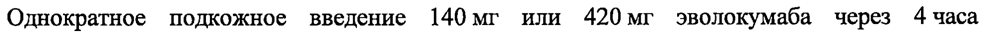
- стр. 2: «Схемы терапии с подкожным введением 140 мг 1 раз в 2 недели и 420 мг 1 раз в месяц» — низкая уверенность: «140» (79)  
  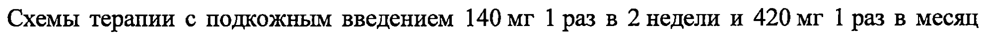
- стр. 3: «дозе, достигали концентрации ХС-ЛИНП <2,6 ммоль/л, и до 95% достигали» — низкая уверенность: «<2,6» (80)  
  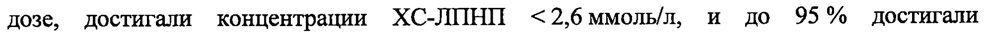
- стр. 4: «420 мг 1 раз в месяц значимо снижал ХС-ЛИНП через 12 недель и через 52 недели» — низкая уверенность: «1» (6)  
  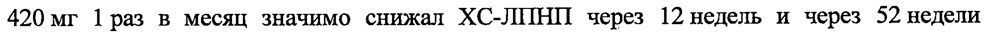
- стр. 5: «могла повышаться до 420 мг 1 раз в 2 недели в зависимости от ответа концентраций» — низкая уверенность: «420» (52)  
  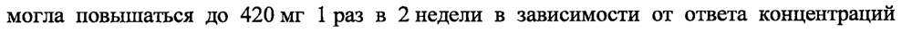
- стр. 6: «плацебо составила 38% (95% ДИ: 45, 31%; р< 0,0001). Стандартная ошибка (SE)» — низкая уверенность: «0,0001).» (0)  
  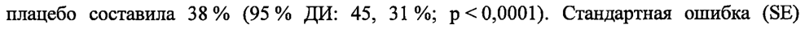
- стр. 6: «(р< 0,0001) на 44% (2%) относительно исходного уровня, а в группе применения» — низкая уверенность: «0,0001)» (39)  
  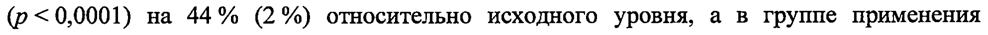
- стр. 7: «-30,3 % (2,2 %) для отношения АпоВ/АпоА1 и -24,9 % (1,9 %) для ХС.» — низкая уверенность: «АпоВ/АпоА1» (59)  
  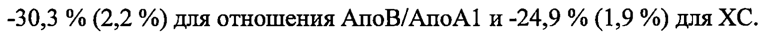
- стр. 8: «12 до 65 лет. Применение препарата Репата в дозе 420 мг 1 раз в месяц в качестве» — низкая уверенность: «420» (46), «1» (0)  
  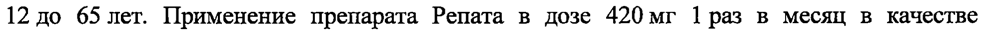
- стр. 9: «420мг ОМ | -14,3 -13 -3,7 3» — низкая уверенность: «3» (56)  
  
- стр. 9: «QM — 1 раз в месяц (подкожно); ХС-ЛИНИ — холестерин липопротеинов низкой плотности; ХС-ЛИВП — холестерин» — повторное чтение: «QM — 1 раз в месяц (подкожно); ХС-ЛИНП — холестерин липопротеинов низкой плотности; ХС-ЛПВП — холестерин»  
  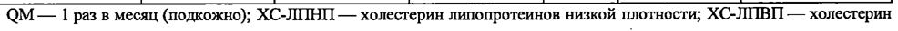
- стр. 10: «38 % (р = 0,041)). Данные, полученные для вторичной конечной точки, свидетельствуют о» — низкая уверенность: «0,041)).» (72)  
  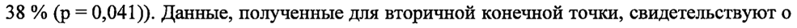
- стр. 10: «составляла 2,4 ммоль/л (2,1, 2,8). Абсолютный  сердечно-сосудистый риск был» — низкая уверенность: «2,4» (55)  
  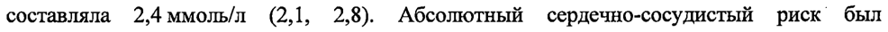
- стр. 10: «сердечно-сосудистого риска; 80 % имели артериальную гипертензию, 36 % сахарный» — низкая уверенность: «80» (74)  
  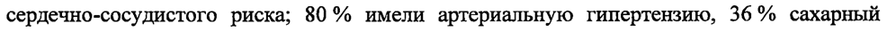
- стр. 11: «дозе 420 мг 1 раз в месяц на протяжении приблизительно 5 лет, а также продолжали» — низкая уверенность: «420» (75), «1» (46), «5» (36)  
  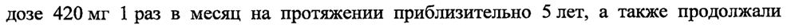
- стр. 12: «составлял >40 мг/дл (1,03 ммоль/л). Среди пациентов, у которых с момента оценки» — низкая уверенность: «>40» (57)  
  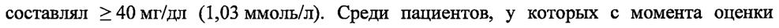
- стр. 12: «пациентов с достигнутым уровнем концентрации ХС-ЛПНПИ < 25 мг/дл и у 827%» — низкая уверенность: «25» (1), «827%» (66)  
  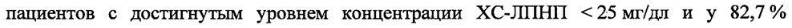
- стр. 13: «аторвастатином в дозе 40 мг один раз в сутки. Рандомизация проводилась со» — низкая уверенность: «40» (0)  
  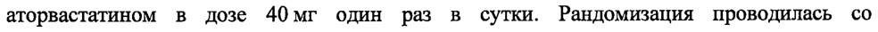
- стр. 13: «(LS) 40,7% (36,2 %, 45,2 %). Исходные значения концентрации ХС-ЛИНИ составляли» — низкая уверенность: «40,7%» (63)  
  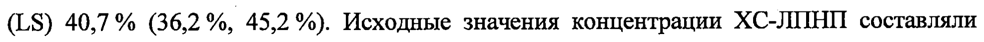
- стр. 13: «После однократного подкожного введения эволокумаба в дозе 140 мг или 420 мг» — низкая уверенность: «140» (43), «420» (44)  
  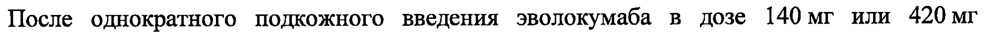
- стр. 14: «| дозе 140 мг обеспечивало среднее значение Cmax (SD)*1350°(10,4) мкг/мл и“ среднее» — низкая уверенность: «140» (26), «(SD)*1350°(10,4)» (11); повторное чтение: «| дозе 140 mr обеспечивало среднее значение Сиах_($0)^18:0{10, 4) мкг/мл и" среднее»  
  
- стр. 14: «однократному подкожному введению препарата в дозе 420 мг. Установлено, что» — низкая уверенность: «420» (29)  
  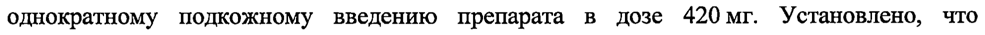
- стр. 14: «_ После однократного внутривенного введения препарата в дозе 420 мг средний (SD)» — низкая уверенность: «420» (68)  
  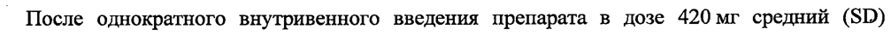
- стр. 14: «пропорциональное увеличение экспозиции при применении препарата в дозах 140 мг и» — повторное чтение: «пропорциональное увеличение экспозиции при применении препарата в дозах 140 мги»  
  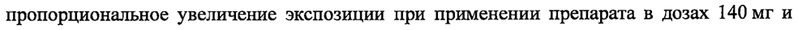
- стр. 15: «или 420 мг 1 раз в месяц (Cmin (SD) 11,2 (10,8)) наблюдалось “накопление “остаточного» — низкая уверенность: «420» (56)  
  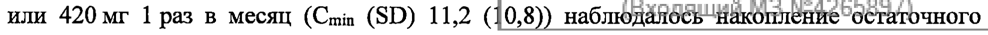
- стр. 15: «показателем Cmax, измеренным после однократного ‘подкожного введения 140 мг» — низкая уверенность: «140» (3)  
  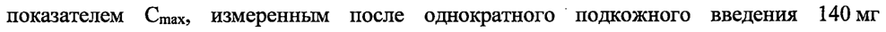
- стр. 16: «была на 147% выше и на 70% ниже у пациентов с массой тела 69 кг и 93 к» — низкая уверенность: «69» (0)  
  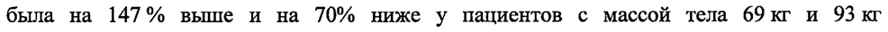
- стр. 16: «U) (HAUSER-RCT). После подкожного введения препарата Репата в дозе 420 мг 1 раз в месяц» — низкая уверенность: «1» (77)  
  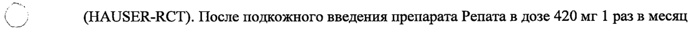
- стр. 19: «до 420 мг 1 раз в 2 недели. Пациентам, которым проводят аферез, терапию можно» — низкая уверенность: «420» (24), «1» (0), «2» (20)  
  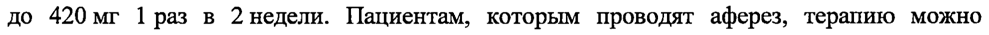
- стр. 20: «Доза 140 мг должна вводиться с использованием одной предварительно заполненной» — низкая уверенность: «140» (75)  
  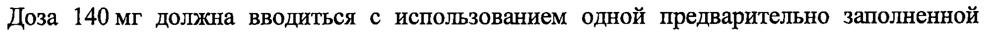
- стр. 20: «шприц-ручки. Доза 420 мг должна вводиться с помощью трех предварительно» — низкая уверенность: «420» (30)  
  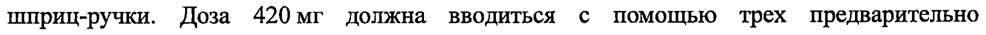
- стр. 20: «‚7 инъекции (2,2%). Профиль безопасности в популяции пациентов с гомозиготной» — низкая уверенность: «‚7» (28)  
  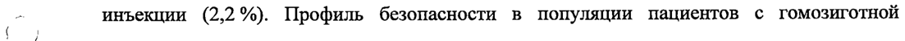
- стр. 22: «значений уровень концентрации ХС-ЛПНИ составил < 25 мг/дл (0,65 ммоль/л) или» — низкая уверенность: «25» (24)  
  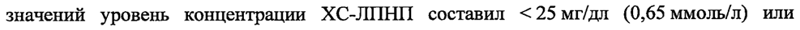
- стр. 22: «<40 мг/дл (1,03 ммоль/л), и у пациентов с более высоким уровнем концентрации» — низкая уверенность: «<40» (75)  
  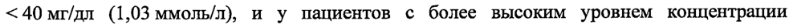
