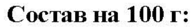
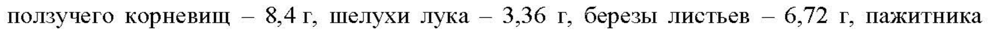
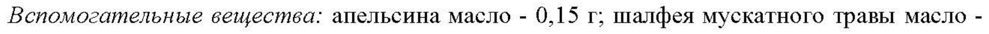
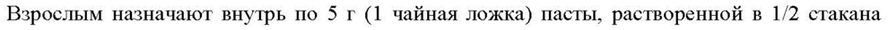
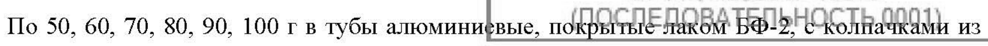

# Экстракт густой золотарника обыкновенного травы, хвоща полевого травы, горца птичьего травы, пырея ползучего корневищ, шелухи лука, березы листьев, пажитника сенного семян, петрушки посевной корней, любистока лекарственного корней — наружно

- Препарат: Фелозилит (паста для приготовления суспензии для приема внутрь)
- АТХ: G04BX
- Источник: ГРЛС, инструкция по медицинскому применению, РУ ЛП-№002805-(РГ-RU), файл от 2023-08-10 (https://grls.rosminzdrav.ru/Grls_View_v2.aspx?routingGuid=49651e4b-3a08-4f4a-ad5b-6a0387a18419)
- Распознано автоматически (OCR): 4 из 4 стр.
- Сомнительных строк после OCR: 5 (см. раздел «Проверка распознавания»)

## Общие сведения

СООТВЕТСТВУЕТ ЭКСПЕРТНОМУ ОТЧЕТУ от 14.07.2023 № 13275
ИНСТРУКЦИ ЯП ОСЛЕДОВАТЕЛЬНОСТЬ 0001)
ПО МЕДИЦИНСКОМУ ПРИМЕНЕНИЮ ЛЕКАРСТВЕННОГО ПРЕПАРАТА
ФЕЛОЗИЛИТ Регистрационный номер Торговое наименование
Фелозилит Международное непатентованное или группировочное наименование -

## 3. Лекарственная форма

Паста для приготовления суспензии для приема внутрь
Паста для приготовления суспензии для приема внутрь
Состав на 100 г:
Активные компоненты:
Экстракт густой (из лекарственного растительного сырья: золотарника обыкновенного травы — 3,36 г, хвоща полевого травы — 6,72 г, горца птичьего травы — 10,08 г, пырея ползучего корневищ — 8,4 г, шелухи лука — 3,36 г, березы листьев — 6,72 г, пажитника сенного семян — 10,08 г, петрушки посевной корней — 11,76 г, любистока лекарственного корней — 6,72 г) - 67,2 г.
Вспомогательные вещества: апельсина масло - 0,15 г; шалфея мускатного травы масло - 1,0 г, мяты перечной травы масло - 0,5 г; сосны обыкновенной масло - 0,2 г; агар-агар - 1,2 г; этилпарагидроксибензоат - 0,2 г; крахмал пшеничный - 2,3 г; ванилин - 0,0004 г;
глицерол (глицерин) - до 100,0 г.
Описание Паста мягкой консистенции зелено-коричневого цвета, с характерным запахом.
Фармакотерапевтическая группа Средства, применяемые в урологии; другие средства, применяемые в урологии.
Код ATX: GO4BX СООТВЕТСТВУЕТ ЭКСПЕРТНОМУ ОТЧЕТУ от 14.07.2023 № 13275 2
Фармакологические свойства

## 5.1. Фармакодинамика

Препарат обладает мочегонным, противовоспалительным, спазмолитическим действием.
Препарат обладает мочегонным, противовоспалительным, спазмолитическим действием.
Способствует вымыванию песка и мелких конкрементов из мочевыводящих путей, уменьшает кристаллизацию минеральных компонентов мочи.

## 5.2. Фармакокинетика

Данные отсутствуют.
Данные отсутствуют.

## 4.1. Показания к применению

Инфекционно-воспалительные заболевания мочевых путей, нефроуролитиаз (в составе комплексной терапии).
Инфекционно-воспалительные заболевания мочевых путей, нефроуролитиаз (в составе комплексной терапии).

## 4.3. Противопоказания

Повышенная чувствительность к компонентам препарата, почечная недостаточность, сердечная недостаточность, гломерулонефрит, фосфатный уролитиаз, возраст до 18 лет.
Повышенная чувствительность к компонентам препарата, почечная недостаточность, сердечная недостаточность, гломерулонефрит, фосфатный уролитиаз, возраст до 18 лет.

## 4.6. Применение при беременности и в период грудного вскармливания

В связи с отсутствием данных, касающихся тератогенного действия компонентов препарата, не рекомендуется применять препарат в период беременности и кормления грудью.

## 4.2. Способ применения и дозы

Взрослым назначают внутрь по 5 г (1 чайная ложка) пасты, растворенной в 1/2 стакана теплой сладкой воды, 3-4 раза в день после еды.
Взрослым назначают внутрь по 5 г (1 чайная ложка) пасты, растворенной в 1/2 стакана теплой сладкой воды, 3-4 раза в день после еды.
Курс лечения: длительность терапии определяется врачом. Средний курс лечения составляет от 2 недель до 1,5 месяцев. Увеличение продолжительности курса лечения возможно по назначению врача.
Если после лечения улучшения не наступает или симптомы усугубляются, или появляются новые симптомы, необходимо проконсультироваться с врачом. Применяйте препарат только согласно тем показаниям, тому способу применения и в тех дозах, которые указаны в инструкции.

## 4.8. Побочное действие

Возможны аллергические реакции, иногда - тошнота.
Возможны аллергические реакции, иногда - тошнота.
При повышенной чувствительности к ультрафиолетовым лучам возможны явления
СООТВЕТСТВУЕТ ЭКСПЕРТНОМУ ОТЧЕТУ от 14.07.2023 № 13275 3 фотосенсибилизации.

При появлении побочных эффектов препарат следует отменить.

## 4.9. Передозировка

До настоящего времени о случаях передозировки не сообщалось.
До настоящего времени о случаях передозировки не сообщалось.

## 4.5. Взаимодействие с другими лекарственными средствами

В связи с мочегонным действием препарата следует учитывать возможность ускоренного выведения других, одновременно применяемых лекарственных средств.
Препарат может усиливать действие антикоагулянтов, нестероидных противовоспалительных препаратов, гипогликемических лекарственных средств, лекарственных средств, содержащих соли лития, ингибиторов моноаминоксидазы, пролонгировать действие пентобарбитала, парацетамола.
Препарат может уменьшить всасывание лекарственных средств в тонком кишечнике, в том числе бета-каротина, альфа-токоферола.
Если Вы применяете вышеперечисленные или другие лекарственные препараты (в том числе безрецептурные), перед применением препарата Фелозилит проконсультируйтесь с врачом.

## 4.4. Особые указания

Не следует применять препарат в случае появления отеков, вызванных недостаточностью функции сердца или почек.
Не следует применять препарат в случае появления отеков, вызванных недостаточностью функции сердца или почек.
Препарат содержит этилпарагидроксибензоат, который может вызывать аллергические реакции (в том числе, отсроченные).
Влияние лекарственного препарата на способность управлять транспортными средствами, механизмами
Применение препарата не оказывает влияния на способность к выполнению потенциально опасных видов деятельности, требующих повышенной концентрации внимания и быстроты психомоторных реакций (управление транспортными средствами, работа с движущимися механизмами).

## 6.5. Форма выпуска

Паста для приготовления суспензии для приема внутрь.
Паста для приготовления суспензии для приема внутрь.
СООТВЕТСТВУЕТ ЭКСПЕРТНОМУ ОТЧЕТУ от 14.07.2023 № 13275 4
По 50, 60, 70, 80, 90, 100 г в тубы алюминиёвые, 110% SBME ROM BDL Колначкаи из полиэтилена высокого давления или в полимерные полиэтиленовые тубы с полиэтиленовыми (ПЭВИ) завинчивающимися крышками.
Каждую тубу вместе с инструкцией по применению помещают в пачку из картона.

## 6.4. Условия хранения

Хранить при температуре не выше 25 °С.
Хранить при температуре не выше 25 °С.
Хранить в недоступном для детей месте.

## 6.3. Срок годности

3 года.
3 года.
Не применять по истечении срока годности.
Условия отпуска Отпускают без рецепта.
Владелец регистрационного удостоверения ООО «Тульская фармацевтическая фабрика»
Россия, 300004, г. Тула, Торховский проезд, д. 10
Производитель/Организация, принимающая претензии потребителей:
ООО «Тульская фармацевтическая фабрика»
Россия, 300004, г. Тула, Торховский проезд, д. 10
Тел./факс: (4872) 41-04-73.
## Проверка распознавания

Страницы-сканы распознаны автоматически. В 5 строках с дозировками цифры могли распознаться с ошибкой — сверьте с вырезкой из оригинала:

- стр. 1: «Состав на 100 г:» — низкая уверенность: «100» (34)  
  
- стр. 1: «ползучего корневищ — 8,4 г, шелухи лука — 3,36 г, березы листьев — 6,72 г, пажитника» — низкая уверенность: «8,4» (29)  
  
- стр. 1: «Вспомогательные вещества: апельсина масло - 0,15 г; шалфея мускатного травы масло -» — повторное чтение: «Вспомогательные вещества: апельсина масло - 0,15 В, шалфея мускатного травы масло -»  
  
- стр. 2: «Взрослым назначают внутрь по 5 г (1 чайная ложка) пасты, растворенной в 1/2 стакана» — низкая уверенность: «5» (79)  
  
- стр. 4: «По 50, 60, 70, 80, 90, 100 г в тубы алюминиёвые, 110% SBME ROM BDL Колначкаи из» — низкая уверенность: «110%» (34); повторное чтение: «По 50, 60, 70, 80, 90, 100 г в тубы алюминивые, покрытые HARON БФ Ko hkduwanth из»  
  
