# Эренумаб — парентерально

- Препарат: Иринэкс (раствор для подкожного введения;)
- АТХ: N02CD01
- Источник: ГРЛС, инструкция по медицинскому применению, РУ ЛП-008468, файл от 2023-10-31 (https://grls.rosminzdrav.ru/Grls_View_v2.aspx?routingGuid=e3e9a741-1b7d-4825-9fab-aa774bc2c296)
- Распознано автоматически (OCR): 30 из 30 стр.
- Сомнительных строк после OCR: 25 (см. раздел «Проверка распознавания»)

## Общие сведения

МИНИСТЕРСТВО ЗДРАВООХРАНЕНИЯ РОССИЙСКОЙ ФЕДЕРАЦИИ
ИНСТРУКЦИЯ ПО МЕДИЦИНСКОМУ ПРИМЕНЕНИЮ ЛЕКАРСТВЕННОГО ПРЕПАРАТА =
МИНЗДРАВРОССИИ i ИРИНЭКС о no бой О9 | ГЛАСОВА] |
РЕГИСТРАЦИОННЫЙ НОМЕР: ——_—_—_———_— ТОРГОВОЕ НАИМЕНОВАНИЕ: Иринэкс
МЕЖДУНАРОДНОЕ НЕПАТЕНТОВАННОЕ НАИМЕНОВАНИЕ: эренумаб

## 3. Лекарственная форма

раствор для подкожного введения
раствор для подкожного введения

© СОСТАВ 1 мл препарата содержит:
действующее вещество: эренумаб 140 мг;
вспомогательные вещества: сахароза, полисорбат-80, уксусная кислота ледяная, натрия гидроксид, вода для инъекций.

ОПИСАНИЕ

Раствор от бесцветного до светло-желтого цвета.

ХАРАКТЕРИСТИКА ПРЕПАРАТА

Эренумаб представляет собой человеческое моноклональное антитело класса G2 (1202), с высокой аффинностью связывающееся с рецептором кальцитонин-ген-родственного пептида (СОКР). Эренумаб состоит из 2 тяжелых цепей, в каждой из которых содержится по 456 аминокислот, и 2 легких цепей подкласса лямбда, состоящих из 216 аминокислот.

& Приблизительная молекулярная масса составляет 150 кДа. Эренумаб производится по технологии рекомбинантной ДНК в клетках яичников китайского хомячка (СНО).
ФАРМАКОТЕРАПЕВТИЧЕСКАЯ ГРУППА: Противомигренозное средство.

Код ATX: NO2CD01

ФАРМАКОЛОГИЧЕСКИЕ СВОЙСТВА

Механизм действия

Эренумаб — это человеческое моноклональное антитело, являющееся антагонистом

рецептора CGRP, и не обладает значимой фармакологической активностью в отношении

рецепторов адреномедуллина, кальцитонина и амилина, а также агонистической

активностью в отношении рецептора CGRP.

CGRP — это нейропептид, модулирующий передачу ноцицептивных сигналов, и

вазодилататор, связанный с патофизиологией мигрени. Показано, что в отличие от 1/30

ТУ ТТ9 других нейропептидов, концентрация CGRP значительно увеличивается во время | приступа мигрени и возвращается к норме после его разрешения. Внутривенное (в/в)
введение СОКР вызывает у пациентов мигренеподобную головную боль, из чего можно предположить, что CGRP может являться причиной возникновения мигрени.
Рецептор к CGRP локализуется на участках, имеющих отношение к патофизиологии мигрени. Эренумаб является мощным и специфичным конкурентом СОКР за связывание с рецептором и тем самым подавляет его действие на рецептор.

## 5.1. Фармакодинамика

В рандомизированном двойном слепом плацебо-контролируемом исследовании по оценке эффективности однократного в/в введения эренумаба в дозе 140 мгу пациентов со стабильной стенокардией не отмечалось снижения переносимости физической
В рандомизированном двойном слепом плацебо-контролируемом исследовании по оценке эффективности однократного в/в введения эренумаба в дозе 140 мгу пациентов со стабильной стенокардией не отмечалось снижения переносимости физической
© нагрузки при нагрузочной ЭКГ-пробе (на тредмил-тесте) по сравнению с плацебо и усугубления ишемии миокарда.
Клинические данные Эренумаб оценивался в 3 базовых исследованиях по изучению профилактического лечения эпизодической и хронической мигрени. В исследования были включены пациенты с мигренью с аурой или без ауры в анамнезе в соответствии с диагностическими критериями Международной классификации головной боли (the
International Classification of Headache Disorders, 1СНО-Ш).
Эренумаб продемонстрировал статистически и клинически значимые улучшения ключевых показателей эффективности по сравнению с плацебо.
Хроническая мигрень Эренумаб оценивался в качестве монотерапии для профилактики хронической мигрени we в рандомизированном многоцентровом 12-недельном плацебо-контролируемом двойном слепом исследовании у пациентов, страдающих мигренью с аурой или без нее
(>15 дней с головной болью в месяц и >8 дней мигрени в месяц).
В клиническом исследовании пациентов с хронической мигренью эффективность применения препарата оценивалась на основании изменения количества дней с мигренью в течение месяца (ДММ) к 3 месяцу по сравнению с таковым показателем до лечения эренумабом (исходный уровень). Вторичными показателями эффективности служили снижение количества ДММ на 50-100% относительно исходного уровня (ответ 250%), изменение относительно исходного уровня количества дней в течение месяца, в которые пациенты применяли специфические препараты для купирования острой мигрени. На рисунке | и в таблице | приведены ключевые результаты исследования.
Анализ ежемесячных изменений показал, что среднемесячное количество дней с 2/30 мигренью снизилось по сравнению с плацебо ужев первый месяц, а последующий анализ

еженедельных изменений показал, что эффект эренумаба развивался уже на первой

неделе после инъекции.

Рисунок 1. Динамика изменения количества ДММ относительно исходного уровня у

пациентов с хронической мигренью*.

0 --@- Плацебо 5 05 < — A - Эренумаб 70 мг1 p/m ох у SS: —s— Эренумаб 140 мг 1 p/m
-1 fer
: 8 1.5 Y io 2 > у XN vse.
= 0 -2 Y ae = б < fag oz -25 N т 5х Ч сы:
Фо -3 м ---4 Ех XN TE Ч= -35 < в ИИ & бо \ а

нЕ -4 С TTT ee ода y $5 -45 \ ES 4 от -55 = 55 =
$7 Sap ~~ oo 65 — a2 7 >

-7.5

Исходный Месяц 1 Месяц 2 Месяц 3 уровень

* Представлены среднеквадратичные средние значения и 95%-ные доверительные интервалы.

Все р-значения для разницы в среднеквадратичных средних между группами эренумаба и плацебо,

которые оценивали через 3 месяца (главный показатель эффективности), составляли <0,001.

Таблица 1. Конечные точки эффективности на 12 неделе исследования у пациентов с

| хронической мигренью Эренумаб Эренумаб Плацебо Межгрупповая 70 мг 140 мг (n = 281) разница/
(n=188) (n = 187) Отношение шансов мм Среднее -6,6 -6,6 -4,2 70 мг < 0,001 изменение? -2,5 (-3,5; -1,4)
(95% ДИ) (-7,5; -5,8) (-7,5; -5,8) (-4,9; -3,5) 140 мг
-2,5 (-3,5; -1,4
Пациенты, у которых показатель JIMM изменился на > 50%

[mT 99 a8 О ОИ ПИ Отношение Не применимо < 0,001 шансов° 95% JT

Пациенты, у которых показатель ДММ изменился на > 75%!
| Отношение Не применимо шансов Не применимо 95% ДИ 3/30
Эренумаб Эренумаб Плацебо Межгрупповая 70 мг 140 мг (п = 281) разница/
(п=188) (п = 187) Отношение шансов Количество дней в течение месяца, в которые пациенты применяли специфические препараты от острой мигрени®
Среднее -3,5 -4,1 -1,6 70 мг < 0,001 изменение? -1,9 (-2,6; -1,1)
95% ДИ (-4,0; -2,9) (-4,7; -3,6) ал) 140 мг
-2,6 (-3,3; -1,8
Среднее -5,6 -5,6 -3,1 70 мг изменение? -2,5 (-3,7; -1,2) Не применимо 95% ДИ (-6,5; -4,6) (-6,5; -4,6) (-3,9; -2,3) 140 мг
-2,5 (-3,7; -1,2
Суммарный показатель MIDAS Среднее -19,4 -19,8 -7,5 70 мг изменение? -11,9 (-19,3; -4,4) | Не применимо 95% ДИ (-25,2; -13,6) | (-25,6; -14,0) (-12,4; -2,7) 140 мг

- -12,2 (-19,7; -4,8)

ДИ — доверительный интервал; HIT-6 (headache impact test) — индекс влияния головной боли; MIDAS

(migraine disability assessment) - оценка нетрудоспособности по причине мигрени; ДММ - количество дней

с мигренью в течение месяца.

а Все р-значения представлены в виде нескорректированных значений и после коррекции на

множественность сравнений являются статистически значимыми.

b С еднеквадратичное среднее изменение к месяц! 3 относительно исходного ровня, межг упповая р р р у y р

разница и р-значение основаны на линейной модели смешанных эффектов, в которую включены

исследуемая группа, среднемесячное значение на исходном уровне, факторы стратификации (регион

[Северная Америка или Европа] и злоупотребление лекарственными препаратами [имеется или

отсутствует]), плановый визит и взаимодействие «исследуемая группа—плановый визит»; вменения

отсутствующих данных не проводили.

° Отношение шансов и р-значение для пациентов с ответом >50% к 3 месяцу основано на

стратифицированном критерии Кохрана-Мэнтела-Ханцеля после вменения отсутствующих данных,

которые считались отсутствием ответа.

4 Апостериорный анализ; никакой проверки гипотезы не проводили.

°К специфическим препаратам от мигрени относятся триптаны и производные эрготамина.

\ У пациентов, у которых не был достигнут клинический ответ на один или несколько методов профилактической терапии, разница в сокращении ДММ, наблюдаемая между дозой 140 мг и плацебо, составляла -3,3 дня (95% ДИ: -4,6; -2,1), а между дозой 70 мги плацебо — -2,5 дня (95% ДИ: -3,8; -1,2). У пациентов, у которых небыл достигнут клинический ответ на два или более метода профилактической терапии, разница ДММ составляла -4,3 дня (95% ДИ: -5,8; -2,8) между дозой 140 мг и плацебо и -2,7 дня (95%
ДИ: -4,2; -1,2) между дозой 70 мг и плацебо соответственно. Доля пациентов, получавших эренумаб, которые достигли по меньшей мере 50% сокращения ДММ была выше по сравнению с группой плацебо среди пациентов, не достигших клинического ответа на один или несколько методов профилактической терапии (40,8 % для дозы 140 мги 34,7% для дозы 70 мг против 17,3% для плацебо), с отношением шансов 3,3 (95%
ДИ: 2,0; 5,5) для дозы 140 мги 2,6 (95% ДИ: 1,6; 4,5) для дозы 70 мг. У пациентов, не достигших клинического ответа после применения двух или более методов

4/30 профилактической терапии, доля составила 41,3% для дозы 140 мг и 35,6% для дозы 70 мг против 14,2% для плацебо с отношением шансов 4,2 (95% ДИ: 2,2; 7,9) и 3,5 (95%
ДИ: 1,8; 6,6) соответственно.
Эпизодическая мигрень Эренумаб оценивался в качестве средства для профилактики эпизодической мигрени в рандомизированном многоцентровом 24-недельном плацебо-контролируемом двойном слепом исследовании у пациентов, страдающих мигренью с аурой или без нее (4-14 дней мигрени в месяц).
В клиническом исследовании пациентов с эпизодической мигренью эффективность применения препарата оценивалась на основании изменения среднемесячного количества дней с мигренью в течение месяцев 4-6 относительно исходного уровня.
© Вторичными показателями эффективности служили снижение на 50-100% относительно исходного уровня среднего количества ДММ (ответ >50%), изменение относительно исходного уровня среднего количества дней в течение месяца, в которые пациенты применяли специфические препараты для купирования острой мигрени, и изменение относительно исходного уровня показателей по двум доменам опросника МРЕШ
(Дневник влияния мигрени на физическую активность), связанных с ухудшением физического состояния (УФС) и повседневной активностью (ПА). Опросник MPFID — это инструмент для оценки исходов, сообщаемых пациентами, который позволяет измерить влияние мигрени на физическое функционирование (физическую активность).
Он содержит 13 пунктов для оценки влияния мигрени в течение прошедших 24 часов на два аспекта физического функционирования, представляющих интерес — влияние на повседневную активность (ПА: 7 пунктов, например, трудности с выполнением
- действий, требующих концентрации внимания) и ухудшение физического состояния
(УФС: 5 пунктов, например, трудности с выполнением действий, требующих физических усилий), а также один общий пункт для оценки влияния на повседневную активность в целом. Пациенты ежедневно оценивают время, в течение которого они ощущали влияние мигрени, или уровень затруднений, связанных с мигренью.
Показатели по шкале MPFID за месяц усредняются по дням с мигренью и без мигрени;
при этом чем выше показатель, тем в большей степени мигрень влияет на домены ПА и
УФС.
На рисунке 2 и в таблице 2 приведены ключевые результаты исследования.
5/30 Рисунок 2. Динамика изменения количества дней с мигренью в течение месяца относительно исходного уровня в исследовании пациентов с эпизодической мигренью.
0 --@- Плацебо = ‘om —А-- Эренумаб 70 мг 1 p/m я z -0.5 ‘ey. —*— Эренумаб 140 wr 1 p/m
ЕВ: a es -1 mean se \\ ыы, $ -2 \ Sc 5 2-25 > те ``
EE 3 9 -_ : Е -3.5 ae 4 © 23 > -4,5 Исходный Месяц 1 Месяц 2 Месяц 3 Месяц 4 Месяц 5 Месяц 6 уровень
Таблица 2. Конечные точки эффективности на 13-24 неделе исследования пациентов с эпизодической мигренью.
Эренумаб Эренумаб Плацебо Межгрупповая р-значение* 70 мг 140 мг (п = 316) разница/
(п = 312) (п = 318) Отношение шансов Среднее -3,2 -3,7 -1,8 70 мг < 0,001 изменение? -1,4 (-1,9; -0,9)
95% ДИ (-3,6; -2,9) (-4,0, -3,3) (-2,2, -1,5) 140 мг
-1,9 (-2,3; -1,4
[% | 30066 | ПОНИ Отношение Не применимо < 0,001
& шансов° 95% ДИ ОРВИ [| os Po ИИ ПОС ОО ОО ОИ
Отношение Не применимо Не применимо р 95% ДИ
Количество дней в течение месяца, в которые пациенты применяли специфические препараты
Среднее -1,1 -1,6 -0,2 70 мг < 0,001 изменение? (-1,3; -0,9) (-1,8; -1,4) (-0,4; 0,0) -0,9 (-1,2; -0,6)
95% ДИ 140 мг -1,4 (-1,7; -1,1 Среднее -4,3 -4,8 -2,4 70 мг < 0,001 изменение? (-5,0; -3,5) (-5,6; -4,0) (-3,2; -1,6) -1,9 (-3,0; -0,8)
95% ДИ 140 мг -2,4 (-3,5; -1,4 Среднее -5,5 -5,9 -3,3 70 мг < 0,001 изменение? (-6,3; -4,8) (-6,6; -5,1) (-4,1; -2,5) -2,2 (-3,3; -1,2)
6/30 Эренумаб Эренумаб Плацебо Межгрупповая р-значение* 70 мг 140 мг (п = 316) разница/
(п = 312) (n = 318) Отношение шансов [ею [|
Среднее -6,7 -6,9 -4,6 70 мг Не применимо изменение (-7,4; -6,0) (-7,6; -6,3) (-5,3; -4,0) -2,1 (-3,0; -1,1)
-2,3 (-3,2; -1,3
Среднее -6,7 -7,5 -4,6 70 мг Не применимо изменение -2,1 (-3,3; -0,9)
95% ДИ (-7,6; -5,9) (-8,3; -6,6) (-5,5; -3,8) 140 мг
-2,8 (-4,0; -1,7)
| Отношение 70 мг © шансов 1,5 (1,1; 2,1)
95% ДИ 140 мг 1,7 (1,2; 2,4 СЗО ПОЕТ И ПОВЕТЕ ОЕ ОИ ПОООИИ
Отношение 70 мг шансов 1,8 (1,3; 2,5)
95% ДИ 140 мг 1,9 (1,4; 2,7)
ДИ - доверительный интервал; HIT-6 (headache impact test) — индекс влияния головной боли; MIDAS
(migraine disability assessment) — оценка нетрудоспособности по причине мигрени; ДММ - количество дней с мигренью в течение месяца; MPFID — дневник влияния мигрени на физическую активность
* Все р-значения представлены в виде нескорректированных значений и после коррекции на множественность сравнений являются статистически значимыми.
> Среднеквадратичное среднее изменение на 4-6 месяцы относительно исходного уровня, межгрупповая разница и р-значение основаны на линейной модели смешанных эффектов, в которую включены исследуемая группа, значение на исходном уровне, факторы стратификации (регион [Северная Америка или другой] и применение в прошлом лекарственных препаратов для профилактики мигрени
[применялись, применялись в прошлом, применяются в настоящее время в качестве сопутствующих
& препаратов]), плановый визит и взаимодействие «исследуемая группа— плановый визит»; вменения отсутствующих данных не проводили.
° Отношение шансов и р-значение для пациентов с ответом >50% на 4-6 месяцы основано на стратифицированном критерии Кохрана-Мэнтела-Ханцеля после вменения отсутствующих данных, которые считались отсутствием ответа.
$ Апостериорный анализ; никакой проверки гипотезы не проводили.
°К специфическим препаратам от мигрени относятся триптаны и производные эрготамина.
: Снижение на >5 среднего месячного показателя УФС и ПА по сравнению с исходным показателем.
У пациентов, у которых не был достигнут клинический ответ на один или несколько методов профилактического лечения, разница сокращения ДММ, наблюдаемая между дозой 140 мги плацебо, составила -2,5 (95% ДИ: -3,4; -1,7) и между дозой 70 мги плацебо
-2,0 (95% ДИ: -2,8; -1,2). Также доля пациентов, у которых достигнуто сокращение ДММ на 50% была больше по сравнению с группой плацебо (39,7% для 140 мги 38,6% для 70 мг, при отношении шансов 3,1 [95% ДИ: 1,7; 5,5] и 2,9 [95% ДИ: 1,6; 5,3] соответственно).
7/30 Фармакокинетика Эренумаб характеризуется нелинейной кинетикой, что обусловлено его связыванием с рецептором CGRP. Однако при терапевтически значимых дозах фармакокинетика эренумаба после подкожного введения каждые 4 недели является преимущественно линейной в связи с насыщением СОВР-рецепторов в результате связывания. У здоровых добровольцев, которым подкожно (п/к) вводили препарат в дозе 70 мг один раз в месяц или 140 мг один раз в месяц, среднее значение максимальной концентрации (Cmax)
составляло соответственно 6,1 мкг/мл и 15,8 мкг/мл (стандартное отклонение [SD] 2,1 мкг/мл 4,8 мкг/мл), а среднее значение площади под кривой “концентрация-время”
(AUCiast) — 159 сут*мкг/мл и 505 сут*мкг/мл (SD 58 сут*мкг/мл и 139 сут*мкг/мл)

© соответственно.
У пациентов, получавших препарат в дозе 140 мг п/к каждые 4 недели, минимальная концентрация в сыворотке крови со временем увеличивалась менее чем в 2 раза и достигала равновесного состояния через 12 недель после начала лечения.
Всасывание У здоровых добровольцев взрослого возраста, получавших однократную п/к инъекцию эренумаба в дозе 70 мг или 140 мг, медиана Cmax в плазме крови достигалась через 46 дней, а расчетная абсолютная биодоступность составляла 82%.
Распределение После однократного в/в введения в дозе 140 мг средний объем распределения (SD) в терминальной фазе выведения (Vz) составлял около 3,86 л (SD = 0,77).
Метаболизм и выведение

ww Выведение эренумаба описывается двухфазной кривой. При низких концентрациях выведение происходит преимущественно за счет насыщаемого связывания с мишенью
(рецептором СОКР), в то время как при более высоких концентрациях выведение эренумаба происходит преимущественно за счет неспецифического ненасыщаемого протеолиза. В период введения препарата эренумаб выводится преимущественно за счет неспецифического протеолиза с эффективным периодом полувыведения 28 дней.
Фармакокинетика у особых групп пациентов
Пациенты с нарушениями функции почек У пациентов с нарушением функции почек тяжелой степени (рСКФ < 30 мл/мин/1,73 м²)
исследований не проводилось. Не выявлены различия в фармакокинетике эренумаба у пациентов с нарушением функции почек легкой или средней степеней тяжести и

8/30 пациентами с нормальной функцией почек по данным популяционного фармакокинетического анализа (см. раздел «Способ применения и дозы»).

Пациенты с нарушениями функции печени

Клинических исследований у пациентов с нарушением функции печени не проводилось.
Эренумаб, как человеческое моноклональное антитело, не метаболизируется изоферментами системы цитохрома Р450. Выведение через печень не является основным способом выведения эренумаба (см. раздел «Способ применения и дозы»).

## 4.1. Показания к применению

Препарат применяется для профилактики мигрени у взрослых, которые имеют по крайней мере 4 дня мигрени в течение месяца.

© ПРОТИВОПОКАЗАНИЯ

Гиперчувствительность к действующему веществу или к любому из компонентов препарата.

Детский возраст до 18 лет (опыт применения у детей отсутствует).

## 4.6. Применение при беременности и в период грудного вскармливания

Беременность

Данные по применению эренумаба беременными женщинами ограничены.
Исследования на животных не выявили прямой или опосредованной репродуктивной токсичности эренумаба. В качестве меры предосторожности предпочтительно избегать применения препарата Иринэкс во время беременности.

- Период грудного вскармливания

Неизвестно, проникает ли эренумаб в грудное молоко человека. Имеются данные о том, что IgG проникает в грудное молоко в течение первых нескольких дней после рождения ребенка, затем концентрация IgG снижается до низких значений. Следовательно, в течение первых нескольких дней после рождения нельзя исключить риск для ребенка, находящегося на грудном вскармливании.

В течение дальнейшего периода кормления грудью применение препарата следует рассматривать исключительно с точки зрения клинической необходимости.

## 4.2. Способ применения и дозы

Лечение должно начинаться врачами, имеющими опыт диагностики и лечения мигрени.
Лечение должно начинаться врачами, имеющими опыт диагностики и лечения мигрени.

9/30 Препарат показан пациентам, которые имеют по крайней мере 4 дня мигрени в течение месяца в начале применения эренумаба.
Рекомендуемая доза — 70 мг 1 раз в 4 недели. У некоторых пациентов клинический эффект может достигаться при применении дозы 140 мг 1 раз в 4 недели.
Клинические исследования показали, что у большинства пациентов, отвечающих на терапию, эффект наступает в течение 3 месяцев. Следует рассмотреть возможность прекращения лечения у пациентов, у которых не получен ответ после 3 месяцев терапии.
Рекомендуется регулярно оценивать необходимость продолжения лечения.
При пропуске очередной дозы рекомендуется возобновить лечение как можно раньше.
В дальнейшем препарат применяется 1 раз в 4 недели, начиная с последней полученной дозы.
© Препарат Иринэкс следует вводить подкожно (п/к).
Препарат Иринэкс предназначен для самостоятельного введения пациентом, прошедшим соответствующее обучение.
Введение должно осуществляться лицом, обученным технике введения препарата.
Препарат можно вводить в живот, бедро или во внешнюю область плеча (инъекцию в руку следует использовать только в том случае, если инъекцию проводит не пациент, а другой человек). Места инъекций следует менять и не следует делать инъекции в области чувствительной, красной, уплотненной кожи или гематом.
Для введения дозы 140 мг следует провести две последовательные подкожные инъекции препарата Иринэкс по 70 мг каждая или одну подкожную инъекцию препарата Иринэкс 140 мг.
Подробные указания по хранению препарата, обращению с ним и технике введения
- приведены в разделе «Указания по применению препарата Иринэкс».

Особые группы пациентов Применение у пациентов в возрасте 65 лет и старше
Препарат Иринэкс не изучался у пожилых пациентов. Коррекции дозы не требуется.
Почечная недостаточность!/ печеночная недостаточность
У пациентов с почечной недостаточностью легкой и средней степени тяжести или печеночной недостаточностью коррекции дозы не требуется.

## 4.8. Побочное действие

Краткий обзор профиля безопасности
Краткий обзор профиля безопасности

10/30 В общей сложности в ходе регистрационных исследований эренумаб применялся более чем у 2500 пациентов (более 2600 пациенто-лет). Из них более 1300 пациентов применяли препарат не менее 12 месяцев.
Сообщалось о нежелательных реакциях для 70 мг и 140 мг: реакции в месте введения
(5,6 %/4,5 %), запор (1,3 %/3,2 %), мышечные спазмы (0,1 %/2,0 %) и зуд (0,7 %/1,8 %).
Большинство реакций были легкой или средней степени тяжести. Менее чем 2% пациентов прекратили участие в этих исследованиях из-за нежелательных явлений.
Перечень нежелательных реакций (НР) в табличном формате
Все НР, зарегистрированные у пациентов, получавших эренумаб в 12-недельный плацебо-контролируемый период клинических исследований, а также в период пострегистрационного применения препарата приведены в таблице 3. Внутри каждого
= системно-органного класса НР представлены по категориям частоты встречаемости, причем сначала указаны наиболее частые реакции. Внутри каждой категории частоты
НР представлены в порядке уменьшения степени их серьезности. Кроме того, для каждой
НР приведена соответствующая ей категория частоты в соответствии со следующими обозначениями: очень часто (> 1/10); часто (> 1/100, < 1/10); нечасто (> 1/1000, < 1/100);
редко (> 1/10 000, < 1/1000); очень редко (< 1/10 000).
Таблица 3. НР, возникавшие на фоне применения эренумаба
Системно-органный Категория частоты класс
Нарушения со стороны | Реакции Часто иммунной системы гиперчувствительности*, включая анафилаксию, ангионевротический отек,
> сыпь, припухлость/отек и крапивниц Нарушения со стороны | Запор Часто желудочно-кишечного Язвенные поражения | Частота не известна тракта полости pra?
Нарушения со стороны Часто кожи и — подкожных | Алопеция, cpm! Частота не известна тканей
Нарушения со стороны | Мышечный спазм Часто костно-мышечной системы и соединительной ткани
Общие расстройства и | Реакции в месте введения" | Часто нарушения в месте введения
2 См. раздел «Описание отдельных нежелательных реакций».
b Термин «Язвенные поражения полости рта» включает такие предпочтительные термины, как стоматит, язвы во рту, образование пузырей на слизистой оболочке рта.
11/30 ° Термин «зуд» включает такие предпочтительные термины, как генерализованный зуд, зуд и зудящая сыпь.
A Термин «сыпь» включает такие предпочтительные термины, как папулезная сыпь, эксфолиативная сыпь, эритематозная сыпь, крапивница, волдырь.
Описание отдельных нежелательных реакций
Реакции в месте введения В объединенном анализе 12-недельного плацебо-контролируемого периода клинических исследований реакции в месте введения были легкие и проходящие. У одного пациента, получившего эренумаб в дозе 70 мг, препарат был отменен в связи с развитием сыпи в месте введения. Наиболее частыми реакциями в месте введения были боль в месте введения, эритема в месте введения и зуд в месте введения. Как правило, боль в месте инъекции проходит в течение 1 часа после инъекции.

& Кожные реакции и реакции гиперчувствительности
В объединенном анализе 12-недельного плацебо-контролируемого периода исследований наблюдались несерьезные случаи сыпи, зуда и припухлости/отека, которые в большинстве случаев были легкими и не привели к прекращению лечения.
Запор В объединенном анализе 12-недельного плацебо-контролируемого периода зарегистрировано 28 сообщений о случаях запора среди 1400 пациентов, получавших препарат Иринэкс. Все нежелательные явления были легкими или умеренными по степени тяжести. В большинстве таких этих случаев (23) симптомы появились в течение одного месяца после первого введения препарата, однако, у некоторых пациентов запор наблюдался позднее на фоне продолжения терапии. В большинстве случаев (18) запор

© разрешился в течение трех месяцев. Все пациенты, за исключением одного, продолжили лечение.
Иммуногенность В клинических исследованиях профилактического лечения мигрени на протяжении двойной слепой фазы исследования частота образования антител к эренумабу у пациентов, получавших эренумаб в дозе 70 мг составила 6,3% (56/884) (у 3 пациентов нейтрализующая активность определялась in vitro) и 2,6% (13/504) у пациентов, получавших эренумаб в дозе 140 мг (in vitro нейтрализующая активность не определялась ни у одного пациента). Образование антител к эренумабу не влияло на его эффективность или безопасность.
Пострегистрационные данные Нарушения со стороны иммунной системы

12/30 В пострегистрационном периоде отмечены реакции гиперчувствительности, включая сыпь, ангионевротический отек и анафилактоидные реакции (см. раздел «Особые указания»).
Нарушения со стороны желудочно-кишечного тракта
® Зарегистрированы случаи запора с серьезными осложнениями в пострегистрационном применении. В большинстве этих случаев нежелательные явления наблюдались после введения первой дозы препарата Иринэкс, однако они могли возникать и позднее на фоне продолжения терапии. Многие случаи запора с серьезными осложнениями были зарегистрированы у пациентов с наличием в анамнезе эпизодов запора, или получавших сопутствующую терапию лекарственными препаратами, уменьшающими моторику желудочно-кишечного
© тракта. В отдельных тяжелых случаях потребовалась госпитализация.
® Отмечались язвы полости рта (например, стоматиты, изъязвление слизистой оболочки полости рта, образование пузырей на слизистой оболочке полости рта).
Нарушения со стороны кожи и подкожных тканей
Алопеция, кожная сыпь (например, папулезная сыпь, эксфолиативная сыпь, эритематозная сыпь, крапивница, образование волдырей).
Нарушения со стороны сосудов Артериальная гипертензия.
Если любые из указанных в инструкции побочных эффектов усугубляются, или Вы заметили любые другие побочные эффекты, не указанные в инструкции, сообщите об этом врачу.
~ ПЕРЕДОЗИРОВКА В клинических исследованиях не было выявлено случаев передозировки эренумаба у человека. В клинических исследованиях эренумаб применяли п/к в дозах до 280 мг без каких-либо признаков дозоограничивающей токсичности. В случае передозировки следует проводить поддерживающую и симптоматическую терапию по мере необходимости.

## 4.5. Взаимодействие с другими лекарственными средствами

В открытом исследовании фармакокинетического лекарственного взаимодействия эренумаба и комбинированных пероральных контрацептивов у здоровых женщин эренумаб (однократная п/к инъекция в дозе 140 мг) не влиял на фармакокинетику 13/30 комбинированных пероральных контрацептивов, содержащих этинилэстрадиол и

норгестимат.

В рандомизированном двойном слепом плацебо-контролируемом исследовании у

здоровых добровольцев эренумаб (однократное в/в введение в дозе 140 мг),

применяемый одновременно с суматриптаном, никак невлиял на показатели

артериального давления в покое по сравнению с суматриптаном в качестве монотерапии.

Эренумаб не оказывал влияния на фармакокинетику суматриптана.

Эренумаб не метаболизируется изоферментами цитохрома Р450; также маловероятно,

что он может вызывать заметные изменения концентрации провоспалительных

цитокинов, которые способны влиять на экспрессию или активность изоферментов

цитохрома Р450. По этой причине лекарственные взаимодействия при одновременном
© применении препаратов, которые являются субстратами, индукторами или

ингибиторами изоферментов цитохрома Р450, представляются маловероятными.

Влияние на результаты лабораторных и диагностических исследований

Влияние эренумаба на результаты лабораторных и/или диагностических исследований

не изучалось.

## 4.4. Особые указания

Реакции гиперчувствительности

В постмаркетинговом опыте применения препарата Иринэкс сообщалось о таких

серьезных нежелательных реакциях гиперчувствительности, как кожная сыпь,

ангионевротический отек и анафилактоидные реакции. Эти реакции могут возникать в

течение нескольких минут, хотя некоторые из них могут возникать более чем через
> неделю после лечения. При возникновении серьезных или тяжелых реакций

гиперчувствительности применение препарата Иринэкс следует прекратить и начать

соответствующую терапию (см. раздел «Противопоказания»).

Пациенты с гиперчувствительностью к латексу

Съемная крышка предварительно заполненного шприца и автоинжектора (шприц-ручки)

содержит сухой натуральный каучуковый латекс, который может вызывать

аллергические реакции у лиц, чувствительных к латексу.

Запор

Запор является частым побочным эффектом при применении препарата Иринэкс и

обычно характеризуется легкой или умеренной интенсивностью. В большинстве случаев

о появлении запоров сообщалось сразу после применения первой дозы препарата, однако

пациенты испытывали запор и позже в течение курса лечения. В большинстве случаев

14/30 запор разрешался в течение трех месяцев. При пострегистрационном применении эренумаба отмечались запоры, сопровождающиеся серьезными осложнениями. В некоторых случаях требовалась госпитализация, в том числе обусловленная необходимостью хирургического вмешательства.
Запор в анамнезе или одновременный прием препаратов, связанных со сниженной перистальтикой желудочно-кишечного тракта, может привести к увеличению риска развития более тяжелых запоров и осложнений, связанных с запорами. Следует предупредить пациентов об опасности развития тяжелых запоров и рекомендовать обратиться к врачу, в том случае, если запор не проходит или усиливается. При развитии тяжелых запоров пациентам следует немедленно обратиться за медицинской помощью.
Лечение запора следует начать незамедлительно, учитывая наличие медицинских
© показаний. При развитии тяжелых запоров необходимо прекратить применение препарата.
Сердечно-сосудистые заболевания Пациенты с некоторыми основными сердечно-сосудистыми заболеваниями были исключены из клинических исследований, в связи с чем данные по безопасности у этих пациентов отсутствуют.
Артериальная гипертензия Сообщалось о развитии артериальной гипертензии и утяжелении уже имеющейся артериальной гипертензии после применения препарата Иринэкс. У многих пациентов уже имелась артериальная гипертензия или факторы риска развития этого заболевания.
В некоторых случаях требовалась медикаментозная терапия и даже госпитализация.
При применении препарата Иринэкс следует наблюдать за состоянием пациентов на
- предмет развития артериальной гипертензии или утяжеления уже имеющейся артериальной гипертензии. В соответствующих случаях, если не удалось установить альтернативную этиологию осложнений, следует рассмотреть отмену препарата
Иринэкс.
Фертильность Данных по влиянию эренумаба на репродуктивную функцию человека нет. При системных экспозициях эренумаба у половозрелых обезьян, до 283 или 123 раз превышающих экспозицию (оцениваемую по AUC для сыворотки крови) у человека, достигаемую в случае применения препарата в клинической дозе 70 мг или 140 мг 1 раз в месяц, никаких нежелательных действий в отношении суррогатных маркеров фертильности (патологоанатомических или гистопатологических изменений репродуктивных органов) не наблюдалось.
15/30 ВЛИЯНИЕ НА СПОСОБНОСТЬ УПРАВЛЯТЬ ТРАНСПОРТНЫМИ СРЕДСТВАМИ И/ИЛИ
МЕХАНИЗМАМИ Препарат Иринэкс не оказывает значительного влияния на способность управлять транспортными средствами и/или механизмами.
@OPMA ВЫПУСКА Раствор для подкожного введения, 140 мг/мл.
Первичная упаковка По 1 мл в предварительно заполненный шприц из стекла I гидролитического класса с иглой из нержавеющей стали и колпачком иглы из резины, содержащей латекс,
© ИЛИ по 1 мл в предварительно заполненный шприц из стекла I гидролитического класса с иглой из нержавеющей стали и колпачком иглы из резины, содержащей латекс, в автоинжекторе (шприц-ручке).
Вторичная упаковка: один предварительно заполненный шприц или одну предварительно заполненную шприц-ручку вместе с инструкцией по медицинскому применению лекарственного препарата помещают в пачку картонную с контролем первого вскрытия.

## 6.4. Условия хранения

При температуре от 2 до 8 °С. Не замораживать.
При температуре от 2 до 8 °С. Не замораживать.
Хранить предварительно заполненные шприцылиприц-ручки в оригинальной картонной jw пачке для защиты OT воздействия света.
Хранить в недоступном для детей месте.

## 6.3. Срок годности

2 года.
2 года.
Не применять после истечения срока годности.
УСЛОВИЯ ОТПУСКА Отпускают по рецепту.
ВЛАДЕЛЕЦ РЕГИСТРАЦИОННОГО УДОСТОВЕРЕНИЯ 16/30
«Сандоз Фармасьютикалс д.д.», Веровшкова 57, 1000 Любляна, Словения / Sandoz
Pharmaceuticals d.d., Verovskova 57, 1000 Ljubljana, Slovenia
ПРОИЗВОДИТЕЛЬ Производство готовой лекарственной формы, первичная упаковка
«Амджен Мэньюфэкчуринг Лимитед», Роуд 31, Км 24.6, Джанкос, Пуэрто-Рико 00777,
США / Amgen Manufacturing Limited, Road 31, Km. 24.6, Juncos, PR, 00777, USA
Вторичная (потребительская) упаковка, выпускающий контроль качества
«с.а. Алкон-Куврер н.в.», Рейксвег 14, 2870 Пуурс, Бельгия / s.a. Alcon-Couvreur n.v.,
Rijksweg 14, Puurs, 2870, Belgium (предварительно заполненные шприцы)
«Сандоз ГмбХ», Биохемиштрассе 10, 6336 Лангкампфен, Австрия / Sandoz GmbH,
© Biochemiestrasse 10, 6336 Langkampfen, Austria (предварительно заполненные шприцручки)
ОРГАНИЗАЦИЯ, ПРИНИМАЮЩАЯ ПРЕТЕНЗИИ ПОТРЕБИТЕЛЕЙ:
ООО «Новартис Фарма»
125315, г. Москва, Ленинградский проспект, д. 70 тел. (495) 967 12 70 факс (495) 967 12 68
Wwww.novartis.ru - 17/30 УКАЗАНИЯ ПО ПРИМЕНЕНИЮ ПРЕПАРАТА ИРИНЭКС
Инструкция по применению препарата Иринэкс, раствор для подкожного введения 140 мг/мл, в предварительно заполненном шприие
Одноразовый предварительно заполненный шприц
До применения После применения aS Поршень
Поршень TF Упор для пальцев | CD р т.
| АРТИ | ie | j= | Этикетка шприца (с О р | датой окончания пор для пальцев |
. PA Ч | срока годности)
fo) мы Этикетка шприца (с А Цилиндр шприца датой окончания pes срока годности) |
Цилиндр шприца ‚ 0 | Игла | Раствор a Серый колпачок не CHAT Серый колпачок снят
(игла внутри)
& Важно! Внутри находится игла.
Важно Перед применением препарата Иринэкс (предварительно заполненный шприц)
ознакомьтесь с важной информацией:
Хранение Храните препарат в недоступном и невидном для детей месте.
Храните препарат в оригинальной картонной пачке для защиты от света или физических повреждений.
Храните препарат в холодильнике при температуре 2-8°С.
Вне холодильника длительность хранения препарата при комнатной температуре (до 25°С) не должна превышать 14 дней.
18/30 Не убирайте препарат обратно в холодильник, после того как он был из него извлечен.
Не применяйте препарат, если он хранился при комнатной температуре (до 25°С) в течение более 14 дней.
Препарат следует утилизировать в случае его хранения при более высокой температуре либо более 14 дней.
Не подвергайте препарат воздействию экстремально низких или высоких температур.
Например, избегайте хранения препарата в машине.
Не замораживайте.
Применение Не пытайтесь вводить препарат Иринэкс до того, как лечащий врач или медсестра не обучат Вас технике введения препарата.
© Не применяйте препарат после истечения срока годности, указанного на упаковке.
Не встряхивайте шприц.
Не снимайте серый колпачок со шприца до тех пор, пока не будете готовы к введению препарата.
Не замораживайте препарат и не применяйте препарат, если он был заморожен.
Не используйте шприц, если он падал на твердую поверхность, так как часть шприца может быть повреждена, даже если Вы не видите каких-либо повреждений. В этом случае возьмите новый шприц и сообщите об этом лечащему врачу.
В сером колпачке иглы содержится натуральный латекс, что может вызвать аллергические реакции у лиц, имеющих аллергическую реакцию на латекс. Сообщите лечащему врачу, если у Вас есть аллергическая реакция на латекс.
| За более подробной информацией или помощью обратитесь к лечащему врачу.
м Шаг 1. Подготовка перед инъекцией Ознакомьтесь с данной информацией до введения препарата.
Проверьте назначение врача.
Лечащий врач назначил Вам дозу 140 мг.
Для введения дозы 140 мг Вам будет нужно полностью ввести содержимое одного предварительно заполненного шприца.
Чтобы избежать дискомфорта в месте инъекции, оставьте предварительно заполненный шприц при комнатной температуре в течение минимум 30 минут до начала инъекции.
Не пытайтесь нагреть предварительно заполненный шприц за счет внешнего источника тепла, например, горячей водой или в микроволновой печи.
Не оставляйте предварительно заполненный шприц на прямом солнечном свете.
19/30 А) Достаньте предварительно заполненный шприц с препаратом Иринэкс из картонной пачки.
Возьмитесь за цилиндр шприца, чтобы достать его из упаковки.
—— чавес“ SOE у | (CJ == pa К / = | ‘a У м а Ы Г У“
— C)
Удерживайте шприц за цилиндр.
Б) Внимательно осмотрите предварительно заполненный шприц с препаратом Иринэкс.
Всегда держите шприц за цилиндр.
Убедитесь, что препарат в шприце является прозрачным бесцветным или светложелтым раствором.
Оставьте шприц при комнатной температуре в течение минимум 30 минут до инъекции.
Не используйте шприц, если препарат в нем мутный или изменил цвет, а также содержит хлопья или частицы.
Не используйте шприц, если любая его часть имеет трещину или сломана.
Не используйте шприц, если его роняли.
& Не используйте шприц, если серый колпачок иглы отсутствует или плохо закрыт.
Не используйте шприц, если срок годности, указанный на этикетке, истек.
Во всех указанных случаях используйте новый шприц, а в случае сомнений обратитесь к лечащему врачу.
Этикетка с датой окончания срока годности
Цилиндр } | hes Поршень шприца i Упор для пальцев
Серый Раствор у колпачок иглы (игла внутри)
20/30 В) Приготовьте все материалы необходимые для инъекции. Тщательно вымойте руки с мылом.
На чистую, хорошо освещенную рабочую поверхность положите:
® 1 новый предварительно заполненный шприц,
© спиртовые салфетки, ® ватные шарики или марлевые тампоны,
® лейкопластырь, ® контейнер для утилизации острых предметов.
© A м \ . ®, Г) Подготовьте и очистите место инъекции(Й).
Инъекцию можно производить в:
® 0едро, ® область живота, за исключением 5 см вокруг пупка,
® внешнюю поверхность плеча (только если инъекция проводится с посторонней помощью).
т Плечо Область ™ живота PS Бедро | „ ’ Очистите предполагаемое место инъекции спиртовой салфеткой и подождите, пока поверхность кожи станет сухой.
Не прикасайтесь к этой зоне до инъекции.
21/30 Проводите инъекцию каждый раз в различные места. Если Вы хотите вводить препарат в ту же самую область, убедитесь, что это не то же самое место предыдущей инъекции.
Не производите инъекцию в область поврежденной кожи (истончение, покраснение, раздражение, уплотнение, шелушение, сыпь, кровоизлияния). Избегайте введения в места с наличием шрамов и растяжек.
Шаг 2. Непосредственно перед введением > Д) Снимите серый колпачок с иглы в направлении OT
\ себя, только когда будете готовы к инъекции.
j Необходимо провести инъекцию в течение 5 минут.
© Не оставляйте серый колпачок снятым более 5 минут.
у My, Это может привести к высыханию препарата.
be > — Наличие на конце иглы капли препарата является нормальным.
Не скручивайте и не сгибайте серый колпачок.
Не надевайте серый колпачок обратно на шприц.
Не снимайте серый колпачок с иглы до тех пор, пока
Вы не будете готовы к инъекции.
= Е) Создайте складку кожи в месте введения, чтобы образовалась плотная поверхность для инъекции.
Удерживайте кожу между большим и указательным w пальцами, создавая зону около 5 CM шириной.
Важно. Во время проведения самой инъекции продолжайте удерживать кожу в этом положении.
Шаг 3. Инъекция | | 90° 2K) Удерживая складку кожи, введите иглу шприца со
(sm i. ra снятым серым колпачком в кожу под углом 45-90
>25 градусов.
Не помещайте палец на поршень, пока вводите иглу.
22/30 3) Медленно, не останавливаясь, надавите на поршень а вниз, пока он не перестанет двигаться.
И) После этого уберите палец и плавно удалите шприц
ИЗ КОЖИ.
Ц Важно. Если при удалении шприца Вы обнаружите,
| что в цилиндре остался раствор, значит Вы ввели неполную дозу. Сразу же сообщите об этом лечащему врачу.
-
Шаг 4. После инъекции =: К) Утилизируйте использованный шприц и серый
&& колпачок.
f ry й Положите использованный шприц в контейнер для hogs: утилизации острых предметов сразу после
| — | использования. Не бросайте в бытовой мусор.
: | Обсудите с лечащим врачом как правильно
~ утилизировать итприц.
Не используйте шприц повторно.
© Не следует повторно использовать шприц или контейнер для утилизации острых предметов или выбрасывать их в бытовой мусор.
Важно. Всегда храните контейнер для утилизации острых предметов в недоступном для детей месте.
Л) Осмотрите место введения.
При появлении крови прижмите ватный шарик или марлевый тампон к месту инъекции.
Не растирайте место инъекции. При необходимости используйте лейкопластырь.
23/30 Инструкция по применению препарата Иринэкс, раствор для подкожного введения 140 мг/мл, в предварительно заполненном шприце в автоинжекторе (шприц-ручке)
Одноразовый предварительно заполненный шприц в автоинжекторе (шприц-ручке)
До применения После применения Серая кнопка пуска =a 1 т vt Срокгодности 0000000 por ros
$1/00 i 0000000 1 Срок годности :
i р i - i р Е Желтое окошко ! | (инъекция завершена)
1 | Окошко : |)
Раствор i i Но Желтый | предохранитель С bo р
Оранжевый колпачок надет (игла внутри)
м i алый i Оранжевый колпачок CHAT предохранитель ;
(игла внутри) `` Важно! Игла находится внутри желтого предохранителя.
Важно Перед применением препарата Иринэкс (предварительно заполненный шприц в автоинжекторе (шприц-ручке)) ознакомьтесь с важной информацией:
Хранение Храните препарат в недоступном и невидном для детей месте.
Храните препарат в оригинальной картонной пачке для защиты от света или физических повреждений.
Храните препарат в холодильнике при температуре 2-8°C.
Вне холодильника длительность хранения препарата при комнатной температуре (до 25°С) не должна превышать 14 дней.
24/30 Не убирайте препарат обратно в холодильник, после того как он был из него извлечен.
Не применяйте препарат, если он хранился при комнатной температуре (до 25°С) в течение более 14 дней.
Препарат следует утилизировать в случае его хранения при более высокой температуре либо более 14 дней.
Не подвергайте препарат воздействию экстремально низких или высоких температур.
Например, избегайте хранения препарата в машине.
Не замораживайте.
Применение Не пытайтесь вводить препарат Иринэкс до того, как лечащий врач или медсестра не обучат Вас технике введения препарата.

© Не применяйте препарат после истечения срока годности, указанного на упаковке.
Не встряхивайте автоинжектор.
Не снимайте оранжевый колпачок с автоинжектора до тех пор, пока не будете готовы к введению препарата.
Не замораживайте препарат и не применяйте препарат, если он был заморожен.
Не используйте автоинжектор, если он падал на твердую поверхность, так как часть автоинжектора может быть повреждена, даже если Вы невидите каких-либо повреждений. В этом случае возьмите новый автоинжектор и сообщите об этом лечащему врачу.
В оранжевом колпачке иглы содержится натуральный латекс, что может вызвать аллергические реакции у лиц, имеющих аллергическую реакцию на латекс. Сообщите лечащему врачу, если у Вас есть аллергическая реакция на латекс.

w За более подробной информацией или помощью обратитесь к лечащему врачу.
Шаг 1. Подготовка перед инъекцией Ознакомьтесь с данной информацией до введения препарата.
Проверьте назначение врача.
Лечащий врач назначил Вам дозу 140 мг.
Для введения дозы 140 мг Вам будет нужно полностью ввести содержимое одной предварительно заполненной шприц-ручки.
Чтобы избежать дискомфорта в месте инъекции, оставьте предварительно заполненную шприц-ручку при комнатной температуре в течение минимум 30 минут до начала инъекции.
А) Достаньте автоинжектор с препаратом Иринэкс из картонной пачки.
Аккуратно достаньте автоинжектор из картонной пачки в направлении вверх.

25/30 Оставьте автоинжектор при комнатной температуре в течение минимум 30 минут до инъекции.
Не убирайте автоинжектор обратно в холодильник после того, как препарат достиг комнатной температуры.
Не пытайтесь нагреть автоинжектор за счет внешнего источника тепла, например, горячей водой или в микроволновой печи.
Не оставляйте автоинжектор на прямом солнечном свете.
Не встряхивайте автоинжектор.
На этом этапе не снимайте с автоинжектора оранжевый колпачок.
Б) Внимательно осмотрите автоинжектор с препаратом Иринэкс.
Убедитесь, что препарат в окошке является прозрачным бесцветным или светло-
© желтым раствором.
Не используйте автоинжектор, если препарат в нем мутный или изменил цвет, а также содержит хлопья или частицы.
Не используйте автоинжектор, если любая его часть имеет трещину или сломана.
Не используйте автоинжектор, если его роняли.
Не используйте автоинжектор, если оранжевый колпачок иглы отсутствует или плохо закрыт.
Не используйте автоинжектор, если срок годности, указанный на этикетке, истек.
Во всех указанных случаях используйте новый автоинжектор, а в случае сомнений обратитесь к лечащему врачу.
Желтый предохранитель (игла внутри)
Оранжевый Окошко Раствор колпачок иглы В) Приготовьте все материалы необходимые для инъекции. Тщательно вымойте руки с мылом.
На чистую, хорошо освещенную рабочую поверхность положите:
e | новый автоинжектор, ® спиртовые салфетки,
® ватные шарики или марлевые тампоны, ® лейкопластырь, 26/30
® контейнер для утилизации острых предметов.
ь и. в ) = Г) Подготовьте и очистите место инъекции(Й).
Инъекцию можно производить в:
® бедро, » область живота, за исключением 5 см вокруг пупка,
© © внешнюю поверхность плеча (только если инъекция проводится с посторонней помощью).
| Плечо Область _ живота ia Бедро р | „ ‘
Очистите предполагаемое место инъекции спиртовой салфеткой и подождите, пока поверхность кожи станет сухой.
Не прикасайтесь к этой зоне до инъекции.
Проводите инъекцию каждый раз в различные места. Если Вы хотите вводить препарат в ту же самую область, убедитесь, что это не то же самое место предыдущей инъекции.
Не производите инъекцию в область поврежденной кожи (истончение, покраснение, раздражение, уплотнение, шелушение, сыпь, кровоизлияния). Избегайте введения в места с наличием шрамов и растяжек.
27/30 Шаг 2. Непосредственно перед введением
Д) Снимите оранжевый колпачок с иглы в Quam <A> направлении от себя, только когда будете готовы к
CH инъекции. Необходимо провести инъекцию в 7 течение 5 минут. Не оставляйте оранжевый
Оранжевый колпачок колпачок снятым более 5 минут. Это может
ИГЛЫ привести к высыханию препарата.
Наличие на конце иглы капли препарата является нормальным.
Не скручивайте и не сгибайте оранжевый колпачок.
© Не надевайте оранжевый колпачок обратно на шприц-ручку.
Не дотрагивайтесь пальцами до желтого предохранителя.
Не снимайте оранжевый колпачок с иглы до тех пор, пока Вы не будете готовы к инъекции.
Е) Растяните или оттяните кожу в месте инъекции, чтобы создать твердую поверхность.
Метод с растяжением кожи (в \ Уверенным движением растяните кожу, для чего на = нажмите Ha нее и разведите большой палец и w указательный пальцы в разные стороны, создав область шириной около 5 см.
или i Метод с оттягиванием кожи Оттяните кожу, зажав ее большим и указательным пальцами и создав область шириной около 5 см.
Важно! Во время инъекции удерживайте кожу в растянутом или оттянутом состоянии.
28 / 30 Шаг 3. Инъекция Ж) Удерживайте кожу в растянутом или оттянутом 7 ®
Желтый б i состоянии. Подведите шприц-ручку со снятым предохра- a | оранжевым колпачком к коже под углом 90 нитель {= ха градусов. Игла внутри желтого предохранителя.
6.
(игла их oo внутри) Ky! Важно! Пока He прикасайтесь к серой кнопке пуска.
I | ( 3) Уверенным движением протолкните шприцручку вниз, пока она не перестанет двигаться.
= Проталкивание вниз Важно! Необходимо протолкнуть автоинжектор t мА вниз до конца, не касаясь серой кнопки пуска до тех
— пор, пока Вы не будете готовы сделать инъекцию.
И) Когда Вы будете готовы к инъекции, нажмите на серую кнопку пуска. При этом Вы услышите щелчок.
К) Уберите палец с кнопки пуска, но продолжайте щелчок.
<-> давить на кожу. Инъекция может занять около 15
J (CS mm CN секунд.
СО st SS 15 секунд YY —_ | j Важно! После завершения инъекции
Е Е окошко становится желтым, и Вы можете услышать второй щелчок.
29/30 Важно! После извлечения — № | автоинжектора из кожи игла будет автоматически закрыта.
Важно! Если после извлечения автоинжектора окошко не стало желтым либо Вам кажется, что инъекция препарата продолжается, значит Вы ввели неполную дозу.
Незамедлительно обратитесь к Вашему лечащему врачу.
Шаг 4. После инъекции Л) Утилизируйте использованный автоинжектор и ey
Е — оранжевый колпачок.
Sp = И Положите использованный —автоинжектор в
| J. р контейнер для утилизации острых предметов сразу
И : после использования.
a то Обсудите с лечащим врачом как правильно a утилизировать автоинжектор.
- Не используйте автоинжектор повторно.
Не помещайте автоинжектор или контейнер для w острых отходов в емкости для рециклинга и не выбрасывайте их вместе с бытовым мусором.
Важно. Всегда храните контейнер для утилизации острых предметов в недоступном и невидном для детей месте.
М) Осмотрите место введения.
При появлении крови прижмите ватный шарик или марлевый тампон к месту инъекции.
Не растирайте место инъекции. При необходимости используйте лейкопластырь.
<A A BEHH OCR NN.
4 Cm в
| 473 ра | ЯР С > тародубова М. В.
| ООВ aa АЙ ОТЧЕТ | | 4 оджеруио ре уторным проектам
} > | | - i 2 | 4 TAY ой Ve CYS | bra Eh ЦЛЯ ДАННОЙ & | | 2 а OOO «Новартис Фарма»
И ee ON /§ 30/30 oP oe | И < 7 ° LE 37 мос
## Проверка распознавания

Страницы-сканы распознаны автоматически. В 25 строках с дозировками цифры могли распознаться с ошибкой — сверьте с вырезкой из оригинала:

- стр. 3: «5 05 < — A - Эренумаб 70 мг1 p/m» — низкая уверенность: «5» (13), «05» (63); повторное чтение: «o 954 М. — &- - Эренумаб 70 мг 1 р/м»  
  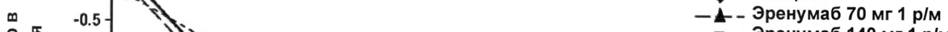
- стр. 3: «70 мг 140 мг (n = 281) разница/» — повторное чтение: «70мг | 140м | (@=280 |  разница/»  
  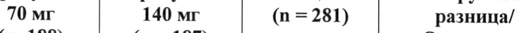
- стр. 3: «Среднее -6,6 -6,6 -4,2 70 мг < 0,001» — повторное чтение: «Среднее -6,6 -6,6 -4,2 — 70мг <0,001»  
  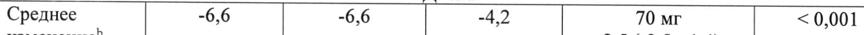
- стр. 3: «Пациенты, у которых показатель ДММ изменился на > 75%!» — низкая уверенность: «75%!» (36)  
  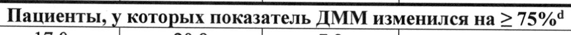
- стр. 4: «Среднее -3,5 -4,1 -1,6 70 мг < 0,001» — повторное чтение: «Среднее | -3,5 |6 |  7м | 50001»  
  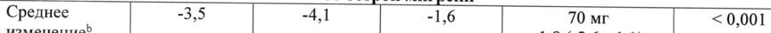
- стр. 4: «95% ДИ (-6,5; -4,6) (-6,5; -4,6) (-3,9; -2,3) 140 мг» — повторное чтение: «95% ДИ | (-6,5; -4,6) | (-6,5; -4,6) | (-3,9; -2,3) | 140 мг»  
  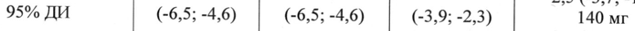
- стр. 4: «° Отношение шансов и р-значение для пациентов с ответом >50% к 3 месяцу основано на» — повторное чтение: «ы Отношение шансов и’ р-значение: для. пациентов с ответом 250% к 3 месяцу основано на»  
  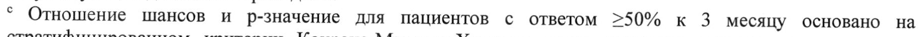
- стр. 5: «профилактической терапии, доля составила 41,3% для дозы 140 мг и 35,6% для дозы» — повторное чтение: «профилактической терапии, доля составила 41,3% для дозы 140 мги 35,6% для дозы»  
  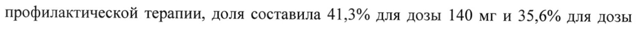
- стр. 6: «70 мг 140 мг (п = 316) разница/» — повторное чтение: «Tome | 140м | (n=316) 1 разница»  
  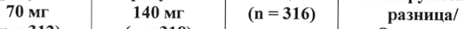
- стр. 6: «Среднее -3,2 -3,7 -1,8 70 мг < 0,001» — повторное чтение: «Среднее — 3,2 3,7 18 | 70мг <0,001»  
  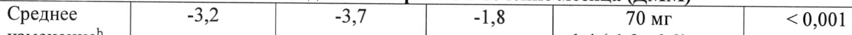
- стр. 6: «95% ДИ (-3,6; -2,9) (-4,0, -3,3) (-2,2, -1,5) 140 мг» — повторное чтение: «9%ди | (-3,6;-2,9) | -4,0,-3,3) | (22,-15) | 140мг»  
  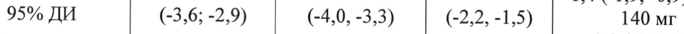
- стр. 6: «95% ДИ 140 мг» — повторное чтение: «95% ДИ | м»  
  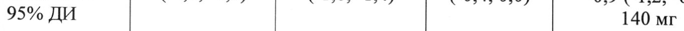
- стр. 6: «Среднее -4,3 -4,8 -2,4 70 мг < 0,001» — повторное чтение: «Среднее | 43 | 448 | 24 | 0мг | 30001»  
  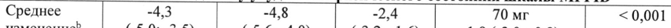
- стр. 6: «95% ДИ 140 мг» — повторное чтение: «959% MM ff м»  
  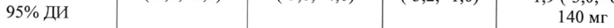
- стр. 6: «Среднее -5,5 -5,9 -3,3 70 мг < 0,001» — повторное чтение: «Среднее | 5550 [5.9 | 33 | м | 30,001»  
  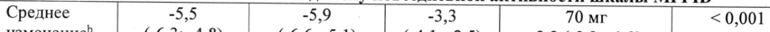
- стр. 7: «70 мг 140 мг (п = 316) разница/» — повторное чтение: «70мг |  140м | (@=316) |  разница/»  
  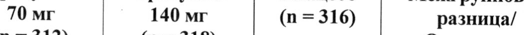
- стр. 7: «Среднее -6,7 -6,9 -4,6 70 мг Не применимо» — повторное чтение: «Среднее {77 “6,7 ny у > “6,9 эх | | “4,6 Po а 5 70 мг 2 Не применимо»  
  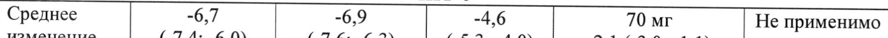
- стр. 7: «Отношение 70 мг» — повторное чтение: «»  
  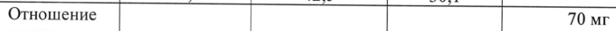
- стр. 7: «95% ДИ 140 мг» — повторное чтение: «95% ди | | | | 140 мг.»  
  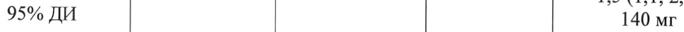
- стр. 7: «Отношение 70 мг» — повторное чтение: «‘Omomenne | | Sr»  
  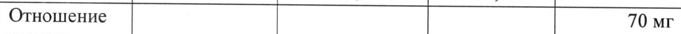
- стр. 7: «° Отношение шансов и р-значение для пациентов с ответом >50% на 4-6 месяцы основано на» — повторное чтение: «° Отношение шансов и р-значение для пациентов с ответом 250% на 4-6 месяцы основано на»  
  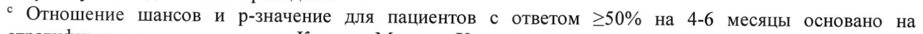
- стр. 8: «или 140 мг один раз в месяц, среднее значение максимальной концентрации (Cmax)» — низкая уверенность: «140» (73)  
  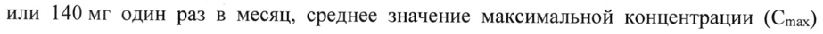
- стр. 14: «здоровых добровольцев эренумаб (однократное в/в введение в дозе 140 мг),» — низкая уверенность: «140» (62)  
  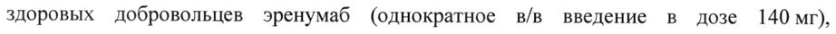
- стр. 16: «По 1 мл в предварительно заполненный шприц из стекла I гидролитического класса с» — повторное чтение: «По 1 млв предварительно заполненный шприц из стекла I гидролитического класса с»  
  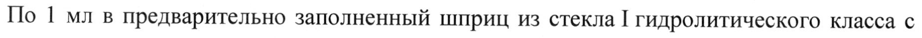
- стр. 16: «по 1 мл в предварительно заполненный шприц из стекла I гидролитического класса с» — повторное чтение: «по 1 млв предварительно заполненный шприц из стекла I гидролитического класса с»  
  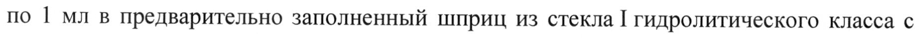
