# Эртуглифлозин — внутрь

- Препарат: Стиглатра (таблетки, покрытые пленочной оболочкой;)
- АТХ: A10BK04
- Источник: ГРЛС, инструкция по медицинскому применению, РУ ЛП-005959, файл от 2023-10-02 (https://grls.rosminzdrav.ru/Grls_View_v2.aspx?routingGuid=4f5ef090-39a2-4b09-b6d8-0c2be11e5e68)
- Распознано автоматически (OCR): 18 из 18 стр.
- Инструкция к другому РУ того же препарата: ЛП-005959 (исключено из реестра, решение от 02.10.2023). Текст может быть старше действующего
- Сомнительных строк после OCR: 15 (см. раздел «Проверка распознавания»)

## Общие сведения

МИНИСТЕРСТВО ЗДРАВООХРАНЕНИЯ РОССИЙСКОЙ ФЕДЕРАЦИИ
ИНСТРУКЦИЯ ПО МЕДИЦИНСКОМУ ПРИМЕНЕНИЮ ЛЕКАРСТВЕННОГО
ПРЕПАРАТА СТИГЛАТРА

РЕГИСТРАЦИОННЫЙ НОМЕР:

ТОРГОВОЕ НАИМЕНОВАНИЕ: Стиглатра

МЕЖДУНАРОДНОЕ НЕПАТЕНТОВАННОЕ ИЛИ ГРУППИРОВОЧНОЕ

НАИМЕНОВАНИЕ: эртуглифлозин

## 3. Лекарственная форма

таблетки, покрытые пленочной оболочкой
таблетки, покрытые пленочной оболочкой

## 2. Состав

| | таблетка, покрытая пленочной оболочкой, содержит:
~ Дозировка $ мг:

Действующее вещество: эртуглифлозина [-пироглутаминовой кислоты 6,477 мг

эквивалентно 5,000 мг эртуглифлозина.

Вспомогательные _ вещества: целлюлоза микрокристаллическая РН-102, лактозы

моногидрат, карбоксиметилкрахмал натрия (тип А), магния стеарат.

Пленочное покрытие: Опадрай П Розовый 330150000.

Состав Опадрая IT Розового 334150000: гипромеллоза 2910 / гипромеллоза 6cP, лактозы

моногидрат, макроголЛТЭГ 3350, триацетин, титана диоксид, краситель железа оксид

красный.

Дозировка 15 мг:

Действующее вещество: эртуглифлозина [-пироглутаминовой кислоты 19,431 мг

©, эквивалентно 15,000 мг эртуглифлозина.

Вспомогательные _ вещества: целлюлоза микрокристаллическая РН-102, лактозы

моногидрат, карбоксиметилкрахмал натрия (тип А), магния стеарат.

Пленочное покрытие: Опадрай П Красный 33015398.

Состав Опадрая II Красного 33415398: гипромеллоза 2910 / гипромеллоза 6cP, лактозы

моногидрат, макроголЛТЭГ 3350, триацетин, титана диоксид, краситель железа оксид

красный.

ОПИСАНИЕ

Дозировка 5 мг

Розовые двояковыпуклые таблетки треугольной формы, покрытые пленочной оболочкой, с
|

416752 гравировкой «701» на одной стороне, гладкие на другой стороне.
Дозировка 15 мг Коричнево-красные двояковыпуклые таблетки треугольной формы, покрытые пленочной оболочкой, с гравировкой «702» на одной стороне, гладкие на другой стороне.
ФАРМАКОТЕРАПЕВТИЧЕСКАЯ ГРУППА: гипогликемическое средство для перорального применения — ингибитор натрийзависимого переносчика глюкозы 2 типа.
КОД ATX: A10BK04 ФАРМАКОЛОГИЧЕСКИЕ СВОЙСТВА
Механизм действия ~ Натрийзависимый переносчик глюкозы 2типа (НГЛТ2) является преобладающим транспортером, отвечающим за реабсорбцию глюкозы из клубочкового фильтрата обратно в кровоток. Эртуглифлозин является мощным, селективным и обратимым ингибитором
НГЛТ2. Ингибируя НГЛТ2, эртуглифлозин уменьшает почечную реабсорбцию отфильтрованной глюкозы и снижает почечный порог для глюкозы, тем самым увеличивая выведение глюкозы почками.

## 5.1. Фармакодинамика

Выведение глюкозы почками и объем мочи
Выведение глюкозы почками и объем мочи
Дозозависимое увеличение количества глюкозы, выводимой почками, наблюдалось у здоровых добровольцев и у пациентов с сахарным диабетом 2 типа после приема однократной и многократных доз эртуглифлозина. Моделирование взаимосвязи «доза-
© ответ» показало, что эртуглифлозин в дозах 5 мги 15 мг приводит почти к максимальному выведению глюкозы почками у пациентов с сахарным диабетом 2 типа, обеспечивая 87% и 96% от максимального ингибирования соответственно.

## 5.2. Фармакокинетика

Фармакокинетические параметры эртуглифлозина являются сходными у здоровых добровольцев и у пациентов с сахарным диабетом 2 типа. Средние равновесные значения площади под кривой «концентрация-время» (AUC) и максимальной концентрации (Cmax) B плазме крови составили соответственно 398 нг-ч/мл и 81 нг/мл при применении эртуглифлозина 5 мг один раз в сутки, 1193 нг-ч/мл и 268 нг/мл при применении эртуглифлозина 15 мг один раз в сутки. Равновесное состояние достигается через 4-6 дней приема эртуглифлозина один раз в сутки. Эртуглифлозин не характеризуется зависящими 416732 от времени фармакокинетическими параметрами и накапливается в плазме крови до 10-40% после многократного приема.
Фармакокинетические параметры эртуглифлозина являются сходными у здоровых добровольцев и у пациентов с сахарным диабетом 2 типа. Средние равновесные значения площади под кривой «концентрация-время» (AUC) и максимальной концентрации (Cmax) B плазме крови составили соответственно 398 нг-ч/мл и 81 нг/мл при применении эртуглифлозина 5 мг один раз в сутки, 1193 нг-ч/мл и 268 нг/мл при применении эртуглифлозина 15 мг один раз в сутки. Равновесное состояние достигается через 4-6 дней приема эртуглифлозина один раз в сутки. Эртуглифлозин не характеризуется зависящими 416732 от времени фармакокинетическими параметрами и накапливается в плазме крови до 10-40% после многократного приема.
Всасывание После однократного приема внутрь эртуглифлозина в дозах 5 мг и 15 мг максимальная концентрация эртуглифлозина в плазме крови (медиана значения времени достижения максимальной концентрации Tmax) достигается через | час после приема препарата натощак. Cmax и AUC эртуглифлозина в плазме крови возрастают дозопропорционально после однократного приема доз от 0,5 мг до 300 мг и после многократного приема доз от 1 мг до 100 мг. После приема внутрь эртуглифлозина в дозе 15 мг абсолютная биодоступность составляет приблизительно 100%.
Прием эртуглифлозина вместе с пищей с высоким содержанием жиров и высоким содержанием калорий снижает Cmax эртуглифлозина на 29% и увеличивает Tmax на | час, но
~ не влияет на AUC по сравнению с приемом препарата натощак. Наблюдаемое влияние пищи на фармакокинетические параметры эртуглифлозина не считается клинически значимым, и эртуглифлозин можно принимать независимо от приема пищи. В клинических исследованиях 3 фазы эртуглифлозин назначали независимо от приема пищи.
Эртуглифлозин является субстратом транспортеров р-гликопротеина (P-gp) и белка резистентности рака молочной железы (ВСКР).
Распределение Средний объем распределения эртуглифлозина в равновесном состоянии после внутривенного введения составляет 86 л. Степень связывания эртуглифлозина с белками плазмы составляет 93,6% и не зависит от концентрации эртуглифлозина в плазме крови.
Степень связывания эртуглифлозина с белками плазмы крови значимо не изменяется у
© пациентов с нарушением функции почек или нарушением функции печени. Отношение концентраций эртуглифлозина в крови к концентрации в плазме составляет 0,66.
Эртуглифлозин не является субстратом транспортеров органических анионов (ОАТТ,
ОАТЗ), транспортеров органических катионов (ОСТ, OCT2) или полипептидов, транспортирующих органические анионы (ОАТР1В1, ОАТР1ВЗ) in vitro.
Метаболизм Метаболизм является основным механизмом клиренса для эртуглифлозина. Основным метаболическим путем для эртуглифлозина является UGT1A9- и ОСТ2В7-опосредованное
О-глюкуронирование с образованием двух глюкуронидов, которые фармакологически неактивны в клинически значимых концентрациях. СУР-опосредованный (окислительный)
метаболизм эртуглифлозина минимален (12%).
916752 Выведение Средний системный клиренс эртуглифлозина из плазмы крови после внутривенного введения дозы 100 мкг составил 11 л/час. На основании популяционного фармакокинетического анализа средний период полувыведения у пациентов с сахарным диабетом 2 типа с нормальной функцией почек составил 17 часов. После приема внутрь раствора [““С]-эртуглифлозина здоровыми добровольцами приблизительно 41% и 50% связанного с препаратом радиоактивного изотопа выводились через кишечник и почками соответственно. Только 1,5% принятой дозы выводилось из организма в виде неизмененного эртуглифлозина почками и 34% в виде неизмененного эртуглифлозина через кишечник, что, вероятно, связано с желчной экскрецией глюкуронидных метаболитов и их последующим гидролизом до исходного вещества.
Особые группы пациентов - Нарушение функции почек
В клиническом фармакологическом исследовании | фазы у пациентов с сахарным диабетом 2 типа и легкой, средней или тяжелой степенью нарушения функции почек (на основании | расчетной скорости клубочковой фильтрации (рСКФ)) после однократного приема 15 мг эртуглифлозина значения AUC эртуглифлозина в среднем увеличивались в <1,7 раза по сравнению с пациентами с нормальной функцией почек. Эти увеличения AUC эртуглифлозина не расцениваются как клинически значимые. Не зарегистрировано клинически значимых различий в значениях Cmax эртуглифлозина среди групп пациентов с различной функцией почек. Суточная экскреция глюкозы почками снижалась по мере нарастания степени тяжести нарушения функции почек. Степень связывания эртуглифлозина с белками плазмы крови не изменялась у пациентов с нарушением функции
| почек.

Печеночная недостаточность Средняя степень печеночной недостаточности (по классификации Чайлд-Пью) не приводила к увеличению экспозиции эртуглифлозина. Значение AUC эртуглифлозина снижалось приблизительно на 13%, а значение Cmax снижалось приблизительно на 21% по сравнению с пациентами с нормальной функцией печени. Это уменьшение экспозиции эртуглифлозина не расценивается как клинически значимое. Отсутствует опыт клинического применения эртуглифлозина у пациентов с тяжелой степенью печеночной недостаточности (класс С по классификации Чайлд-Пью). Степень связывания эртуглифлозина с белками плазмы крови не изменялась у пациентов с умеренным нарушением функции печени.

416752 Дети Фармакокинетика эртуглифлозина у детей не изучалась.
Влияние возраста, массы тела, пола и расы
В популяционном фармакокинетическом анализе не было отмечено клинически значимого влияния возраста, массы тела, пола и расы на фармакокинетику эртуглифлозина.

## 4.5. Взаимодействие с другими лекарственными средствами

В исследованиях in vitro эртуглифлозин и глюкурониды эртуглифлозина не ингибировали и не инактивировали 1А2, 2С9, 2C19, 2C8, 2В6, 206 или 3A4 изоферменты цитохрома 450
(CYP) и не индуцировали 1A2, 2B6 или 3A4 CYP. Эртуглифлозин и глюкурониды эртуглифлозина не ингибировали активность УДФ-глюкуронозилтрансфераз (ОСТ) 1A6, 1А9 или 2B7 in vitro. Эртуглифлозин был слабым ингибитором ОСТ IAI и 1A4 in vitro в
~ более высоких концентрациях, не имеющих клинической значимости. Глюкурониды эртуглифлозина не оказывали влияния на эти изоформы. В целом, влияние эртуглифлозина на фармакокинетику одновременно применяемых препаратов, которые выводятся этими ферментами, представляется маловероятным.
Эртуглифлозин и глюкурониды эртуглифлозина значимо не ингибируют P-gp, транспортеры OCT2, ОАТ1 или ОАТЗ или транспортирующие полипептиды OATPIBI и
OATPIB3 в клинически значимых концентрациях т уйто. В целом, влияние эртуглифлозина и глюкуронидов эртуглифлозина на фармакокинетику одновременно применяемых лекарственных препаратов, являющихся субстратами этих транспортеров, представляется маловероятным.
© ПОКАЗАНИЯ К ПРИМЕНЕНИЮ Препарат Стиглатра показан к применению у пациентов с сахарным диабетом 2 типа в возрасте 18 лет и старше в дополнение к диете и физическим упражнениям для улучшения гликемического контроля:
* в качестве монотерапии у пациентов, которым применение метформина не показано из-за непереносимости или противопоказаний.
. в качестве комбинированной терапии с метформином, производными сульфонилмочевины, ингибиторами дипептидилпептидазы 4 (ДИП-4) (в том числе, в комбинации с метформином) и препаратами инсулина при отсутствии адекватного гликемического контроля на данной терапии.
= 916752 ПРОТИВОПОКАЗАНИЯ - Повышенная чувствительность к эртуглифлозину или любому другому из компонентов лекарственного препарата;
- Тяжелая степень печеночной недостаточности (данные по эффективности и безопасности отсутствуют);
- Нарушение функции почек с рСКФ устойчиво ниже 45 мл/мин/1,73 м? или с клиренсом креатинина менее 45 мл/мин или пациенты на диализе;
- Диабетический кетоацидоз:
- Сахарный диабет | типа;
- Детский возраст до 18 лет (данные по безопасности и эффективности отсутствуют);
- Беременность и период грудного вскармливания;
© - Дефицит лактазы, непереносимость галактозы, глюкозо-галактозная мальабсорбция.

## 4.3. С осторожностью

- Нарушение функции почек с рСКФ ниже 60 мл/мин/1,73 м? или клиренс креатинина менее 60 мл/мин (для начала терапии).
- Нарушение функции почек с рСКФ ниже 60 мл/мин/1,73 м? или клиренс креатинина менее 60 мл/мин (для начала терапии).

## 4.6. Применение при беременности и в период грудного вскармливания

ВСКАРМЛИВАНИЯ Беременность Имеются ограниченные данные по применению эртуглифлозина у беременных женщин. На основании результатов исследований у животных эртуглифлозин может влиять на развитие и созревание почек. В связи с этим применение препарата Стиглатра во время беременности
© противопоказано.

Период грудного вскармливания Отсутствует информация о наличии эртуглифлозина в грудном молоке у человека, о воздействии на ребенка, находящегося на грудном вскармливании или о влиянии на продукцию грудного молока. Эртуглифлозин присутствовал в молоке лактирующих крыс и оказывал влияние на потомство лактирующих крыс. Фармакологически опосредованные эффекты наблюдались у неполовозрелых крыс. В связи с тем, что созревание почек человека происходит внутриутробно и в течение первых 2 лет жизни, когда возможна экспозиция через грудное молоко, риск для новорожденных и детей не может быть исключен. Применение препарата Стиглатра в период грудного вскармливания противопоказано.

416752 Фертильность

Влияние эртуглифлозина на репродуктивную функцию человека не изучалось. В

исследованиях на животных влияние на репродуктивную функцию не наблюдалось.

## 4.2. Способ применения и дозы

Внутрь.

Способ применения

Препарат Стиглатра следует принимать перорально один раз в сутки утром независимо от

приема пищи. В случае проблем с проглатыванием таблетку можно разломить или

измельчить, так как препарат выпускается в лекарственной форме немедленного

высвобождения.

© Режим дозирования

Рекомендуемая начальная доза препарата Стиглатра составляет 5 мг один раз в сутки утром

независимо от приема пищи. У пациентов, хорошо переносящих препарат Стиглатра 5 мг

один раз в сутки, доза может быть увеличена до 15 мг один раз в сутки, если необходимо

усиление гликемического контроля.

При применении эртуглифлозина в комбинации с инсулином или с препаратом

секретагогом инсулина может потребоваться применение более низких доз инсулина или

препарата секретагога инсулина, чтобы снизить риск возникновения гипогликемии.

У пациентов со сниженным объемом циркулирующей крови (ОЦК) рекомендуется

скорректировать это состояние до начала применения эртуглифлозина.

В случае пропуска дозы ее необходимо принять как можно скорее после того, как пациент

вспомнит об этом. Не следует принимать две дозы препарата Стиглатра в один день.

© Особые группы пациентов

Нарушение функции почек

Рекомендуется проводить оценку функции почек до начала терапии препаратом Стиглатра

и периодически во время лечения.

Пациентам с pCK® меньше 60 мл/мин/1,73 м’ или с клиренсом креатинина меньше

60 мл/мин не рекомендуется начинать терапию препаратом Стиглатра.

Прием препарат Стиглатра следует прекратить, если РСКФ устойчиво меньше

45 мл/мин/1,73 м? или клиренс креатинина устойчиво меньше 45 мл/мин.

Препарат Стиглатра не следует применять у пациентов с тяжелым нарушением функции

почек, с терминальной стадией почечной недостаточности (TCITH) или у пациентов,

116752 находящихся на диализе, поскольку ожидается, что препарат будет неэффективным у этих пациентов.
Печеночная недостаточность Корректировка дозы для пациентов с печеночной недостаточностью легкой или средней степени тяжести не требуется. Применение эртуглифлозина не изучалось у пациентов с печеночной недостаточностью тяжелой степени тяжести и не рекомендуется у данной группы пациентов.
Пациенты пожилого возраста (> 65 лет)
Корректировка дозы эртуглифлозина в зависимости от возраста не требуется. Следует принимать во внимание функцию почек и риск снижения ОЦК. Опыт применения препарата Стиглатра у пациентов в возрасте > 75 лет ограничен.

© Дети Безопасность и эффективность эртуглифлозина у детей в возрасте до 18 лет не изучены.
Данные отсутствуют.

## 4.8. Побочное действие

Резюме профиля безопасности
Резюме профиля безопасности
Обобщенные данные плацебо-контролируемых исследований с оценкой безопасности препарата Стиглатра 5 мг и 15 мг.
Первичная оценка безопасности была проведена на основании данных трех 26-недельных плацебо-контролируемых исследований.
Эртуглифлозин применялся в качестве монотерапии в одном исследовании и в качестве дополнительной терапии в двух исследованиях. В этих исследованиях эртуглифлозин

©, получали 1029 пациентов со средней продолжительностью терапии около 25 недель.
Пациенты получали эртуглифлозин в дозе 5 мг (М = 519), эртуглифлозин в дозе 15 мг
(М = 510) или плацебо (М = 515) один раз в сутки.
Наиболее часто сообщаемыми нежелательными реакциями за время клинических исследований были вульвовагинальные грибковые инфекции и другие грибковые инфекции женских половых органов. О случаях тяжелого диабетического кетоацидоза сообщалось редко.
Таблица нежелательных реакций Перечисленные ниже побочные реакции классифицированы в соответствии с частотой и системно-органным классом. Категории частоты возникновения определены следующим образом: очень часто (> 1/10), часто (> 1/100 и < 1/10), нечасто (> 1/1000 и < 1/100), редко

416732 (> 1/10 000 и < 1/1000), очень редко (< 1/10 000), неизвестно (невозможно оценить по

имеющимся данным).

Таблица 1: Нежелательные реакции

Системно-органный класс Нежелательная реакция

Частота

Очень часто Вульвовагинальные грибковые инфекции и другие грибковые инфекции половых органов у женщин"?

© Кандидозный баланит и другие

Часто грибковые инфекции половых органов у мужчин"?

Часто Гипогликемия"?

Редко Диабетический кетоацидоз "2

Часто Учащенное мочеиспускание?

Нечасто Дизурия, повышение концентрации

- креатинина в крови/ снижение

скорости клубочковой фильтрации?

Часто Изменение концентрации липидов сыворотки крови’, повышение концентрации гемоглобина°,

416732 повышение концентрации азота мочевины крови (AMK)’

' См. раздел «Особые указания».

? Дополнительная информация приведена в подразделах ниже.

3 Включает: поллакиурию, императивные позывы к мочеиспусканию, полиурию, усиление диуреза и ноктурию.

* Включает: жажду и полидипсию.

° Среднее изменение от исходного уровня в процентах в группах эртуглифлозина в дозах 5 мги 15 мг по сравнению с группой плацебо составило соответственно: Х-ЛИНП 5,8% и 8,4% по сравнению с 3,2%;
общий холестерин 2,8% и 5,7% по сравнению с 1,1%; однако, Х-ЛПВП 6,2% и 7,6% по сравнению с 1,9%.
Медиана изменений от исходного уровня в процентах в группах эртуглифлозина в дозах 5 мги 15 мг по сравнению с группой плацебо составила соответственно: триглицериды -3,9% и -1,7% по сравнению с 4,5%.

° Доля пациентов, у которых было как минимум | повышение концентрации гемоглобина > 2,0 г/дл, была больше в группах эртуглифлозина в дозах 5 мги 15 мг (4,7% и 4,1% соответственно) по сравнению с группой плацебо (0,6%).

py

7 Доля пациентов, у которых были зарегистрированы повышение концентрации АМК на > 50% и значение
> BIH, была в числовом выражении больше в группе эртуглифлозина в дозе 5 мг и больше в группе эртуглифлозина в дозе 15 мг (7,9% и 9,8% соответственно) по сравнению с группой плацебо (5,1%).

С р гру

Описание отдельных нежелательных реакций

Снижение ОЦК

Прием эртуглифлозина вызывает осмотический диурез, который может привести к

сокращению внутрисосудистого объема и нежелательным реакциям, связанным со

снижением ОЦК. По обобщенным данным плацебо-контролируемых исследований частота нежелательных явлений, связанных со снижением ОЦК (обезвоживание, постуральное головокружение, предобморочное состояние, обморок, гипотензия и ортостатическая гипотензия), была низкой (<2%) и существенным образом не отличалась в группах эртуглифлозина и плацебо. По данным анализа по подгруппам более широкого объема исследований 3 фазы у пациентов с рСКФ < 60 мл/мин/1,73 м?, пациентов возрасте > 65 лет
. и пациентов, принимающих диуретики, частота снижения ОЦК была выше в группах эртуглифлозина, чем в группах препарата сравнения. У пациентов с рСКФ
< 60 мл/мин/1,73 м? частота составила 5,1%, 2,6% и 0,5% в группах эртуглифлозина в дозе

5 мг, эртуглифлозина в дозе 15 мг и препарата сравнения; у пациентов с рСКФ от 45 до

< 60 мл/мин/1,73 м? частота составила 6,4%, 3,7% и 0% соответственно.

Гипогликемия

По обобщенным данным — плацебо-контролируемых — исследований — частота

зарегистрированной гипогликемии была выше в группах эртуглифлозина в дозах 5 мг и

15 мг (5,0% и 4,5%) по сравнению с группой плацебо (2,9%). В данной популяции частота

тяжелой гипогликемии составила 0,4% в каждой группе. При приеме эртуглифлозина в

качестве монотерапии частота гипогликемии составила 2,6% в обеих группах

эртуглифлозина и 0,7% в группе плацебо. При приеме эртуглифлозина в комбинации с

метформином частота гипогликемии составила 7,2% в группе эртуглифлозина в дозе 5 мг,

7,8% в группе эртуглифлозина в дозе 15 мги 4,3% в группе плацебо.

При сравнении комбинации эртуглифлозина и метформина с препаратами

сульфонилмочевины, частота гипогликемии была выше у пациентов, принимающих

препараты сульфонилмочевины (27%) по сравнению с пациентами, принимающими

эртуглифлозин (5,6% и 8,2% в группах эртуглифлозина в дозах 5мг и 15мг

соответственно).

У пациентов с нарушением функции почек средней степени тяжести, получавших

инсулины, препараты сульфонилмочевины или меглитиниды в качестве фоновой терапии,

частота зарегистрированной гипогликемии составила 36%, 27% и 36% в группе

эртуглифлозина в дозе 5 мг, в группе эртуглифлозина в дозе 15 мг и в группе плацебо
© соответственно.

Диабетический кетоацидоз

В рамках клинической программы кетоацидоз был выявлен у 3 из 3409 пациентов (0,1%),

получавших лечение эртуглифлозином, и ни у одного из пациентов (0,0%), получавших

препараты сравнения.

Повышение концентрации креатинина в крови/снижение скорости клубочковой

фильтрации и явления, связанные с функцией почек

У пациентов, получавших эртуглифлозин, во время непрерывного лечения наблюдалось,

как правило, временное первоначальное увеличение средней концентрации креатинина и

снижение среднего значения рСКФ. Пациенты с исходным нарушением функции почек

средней степени тяжести имели большие изменения средних значений, которые не

возвращались к исходному уровню на неделе 26; эти изменения вернулись к исходному
& уровню после прекращения лечения.

Нежелательные реакции, связанные с функцией почек (например, острое повреждение

почек, нарушение функции почек, острая преренальная почечная недостаточность), могут

возникать у пациентов, получающих терапию эртуглифлозином, особенно у пациентов с

нарушением функции почек средней степени тяжести, у которых частота нежелательных

реакций, связанных с функцией почек, составила 2,5%, 1,3% и 0,6 % у пациентов в группе

эртуглифлозина в дозе 5 мг, в группе эртуглифлозина в дозе 15 мг и в группе плацебо

соответственно.

Грибковые инфекции половых органов

По обобщенным данным трех плацебо-контролируемых исследований грибковые

инфекции половых органов у женщин (например, генитальный кандидоз, грибковая

116752 инфекция половых органов, вагинальная инфекция, вульвит, вульвовагинальный кандидоз, вульвовагинальная грибковая инфекция, вульвовагинит) наблюдалисьу 9,1%, 12% и 3,0% женщин, получавших эртуглифлозин в дозе 5 мг, эртуглифлозин в дозе 15 мг и плацебо соответственно. Прерывание лечения в связи с грибковыми инфекциями половых органов потребовалось у 0,6% и 0% женщин, получавших эртуглифлозин и плацебо соответственно.
В этой же совокупности данных грибковые инфекции половых органов у мужчин
(например, кандидозный баланит, баланопостит, инфекция половых органов, грибковая инфекция половых органов) наблюдались у 3,7%, 4,2% и 0,4% мужчин, получавших эртуглифлозин в дозе 5 мг, эртуглифлозин в дозе 15 мг и плацебо соответственно.
Грибковые инфекции половых органов чаще случались у необрезанных мужчин.
Прерывание лечения в связи с грибковыми инфекциями половых органов потребовалось у
© 0,2% и 0% мужчин, получавших эртуглифлозин и плацебо соответственно. Редко сообщалось о фимозе, и в некоторых случаях выполнялось обрезание.

## 4.9. Передозировка

При применении перорально однократных доз до 300 мг и многократных доз до 100 мг ежедневно в течение 2 недель у здоровых добровольцев не было выявлено никаких признаков токсичности эртуглифлозина. Не было выявлено никаких потенциальных острых симптомов и признаков передозировки.
При применении перорально однократных доз до 300 мг и многократных доз до 100 мг ежедневно в течение 2 недель у здоровых добровольцев не было выявлено никаких признаков токсичности эртуглифлозина. Не было выявлено никаких потенциальных острых симптомов и признаков передозировки.
В случае передозировки следует применять обычные поддерживающие меры (например, удалить невсосавшееся вещество из желудочно-кишечного тракта, осуществлять клинический мониторинг и назначить поддерживающее лечение) на основании клинического состояния пациента. Удаление эртуглифлозина с помощью гемодиализа не
©, изучалось.
ВЗАИМОДЕЙСТВИЕ С ДРУГИМИ ЛЕКАРСТВЕННЫМИ ПРЕПАРАТАМИ
Фармакодинамическое взаимодействие Диуретики
Эртуглифлозин может усиливать диуретический эффект диуретиков и увеличивать риск обезвоживания и гипотензии.
Инсулин и препараты секретагоги инсулина
Известно, что инсулин и препараты секретагоги инсулина (например, препараты сульфонилмочевины) вызывают гипогликемию. Эртуглифлозин может увеличить риск гипогликемии при применении в комбинации с инсулином и/или препаратами 116752 секретагогами инсулина. В связи с этим может потребоваться снижение дозы инсулина или

препарата секретагога инсулина, чтобы снизить риск возникновения гипогликемии при их

применении в комбинации с эртуглифлозином.

Фармакокинетическое взаимодействие

Влияние других лекарственных препаратов на фармакокинетику эртуглифлозина

Метаболизм с участием изоферментов UGT1A9 и UGT2B7 является основным механизмом

клиренса эртуглифлозина.

Исследования по изучению взаимодействия с участием здоровых добровольцев при

применении однократной дозы позволяют сделать предположение о том, что ситаглиптин,

метформин, глимепирид или симвастатин не изменяют фармакокинетику эртуглифлозина.

Введение многократных доз рифампицина (индуктора UGT и CYP) снижает AUC и Cinax
© эртуглифлозина на 39% и 15% соответственно. Это снижение экспозиции не считается

клинически значимым, и поэтому корректировка дозы не рекомендуется. Клинически

значимого эффекта от взаимодействия с другими индукторами (например, карбамазепином,

фенитоином, фенобарбиталом) не ожидается.

Влияние ингибиторов ОСТ на фармакокинетику эртуглифлозина не изучалось в

клинических условиях, но возможное увеличение экспозиции эртуглифлозина вследствие

ингибирования ОСТ не считается клинически значимым.

Влияние эртуглифлозина на фармакокинетику других лекарственных препаратов

Исследования по изучению взаимодействия с участием здоровых добровольцев позволяют

сделать предположение, что эртуглифлозин не оказывает клинически значимого влияния

на фармакокинетику ситаглиптина, метформина и глимепирида.

Совместное применение симвастатина и эртуглифлозина привело к увеличению AUC и Cmax
© симвастатина на 24% и 19% соответственно и к увеличению AUC и Cmax симвастатиновой

кислоты на 30% и 16% соответственно. Механизм незначительного повышения параметров

симвастатина и симвастатиновой кислоты неизвестен и не является результатом

ингибирования ОАТР эртуглифлозином. Такое повышение не расценивается как

клинически значимое.

## 4.4. Особые указания

Гипотензия/снижение ОЦК

Эртуглифлозин вызывает осмотический диурез, который может привести к сокращению

внутрисосудистого объема. В связи с этим после начала приема препарата Стиглатра может

наблюдаться симптоматическая гипотензия, особенно у пациентов с нарушением функции

почек (рСКФ меньше 60 мл/мин/1,73 м? или клиренсом креатинина меньше 60 мл/мин),

416732 пациентов пожилого возраста (> 65 лет), пациентов, принимающих диуретики или у пациентов, получающих антигипертензивную терапию с гипотензией в анамнезе. Прежде чем начинать терапию препаратом Стиглатра, необходимо оценить состояние ОЦК и при необходимости провести его коррекцию. Следует осуществлять наблюдение за признаками и симптомами после начала терапии.
В силу своего механизма действия эртуглифлозин индуцирует осмотический диурез, повышает концентрацию креатинина сыворотки и снижает рСКФ. Повышение концентрации креатинина сыворотки и снижение рСКФ были более выражены у пациентов с нарушением функции почек легкой и средней степени тяжести.
При наличии состояний, которые могут привести к потере жидкости (например, при наличии заболевания желудочно-кишечного тракта), рекомендуется осуществлять
© тщательный мониторинг за состоянием ОЦК и концентрацией электролитов у пациентов, получающих эртуглифлозин (например, проводить физикальное обследование, измерять артериальное давление, осуществлять лабораторную диагностику, включая определение гематокрита). Следует рассмотреть возможность временного прекращения терапии эртуглифлозином до момента, когда потеря жидкости будет скорректирована.
Диабетический кетоацидоз (ДКА)
Редкие случаи ДКА, включая жизнеугрожающие и летальные случаи, были зарегистрированы в клинических исследованиях и в пострегистрационный период у пациентов, получавших терапию ингибиторами НГЛТ2. Случаи ДКА были зарегистрированы в клинических исследованиях с применением эртуглифлозина. В ряде случаев наблюдалось нетипичное развитие состояния с только умеренно повышенными значениями концентрации глюкозы в крови (ниже 14 ммоль/л (250 мг/дл)). Неизвестно,
& может ли ДКА чаще возникать при приеме более высоких доз эртуглифлозина.
Следует оценить риск развития диабетического кетоацидоза при наличии неспецифических симптомов, таких как тошнота, рвота, анорексия, боль в животе, чрезмерная жажда, затрудненное дыхание, спутанность сознания, необычная усталость или сонливость. При наличии таких симптомов следует немедленно обследовать пациентов на предмет кетоацидоза, независимо от концентрации глюкозы в крови.
У пациентов с подозрением на ДКА или с диагностированным ДКА лечение эртуглифлозином следует немедленно прекратить.
Лечение пациентов, госпитализированных для проведения обширных хирургических процедур или в связи с серьезными острыми заболеваниями, должно быть прервано. В 1167352 обоих случаях лечение эртуглифлозином может быть возобновлено после стабилизации

состояния пациента.

Перед началом терапии эртуглифлозином следует учесть факторы в анамнезе пациента,

которые могут предрасполагать к кетоацидозу.

К пациентам с повышенным риском развития ДКА относятся пациенты с низким

функциональным резервом бета-клеток (например, пациенты с диабетом 2 типа с низкой

концентрацией С-пептида или латентным аутоиммунным диабетом взрослых (LADA) или

пациенты с панкреатитом в анамнезе), пациенты с состояниями, которые приводят к

ограничению приема пищи или тяжелой дегидратации, пациенты, которым снизили дозы

инсулина и пациенты, которым требуется повышение доз инсулина в связи с острыми

заболеваниями, хирургической операцией или злоупотреблением алкоголем. У данной
© категории пациентов ингибиторы НГЛТ2 следует применять с осторожностью.

Возобновление терапии ингибитором НГЛТ2 у пациентов с ДКА в анамнезе на фоне

терапии НГЛТ2 не рекомендуется, за исключением случаев, когда четко установлен и

устранен другой провоцирующий фактор.

Безопасность и эффективность эртуглифлозина у пациентов с сахарным диабетом | типа не

установлена, и эртуглифлозин не следует применять для лечения пациентов с сахарным

диабетом | типа. Ограниченные данные клинических исследований позволяют сделать

предположение о том, что ДКА возникает часто при лечении ингибиторами НГЛТ2

пациентов с сахарным диабетом | типа.

Ампутации нижних конечностей

В долгосрочных клинических исследованиях с применением другого ингибитора НГЛТ2

наблюдалось увеличение случаев ампутаций нижних конечностей (главным образом
© пальцев ног). Неизвестно, является ли это класс-эффектом. Как и всем пациентам с

сахарным диабетом, пациентам, получающим терапию эртуглифлозином, важно давать

рекомендации по вопросам регулярного профилактического ухода за ногами.

Нарушение функции почек

Поскольку эффективность эртуглифлозина зависит от функции почек, эффективность

снижается у пациентов с нарушением функции почек средней степени тяжести и, вероятно,

отсутствует у пациентов с нарушением функции почек тяжелой степени.

Препарат Стиглатра не следует начинать применять у пациентов с рСКФ ниже

60 мл/мин/1,73 м? или клиренсом креатинина ниже 60 мл/мин. Прием препарата Стиглатра

следует прекратить, если pCK® стабильно меньше 45 мл/мин/1,73 м? или клиренс

креатинина стабильно меньше 45 мл/мин, в связи со снижением эффективности.

416732 Рекомендуется осуществлять мониторинг функции почек следующим образом:
- До начала применения эртуглифлозина и периодически на протяжении лечения;
- Чаще у пациентов с pCK® ниже 60 мл/мин/1,73 м? или клиренсом креатинина ниже 60 мл/мин.

Гипогликемия при одновременном применении с инсулином или препаратами секретагогами инсулина
Эртуглифлозин может повышать риск гипогликемии при использовании в комбинации с инсулином и/или препаратом секретагогом инсулина, которые могут вызывать гипогликемию. В связи с этим может потребоваться снижение дозы инсулина или препарата секретагога инсулина, чтобы минимизировать риск возникновения гипогликемии при их использовании в комбинации с эртуглифлозином.

© Грибковые инфекции половых органов Эртуглифлозин повышает риск возникновения грибковых инфекций половых органов. В исследованиях с применением ингибиторов HI JIT2 грибковые инфекции половых органов с большей вероятностью развивались у пациентов с грибковыми инфекциями половых органов в анамнезе и у необрезанных мужчин. Следует тщательно наблюдать за пациентами, и они должны получать соответствующее лечение.
Инфекции мочевыводящих путей Выведение глюкозы почками может сопровождаться повышением риска инфекций мочевыводящих путей. Частота возникновения инфекций мочевыводящих путей существенным образом не отличалась в группах эртуглифлозина 5 мги 15 мг (4,0% и 4,1%)
и в группе плацебо (3,9%). В большинстве случаев инфекции были легкой и средней степени тяжести, сообщений о тяжелых случаях не было. Во время лечения пиелонефрита

& или уросепсиса следует рассмотреть возможность временного прекращения применения эртуглифлозина.
Пациенты пожилого возраста У пожилых пациентов может быть повышен риск снижения ОЦК. У пациентов в возрасте 65 лет и старше, которые получали терапию эртуглифлозином, частота нежелательных реакций, связанных со снижением ОЦК, была выше по сравнению с более молодыми пациентами. Ожидается, что эффективность эртуглифлозина у пожилых пациентов с нарушением функции почек снижена.
Сердечная недостаточность Опыт применения при сердечной недостаточности класса 1-П по классификации
Нью-Йоркской кардиологической ассоциации (МУНА) ограничен; опыт применения в

116752 клинических исследованиях при сердечной недостаточности класса Ш-У no классификации МУНА отсутствует.
Лабораторные анализы мочи В соответствии с механизмом действия препарата, результат анализа мочи на наличие глюкозы в моче у пациентов, принимающих препарат Стиглатра, будет положительным.
Для мониторинга гликемического контроля следует использовать альтернативные методы.
Влияние на анализ на содержание 1.5-ангидроглюцитола (1,5-АГ)
Мониторинг гликемического контроля с помощью анализа на содержание 1,5-АГ не рекомендуется, поскольку измерение 1,5-АГ не является надежным способом оценки гликемического контроля у пациентов, принимающих ингибиторы НГЛТ2. Для мониторинга гликемического контроля следует использовать альтернативные методы.

-

## 4.7. Влияние на способность управлять транспортными средствами, механизмами

СРЕДСТВАМИ, МЕХАНИЗМАМИ Эртуглифлозин не оказывает влияния на способность управлять транспортными средствами и работать с механизмами, либо оказывает незначительное влияние. Пациентов следует предупредить о риске гипогликемии при применении препарата Стиглатра в комбинации с инсулином или препаратом секретагогом инсулина и о повышенном риске возникновения нежелательных реакций, связанных со снижением ОЦК, таких как постуральное головокружение.

## 6.5. Форма выпуска

Таблетки, покрытые пленочной оболочкой, 5 мг, 15 мг.
Таблетки, покрытые пленочной оболочкой, 5 мг, 15 мг.

& По 7 таблеток в блистер из Ал/ПВХ/оПА/Ал. По 4 блистера вместе с инструкцией по применению в картонную пачку.
По 10 таблеток в блистер из Ал/ПВХ/оПА/Ал. По 3 блистера вместе с инструкцией по применению в картонную пачку.
С целью контроля первого вскрытия на картонную пачку наклеивают стикеры.

## 6.4. Условия хранения

Хранить при температуре не выше 30 °С в оригинальной упаковке (в блистере).
Хранить при температуре не выше 30 °С в оригинальной упаковке (в блистере).
Хранить в недоступном для детей месте.

## 6.3. Срок годности

2 года.
2 года.
Не использовать по истечении срока годности.

116752 УСЛОВИЯ ОТПУСКА Отпускают по рецепту.
ЮРИДИЧЕСКОЕ ЛИЦО, НА ИМЯ КОТОРОГО ВЫДАНО РЕГИСТРАЦИОННОЕ
УДОСТОВЕРЕНИЕ ООО «МСД Фармасьютикалс», Россия
ПРОИЗВОДИТЕЛЬ Произведено:
Пфайзер Мэнюфэкчуринг Дойчленд ГмбХ, Германия
Pfizer Manufacturing Deutschland GmbH, Mooswaldallee |, 79090, Freiburg, Germany
Выпускающий контроль качества:
Шеринг-Плау Лабо Н.В., Бельгия © Schering-Plough Labo N.V., Industriepark 30, Heist-op-den-Berg, 2220, Belgium
ПРЕТЕНЗИИ ПОТРЕБИТЕЛЕЙ НАПРАВЛЯТЬ ПО АДРЕСУ:
ООО «МСД Фармасьютикалс»
ул. Тимура Фрунзе, д. 11, стр. 1 г. Москва, Россия, 119021 тел.: (495) 916-71-00 факс: (495) 916-70-94
Ведущий специалист отдела по работе с регуляторными органами SEE ть
ООО «МСД Фармасьютикалс» A Fit >) Назарова С.Б.
& \ | 5 СМЕРТНЫЙ ОТЧЕТ i 5 18 | fa етики as so О |
| @| вЕРСИИ ДОКУМЕНТА | 3 —_ 1167 52
## Проверка распознавания

Страницы-сканы распознаны автоматически. В 15 строках с дозировками цифры могли распознаться с ошибкой — сверьте с вырезкой из оригинала:

- стр. 2: «плазме крови составили соответственно 398 нг-ч/мл и 81 нг/мл при применении» — низкая уверенность: «81» (24)  
  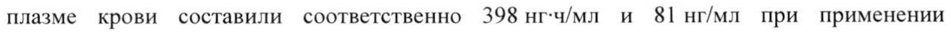
- стр. 2: «эртуглифлозина 5 мг один раз в сутки, 1193 нг-ч/мл и 268 нг/мл при применении» — низкая уверенность: «5» (63)  
  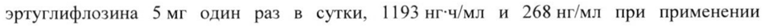
- стр. 3: «1 мг до 100 мг. После приема внутрь эртуглифлозина в дозе 15 мг абсолютная» — низкая уверенность: «100» (3), «15» (11)  
  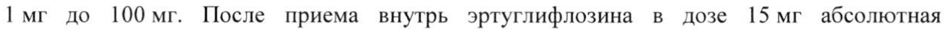
- стр. 4: «введения дозы 100 мкг составил 11 л/час. На основании  популяционного» — низкая уверенность: «100» (0), «11» (46)  
  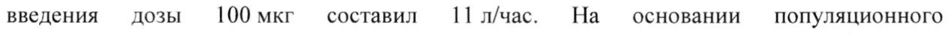
- стр. 7: «независимо от приема пищи. У пациентов, хорошо переносящих препарат Стиглатра 5 мг» — повторное чтение: «независимо от приема пищи. У пациентов, хорошо переносящих препарат Стиглатра 5 Mr»  
  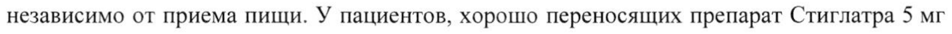
- стр. 10: «° Среднее изменение от исходного уровня в процентах в группах эртуглифлозина в дозах 5 мги 15 мг по» — повторное чтение: «2 Среднее изменение от исходного уровня в процентах в группах эртуглифлозина в дозах 5 мги 15 Mr по»  
  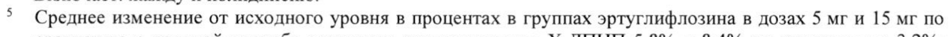
- стр. 10: «больше в группах эртуглифлозина в дозах 5 мги 15 мг (4,7% и 4,1% соответственно) по сравнению с» — низкая уверенность: «15» (68)  
  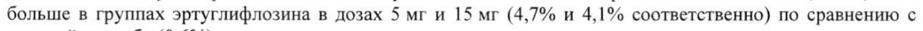
- стр. 10: «7 Доля пациентов, у которых были зарегистрированы повышение концентрации АМК на > 50% и значение» — низкая уверенность: «7» (78)  
  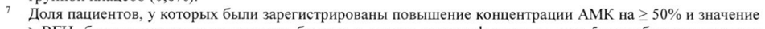
- стр. 10: «< 60 мл/мин/1,73 м? частота составила 5,1%, 2,6% и 0,5% в группах эртуглифлозина в дозе» — низкая уверенность: «мл/мин/1,73» (78)  
  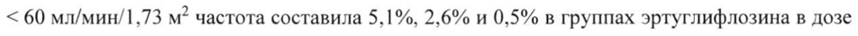
- стр. 10: «зарегистрированной гипогликемии была выше в группах эртуглифлозина в дозах 5 мг и» — повторное чтение: «зарегистрированной гипогликемии была выше в группах эртуглифлозина в дозах 5 мги»  
  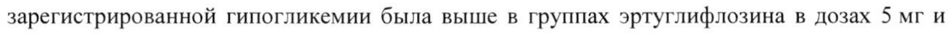
- стр. 12: «эртуглифлозин в дозе 5 мг, эртуглифлозин в дозе 15 мг и плацебо соответственно.» — низкая уверенность: «15» (0)  
  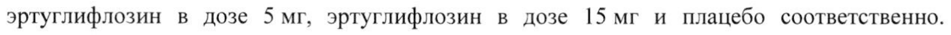
- стр. 12: «© 0,2% и 0% мужчин, получавших эртуглифлозин и плацебо соответственно. Редко» — повторное чтение: «QO ооо Осии 8 TOES SERINE, РОД»  
  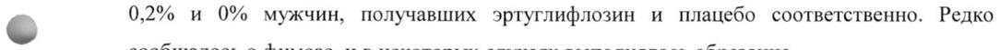
- стр. 12: «При применении перорально однократных доз до 300 мг и многократных доз до 100 мг» — низкая уверенность: «100» (77)  
  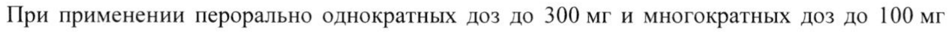
- стр. 13: «© эртуглифлозина на 39% и 15% соответственно. Это снижение экспозиции не считается» — повторное чтение: «ло»  
  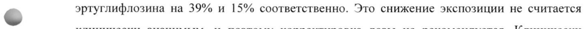
- стр. 13: «почек (рСКФ меньше 60 мл/мин/1,73 м? или клиренсом креатинина меньше 60 мл/мин),» — низкая уверенность: «мл/мин/1,73» (79)  
  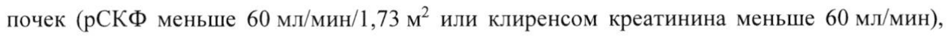
