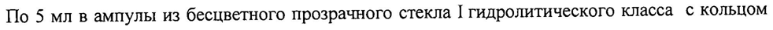

# Эсцина лизинат — парентерально

- Препарат: L-Лизина эсцинат® (концентрат для приготовления раствора для внутривенного введения;)
- АТХ: C05CX
- Источник: ГРЛС, инструкция по медицинскому применению, РУ ЛП-000504, файл от 2024-08-12 (https://grls.rosminzdrav.ru/Grls_View_v2.aspx?routingGuid=6540c78c-1e34-4ce9-b948-76e39dd5185c)
- Распознано автоматически (OCR): 5 из 5 стр.
- Инструкция к другому РУ того же препарата: ЛП-000504 (исключено из реестра, решение от 12.08.2024). Текст может быть старше действующего
- Сомнительных строк после OCR: 1 (см. раздел «Проверка распознавания»)

## Общие сведения

ЛП-000504-190716 . \ МИНИСТЕРСТВО ЗДРАВООХРАНЕНИЯ РОССИЙСКОЙ КОРАЕВАЩИИ
ИНСТРУКЦИЯ по применению лекарственного препарата для медицинского применения
[.-лизина эсцинат® Регистрационный номер:
Торговое наименование: Г.-лизина эсцинат®
Группировочное наименование: эсцина лизинат

## 3. Лекарственная форма

концентрат для приготовления раствора для внутривенного введения.
концентрат для приготовления раствора для внутривенного введения.
Состав на 1 мл:
| Активное вещество: [.-лизина эсцинат - 1,0 мг.
Вспомогательные вещества: этанол 96% - 200,0 мг, пропиленгликоль — 200,0 мг, вода для инъекций — до | мл. ,
Описание: прозрачная, бесцветная или слабо окрашенная жидкость.
Фармакотерапевтическая группа: ангиопротекторное средство
Код ATX: С05СХ | Фармакологические свойства о | |

## 5.1. Фармакодинамика

[.-лизина эсцинат понижает активность лизосомальных гидролаз, что предупреждает расщепление мукополисахаридов в стенках капилляров и в соединительной ткани,
[.-лизина эсцинат понижает активность лизосомальных гидролаз, что предупреждает расщепление мукополисахаридов в стенках капилляров и в соединительной ткани,
| которая их окружает, и таким образом нормализует повышенную сосудисто-тканевую проницаемость и оказывает антиэкссудативное (противоотечное), противовоспалительное
. и обезболивающее действие. Препарат повышает тонус сосудов, оказывает умеренный иммунокорригирующий и гипогликемический эффекты.

## 5.2. Фармакокинетика

Не изучалась.
Не изучалась.
Показания к применению e Посттравматические и послеоперационные отеки мягких тканей различной локализации; ° e Отек головного или спинного мозга травматического или послеоперационного происхождения;
96609 ЛП-000504-190716 ° Нарушения периферического венозного кровообращения, сопровождающиеся отеками.

## 4.3. Противопоказания

| e повышенная чувствительность к Г.-лизина эсцинату и/или другим компонентам препарата; | e тяжелые нарушения функции почек;
| e повышенная чувствительность к Г.-лизина эсцинату и/или другим компонентам препарата; | e тяжелые нарушения функции почек;
e тяжелые нарушения функции печени; | e кровотечения;
° детский возраст до 18 лет;
° беременность;
° период грудного вскармливания.

## 4.3. С осторожностью

при алкоголизме, а также пациентам с заболеваниями печени и эпилепсией.
при алкоголизме, а также пациентам с заболеваниями печени и эпилепсией.

## 4.6. Применение при беременности и в период грудного вскармливания

Применение препарата при беременности и в период грудного вскармливания
_. противопоказано.

## 4.2. Способ применения и дозы

| | Препарат вводят внутривенно медленно, как правило, капельно (внутриартериальное | введение не допускается!) в суточной дозе 5-10 мл.
| | Препарат вводят внутривенно медленно, как правило, капельно (внутриартериальное | введение не допускается!) в суточной дозе 5-10 мл.
Для приготовления инфузионного раствора Г-лизина эсцинат® разводят в 15-100 мл 0,9 % | раствора натрия хлорида.
При необходимости препарат можно вводить внутривенно струйно очень медленно. Для внутривенного струйного введения Г-лизина эсцинат® разводят в 10-15 мл 0,9% раствора натрия хлорида. Без предварительного разведения препарат не применяется.
При состояниях, угрожающих жизни пациента (черепно-мозговая травма, .
послеоперационные отеки головного и спинного мозга с явлениями отека-набухания, | отечность больших размеров вследствие обширных травм мягких тканей), суточную дозу | препарата увеличивают до 20 мл, разделив Ha 2 приема. Oo
Длительность курса лечения — от 2 до 8 дней, в зависимости от состояния пациента и эффективности терапии. | 96609 |
ЛП-000504-190716 Побочное действие Аллергические реакции: кожная сыпь (папулезная, петехиальная, эритематозная), кожный зуд, гиперемия кожи, гипертермия, крапивница, отек Квинке, анафилактический шок.
Со стороны центральной и периферической нервной системы: головная боль, головокружение, тремор, парестезии, шаткая походка, нарушение равновесия, кратковременная потеря сознания.
Со стороны печени и билиарной системы: повышение активности трансаминаз и уровня билирубина.
Со стороны желудочно-кишечного тракта: тошнота, рвота, диарея, боль в животе.
Со стороны сердечно-сосудистой системы: артериальная гипотензия, артериальная гипертензия, тахикардия, боль за грудиной.
| Со стороны органов дыхания: чувство нехватки воздуха, одышка, бронхообструкция, сухой кашель.
Местные реакции: чувство жжения по ходу вены при введении, флебит, боль и отек в месте введения. |
Прочие: общая слабость, озноб, чувство жара, боль в пояснице, потливость.

## 4.9. Передозировка

Симптомы: жар, тахикардия, тошнота, изжога, боль в эпигастрии.
Симптомы: жар, тахикардия, тошнота, изжога, боль в эпигастрии.
Лечение: симптоматическая терапия.

## 4.5. Взаимодействие с другими лекарственными средствами

Препарат не следует применять одновременно с аминогликозидами из-за возможности повышения их нефротоксичности.
В случае недавней, предшествующей назначению Г.-лизина эсцината, длительной терапии антикоагулянтами или при необходимости одновременного назначения [-лизина эсцината и антикоагулянтов необходимо проводить коррекцию дозы последних под контролем протромбинового индекса.
Связывание эсцина с белками плазмы затрудняется при одновременном применении антибиотиков цефалоспоринового ряда, что может повышать концентрацию свободного эсцина в крови с риском развития побочных эффектов последнего.
В состав входит спирт этиловый 96 %. Необходимо учитывать возможное взаимодействие спирта с другими лекарственными препаратами.
96609 | | ЛП-000504-190716

## 4.4. Особые указания

У отдельных пациентов с гепатохолециститом при назначении препарата возможно кратковременное повышение активности трансаминаз и билирубина (прямой фракции), не представляющие угрозы для пациентов и не требующее отмены препарата.
У отдельных пациентов с гепатохолециститом при назначении препарата возможно кратковременное повышение активности трансаминаз и билирубина (прямой фракции), не представляющие угрозы для пациентов и не требующее отмены препарата.
Влияние лекарственного препарата для медицинского применения на способность управлять транспортными средствами, механизмами
Препарат содержит объемных 23,8% этанола, то есть до 2,4 мл этанола в разовой дозе и максимально до 6,1 мл в сутки, что соответствует 122 мл пива или 50,8 мл вина в сутки.
Применение препарата может влиять на способность к управлению транспортными средствами и механизмами, но вследствие тяжести травм, при которых показано применение, этот фактор обычно не имеет значения.

## 6.5. Форма выпуска

Концентрат для приготовления раствора для внутривенного введения | мг/мл.
По 5 мл в ампулы из бесцветного прозрачного стекла | гидролитического класса с кольцом излома желтого цвета или с точкой излома, или без кольца и точки.

По 5 ампул вкладывают в контурную ячейковую упаковку из пленки поливинилхлоридной или в контурную ячейковую упаковку из пленки поливинилхлоридной, покрытую пленкой полиэтилентерфталатной термосварочной.

Две контурные ячейковые упаковки вместе с инструкцией по применению и скарификатором ампульным вкладывают в пачку.

При использовании ампул с точкой излома или кольцом излома скарификатор в пачку не вкладывают.

Упаковка «in bulk»

По 5 ампул вкладывают в контурную ячейковую упаковку из пленки

поливинилхлоридной или в контурную ячейковую упаковку из пленки

поливинилхлоридной, покрытую пленкой полиэтилентерфталатной термосварочной.

80 контурных ячейковых упаковок вкладывают в короб картонный.

## 6.4. Условия хранения

Хранить в оригинальной упаковке при температуре не выше 25°С.

Хранить в недоступном для детей месте!

## 6.3. Срок годности

|
|

2 года.

96609 ЛП-000504-190716 Не использовать после истечения срока годности.
Условия отпуска Отпускают по рецепту.
Производитель ПАО «Галичфарм»
Украина, 79024, г. Львов, ул. Опрышковская, 6/8.
Фасовщик (первичная упаковка)
ПАО «Галичфарм»
Украина, 79024, г. Львов, ул. Опрышковская, 6/8. |
Упаковщик (вторичная (потребительская) упаковка)
ПАО «Галичфарм»
Украина, 79024, г. Львов, ул. Опрышковская, 6/8.
ООО «Завод Медсинтез»
Россия ‚624130, Свердловская обл., г. Новоуральск, ул. Торговая, дом 15.
«ФАРМАЦЕУТИКАЛ БАЛКАНС»
д.о.о. Нови Бечей, Куманачки пут 66, Нови Бечей, Республика Сербия.
Выпускающий контроль качества | ПАО «Галичфарм» Украина.
- ООО «Завод Медсинтез», Россия.
«ФАРМАЦЕУТИКАЛ BAJIKAHC» д.о.о. Нови Бечей, Республика Сербия.
Адрес и телефон уполномоченной организации (для направления претензий потребителей и рекламаций)
Представительство Корпорации «АРТЕРИУМ» в Российской Федерации:
Адрес: 109004, г. Москва, ул. Таганская, 3, офис 509-510. Тел. (495) 640 20 02
M3 P® > ЭКСПЕРТНЫЙ ОТЧЕТ В 2 [ДЕЙСТВИТЕЛЕН ДЛЯ ДАННОЙ о
ATS? | ВЕРСИИ ДОКУМЕНТА 1 Я | . № р 3 © №№ ч000090000$
Генеральный директор KS Pegi: р. ©)
. S/ pM AME енто» \S OOO «Экспертно-юридический центр» 5 дей р |= Ренев А.В.
vl *exXpert &Legay /= e\%, Center» ре гу 5
ON ау OS LY 96609 SMOKERS
## Проверка распознавания

Страницы-сканы распознаны автоматически. В 1 строках с дозировками цифры могли распознаться с ошибкой — сверьте с вырезкой из оригинала:

- стр. 4: «По 5 мл в ампулы из бесцветного прозрачного стекла | гидролитического класса с кольцом» — повторное чтение: «По 5 млв ампулы из бесцветного прозрачного стекла Ггидролитического класса с кольцом»  
  
