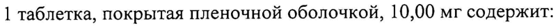
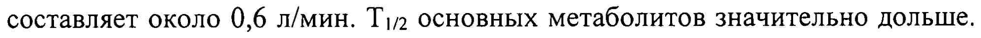

# Эсциталопрам Канон — внутрь

- Препарат: Эсциталопрам Канон (таблетки, покрытые пленочной оболочкой;)
- АТХ: N06AB10
- Источник: ГРЛС, инструкция по медицинскому применению, РУ ЛП-003471, файл от 2024-02-20 (https://grls.rosminzdrav.ru/Grls_View_v2.aspx?routingGuid=a3cbdbcd-21f4-403f-ba37-5776839d368a)
- Распознано автоматически (OCR): 27 из 27 стр.
- Инструкция к другому РУ того же препарата: ЛП-003471 (национальное РУ, переоформленное по правилам ЕАЭС, решение от 24.01.2024). Текст может быть старше действующего
- Сомнительных строк после OCR: 2 (см. раздел «Проверка распознавания»)

## Общие сведения

МИНИСТЕРСТВО ЗДРАВООХРАНЕНИЯ РО ССИИСКОЙ OEE yi
ИНСТРУВНИЯ ЛП - 003471 - 260216 по применению лекарственного препарата для медицинское применения
Эсциталопрам Канон _ наименование лекарственного препарата

Регистрационный номер:
Торговое наименование: Эсциталопрам Канон

_ Международное непатентованное наименование: эсциталопрам

| Лекарственная форма: таблетки, покрытые пленочной оболочкой

## 2. Состав

Дозировка 5 мг 1 таблетка, покрытая пленочной оболочкой, 5,00 мг содержит:
Дозировка 5 мг 1 таблетка, покрытая пленочной оболочкой, 5,00 мг содержит:
активное вещество: эсциталопрама оксалат 6,39 мг, в пересчете на эсциталопрам 5,00 мг;
вспомогательные вещества: кроскармеллоза натрия 3,00 мг, магния стеарат 1,00 мг, просолв [целлюлоза микрокристаллическая 98%, кремния диоксид коллоидный 2%] 108,61 мг, стеариновая кислота 1,00 мг; |

, пленочная оболочка: Опадрай белый 4,000 мг, в том числе: гипромеллоза
(гидроксипропилметилцеллюлоза) 1,350 мг, гипролоза (гидроксипропилцеллюлоза) 1,350 мг, тальк 0,800 мг, титана диоксид 0,500 мг.
Дозировка 10 мг 1 таблетка, покрытая пленочной оболочкой, 10,00 мг содержит:
активное вещество: эсциталопрама оксалат 12,78 мг, в пересчете на эсциталопрам 10,00 мг;
вспомогательные вещества: кроскармеллоза натрия 4,50 мг, магния стеарат 1,50 мг, просолв [целлюлоза микрокристаллическая 98%, кремния диоксид коллоидный 2%] 159,72 мг, стеариновая кислота 1,50 мг;

927.86 9 + ЛП -003471 - 260216 пленочная оболочка: Опадрай белый 6,000 мг, в том числе: гипромеллоза .
СОГЛАСОВАНО (гидроксипропилметилцеллюлоза) 2,025 мг, гипролоза—(гинрекеипропил= целлюлоза) 2,025 мг, тальк 1,200 мг, титана диоксид 0,750 мг. |
| Дозировка 20 мг 1 таблетка, покрытая пленочной оболочкой, 20,00 мг содержит:
активное вещество: эсциталопрама оксалат 25,55 мг, в пересчете на эсциталопрам 20,00 мг;
вспомогательные вещества: кроскармеллоза натрия 6,75 мг, магния стеарат
. 2,25 мг, просолв [целлюлоза микрокристаллическая 98%, кремния диоксид
| коллоидный 2%] 233,20 мг, стеариновая кислота 2,25 мг;
пленочная оболочка: Опадрай белый 9,000 мг, в том числе: гипромеллоза
(гидроксипропилметилцеллюлоза) 3,038 мг, гипролоза (гидроксипропилцеллюлоза) 3,037 мг, тальк 1,800 мг, титана диоксид 1,125 мг.
Описание Таблетки круглые двояковыпуклые с риской, покрытые пленочной оболочкой белого или почти белого цвета. На поперечном разрезе почти белого цвета.
Фармакотерапевтическая группа: антидепрессант
Код ATX: №06АВ10 | Фармакологические свойства

## 5.1. Фармакодинамика

Эсциталопрам — селективный ингибитор обратного захвата серотонина
Эсциталопрам — селективный ингибитор обратного захвата серотонина
(5-НТ) с высокой аффинностью к первичному активному центру. Он также связан с аллостерическим центром на транспортере серотонина с | аффинностью ниже в 1000 раз. |
Эсциталопрам не имеет или имеет низкую аффинность к ряду рецепторов, включая 5-HT 14, 5-HT2, DA D, и D2 a) -, a2 -, В-адренорецепторы, гистамин Hi, холинергический мускарин, бензодиазепин и опиоидные рецепторы.
7 2 92786 МИНЗДРАВ РОССИИ ЛИ - 003471 - 260216
Ингибирование обратного захвата 5-НТ является е инств И жным механизмом действия, который объясняет фармакологическое и клиническое воздействие эсциталопрама.
Клиническая эффективность Депрессивные эпизоды тяжелой степени
Была обнаружена эффективность эсциталопрама при неотложном лечении депрессивных эпизодов тяжелой степени в трех из четырех двойных слепых | плацебо-контролируемых краткосрочных (8-недельных) исследованиях. Во зи время долгосрочного исследования по предотвращению срывов 274 пациента, прошедших первоначальную 8-недельную фазу открытого исследования и принимавших эсциталопрам в дозировке 10 или 20 мг в сутки, были рандомизированы и в дальнейшем принимали эсциталопрам в той же дозировке или плацебо на протяжении максимум 36 недель. На протяжении данного исследования пациенты, которые продолжали принимать эсциталопрам, не испытывали срыва в течение более длительного периода времени в последующие 36 недель по сравнению с теми, кто принимал плацебо.
Социальная фобия Эсциталопрам показал свою эффективность как на протяжении трех краткосрочных (12-недельных) исследований, так и во время 6-месячных исследований по предотвращению срыва у пациентов с социальной фобией.
На протяжении 24-недельного исследования подбора дозы была показана | эффективность эсциталопрама в дозе 5, 10 и 20 мг. |
Генерализованное тревожное расстройство Эсциталопрам в дозе 10 и 20 мг в день показал свою эффективность в четырех из четырех плацебо-контролируемых исследованиях. !
Суммарный анализ данных трех сводных исследований, включающих в себя 421 пациента, принимающего эсциталопрам, и 419 пациентов, принимающих 3 , 9278 6
| | МИНЗДРАВ РОССИИ ЛИ - 003471 - 260216 плацебо, включал в себя 47,5% и 28,9% пациентов, у “ROTOPRR! WReuenne достигло цели, соответственно, и 37,1% и 20,8% пациентов, болезнь которых перешла в стадию ремиссии. Устойчивое воздействие наблюдалось, начиная с
| 1 недели.
Поддержание эффективности эсциталопрама в дозировке 20 мг в день было продемонстрировано в рамках 24-76-недельного рандомизированного исследования, направленного на поддержание эффективности лечения, проведенного с участием 373 пациентов, у которых наблюдалось улучшение на протяжении первоначального 12-недельного открытого исследования.
_ Обсессивно-компульсивное расстройство В рандомизированном двойном слепом клиническом исследовании действие эсциталопрама в дозе 20 мг в день сравнивалось с плацебо на основании подсчетов по обсессивно-компульсивной шкале Йеля-Брауна через 12 недель.
Через 24 недели эсциталопрам в дозировке 10 и 20 мг в день показал более высокие результаты по сравнению с плацебо.
Профилактика рецидивов была продемонстрирована при приеме эсциталопрама в дозе 10 и 20 мг в день пациентами, лечение которых эсциталопрамом показало успешные результаты на протяжении 16-недельного открытого исследования, которые участвовали в 24-недельном рандомизированном двойном слепом плацебо-контролируемом исследовании.
На протяжении двойного слепого плацебо-контролируемого. исследования
ЭКГ, проводимого на здоровых пациентах, отличие ОТ от изолинии
(коррекция по формуле Fridericia) составило 4,3 мсек. (90% ДИ: 2.2, 6.4) при дозировке в 10 мгв день и 10,7 мсек. (90% ДИ: 8.6, 12.8) при дозировке 30 мг в день.
| Фармакокинетика Всасывание , 4 92786 МИНЗДРАВ РОССИИ
ЛИ - 003471 - 260216

Препарат всасывается практически полностью И не зависит) ОТ, приема пищи

(среднее время достижения максимальной концентрации (среднее Tmax)

составляет 4 часа после приема в различных дозировках). Как и в случае с

рацемическим циталопрамом, абсолютная биодоступность эсциталопрама

предполагается на уровне около 80%.

Распределение

Предполагаемый уровень распределения (Уав/Е) после приема внутрь

составляет от 12 до 26 л/кг. Связывание с белками плазмы крови не превышает

80% для эсциталопрама и его основных метаболитов.

Метаболизм

Эсциталопрам метаболизируется в печени до деметилированных и

дидеметилированных метаболитов. Оба вещества фармакологически активны.

Как вариант, азот окисляется и формирует метаболит /М№-оксида. Как исходное

вещество, так и метаболиты частично экскретируются в виде глюкуронидов.

После приема разных дозировок средняя концентрация деметилированных и

дидеметилированных метаболитов, как правило, составляет 28-31% и <5%,

соответственно, от концентрации эсциталопрама.

Биотрансформация эсциталопрама в деметилированный — метаболит
| осуществляется в основном при помощи СУР2С19. Ферменты СУРЗА4 и

CYP2D6 также могут оказать определенное влияние.

Выведение

Период полувыведения (Т!/2) после приема различных дозировок составляет

приблизительно 30 4, клиренс плазмы (СЪ) при пероральном приеме

составляет около 0,6 л/мин. Т!/2 основных метаболитов значительно дольше.

Эсциталопрам и основные метаболиты выводятся в основном через печень

(путем метаболизма) и почки, при этом основная часть дозы выводится в виде

метаболитов почками.

Фармакокинетика линейная. Стабильный уровень препарата в плазме крови

92786 :
МИНЗДРАВ РОССИНИ ЛИ - 003471 - 260216 достигается приблизительно через 1 неделю. СредйЯЯА^СФВНвесная концентрация в 50 нмоль/л (в диапазоне от 20 до 125 нмоль/л) достигается при
’ ежедневной дозировке в 10 мг.
Пациенты пожилого возраста (> 65 лет)
У пожилых пациентов эсциталопрам выводится медленнее по сравнению с молодыми пациентами. Системное воздействие (AUC) у пожилых пациентов примерно на 50% выше по сравнению с молодыми.
Пациенты с нарушением функции печени
7 У пациентов с легким или умеренным нарушением функции печени (легкое a нарушение или хроническое алкогольное поражение печени) Tip эсциталопрама примерно в два раза длиннее и воздействие было приблизительно на 60% выше, чем у субъектов с нормальным функционированием печени.
Пациенты с нарушением функции почек В случае с рацемическим циталопрамом, у пациентов с нарушением функции почек (клиренс креатинина (КК) 10-53 мл/мин) наблюдается более длинный
Tin и небольшое увеличение воздействия. Концентрации метаболитов в плазме крови не изучались, однако они могут быть повышены.
Полиморфизм Было установлено, что медленные метаболизаторы СУР2С19 демонстрируют в два раза более высокую концентрацию эсциталопрама в плазме крови по сравнению с быстрыми метаболизаторами. У медленных метаболизаторов
CYP2D6 не наблюдалось значительных отличий в воздействии.
Показания к применению e Депрессивные расстройства; | e Паническое расстройство с/без агорафобией;
e Социальное тревожное расстройство (социальная фобия);
| 92786 МИНЗДРАВ РОССИИ ЛП - 003471 - 260216 e Генерализованное тревожное расстройстве СОГЛАСОВАН

## 4.3. Противопоказания

» повышенная чувствительность к эсциталопраму или другим компонентам препарата;
» повышенная чувствительность к эсциталопраму или другим компонентам препарата;
® одновременный прием с ингибиторами моноаминооксидазы (МАО), моноаминооксидазы-А (МАО-А) (например, моклобемид) или обратимыми неселективными ингибиторами МАО;
» пациенты с удлинением интервала ОТ (врожденный синдром

— удлиненного интервала ОТ); одновременный прием препаратов,

7 способных удлинять интервал ОТ (например, антиаритмические препараты ША и Ш классов, трициклические антидепрессанты, макролиды); |

® беременность;
» период грудного вскармливания;
» детский возраст до 18 лет;
e Одновременный прием пимозида.

## 4.3. С осторожностью

Почечная недостаточность (КК менее 30 мл/мин), маниакальные расстройства
Почечная недостаточность (КК менее 30 мл/мин), маниакальные расстройства
| (в тч. в анамнезе), фармакологически неконтролируемая эпилепсия, депрессия с суицидальными попытками, сахарный диабет, электросудорожная терапия; пожилой возраст (старше 65 лет), цирроз печени, склонность к кровотечениям, одновременный прием с этанолом, лекарственными препаратами, снижающими порог судорожной готовности, литием, триптофанами, лекарственными препаратами, содержащими зверобой продырявленный; с препаратами, вызывающими — гипонатриемию, антикоагулянтами для приема внутрь и лекарственными препаратами, влияющими на свертываемость крови; с препаратами, метаболизирующимися
«9 2786 | ЛИ - 003471 - 260216 с участием системы СУР2С19.
СОГЛАСОВАНО

## 4.2. Способ применения и дозы

Внутрь, 1 раз в сутки, независимо от приема пищи.
Внутрь, 1 раз в сутки, независимо от приема пищи.
Максимальная суточная доза составляет 20 мг.
Депрессивные расстройства Обычная доза составляет 10 мг/день. В зависимости от клинического состояния пациента доза препарата может быть увеличена до максимальной — 20 мг/день.
Антидепрессивный эффект обычно развивается через 2-4 недели после начала

~- лечения. После исчезновения симптомов депрессии как минимум еще в течение 6 месяцев необходимо продолжить терапию для закрепления полученного эффекта.
Паническое расстройство с/без агорафобией |
Рекомендуемая начальная доза в течение первой недели терапии составляет 5 мг с последующим увеличением до 10 мг/день. В зависимости от клинического состояния пациента доза препарата может быть увеличена до | максимальной — 20 мг/день. Максимальный клинический эффект достигается через 3 месяца после начала терапии. Лечение продолжается на протяжении | нескольких месяцев. |

| Социальное тревожное расстройство (социальная фобия)
Обычно назначают 10 мг один раз в сутки. Ослабление симптомов обычно развивается через 2-4 недели после начала лечения. В зависимости от клинического состояния пациента доза препарата впоследствии может быть уменьшена до 5 мг/день или увеличена до максимальной — 20 мг/день.
Поскольку социальное тревожное расстройство является заболеванием с хроническим течением, минимальная рекомендуемая длительность терапевтического курса составляет 12 недель. Для предотвращения рецидивов заболевания препарат может назначаться в течение 6 месяцев или дольше в

_ 92786 | МИНЗДРАВ РОССИИ ЛИ - 003471 - 260216 зависимости от клинического состояния пациента. Рекомендуется регулярно
C ON AC Oph H @ осуществлять оценку проводимого лечения.
Генерализованное тревожное расстройство Рекомендуемая начальная доза — 10 мг/день. В зависимости от клинического состояния пациента доза препарата может быть увеличена до максимальной — 20 мг/день. Допускается длительное назначение препарата (6 месяцев и дольше) в дозе 20 мг/день.
Пожилые пациенты (старше 65 лет)
| Начальная доза составляет половину от рекомендуемой (5 мг). В зависимости we от клинического состояния пациента доза препарата может быть увеличена до 10 мг/сут.
Пациенты с почечной недостаточностью Коррекции дозы при легкой или умеренной почечной недостаточности не требуется. При клиренсе креатинина менее 30 мл/мин препарат следует применять с осторожностью под контролем врача.
Пациенты с печеночной недостаточностью Для пациентов с легкой или умеренной печеночной недостаточностью (класс по шкале Чайлд-Пью А или В) начальная доза в течение первых двух недель
| составляет 5 мг/день. В зависимости от клинического состояния пациента доза препарата может быть повышена до 10 мг/день. При тяжелой печеночной недостаточности (класс С по шкале Чайлд-Пью) препарат назначается под пристальным контролем врача.
Дефицит изофермента CYP2C19 Для пациентов с дефицитом изофермента СУР2С19 начальная доза в первые 2 недели составляет 5 мг/день. В зависимости от клинического состояния пациента доза препарата может быть увеличена до 10 мг/день.
Отмена препарата Следует избегать резкой отмены препарата. При прекращении лечения 92786
МИНЗДРАВ РОССИНИ ЛИ - 003471 - 260216

эсциталопрамом доза препарата должна постепенно снижат & Ав рвалом в 1-2 недели с целью снижения риска развития синдрома «отмены».
При непереносимости снижения дозы возможно возобновление приема | препарата в прежней дозе или снижение дозы с большим интервалом.

## 4.6. Применение при беременности и в период грудного вскармливания

Применение при беременности Применение препарата при беременности противопоказано в связи с отсутствием клинических данных по эффективности и безопасности.
Имеются ограниченные данные о приеме эсциталопрама во время

2 беременности. Во время исследований репродуктивной токсичности эсциталопрама на крысах наблюдалась эмбриофетотоксичность, однако не было установлено повышение количества врожденных пороков. Если прием эсциталопрама продолжался на поздних сроках беременности, особенно в третьем триместре, то за новорожденным следует установить наблюдение. В случае если прием эсциталопрама продолжался вплоть до родов или был прекращен незадолго до родов, у новорожденного возможно развитие симптомов «отмены». В случае применения матерью селективных ингибиторов обратного захвата серотонина или селективных ингибиторов

. обратного захвата серотонина и норадреналина (СИОЗС/СИОЗСН) на поздних сроках беременности у новорожденного могут развиться следующие побочные эффекты: стойкая легочная гипертензия, угнетение дыхания, цианоз, апноэ, судорожные расстройства, скачки температуры, трудности с кормлением, рвота, гипогликемия, гипертония, мышечная гипотония, гиперрефлексия, тремор, повышенная нервно-рефлекторная возбудимость, раздражительность, летаргический сон, постоянный плач, сонливость, плохой сон. Данные симптомы могут возникнуть вследствие развития синдрома
«отмены» или серотонинергического действия. В большинстве случаев подобные осложнения возникают в течение 24 ч после рождения. Применение

_ 92786 . МИНЗДРАВ РОССИНИ ЛИ - 003471 - 260216
СИОЗС/СИОЗСН на поздних сроках беременности также) оВВНИ@т риск развития стойкой легочной гипертензии новорожденных с частотой до 5 — случаев на 1000 при частоте в общей популяции 1-2 на 1000.
Применение в период грудного вскармливания
Препарат в незначительных количествах выделяется в грудное молоко, поэтому при приеме препарата в период лактации рекомендуется решить вопрос о прекращении грудного вскармливания.
Фертильность _ Проводимые на животных исследования показали, что циталопрам может
- влиять на качество спермы. Случаи из медицинской практики, включающие применение СИОЗС, показали, что воздействие на качество спермы обратимо.
До настоящего момента воздействия на фертильность человека обнаружено не было.

## 4.8. Побочное действие

| По данным Всемирной организации здравоохранения (ВОЗ) нежелательные реакции классифицированы в соответствии с их частотой развития следующим образом: очень часто (> 1/10), часто (> 1/100, < 1/10), нечасто
| По данным Всемирной организации здравоохранения (ВОЗ) нежелательные реакции классифицированы в соответствии с их частотой развития следующим образом: очень часто (> 1/10), часто (> 1/100, < 1/10), нечасто
(>1/1000, < 1/100), редко (> 1/10000, <1/1000) и очень редко (<1/10000); частота неизвестна — по имеющимся данным установить частоту возникновения не представлялось возможным. |
Co стороны системы | Частота Тромбоцитопения кроветворения и | неизвестна лимфатической системы
Со стороны — иммунной | Редко Анафилактические системы реакции 92786
МИНЗДРАВ POCCHH ЛП - 003471 - 260216 системы неизвестна антидиуретическойв0
О a oe Метаболические нарушения | Часто Снижение аппетита, и расстройства питания повышение аппетита, увеличение веса
Частота Гипонатриемия, . Со стороны психики Часто Тревога, беспокойство,
-_ необычные сновидения, снижение либидо, аноргазмия (у женщин)
Нечасто Бруксизм, ажитация, . нервозность, панические атаки, спутанность сознания
Редко Агрессия, деперсонализация, . 7 галлюцинации
Частота Мания, суицидальные неизвестна мысли, суицидальное поведение. Случаи появления суицидальных мыслей и поведения были | отмечены при приеме эсциталопрама и сразу после отмены терапии!
92786 | МИНЗДРАВ РОССИНИ ЛП - 003471 - 260216
Со стороны нервной | Часто рессонница, ‚добеийрсть, системы головокружение, парестезии, тремор |
Редко Нарушение вкусовых ощущений, синкопе, серотониновый синдром
Частота Дискинезия, конвульсии, . неизвестна судорожные расстройства,
> психомоторное возбуждение/акатизия?
Со стороны органа зрения Нечасто Мидриаз (расширение
Е Со стороны органа слуха и | Нечасто Тиннитус (шум в ушах)
ee И ИИ Частота Вентрикулярная аритмия, `. | неизвестна включая желудочковую тахикардию типа
«пируэт», удлинение интервала ОТ, ортостатическая гипотензия
Со стороны дыхательной | Часто Синусит, зевательная 92786
МИНЗДРАВ РОССИНИ ЛИ - 003471 - 260216 кишечного тракта Часто Диарея, запор, рвота,
Нечасто Желудочно-кишечное кровотечение, включая кровотечение из прямой кишки
Со стороны печени и| Частота Гепатит, нарушение
. желчевыводящих путей неизвестна функции печени,
- повышение активности | печеночных ферментов.
Со стороны кожи и| Часто Повышенное подкожных тканей потоотделение |
Нечасто Зуд, покраснение, крапивница, сыпь, в том числе буллезная, алопеция
Частота Ангионевротический неизвестна отек, подкожные
И кровоизлияния Со стороны опорно- | Часто Артралгия, миалгия двигательного аппарата и соединительной ткани
Нарушения со — стороны | Частота Задержка мочи почек и мочевыводящих | неизвестна путей
Со стороны репродуктивной | Часто Импотенция, нарушение системы и молочной железы эякуляции 92786
ООО ООО | МИНЗДРАВ РОССИИ ЛИ - 003471 - 260216 кровотечение), меноррагия
Частота Галакторея, приапизм неизвестна Прочее Часто Чувство усталости,
_ ' Имеются сообщения о случаях суицидальных настроений и суицидального
| поведения во время приема эсциталопрама или сразу же после прекращения лечения. —
? Сообщения о данных явлениях поступили в отношении лечебного класса
СИОЗС.
Класс-эффект При проведении эпидемиологических исследований с участием пациентов в возрасте 50 лет и более сообщалось о повышенном риске переломов костей у пациентов, получающих СИОЗС и трициклические антидепрессанты.
Механизм, приводящий к данному риску, неизвестен.
. Симптомы отмены после окончания лечения
Прекращение приема СИОЗС/СИОЗСН (в особенности резкое), как правило, приводит к возникновению симптомов отмены. Наиболее часто наблюдаются такие реакции, как головокружение, сенсорные нарушения (включая парестезию и ощущение электрошока), нарушение сна (включая бессонницу и яркие сны), возбуждение или беспокойство, тошнота и/или рвота, тремор, спутанность сознания, потоотделение, головная боль, диарея, учащенное сердцебиение, эмоциональная неустойчивость, раздражительность и расстройства зрения. Как правило, данные явления носят легкую или умеренную степень тяжести и проходят самостоятельно, однако у некоторых 92786
МИНЗДРАВ РОССИИ ЛП - 003471 - 260216 пациентов они могут принимать тяжелую форму и быть проделжийельными.
Таким образом, когда необходимость лечения эсциталопрамом отпадает, рекомендуется отменять препарат путем постепенного снижения дозы.
Случаи удлинения интервала ОТ Сообщалось о случаях удлинения интервала ОТ и вентрикулярной аритмии, включая желудочковую тахикардию типа «пируэт», преимущественно у пациентов женского пола, с гипокалиемией или ранее существующим удлинением интервала QT или другими сердечно-сосудистыми
_ заболеваниями.

## 4.9. Передозировка

Токсичность | | Клинические данные о передозировке эсциталопрамом ограничены, и многие случаи включают в себя одновременную передозировку других препаратов. В | большинстве случаев симптомы носят легкую степень выраженности или | отсутствуют. О смертельных случаях в результате передозировки исключительно эсциталопрама сообщается редко; в основном имеет ‘место также передозировка одновременно принимаемых препаратов. Дозы в 400 и 800 мг эсциталопрама без приема других препаратов переносятся без каких-
Токсичность | | Клинические данные о передозировке эсциталопрамом ограничены, и многие случаи включают в себя одновременную передозировку других препаратов. В | большинстве случаев симптомы носят легкую степень выраженности или | отсутствуют. О смертельных случаях в результате передозировки исключительно эсциталопрама сообщается редко; в основном имеет ‘место также передозировка одновременно принимаемых препаратов. Дозы в 400 и 800 мг эсциталопрама без приема других препаратов переносятся без каких-
. либо серьезных симптомов.
| Симптомы: при передозировке препарата развивается головокружение, тремор, ажитация, тошнота, рвота, артериальная гипотензия, тахикардия, удлинение интервала ОТ, гипокалиемия, гипонатриемия, в редких случаях — серотониновый синдром, сердечные аритмии, судороги и кома.
Лечение: специфический антидот неизвестен. Лечение симптоматическое:
обеспечение постоянного притока свежего воздуха, поддержка функции внешнего дыхания, адекватная оксигенация, контроль сердечной деятельности, промывание желудка, назначение — энтеросорбентов.
Форсированный диурез, гемодиализ, гемоперфузия не эффективны.
92786 МИНЗДРАВ РОССИНИ | ЛП - 003471 - 260216
COPMACOBAHO | Взаимодействие с другими лекарственными средетва:
Фармакодинамическое взаимодействие Противопоказанные сочетания:
Необратимые неселективные ингибиторы МАО
Сообщалось о случаях серьезных нежелательных реакций у пациентов, получающих комбинированную терапию СИОЗС и необратимыми неселективными ингибиторами МАО, а также пациентов, недавно прекративших терапию СИОЗС и начавших терапию такими ингибиторами
- МАО. В некоторых случаях у пациентов развивался серотониновый синдром.
a Эсциталопрам может быть назначен через 14 дней после прекращения лечения необратимыми неселективными ингибиторами МАО. Как минимум 7 дней должно пройти после окончания приема эсциталопрама, прежде чем можно начинать лечение необратимыми неселективными ингибиторами МАО.
Обратимые селективные ингибиторы МАО типа А (моклобемид)
Из-за риска развития серотонинового синдрома совместное применение эсциталопрама с обратимыми селективными ингибиторами МАО, такими, как моклобемид, противопоказано. Если есть обоснованная необходимость в применении такой комбинации, лечение стоит начинать с минимальной рекомендуемой дозы под усиленным клиническим наблюдением.
| Обратимые неселективные ингибиторы МАО (линезолид)
Антибиотик линезолид является обратимым неселективным ингибитором
МАО и не должен применяться у пациентов, получающих терапию эсциталопрамом. Если есть обоснованная необходимость в применении такой комбинации, лечение стоит начинать с минимальных доз под внимательным клиническим наблюдением.
Необратимые селективные ингибиторы МАО типа В (селегилин)
Необходима осторожность в случае совместного применения эсциталопрама и необратимого селективного ингибитора МАО muna В (селегилина) из-за риска 92786
МИНЗДРАВ РОССИНИ | ЛИ - 003471 - 260216 развития серотонинового синдрома. Селегилин в дозах до 10 MAB ензуёйешно | применялся совместно с рацемированным циталопрамом.
Лекарственные средства, удлиняющие интервал ОТ |
Фармакокинетические и фармакодинамические исследования эсциталопрама в сочетании с другими лекарственными препаратами, которые удлиняют интервал ОТ, не проводились. Аддитивный эффект эсциталопрама и указанных лекарственных препаратов не может быть исключен. Таким | образом, одновременный прием эсциталопрама с лекарственными | препаратами, которые удлиняют интервал ОТ, такими как антиаритмические
Е средства Класса [А и Ш, нейролептики (например, производные фенотиазина, пимозид, галоперидол), трициклические антидепрессанты, некоторые антимикробные агенты (например, спарфлоксацин, моксифлоксацин, | эритромицин IV, пентамидин, противомалярийные препараты, особенно :
галофантрин), некоторые антигистаминные препараты (астемизол, мизоластин), противопоказан. |
Одновременный прием препаратов, которые требуют осторожности при использовании:
Лекарственные средства, снижающие порог судорожной готовности
| Эсциталопрам может снижать порог судорожной готовности. Необходимо |
| соблюдать осторожность при одновременном применении эсциталопрама и других средств, снижающих порог судорожной готовности (трициклические антидепрессанты, СИОЗС, нейролептики — производные фенотиазина, | тиоксантена и бутирофенона, мефлохина и трамадола). |
При одновременном применении препаратов лития и триптофана зафиксированы случаи усиления действия эсциталопрама.
Одновременное применение с препаратами зверобоя продырявленного !
(Hypericum perforatum) может привести к увеличению числа побочных эффектов.
| _ 92786 МИНЗДРАВ РОССИИ ЛИ - 003471 - 260216
Антикоагулянты и средства, влияющие на сверт ываемост USAR AHO
При одновременном применении антикоагулянтов и других препаратов, влияющих на свертываемость крови (например, атипичные нейролептики и производные фенотиазина, трициклические антидепрессанты, ацетилсалициловая кислота и нестероидные противовоспалительные препараты, тиклопидин, дипиридамол) может возникнуть нарушение | свертывания крови.
Эсциталопрам не вступает с этанолом в фармакодинамическое или
| фармакокинетическое взаимодействие. Однако, как и в случае с другими
- психотропными лекарственными средствами, одновременное применение эсциталопрама и алкоголя не рекомендуется.
Лекарственные средства, вызывающие гипокалиемию/гипомагниемию |
Требуется соблюдать осторожность при одновременном применении :
лекарственных средств, вызывающих развитие гипокалиемии/гипомагниемии, поскольку при данных состояниях повышается риск развития злокачественных аритмий. |
Фармакокинетические взаимодействия | Влияние других лекарственных средств на фармакокинетику эсциталопрама
Метаболизм эсциталопрама осуществляется в основном при помощи |
| фермента СУР2С19. Ферменты СУРЗА4 и CYP2D6 также могут участвовать в метаболизме, хотя и в меньшей степени. Метаболизм основного метаболита, 5-ДЦТ (деметилированный эсциталопрам), частично катализируется CYP2D6. |
Одновременное введение эсциталопрама и омепразола 30 мг раз в день |
(ингибитор СУР2С19) привело к умеренному (приблизительно на 50%)
увеличению концентрации эсциталопрама в плазме крови.
Одновременное введение эсциталопрама и циметидина 400 мг 2 раза в день
(общий ингибитор ферментов средней силы) привело к увеличению |
(приблизительно Ha 70%) концентрации эсциталопрама в плазме крови. | 92786
МИНЗДРАВ РОССИИ ЛП -003471 - 260216 Эсциталопрам необходимо с осторожностью комринировать с. циметидином.
Рекомендуется корректировка дозы. | Таким образом, препарат нужно с осторожностью комбинировать с ингибиторами CYP2C19 (такими как омепразол, эзомепразол, флувоксамин, лансопразол, тиклопидин) или циметидином. После отслеживания побочных эффектов, вызванных одновременным применением других препаратов, может потребоваться снижение дозы эсциталопрама.
Влияние эсциталопрама на фармакокинетику других лекарственных средств
Эсциталопрам является ингибитором фермента CYP2D6. Необходимо | соблюдать осторожность при одновременном применении эсциталопрама и лекарственных препаратов с узким терапевтическим диапазоном, которые в | основном метаболизируются данным ферментом, например, флекаинида, пропафенона и метопролола (для использования при сердечной | недостаточности), ИЛИ некоторых лекарственных препаратов, воздействующих на ЦНС, которые в основном метаболизируются CYP2D6, напрмер, антидепрессантов, таких как одезиирамин, кломипрамин и нортриптилин или нейролептиков, таких как рисперидон, тиоридазин и галоперидол. Может быть рекомендована корректировка дозы.
Одновременный прием препаратов с дезиирамином или метопрололом привел к двукратному увеличению концентрации данных субстратов CYP2D6 в плазме крови.
Исследование in vitro показали, что эсциталопрам может также быть слабым ингибитором СУР2С19. Рекомендуется с осторожностью использовать препарат одновременно с лекарственными средствами, метаболизируемыми
CYP2C19.

## 4.4. Особые указания

Применение с ингибиторами МАО
Применение с ингибиторами МАО
Эсциталопрам нельзя назначать одновременно с ингибиторами МАО из-за 92786 =
МИНЗДРАВ POCCHH ЛП - 003471 - 260216 риска развития серотонинового синдрома. Эвцитапог paid MG MEH быть назначен через 14 дней после прекращения лечения необратимыми ингибиторами МАО и как минимум через 1 день после прекращения лечения обратимыми ингибиторами МАО типа А (моклобемид).
Как минимум 7 дней должно пройти после окончания приема эсциталопрама,
| прежде чем можно начинать лечение неселективными ингибиторами МАО.
Применение препарата у детей и подростков, не достигших 18 лет
Антидепрессанты противопоказаны детям и подросткам в возрасте до 18 лет из-за повышенного риска возникновения суицидального поведения (попыток суицида и суицидальных мыслей), враждебности (с преобладанием агрессивного поведения, склонности к конфронтации и раздражения).
У молодых людей младше 25 лет с депрессией и другими психическими нарушениями антидепрессанты, по сравнению с плацебо, повышают риск возникновения суицидальных мыслей и суицидального поведения. Поэтому при назначении препарата и любых других антидепрессантов молодым людям младше 25 лет следует соотнести риск суицида и пользу от их применения. В случае принятия решения о начале терапии антидепрессантами пациент должен находиться под тщательным наблюдением с целью раннего выявления нарушений или изменений поведения, а также суицидальных наклонностей.
Парадоксальная тревога При применении препаратов, принадлежащих к терапевтической группе
СИОЗС, включая эсциталопрам, следует учитывать, что у некоторых пациентов с паническими расстройствами в начале лечения СИОЗС может наблюдаться усиление тревоги. Подобная парадоксальная реакция обычно исчезает в течение первых двух недель лечения. Чтобы снизить вероятность возникновения анксиогенного эффекта рекомендуется использовать низкие | начальные дозы. | 7 |
МИНЗДРАВ РОССИИ | Эпилептические припадки COTAAGOBAHO
Прием эсциталопрама следует прекратить, если у пациента впервые случается эпилептический припадок или учащаются его приступы (у пациентов с
| эпилепсией в анамнезе). | Пациентам с нестабильной эпилепсией следует избегать прием СИОЗС, a за пациентами с контролируемой эпилепсией следует тщательно наблюдать.
Мания Эсциталопрам рекомендуется с осторожностью назначать пациентам с манией, гипоманией в анамнезе. При развитии маниакального состояния эсциталопрам должен быть отменен. |
Диабет У пациентов с сахарным диабетом лечение эсциталопрамом может изменить уровень глюкозы в плазме крови. Поэтому может потребоваться коррекция доз
| инсулина и/или пероральных гипогликемических препаратов.
Суицид/суицидальные мысли или клиническое ухудшение депрессивных состояний
Необходимо тщательное наблюдение за пациентами, принимающими антидепрессанты, особенно в начале терапии из-за возможности клинического ухудшения и/или появления суицидальных мыслей и поведения. Клинический
| опыт показывает, что повышенный риск суицида, как правило, наблюдается на ранних стадиях выздоровления.
Другие психические расстройства, при которых назначают эсциталопрам, также могут быть связаны с повышенным риском суицидальных действий и проявлений. Кроме того, эти заболевания могут сопутствовать депрессивному расстройству тяжелой степени. Меры предосторожности, соблюдающиеся при лечении больных с депрессивным расстройством тяжелой степени, также необходимо соблюдать при лечении пациентов с другими психическими расстройствами.
92786 МНИЗДРАВ РОССИНИ ЛП - 003471 - 260216
Известно, что пациенты с суицидальными действиями САГИроявлениями в анамнезе, или те, кто проявлял суицидальную направленность мышления до
`° Лечения, подвергаются большему риску суицидальных намерений или попыток, поэтому за ними следует тщательно наблюдать во время лечения.
| Метаанализ плацебо-контролируемых клинических испытаний антидепрессантов у взрослых пациентов с психическими расстройствами |
| показал повышенный риск суицидального поведения при приеме | антидепрессантов по сравнению с плацебо у пациентов в возрасте менее 25 :
лет. Тщательное наблюдение за пациентами, в частности, лицами с высоким риском, должно сопутствовать медикаментозной терапии в особенности в начале лечения и после изменения дозы.
Пациентов и лиц, осуществляющих уход за больными, следует предупредить | о необходимости отслеживать любое клиническое ухудшение, суицидальное поведение или намерения, а также необычные изменения в поведении, и немедленно обращаться к врачу, если они заметили проявление таких симптомов.
Акатизия/психомоторное возбуждение Применение СИОЗС связано с развитием акатизии — состояния, которое характеризуется неприятным изнурительным ощущением беспокойства и
| гиперактивностью и часто сопровождается неспособностью сидеть или стоять на одном месте. Такое состояние наиболее вероятно возникает на протяжении первых нескольких недель терапии. Повышение дозы может навредить пациентам, у которых возникли такие симптомы.
Гипонатриемия На фоне приема препарата возникает гипонатриемия, возможно связанная с нарушением секреции антидиуретического гормона (АДГ). Обычно исчезает при отмене терапии. |
Необходимо соблюдать осторожность при назначении препарата пациентам,
| 92286 МИНЗДРАВ POCCHH ЛИ - 003471 - 260216

имеющим в анамнезе или входящим в группу риска развит ИА Виемии:
пожилые люди, пациенты с циррозом печени.
Кровотечение | На фоне приема эсциталопрама возможно развитие кожных кровоизлияний
(экхимоз и пурпура). Необходимо с осторожностью применять препарат у пациентов с риском развития кровотечений, а также принимающих пероральные антикоагулянты и препараты, влияющие на свертываемость крови.
Электросудорожная терапия Необходимо соблюдать осторожность при одновременном применении препарата и электросудорожной терапии (ЭСТ) в связи с ограниченным опытом применения.
Серотониновый синдром У пациентов, принимающих эсциталопрам и другие СИОЗС одновременно с серотонинергическими препаратами, в редких случаях может развиться серотониновый синдром. О развитии данного заболевания может свидетельствовать сочетание таких симптомов, как возбуждение, тремор, миоклонус и гипертермия. При указанной ситуации следует немедленно прекратить прием СИОЗС и серотонинергического лекарственного препарата и начать симптоматическое лечение. |
Симптом отмены после прекращения лечения |
Симптомы отмены при прекращении лечения являются общими, особенно если лечение прекратили резко. В клинических исследованиях нежелательные

явления при отмене лечения наблюдались примерно у 25% пациентов, получавших эсциталопрам, и у 15% пациентов, принимавших плацебо.
Риск отмены лечения может зависеть от нескольких факторов, в том числе от длительности, дозы при лечении, а также скорости снижения дозы. Наиболее часто наблюдаются такие реакции, как головокружение, сенсорные

92786 — МИНЗДРАВ РОССИНИ ЛП - 003471 - 260216 нарушения (включая парестезию и ощущения! удара током)}Нарушения сна
- (включая бессонницу и яркие сны), возбуждение или беспокойство, тошнота | | и/или рвота, тремор, спутанность сознания, потоотделение, головная боль, | диарея учащенное сердцебиение, эмоциональная неустойчивость, раздражительность и расстройства зрения. Как правило, данные симптомы носят легкую или умеренную степень тяжести, однако у некоторых пациентов они могут принимать тяжелую форму.
Они обычно возникают в течение первых нескольких дней после отмены
° Лечения, при этом гораздо реже сообщается о сходных симптомах у пациентов, которые случайно пропустили дозу.
Как правило, эти симптомы являются самоизлечивающимися и обычно проходят в течение 2 недель, хотя у некоторых людей могут наблюдаться более длительное время (2-3 месяца и более). Поэтому рекомендуется постепенно снижать дозу эсциталопрама после отмены лечения в течение нескольких недель или месяцев, в зависимости от потребностей пациента.
Ишемическая болезнь сердца В связи с ограниченным опытом применения необходимо соблюдать осторожность при применении препарата у пациентов с ишемической болезнью сердца (ИБС).
Случаи удлинения интервала ОТ | Было установлено, что эсциталопрам становится причиной дозозависимого удлинения ОТ-интервала. Случаи удлинения интервала ОТ и желудочковой аритмии, включая двунаправленную тахикардию, были зарегистрированы во время пострегистрационного периода, преимущественно у пациентов женского пола, с гипокалиемией, или с уже существующим удлинением интервала ОТ или другими сердечно-сосудистыми заболеваниями.
Рекомендуется проявлять осторожность при рекомендации препарата пациентам с сильной брадикардией, пациентам после недавно перенесенного
. 25 92786 МИНЗДРАВ РОССИИ : ЛП - 003471 - 260216 острого инфаркта миокарда или с некомпенсированной: овоердечной недостаточностью. |
Электролитные нарушения, такие как гипокалиемия и гипомагниемия, увеличивают риск опасной аритмии, и указанные заболевания следует корригировать до назначения эсциталопрама.
Если препарат назначается пациентам с постоянным заболеванием сердца, до начала лечения следует делать ЭКГ.
Если во время лечения эсциталопрамом появляются признаки сердечной р аритмии, следует отменить лечение и сделать ЭКГ.
Эсциталопрам не вступает с алкоголем в фармакодинамическое или фармакокинетическое взаимодействие. Однако, как и в случае с другими психотропными лекарственными препаратами, одновременное применение эсциталопрама и алкоголя не рекомендуется.

## 4.7. Влияние на способность управлять транспортными средствами, механизмами

В период применения эсциталопрама следует воздержаться от занятий | потенциально опасными видами деятельности, требующими повышенной концентрации внимания и быстроты психомоторных реакций.
р Форма выпуска Таблетки, покрытые пленочной оболочкой 5 мг, 10 мг, 20 мг. |
По 7, 10 или 14 таблеток в контурную ячейковую упаковку из пленки
‚ поливинилхлоридной или пленки ПВХ/ИВДХ или пленки ПВХЛТХТФЭ и фольги алюминиевой печатной лакированной.
По 2, 4, 8 контурных ячейковых упаковок по 7 таблеток или по 2 контурных | ячейковых упаковки по 10 таблеток или по 1, 2, 4 контурных ячейковых упаковки по 14 таблеток вместе с инструкцией по применению помещают в пачку из картона.
| _. 94786 _ МИНЗДРАВ РОССИИ ЛИ - 003471 - 260216

## 6.4. Условия хранения

_ СОГЛАСОВАНО Хранить при температуре не выше 25 °С в упаковке производителя.
_ СОГЛАСОВАНО Хранить при температуре не выше 25 °С в упаковке производителя.
Хранить в недоступном для детей месте.

## 6.3. Срок годности

2 года.
2 года.
Не применять по истечении срока годности.
| Условия отпуска Отпускается по рецепту.
. Юридическое лицо, на имя которого выдано регистрационное удостоверение:
ЗАО «Канонфарма продакшн», Россия 141100, Московская область, г. Щелково, ул. Заречная, д. 105.
Тел.: (495) 797-99-54, факс: (495) 797-96-63.
Получить дополнительные данные о препарате, направить претензию на его качество, безопасность, сообщить о нежелательных лекарственных реакциях можно по телефонам: +7 (909) 907-72-50, 8 (800) 700-59-99
(бесплатная линия 24 часа) или на сайте www.canonpharma.ru в разделе
«Политика в области качества» - «Безопасность препаратов»
“ Производитель:
ЗАО «Канонфарма продакшн», Россия.
обла oy hoa eS \ 6 oe Kp) % "4 5 Зам. медицинского директор == Е Е Н.М Шмонова 2 рва; a
“| оао [Е 2 \oXe Зума ИХ «< ok 0° Yo * о .
| МЗРФ ь | экспеРТныЙОТчЕт | Е 2 [ДЕЙСТВИТЕЛЕН ДЛЯ ДАННОЙ! &
© ВЕРСИИ ДОКУМЕНТА Е 27 0000000004 7 92736
## Проверка распознавания

Страницы-сканы распознаны автоматически. В 2 строках с дозировками цифры могли распознаться с ошибкой — сверьте с вырезкой из оригинала:

- стр. 1: «1 таблетка, покрытая пленочной оболочкой, 10,00 мг содержит:» — низкая уверенность: «1» (77)  
  
- стр. 5: «составляет около 0,6 л/мин. Т!/2 основных метаболитов значительно дольше.» — низкая уверенность: «Т!/2» (36)  
  
