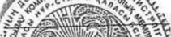

# Якорцев стелющихся травы экстракт — внутрь

- Препарат: Трибестан® (Таблетки покрытые пленочной оболочкой)
- АТХ: G04BE
- Источник: ОХЛП, Единый реестр ЛС ЕАЭС, запись 654e08ebfb44f1336745f5c2, документ от 2026-05-21
- Распознано автоматически (OCR): 2 из 16 стр.
- Сомнительных строк после OCR: 2 (см. раздел «Проверка распознавания»)

## Общие сведения

ДӘРІЛІК ПРЕПАРАТТЫҢ ЖАЛПЫ СИПАТТАМАСЫ
1. ДӘРІЛІК ПРЕПАРАТТЫҢ АТАУЫ
Трибестан, 250 мг үлбірлі қабықпен қапталған таблеткалар
2. САПАЛЫҚ ЖӘНЕ САНДЫҚ ҚҰРАМЫ
Әсер етуші зат: Жатаған теміртікен шөбінің сығындысы.
Үлбірлі қабықпен қапталған әр таблеткада: 250 мг жатаған теміртікен шөбінің құрғақ сығындысы (шикізат пен сығындының қатынасы (35 – 45): 1) құрамында фуростанол сапониндерінің протодиосцинге қайта есептегендегі мөлшері кемінде 112,5 мг.
Қосымша заттардың толық тізімін 6.1-тармақтан қараңыз.
3. ДӘРІЛІК ТҮРІ
Үлбірлі қабықпен қапталған таблеткалар.
Дөңгелек, екі жағы дөңес, үлбірлі қабықпен қапталған, қоңыр түсті таблеткалар.
4. КЛИНИКАЛЫҚ ДЕРЕКТЕР
4.1 Қолданылуы Трибестан ересектер мен 18 жастан асқан балаларда кешенді терапияда қолдануға арналған:
- эректильді дисфункция, оның ішінде либидоның төмендеуімен қатар жүретін;
- идиопатиялық олигоастенотератозооспермияға байланысты ерлердегі бедеулік
(бөлінген шәуеттегі сперматозоидтардың саны мен сапасының төмендеуі), варикоцелеге хирургиялық араласу (аталық бездің шәует шылбырының варикозды кеңеюі), иммунологиялық бедеулік;
- жалпы холестерин деңгейін төмендететін дислипидемия.
4.2 Дозалау режимі және қолдану тәсілі
Дозалау режимі Эректильді дисфункция және бедеулік кезінде: 1-2 таблеткадан күніне 3 рет. Емдеу ұзақтығы кемінде 90 күн. Емдеу курсын дәрігердің ұсынысы бойынша қайталауға болады.
Жалпы холестерин деңгейін төмендету үшін дислипидемия кезінде: күніне 3 рет 2 таблеткадан. Курс - кемінде 3 ай.
Қайталама курстар – дәрігердің ұсынысы бойынша.
Қолдану тәсілі Ішке, тамақтан кейін қабылдау керек.
Балалар

0 жастан 18 жасқа дейінгі балаларда қауіпсіздігі мен тиімділігі анықталмаған. Деректер жоқ.
4.3 Қолдануға болмайтын жағдайлар - 6.1-бөлімде көрсетілген препарат құрамындағы әсер етуші затқа немесе кез келген қосымша затқа аса жоғары сезімталдық.
-
Қуық асты безінің гиперплазиясы.
-
Ауыр жүрек-қантамыр аурулары (инсульт, соңғы жыл ішінде миокард инфарктісі).
-
Ауыр, тұрақсыз және бақыланбайтын жүрек-қан тамырлары аурулары (тұрақсыз стенокардия, тыныш күйдегі созылмалы жүрек жеткіліксіздігі симптомдары, синус түйінінің әлсіздік синдромы немесе синоатриальді блок, II немесе III дәрежелі атриовентрикулярлық блок, брадикардия < 50 соққы/мин сияқты өткізгіштік бұзылыстары).
-
Бүйрек аурулары [ауыр бүйрек жеткіліксіздігі (креатинин клиренсі < 25 мл / мин немесе креатинин > 180 мкмоль/л)].
-
Жержаңғақ ақуызына немесе сояға аллергия.
4.4 Қолдану кезіндегі ерекше нұсқаулар мен сақтық шаралары
Препаратты қабылдауды бастамас бұрын дәрігермен кеңесу керек.
Препаратты 1 ай бойы қабылдау аясында әсер болмаған жағдайда дәрігермен кеңесу керек.
Асқазанның шырышты қабығына Трибестан препаратының ықтимал тітіркендіргіш әсерін болдырмау үшін препаратты тамақтан кейін қабылдау ұсынылады.
Қосымша заттар Дәрілік препараттың қабығында соя лецитині бар.Жержаңғақ ақуызына немесе сояға аллергиясы бар пациенттерге ауыр аллергиялық реакциялардың
(соның ішінде анафилактикалық шоктың)даму қаупінің жоғарылауына байланысты бұл препаратты қолдануға болмайды.
4.5 Басқа дәрілік препараттармен өзара әрекеттесуі және өзара әрекеттесудің басқа түрлері
Трибестан диуретиктердің әсерін және гипертензияға қарсы дәрілердің гипотензивті әсерін күшейтуі мүмкін.
4.6 Фертильділік, жүктілік және лактация.
Жүктілік Осы кезеңдерде препаратты қолдану қауіпсіздігін растайтын клиникалық деректердің болмауына байланысты жүктілік кезінде Трибестанды қолдану ұсынылмайды.
Бала емізу Осы кезеңдерде препаратты қолдану қауіпсіздігін растайтын клиникалық деректердің болмауына байланысты бала емізу кезеңінде Трибестанды қолдану ұсынылмайды.
Фертильділік

Ерлердегі немесе әйелдердегі фертильділік туралы деректер жоқ.
4.7 Көлік құралдарын және қауіптілігі зор механизмдерді басқару қабілетіне әсері
Трибестан зейіннің шоғырлануын және психомоторлық реакциялардың жылдамдығын арттыруды қажет ететін (көлік құралдарын басқару, қозғалмалы механизмдермен жұмыс істеу) ықтимал қауіпті қызмет түрлерін жүзеге асыру қабілетіне әсер етпейді.
4.8 Жағымсыз реакциялар
Жағымсыз реакциялардың бейіні Келесі жағымсыз реакциялар пайда болу жиілігінің градациясына сәйкес жіктеледі: өте жиі (≥1/10), жиі (≥1/100-ден <1/10-ға дейін), жиі емес (≥1/1000-нан < 1/100-ге дейін), сирек (≥1/10 000-нан < 1/1000-ға дейін), өте сирек (< 1/10 000), жиілік белгісіз (қолда бар мәліметтер негізінде бағалау мүмкін емес)..
Асқазан-ішек жолдарының бұзылуы Жиілігі белгісіз: асқазанның шырышты қабығына тітіркендіргіш әсер (жүрек айнуы).
Иммундық жүйе тарапынан бұзылулар Жиілігі белгісіз: аллергиялық реакциялар.
Күдікті жағымсыз реакциялар туралы хабарлау
Дәрілік препараттың «пайда – қауіп»
арақатынасының үздіксіз мониторингін қамтамасыз ету мақсатында препаратты тіркегеннен кейін күдікті жағымсыз реакциялар туралы хабарлау маңызды. Медицина қызметкерлеріне Еуразиялық экономикалық одаққа мүше мемлекеттердің жағымсыз реакциялары туралы хабарлаудың ұлттық жүйелері арқылы дәрілік препараттың кез келген күдікті жағымсыз реакциялары туралы хабарлау ұсынылады.
Ресей Федерациясы:
Денсаулық сақтау саласындағы қадағалау жөніндегі Федералдық қызмет 109012, Мәскеу қ., Славянская алаңы, 4 үй, стр. 1
Телефон: 8 800 550 99 03 Электрондық пошта: pharm@roszdravnadzor.gov.ru
Сайт: www.roszdravnadzor.gov.ru Армения Республикасы:
«Академик Э. Габриелян атындағы дәрілік-заттар мен медициналық технологияларды сараптау ғылыми орталығы»
0051 Ереван қ., Комитас даңғылы 49/5 Тел.: +374-60-83-00-73, +374-10-23-08-96, +374-96-22-05-05
Дәрілік заттардың қауіпсіздігін бақылау бөлімінің жедел желісі
+374-10-20-05-05, +374-96-22-05-05 Электрондық пошта: admin@pharm.am, naira@pharm.am; vigilance@pharm.am
Сайт: www.pharm.am Беларусь Республикасы:
"Денсаулық сақтаудағы сараптамалар мен сынақтар орталығы"
Республикалық Унитарлық Кәсіпорны

220037, Минск қ., Товарищеский жол., 2а Тел.: + 375 (17) 242 00 29.
Электрондық пошта: rcpl@rceth.by Сайт: www.rceth.by
Қазақстан Республикасы:
Қазақстан Республикасы Денсаулық сақтау министрлігі
Медициналық және фармацевтикалық бақылау комитеті «Дәрілік заттар мен медициналық бұйымдарды сараптау ұлттық орталығы» ШЖҚ РМК 010000 Астана қ., А.Иманов көш., 13, «Нұрсәулет 2» БО
Тел.: +7-7172- 235-135 Электрондық пошта: farm@dari.kz, pdlc@dari.kz
Сайт: www.ndda.kz Қырғыз Республикасы:
Қырғыз Республикасы Денсаулық сақтау министрлігінің дәрілік заттар және медициналық бұйымдар департаменті 720044 Бішкек қ., 3-ші Линия көш., 25
Тел.: + 996-312-21-92-78 Электрондық пошта: dlsmi@pharm.kg
Сайт: www.pharm.kg
4.9 Артық дозалану
Симптомдары Трибестан препаратымен артық дозалану жағдайлары туралы хабарламалар жоқ.
Препаратты ұсынылғаннан жоғары дозада қолданған кезде диспепсиялық бұзылыстар
(жүрек айну, құсу) пайда болуы мүмкін.
Емі Симптоматикалық ем жүргізіледі.
5. ФАРМАКОЛОГИЯЛЫҚ ҚАСИЕТТЕРІ
5.1. Фармакодинамикалық қасиеттері
Фармакотерапиялық тобы:
урологияда қолданылатын дәрілер;
эректильді дисфункцияны емдеуге арналған дәрілер.
АТХ коды: G04ВE.
Әсер ету механизмі және фармакодинамикалық әсерлері
Жатаған теміртікен шөбінің сығындысының әсер ету механизмі әлі белгісіз. Басым зат протодиосцин организмде иммунитетке, жасуша мембранасының тұтастығына, эректильді функцияға және холестерин алмасуына пайдалы әсер ететін дегидроэпиандростеронға (DHEA) дейін метаболизденеді деп болжанады. Холестерин барлық стероидтерді, соның ішінде DHEA, тестостерон және эстрадиолды синтездеу үшін бастапқы зат екені белгілі, бұл Трибестан® препаратының гиполипидемиялық әсерін түсіндіреді. Жатаған теміртікен шөбінің сығындысының құрамына кіретін басқа белсенді фуростанол сапониндері протодиосциннің әсерін модуляциялауы мүмкін.

Трибестан гиполипидемиялық әсерге ие, ал липопротеинемиясы бар пациенттерде жалпы холестеринді және төмен тығыздықтағы липопротеидтерді (ТТЛП) төмендетеді, сарысулық триглицеридтер мен жоғары тығыздықтағы липопротеидтердің мәндеріне әсер етпейді.
Трибестан – жатаған теміртікен шөбі (Tribulus terrestris L.) өсімдігінің жер үсті бөлігінен түпнұсқа технология бойынша алынған өсімдік тектес дәрі, құрамында негізінен фуростанол типті стероидты сапониндер бар. Жалпы сергітетін әсерге ие және жыныс жүйесінің кейбір функцияларын ынталандырады. Еркектерде жыныстық либидоны қалпына келтіреді және жақсартады, эрекция уақытын ұзартады. Сперматозоидтардың санын және олардың қозғалғыштығын арттыра отырып, сперматогенезді ынталандырады.
5.2 Фармакокинетикалық қасиеттері
Адамдарда фармакологиялық зерттеулер жүргізілген жоқ. Жатаған теміртікен шөбі құрғақ сығындысында биологиялық белсенді заттар кешені бар, сондықтан фармакокинетикалық зерттеулер жүргізу мүмкін емес.
6. ФАРМАЦЕВТИКАЛЫҚ ҚАСИЕТТЕРІ
6.1. Қосымша заттардың тізбесі микрокристалды целлюлоза (101 тип)
кремнийдің коллоидты қостотығы, сусыз повидон К25 кросповидон магний стеараты тальк
Қабық:
Опадрай (Opadry AMB brown):
поливинил спирті (ішінара гидролизденген)
тальк титанның қостотығы қызыл темір тотығы қара темір тотығы сары темір тотығы соя лецитині ксантан шайыры 6.2. Үйлесімсіздік
Қатысты емес
6.3 Жарамдылық мерзімі (сақтау мерзімі)
5 жыл
6.4 Сақтау кезіндегі ерекше сақтық шаралары
Сақтаудың арнайы шарттарын қажет етпейді.
Түпнұсқалық қаптамада сақтау керек (қорапшадағы блистер).

6.5 Шығарылу түрі және қаптамасы
ПВХ үлбірден және алюминий фольгадан жасалған блистерге үлбірлі қабықпен қапталған 10 таблеткадан.
6 немесе 18 блистер қосымша парақпен бірге картон қорапшада.
18 блистерден тұратын картон қорапшасы үшін қаптаманың бірінші ашылуын бақылауды қолдануға рұқсат етіледі (перфорация, мөлдір жапсырма, картон қорапшасын мөлдір полиэтилен қаптамамен орау).
6.6 Пайдаланылған дәрілік препаратты немесе дәрілік препаратты қолданудан кейін немесе онымен жұмыс істеуден кейін алынған қалдықтарды жою кезіндегі ерекше сақтандыру шаралары.
Арнайы талаптар жоқ.
7. ТІРКЕУ КУӘЛІГІН ҰСТАУШЫ
СОФАРМА АҚ Илиенское шоссе 16, София 1220, Болгария/ 16 Iliensko Shosse Str., Sofia 1220, Bulgaria тел.: +359 02 81 34 200 факс: +359 02 936 02 86
Электрондық мекенжай: mail@sopharma.bg
7.1. ТІРКЕУ КУӘЛІГІН ҰСТАУШЫНЫҢ ӨКІЛІ
Тұтынушылардың шағымдарын мына мекен-жайға жіберу керек:
Ресей Федерациясы «Софарма» АҚ өкілдігі (Болгария) Мәскеу қ.,
Ресей Федерациясы, 115114, Мәскеу, Летниковская көш., 10 үй, құр 2., II үй-жай, 32, 33, 34, 35 БӨЛМЕ.
Тел.: +7 800 511-1035.
Электрондық пошта мекенжайы: info@sopharmagroup.ru.
Беларусь Республикасы Софарма АҚ-ның (Болгария Республикасы) Беларусь Республикасындағы өкілдігі,
Минск қ., 220073, 1 жол. Загородный, 20-24, кең. 8, 15 қабат.
Тел./Факс: +375 17 242-82-92.
Электрондық пошта мекенжайы: info@sopharmagroup.ru.

Қазақстан Республикасы және Қырғыз Республикасы
«Софарма Қазақстан» Жауапкершілігі шектеулі серіктестігі Алматы қ., Қазақстан, 050036, «Мамыр 4» шағ. ауд., 190 үй.
Тел.: +7 (727) 380 01 03, 380 01 37, 380 01 42 (іш. 108).
Факс: +7 (727) 381 63 86.
Электрондық пошта мекенжайы: info@sopharmagroup.ru.
Армения Республикасы «Софарма» АҚ-ның Грузия мен Армениядағы өкілдігі, 0194, 27г, Адам Мицкевич көш., Тбилиси, Грузия.
Тел: +995 32 291 36 21.
Моб: +995 577 52 31 00.
Электрондық пошта мекенжайы: info@sopharmagroup.ru.
8. ТІРКЕУ КУӘЛІГІНІҢ НӨМІРІ
9. БАСТАПҚЫ ТІРКЕЛГЕН КҮНІ (ТІРКЕЛГЕНІН, ҚАЙТА ТІРКЕЛГЕНІН
РАСТАУ)
Бірінші тіркелген күні:
10. МӘТІНДІ ҚАЙТА ҚАРАУ КҮНІ
Трибестан дәрілік препаратының жалпы сипаттамасы Еуразиялық экономикалық одақтың ақпараттық порталында ақпараттық-коммуникациялық
«Интернет»
http://eec.eaeunion.org/ желісінде қолжетімді.

| НЫ
33 АА 6 3% оС
- 5° Sy 9:0,
= See ss Ey oe Ny x < = ? | g це = Е = неее
Е - g Od ЕО < Bees i acess ная << = 6 ЕЕ o © <
= ian
9 Е
= = р == > | = 6 = 4 | = | | | | | | ОБЩАЯ ХАРАКТЕРИСТИКА ЛЕКАРСТВЕННОГО ПРЕПАРАТА

## 1. Наименование лекарственного препарата

Трибестан, 250 мг таблетки, покрытые пленочной оболочкой

## 2. Качественный и количественный состав

Действующее вещество: Якорцев стелющихся травы экстракт.
Каждая таблетка, покрытая пленочной оболочкой, содержит:
мг якорцев стелющихся травы экстракт сухой (соотношение сырья и экстракта (35 – 45) : 1) с содержанием суммы фуростаноловых сапонинов в пересчете на протодиосцин не менее 112,5 мг.
Полный перечень вспомогательных веществ см. в пункте 6.1.

## 3. Лекарственная форма

Таблетки, покрытые пленочной оболочкой.
Таблетки круглые, двояковыпуклые, покрытые пленочной оболочкой, коричневого цвета.

## 4. Клинические данные

## 4.1. Показания к применению

Трибестан показан к применению у взрослых и детей старше 18 лет в комплексной терапии при:
- эректильной дисфункции, в том числе сопровождающейся снижением либидо;
- бесплодии у мужчин, обусловленном идиопатической олигоастенотератозооспермией (уменьшение количества и качества сперматозоидов в выделенной сперме), оперативным вмешательством по поводу варикоцеле
(варикозное расширение вен семенного канатика яичка), иммунологическом бесплодии;
- дислипидемии для снижения уровня общего холестерина.

## 4.2. Режим дозирования и способ применения

Режим дозирования При эректильной дисфункции и бесплодии:
по 1-2 таблетки раза в день.
Продолжительность лечения не менее 90 дней. Курс лечения можно повторить по рекомендации врача.
При дислипидемии для снижения уровня общего холестерина: по 2 таблетки 3 раза в день. Курс - не менее 3 месяцев.
Повторные курсы – по рекомендации врача.

Способ применения Внутрь, после еды.
Дети Безопасность и эффективность у детей в возрасте от 0 до 18 лет не установлены. Данные отсутствуют.

## 4.3. Противопоказания

-
Гиперчувствительность к действующему веществу или любому вспомогательному веществу состава препарата, перечисленных в разделе 6.1.
-
Гиперплазия предстательной железы.
-
Тяжелые сердечно-сосудистые заболевания (инсульт, инфаркт миокарда в течение последнего года).
-
Тяжелые, нестабильные и неконтролируемые сердечно-сосудистые заболевания
(нестабильная стенокардия, хроническая сердечная недостаточность с симптомами в покое, синдром слабости синусового узла или такие нарушения проводимости как синоатриальный блок, атриовентрикулярная блокада II или III степени, брадикардия
< 50 ударов/мин).
-
Почечные заболевания [тяжелая почечная недостаточность (клиренс креатинина
< 25 мл / мин или креатинин > 180 мкмоль/л)].
-
Аллергия на арахисовый белок или сою.

## 4.4. Особые указания и меры предосторожности при применении

Перед тем как начать прием препарата, следует проконсультироваться с врачом.
При отсутствии эффекта на фоне приема препарата в течение 1 месяца следует обратиться к врачу.
Для избежания возможного раздражающего действия препарата Трибестан на слизистую оболочку желудка рекомендуется принимать препарат после еды.
Вспомогательные вещества В оболочке лекарственного препарата содержится соевый лецитин. Пациентам с аллергией на арахисовый белок или сою, нельзя применять этот препарат из-за повышенного риска развития тяжелых аллергических реакций
(включая анафилактический шок).

## 4.5. Взаимодействие с другими лекарственными препаратами и другие виды взаимодействия

Взаимодействия с другими лекарственными препаратами и другие виды взаимодействия

Трибестан может усилить действие диуретиков и потенцировать гипотензивный эффект антигипертензивных средств.

## 4.6. Фертильность, беременность и лактация

Беременность Не рекомендуется применять Трибестан при беременности в связи с отсутствием клинических данных, подтверждающих безопасность применения препарата в эти периоды.

Грудное вскармливание Не рекомендуется применять Трибестан в период грудного вскармливания в связи с отсутствием клинических данных, подтверждающих безопасность применения препарата в эти периоды.
Фертильность Отсутствуют данные о мужской или женской фертильности.
4.7 Влияние на способность управлять транспортными средствами и работать с механизмами
Трибестан не влияет на способность к выполнению потенциально опасных видов деятельности, требующих повышенной концентрации внимания и быстроты психомоторных реакций
(управление автотранспортом, работа с движущимися механизмами).

## 4.8. Нежелательные реакции

Резюме нежелательных реакций Следующие нежелательные реакции классифицированы согласно градации частоты встречаемости: очень часто (≥1/10), часто (≥1/100 до <1/10), нечасто (≥1/1000 до
< 1/100), редко (≥1/10 000 до < 1/1000), очень редко (< 1/10 000), частота неизвестна (на основании имеющихся данных оценить невозможно).
Желудочно-кишечные нарушения Частота неизвестна: раздражающее действие на слизистую оболочку желудка (тошнота).
Нарушения со стороны иммунной системы Частота неизвестна: аллергические реакции.
Сообщение о подозреваемых нежелательных реакциях
Важно сообщать о подозреваемых нежелательных реакциях после регистрации препарата с целью обеспечения непрерывного мониторинга соотношения «польза-риск»
лекарственного препарата. Медицинским работникам рекомендуется сообщать о любых подозреваемых нежелательных реакциях лекарственного препарата через национальные системы сообщения о нежелательных реакциях государств-членов Евразийского экономического союза.
Российская Федерация:
Федеральная служба по надзору в сфере здравоохранения 109012, г. Москва, Славянская площадь, д. 4, строение 1
Телефон: 8 800 550 99 03 Электронная почта: pharm@roszdravnadzor.gov.ru
Сайт: www.roszdravnadzor.gov.ru Республика Армения:
«Научный центр экспертизы лекарств и медицинских технологий им. академика Э.
Габриеляна»
0051 г. Ереван, пр. Комитаса 49/5 Тел.: +374-60-83-00-73, +374-10-23-08-96, +374-96-22-05-05

Горячая линия отдела мониторинга безопасности лекарств
+374-10-20-05-05, +374-96-22-05-05 Электронная почта: admin@pharm.am, naira@pharm.am; vigilance@pharm.am
Сайт: www.pharm.am Республика Беларусь:
Республиканское Унитарное Предприятие "Центр
Экспертиз и Испытаний в Здравоохранении" 220037, г. Минск, пер. Товарищеский, 2а
Тел.: + 375 (17) 242 00 29.
Электронная почта: rcpl@rceth.by Сайт: www.rceth.by
Республика Казахстан:
РГП на ПХВ «Национальный центр экспертизы лекарственных средств и медицинских изделий» Комитета медицинского и фармацевтического контроля Министерства здравоохранения Республики Казахстан 010000 г. Астана, ул. А.Иманова, 13, БЦ «Нурсаулет 2»
Тел.: +7-7172- 235-135 Электронная почта: farm@dari.kz, pdlc@dari.kz
Сайт: www.ndda.kz Кыргызская Республика:
Департамент лекарственных средств и медицинских изделий при Министерстве
Здравоохранения Кыргызской Республики 720044 г. Бишкек, ул. 3-я Линия, 25
Тел.: + 996-312-21-92-78 Электронная почта: dlsmi@pharm.kg
Сайт: www.pharm.kg

## 4.9. Передозировка

Симптомы Нет сообщений о случаях передозировки препаратом Трибестан. При применении препарата в дозах, превышающих рекомендуемые, возможно появление диспепсических расстройств (тошнота, рвота).
Лечение Лечение симптоматическое.

## 5. Фармакологические свойства

## 5.1. Фармакодинамические свойства

Фармакотерапевтическая группа: средства, применяемые в урологии; средства для лечения эректильной дисфункции.
Код АТХ: G04ВE.
Механизм действия и фармакодинамические эффекты

Механизм действия экстракта якорцев стелющихся до сих пор неизвестен.
Предполагается, что преобладающее вещество протодиосцин метаболизируется в организме до дегидроэпиандростерона (DHEA), который оказывает благоприятный эффект на иммунитет, целостность клеточной мембраны, эректильную функцию и метаболизм холестерина. Известно, что холестерин является исходным веществом для синтеза всех стероидов, включительно DHEA, тестостерона и эстрадиола, чем объясняется гиполипидемический эффект препарата Трибестан®. Другие активные фуростаноловые сапонины, входящие в состав экстракта якорцев стелющихся, вероятно, модулируют эффект протодиосцина.
Трибестан обладает гиполипидемическим эффектом, причем у пациентов с липопротеинемией снижает общий холестерин и липопротеиды низкой плотности
(ЛПНП), не влияет на значения сывороточных триглицеридов и липопротеидов высокой плотности.
Трибестан – средство растительного происхождения, получаемое по оригинальной технологии из надземной части растения якорцы стелющиеся (Tribulus terrestris L.), содержит преимущественно стероидные сапонины фуростанолового типа. Оказывает общетонизирующее действие и стимулирует некоторые функции половой системы. У мужчин восстанавливает и улучшает сексуальное либидо, удлиняет время эрекции.
Стимулирует сперматогенез, увеличивая количество сперматозоидов и их подвижность.

## 5.2. Фармакокинетические свойства

Фармакологические исследования у людей не проводились. Якорцев стелющихся травы экстракт сухой содержит комплекс биологически активных веществ, в связи с чем проведение фармакокинетических исследований не представляется возможным.

## 6. Фармацевтические свойства

6.1. Перечень вспомогательных веществ целлюлоза микрокристаллическая (тип 101)
кремния диоксид коллоидный, безводный повидон К25 кросповидон магния стеарат тальк
Оболочка:
Опадрай (Opadry AMB brown):
поливиниловый спирт (частично гидролизированный)
тальк титана диоксид железа оксид красный железа оксид черный железа оксид желтый лецитин соевый камедь ксантановая

## 6.2. Несовместимость

Не применимо

## 6.3. Срок годности (срок хранения)

5 лет
6.4 Особые меры предосторожности при хранении
Не требует специальных условий хранения.
Хранить в оригинальной упаковке (блистер в пачке).
6.5 Форма выпуска и упаковка
По 10 таблеток, покрытых пленочной оболочкой, в блистер из ПВХ-пленки и алюминиевой фольги.
По 6 или 18 блистеров вместе с листком-вкладышем в пачку картонную.
Для пачки картонной 18 блистеров допускается использование контроля первого вскрытия упаковки
(перфорация, прозрачный стикер, обкатка пачки картонной прозрачной полиэтиленовой пленкой).
6.6 Особые меры предосторожности при уничтожении использованного лекарственного препарата или отходов, полученных после применения лекарственного препарата или другие манипуляции с препаратом.
Нет особых требований.

## 7. Держатель регистрационного удостоверения

СОФАРМА АО Илиенское шоссе 16, София 1220, Болгария/ 16 Iliensko Shosse Str., Sofia 1220, Bulgaria тел.: +359 02 81 34 200 факс: +359 02 936 02 86
Электронный адрес: mail@sopharma.bg
7.1. ПРЕДСТАВИТЕЛЬ ДЕРЖАТЕЛЯ РЕГИСТРАЦИОННОГО
УДОСТОВЕРЕНИЯ Претензии потребителей направлять по адресу:
Российская Федерация Представительство АО «Софарма» (Болгария) г. Москва,
Российская Федерация, 115114, Москва, ул Летниковская, д. 10 стр. 2, помещение II,
КОМ. 32, 33, 34, 35.
Тел.: +7 800 511-1035.
Адрес электронной почты: info@sopharmagroup.ru.
Республик Беларусь Представительство АО Софарма (Республика Болгария) в Республике Беларусь, г. Минск, 220073, пер. 1 Загородный, 20-24, каб. 8, 15 этаж.
Тел./Факс: +375 17 242-82-92.
Адрес электронной почты: info@sopharmagroup.ru.
Республика Казахстан и Кыргызская Республика

«Софарма Казахстан» Товарищество с ограниченной ответственностью в г. Алматы,
Казахстан, 050036, мкр. «Мамыр 4», д. 190.
Тел.: +7 (727) 380 01 03, 380 01 37, 380 01 42 (вн. 108).
Факс: +7 (727) 381 63 86.
Адрес электронной почты: info@sopharmagroup.ru.
Республика Армения Представительство АО «Софарма» в Грузии и Армении, 0194, 27г, ул. Адама Мицкевича, Тбилиси, Грузия.
Тел: +995 32 291 36 21.
Моб: +995 577 52 31 00.
Адрес электронной почты: info@sopharmagroup.ru.

## 8. Номер регистрационного удостоверения

## 9. Дата первичной регистрации

(ПОДТВЕРЖДЕНИЯ РЕГИСТРАЦИИ,

ПЕРЕРЕГИСТРАЦИИ)
Дата первой регистрации:
10. ДАТА ПЕРЕСМОТРА ТЕКСТА
Общая характеристика лекарственного препарата
Трибестан доступна на информационном портале Евразийского экономического союза в информационнокоммуникационной сети «Интернет» http://eec.eaeunion.org/.

| НЫ
33 АА 6 3% оС
- 5° Sy 9:0,
= See ss Ey oe Ny x < = ? | g це = Е = неее
Е - g Od ЕО < Bees i acess ная << = 6 ЕЕ o © <
= ian
9 Е
= = р == > | = 6 = 4 | = | | | | | |
## Проверка распознавания

Страницы-сканы распознаны автоматически. В 2 строках с дозировками цифры могли распознаться с ошибкой — сверьте с вырезкой из оригинала:

- стр. 8: «33 АА 6 3%» — низкая уверенность: «33» (54), «6» (11), «3%» (59); повторное чтение: «А ах»  
  
- стр. 16: «33 АА 6 3%» — низкая уверенность: «33» (54), «6» (11), «3%» (59); повторное чтение: «А ах»  
  
